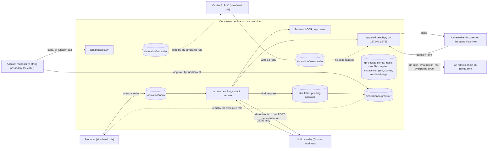
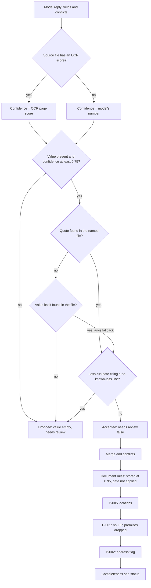
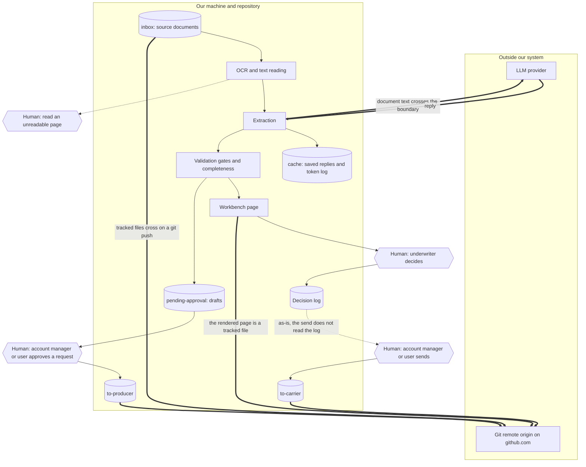
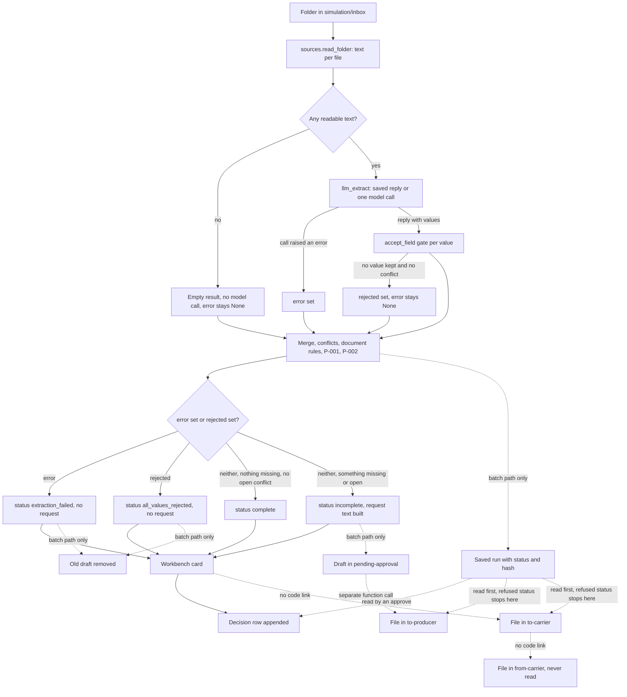
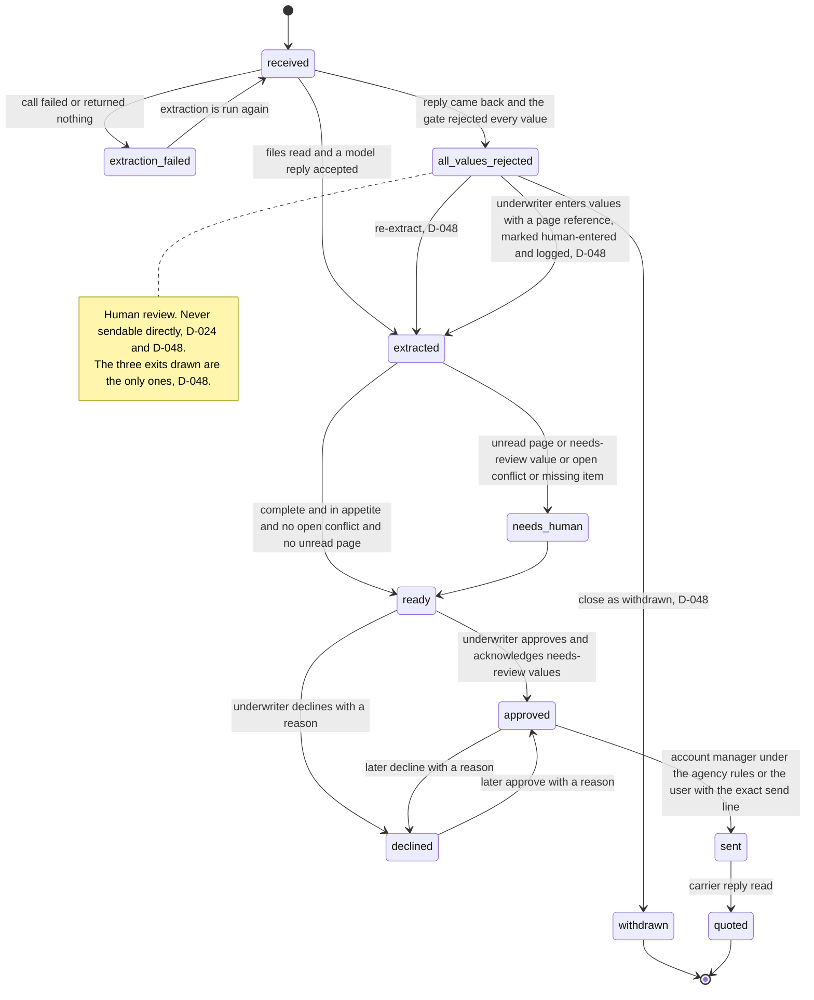

# Architecture: what exists

- Task: T-094. Requested by @user on 2026-10-13.
- Lead and author of the single document: @software-engineer.
- Contributors: @ai-engineer-assistant (2.3, 2.4, 2.7, 2.12, 3.1) and @data-engineer (3.2, 5.3.1, 6.2). All eight contributor sections are filled; each is signed at its top. Section 11 lists them and what the lead checked.
- Date: 2026-10-13. **The document describes the code at commit `dd45467` on branch `ai-team`.** It was written at `d5750fd`; T-070 and T-071 (P-010) were committed after that (`fde95b7` to `dd45467`), and on 2026-10-13 every citation and every As-is statement those commits changed was reconciled to `dd45467` on the user's instruction (D-046). Section 13 says how and gives the counts. No file under `underwriting_pipeline/` or `simulation/` has uncommitted changes (measured: `git status --short underwriting_pipeline simulation`, at the reconciliation turn, 2026-10-13: no output). **Update, later on 2026-10-13:** `HEAD` is now `5e0f180` (measured: `git rev-parse --short HEAD`). A build of T-079 was committed as `db7cbb1` with no review and was reverted by `5e0f180` on the user's order (D-053). The content under `underwriting_pipeline/` at `5e0f180` is the same as at `dd45467` (measured: `git diff dd45467 HEAD -- underwriting_pipeline`, this turn: no output), and no file under `underwriting_pipeline/` or `simulation/` has an uncommitted change (measured: `git status --short underwriting_pipeline simulation`, this turn: no output). The document still describes `dd45467`; no citation moved.
- Status: IN_REVIEW. Reviewers: @model-risk, @compliance. Both gave APPROVE WITH CHANGES on 2026-10-13, neither a veto (`team/DISCUSSION.md`, the two TYPE: REVIEW messages Re: T-094). The document was revised the same day against both; section 12 lists each finding and what was done. Both reviewers looked again on 2026-10-13 and each gave APPROVE with Low findings, none blocking, neither a veto and neither a production approval (`team/DISCUSSION.md`, the two second TYPE: REVIEW messages Re: T-094); section 12.1 lists the Lows and what was done. The task stays IN_REVIEW: closing it is @pm's. The author does not approve it. **Since those approvals the document changed**: the reconciliation to `dd45467`, and the user's decisions D-045, D-048, D-049, D-050, and D-051, which answer Q9, Q12, Q13, and Q14. Section 13 lists every change so the reviewers can look again; their approvals were of the earlier text. **Later on 2026-10-13** the board changed (T-071 DONE, T-059 DONE and its veto lifted by its holder) and the user gave D-053 and D-054; section 13.7 lists what was updated. No reviewer has seen that text.
- Data: synthetic only. Carriers are placeholders Carrier A, B, C.

**What this document is not.** It describes. It decides nothing, authorizes no send, and is not a production approval. Where a choice has not been made, the document names the role that decides and does not choose.

## 0. How to read this document

- **As-is (code today)** and **Target (production)** are separate blocks in every section. "Target" has two kinds of line, always labeled:
  - *Decided, not built*: a decision in `team/DECISIONS.md` or an approved proposal requires it. The D-### or P-### is given.
  - *Not decided*: needed for production, no decision exists. The role that decides is named.
- **Citations.** Paths are relative to `underwriting_pipeline/` unless they start with another top-level folder. `app/workbench.py:38-52` means lines 38 to 52 of `underwriting_pipeline/app/workbench.py`. A citation that starts with a colon, such as `:81`, is in the file named just before it. Every citation was opened and read by the section's author in the turn the section was written.
- **Three authors, one day.** The document was written in three turns on 2026-10-13: the lead's first pass, the two contributors' sections, and the lead's merge. "This turn" and "I" in a section mean that section's author and the turn it was written in. A section with no signature line is the lead's.
- **A claim that something is absent** (no code reads a folder, no file holds a string) cannot cite a line. It cites the command that looked, as "measured: `<command>`".
- **How a claim was established.** "Read in code" means the cited lines say it. "Reported by a reviewer" means a review in `team/DISCUSSION.md` showed the behavior by running it; I did not run it again. No pipeline code was executed for this document, and no model call was made.
- **Numbers.** Each number carries its label where it stands, in one of four forms:
  - *measured*, with the file or the command it came from. Counts of files, rows, and scores are in this form.
  - A value fixed in code (a threshold, a limit, a count of retries), followed by its file and line. That is a measured code constant, whether or not the word is repeated; the citation is its source file.
  - A value set by a decision or an approved proposal, followed by its D-### or P-###. It is decided, not measured.
  - *assumed*, with the reasoning. **This document makes no assumption of its own.** It quotes one made elsewhere: the 7-year retention period in 3.2, which row C-09 of `deliverables/compliance/regulatory-register.md` marks as a working assumption. That register is a draft that `agency-register.md` replaced for control (`deliverables/compliance/agency-register.md:6`), and the accepted register has no retention row, so the 7 years is an assumption from a replaced file (*corrected 2026-10-13, @compliance R4*).
- **Reported by a reviewer, not measured here.** Where a fact needed a network command, this document did not run one. It gives the reviewer's message and date as the source.
  Section 9 lists the numbers of the lead's sections. The contributor sections label theirs in place.
- **Component names** are the thirteen in the task: intake, OCR/text reading, extraction, validation gates, cache, risk score, carrier match, missing-info drafts, workbench, decision log, package/send, quote tracking, eval harness.

## 1. System context

### As-is (code today)

There is no deployed service. The system is a set of Python scripts run by hand on one machine, plus folders under `simulation/` that stand in for the outside parties.

| Party | How it reaches the system today | Citation |
|---|---|---|
| Producer | A simulated role writes a folder `simulation/inbox/SUB-###/`. Code only reads it. | `app/workbench.py:26`, `app/workbench.py:81` |
| Producer (outbound) | An approved missing-info request is a file in `simulation/to-producer/`. Nothing is emailed. | `ai/prepare.py:790-791`, `ai/prepare.py:806-808` |
| Carrier (outbound) | A package is a file in `simulation/to-carrier/`. Nothing is transmitted. | `app/package.py:103-104`, `app/package.py:107-111` |
| Carrier (inbound) | A simulated role writes replies to `simulation/from-carrier/`. **No code reads this folder.** | The string `from-carrier` is in one `.py` file under `underwriting_pipeline/`, in a comment (`app/package.py:10`); no line of code opens, lists, or reads the folder (measured: `grep -rn "from-carrier" underwriting_pipeline --include='*.py'`, 2026-10-13: that one hit). *Corrected 2026-10-13, @compliance R5: this cell said no `.py` file contains the string.* |
| Git remote | The repository has one remote, `origin`, on github.com. Every git-tracked store goes there on a push: the inbox, the sent requests and packages, the carrier replies, the extraction and conflict files, the gold set, the score files, and the rendered page (3.1, 3.2). A push is a person's or the orchestrator's command; no pipeline code pushes (measured: `grep -rnE "git (push\|commit)" underwriting_pipeline --include='*.py'`, 2026-10-13: no match). *Added 2026-10-13, @compliance R1.* | measured: `git remote -v` and `git ls-tree -r origin/ai-team`, 2026-10-13, local refs only, no network call; counts in 3.1 |
| Underwriter | A browser on the same machine. The page is served on `127.0.0.1`. The underwriter id is a free-text form field. | `app/workbench.py:283`, `app/workbench.py:227`, `app/workbench.py:122` |
| Account manager | Not a user of any screen. It is a string, `account-manager`, passed by whoever calls the function. | `app/package.py:33-34`, `app/package.py:94-96`, `ai/prepare.py:787-789` |
| LLM provider | One `POST` to `<LLM_BASE_URL>/chat/completions`, host taken from the shell. Allowed hosts are the Groq URL and localhost unless `ALLOW_PROVIDER` names the host exactly. The Groq URL is HTTPS; the local default is plain HTTP on this machine; the guard does not check which (3.1). *Corrected 2026-10-13: this row said "One HTTPS POST".* | `ai/llm_extract.py:373-390`, `ai/llm_extract.py:193`, `ai/llm_extract.py:28`, `ai/llm_extract.py:219-222` |
| OCR | A local library call (Tesseract through `pytesseract`), in process. No network party. A scanned PDF also needs the `pdftoppm` program, which is not installed on this machine (2.3). | `ai/sources.py:93-111`, `ai/sources.py:145-147`, `requirements.txt:3` |
| Our app | `app/intake.py`, `app/workbench.py`, `app/package.py`, `models/points.py`, and the modules in `ai/`. | Section 2 |

*The `tracked` and `remote` nodes and the last edge were added 2026-10-13 (@compliance R1). The diagram was not rendered again at that revision. *Rendered without error on 2026-10-13 by the orchestrator, Mermaid CLI 12.0.0 (D-046); not changed since.**

### Target (production)

*Decided, not built:*

- Every final decision is the underwriter's. No auto-decline, no auto-bind (D-004). This holds in code today as far as it goes: the score returns only points and codes (`models/points.py:31`), and the decision row writes `bound: False` (`app/workbench.py:145`).
- Only the simulated @account-manager approves a producer request or a carrier send, under the agency rules and with a written reason; the user can override (D-017 item 3). A carrier send also needs a logged underwriter approve as the latest decision (D-033 item 2, as amended by D-053, D-038 item 1), and a user send carries the user's exact line (D-035).
- The model host is free tier or local only; no paid API (D-011, D-012). The demo cost estimate uses enterprise list prices as an estimate only (D-038 item 5).

*Not decided:*

| Open point | Who decides (decision-rights table) |
|---|---|
| Real intake channel (email, portal, agency management system) in place of a folder | @software-engineer, consulting @senior-underwriter |
| Real carrier channel and real carrier panel | @head-of-underwriting; carriers are placeholders until "the real panel is confirmed" (protocol, Project context) |
| Production LLM host, and whether real applicant data may leave to it | @user (LLM architecture); @compliance (legal acceptability) |
| Production OCR service | @user |
| Login, roles, and how an underwriter id is tied to a session | @software-engineer proposes; D-038 item 3 requires it; the mechanism is undefined (`team/NEXT-SESSION.md`, pending decision 5) |
| Deployment, hosting, monitoring | @ml-engineer (T-095 covers it) |

## 2. Components and owners

### 2.1 Owner table

"Owner" is copied from the task board and the decisions as they stand on 2026-10-13. Where the board does not record one owner, the row says so and names the role that is asked. This document does not assign one.

| # | Component | Code today | Exists today | Owner as recorded | Source of the owner |
|---|---|---|---|---|---|
| 1 | Intake | `app/intake.py` | Yes, but not wired into the flow (2.2) | @software-engineer | T-014 |
| 2 | OCR/text reading | `ai/sources.py` | Yes | @ai-engineer-assistant builds; @user decides changes | T-027; D-017. T-041 names the retired handle @ai-engineer |
| 3 | Extraction | `ai/llm_extract.py` | Yes | @ai-engineer-assistant builds; @user decides changes | T-027; D-017 |
| 4 | Validation gates | `ai/llm_extract.py` (`accept_field`), `ai/prepare.py` | Yes | @ai-engineer-assistant builds; @user decides changes | T-047, T-055, T-056; D-017 |
| 5 | Cache | `ai/llm_extract.py`, `cache/` | Yes | @ai-engineer-assistant | T-063, T-074, T-078 |
| 6 | Risk score | `models/points.py`; inputs built in `app/workbench.py` | Yes | @data-scientist | T-017. The `workbench.py` part of P-015 is @software-engineer's (DEMO-BLOCKERS line 5) |
| 7 | Carrier match | `route()` in `app/workbench.py` | Yes, and it contradicts the written rules (section 8, line 4) | @head-of-underwriting (the rules) | T-018, T-082. The code change is T-083, @software-engineer |
| 8 | Missing-info drafts | `ai/prepare.py` | Yes | **Not recorded as one current owner.** T-016 names the retired handle @ai-engineer. T-070 (@ai-engineer-assistant, DONE) edited the same functions | @pm is asked to record the owner |
| 9 | Workbench | `app/workbench.py`, `app/workbench.html` | Yes | @software-engineer | T-019 |
| 10 | Decision log | `record_decision()` in `app/workbench.py` | Code yes; no log file on disk (2.6) | **Not recorded as one owner.** T-019 (@software-engineer) and T-021 (@ml-engineer) both list `app/workbench.py` as output for it | @pm is asked to record the owner |
| 11 | Package/send | `app/package.py` | Yes | @software-engineer | T-020. Approving a send is @account-manager's or the user's (D-017); that is authority, not ownership of the code |
| 12 | Quote tracking | none | **No. Not built.** | @software-engineer | T-020 criterion 3, T-087 |
| 13 | Eval harness | `ai/eval_*.py`, `ai/regression_*.py` | Yes | **Not recorded as one owner.** @ai-engineer-assistant edits the scorers (T-070, T-072); @model-risk owns the hold-out scoring runs (T-093); @user decides eval changes (D-017) | @pm is asked to record the owner |

### 2.2 Intake (@software-engineer)

**As-is (code today)**

- `intake(files)` takes `(filename, bytes)` pairs and returns a new random `submission_id`, a sha256 and a size per file, and `synthetic: True` (`app/intake.py:13-31`). An empty pack raises `ValueError` (`app/intake.py:14-15`).
- `scan_inbox(root)` runs `intake` over each `SUB-*` folder and adds the folder name (`app/intake.py:34-46`).
- **Nothing calls it.** No other module imports `intake` (measured: `grep -rn` over `underwriting_pipeline/`, this turn). The workbench lists the inbox folders itself (`app/workbench.py:81`) and the pipeline reads the files itself (`ai/prepare.py:513`).
- The id used everywhere else is the folder name, for example `SUB-009` (`app/workbench.py:91`, `ai/prepare.py:604`). The uuid from `intake()` is printed by the command line (`app/intake.py:53`) and stored nowhere.
- Intake keeps nothing: no record of when a submission arrived, and no "received" status.
- Duplicate submissions are not detected. Intake computes a hash per file and compares it with nothing.

**Target (production)**

- *Decided and built since this was written (T-069 DONE, T-070 DONE; As-is at `dd45467`):* the saved run carries `saved_hash` with its status, and an approve or a send is refused when the digest of the saved run differs (D-029, P-010 option G2; `ai/prepare.py:649-683`, `:760-761`). By D-044 the hash is "of the saved run's canonical digest", not of the source documents, so a source file changed after the run is not detected by it. Intake computes a per-file SHA-256 that nothing stores (above). *Updated by the lead, 2026-10-13 (section 13).*
- *Not decided:* whether `intake.py` becomes the single entry that assigns the id, stores the files, and writes the "received" state, or is retired in favor of the folder name. @software-engineer decides, consulting @senior-underwriter. Duplicate handling is in T-095's failure table.

### 2.3 OCR/text reading

*Section written by @ai-engineer-assistant, 2026-10-13. Every line cited was opened this turn. No code was run and no model was called.*

**As-is (code today)**

The reader is one function, `read_folder(folder)`. It returns one dictionary per file it can read, with one block of text per file. There are no pages and no boxes in the output; the file says so (`ai/sources.py:5`).

| File ending | Read by | What comes back | Citation |
|---|---|---|---|
| `.md`, `.txt` | `Path.read_text` | The file as text | `ai/sources.py:190-191` |
| `.csv` | `_csv_text` | Rows, cells joined by tabs | `ai/sources.py:192-193`, `:178-181` |
| `.xlsx` | `_xlsx_text` | Every sheet: a `sheet: <name>` line, then each non-empty row, cells joined by tabs. Stored cell values, not formulas | `ai/sources.py:196-197`, `:163-175` |
| `.pdf` | `_pdf_text` | Typed text, or OCR text (PDF path below) | `ai/sources.py:194-195`, `:136-160` |
| `.png`, `.jpg`, `.jpeg`, `.tif`, `.tiff` | `_ocr_image` → `_read_scan` | OCR text (scan path below) | `ai/sources.py:14`, `:198-199`, `:130-133` |
| Anything else (for example `.docx`, `.xls`, `.eml`, `.msg`) | **Nothing** | The file is skipped. It is not in the output and not in any needs-human list | `ai/sources.py:200-201` |
| A sub-folder | **Nothing** | Only regular files directly in the folder are read | `ai/sources.py:186` |

- Each returned document has `name`, `text`, `needs_human`, and `sha256` of the file bytes; `ocr_confidence` only when OCR ran; `ocr` (the settings line) for every PDF and image (`ai/sources.py:202-206`).
- **A file that cannot be opened stops the whole submission.** No `try` surrounds the readers (`ai/sources.py:190-199`), and the pipeline calls `read_folder` outside its own `try` (`ai/prepare.py:513`, `:534-538`). A damaged PDF or a text file in another encoding raises out of `process_submission`. Read in code; not run.
- OCR is Tesseract through `pytesseract`, in process (`ai/sources.py:94-97`). No network call is made by the reader.

*Scan path* (`_read_scan`, `ai/sources.py:114-127`):

1. Two candidates are tried: the image as given, and the image turned by Tesseract's orientation detection (`ai/sources.py:116-119`). The turn is used only when the detected rotation is not 0 and Tesseract's orientation confidence is at least 1 (`ai/sources.py:37-38`).
2. Each candidate is deskewed: whole-degree angles from -12 to +12 are tried on a quarter-size gray copy, and the angle whose text rows are most solid wins (`ai/sources.py:43-63`).
3. Light horizontal scanner rules are lifted and the image is enlarged two times (`ai/sources.py:66-90`).
4. Tesseract reads it with `--psm 6` (`ai/sources.py:97`, `:109`).
5. The page score is the mean Tesseract confidence, 0 to 100, of the counted words (`ai/sources.py:110`). The candidate with the higher score is kept (`ai/sources.py:121-124`).
6. The page is marked needs human, and its text is returned empty, when fewer than 4 words were counted or the score is under 40 (`ai/sources.py:125-126`).

**What the page score counts and does not count.** Every character that is not a letter A to Z is removed from each word before it is counted, and a word with fewer than 4 letters left is dropped (`ai/sources.py:101-103`). So a year, a ZIP, a dollar amount, a date, and a street number add nothing to the score. A page whose words are clear and whose digits are misread gets a high score. This is @model-risk's T-027 finding H2, read in code.

| Threshold | Value | Label | Citation |
|---|---|---|---|
| Orientation confidence needed to turn the page | 1 | measured (code constant) | `ai/sources.py:37` |
| Deskew range | -12 to +12 degrees, whole degrees | measured (code constant) | `ai/sources.py:48` |
| Letters a word needs to be counted in the score | 4 | measured (code constant) | `ai/sources.py:102` |
| Counted words a page needs | 4 | measured (code constant) | `ai/sources.py:125` |
| Page score under which the page needs a person | 40 of 100 | measured (code constant) | `ai/sources.py:125` |
| Typed characters at which a PDF counts as typed | 40 | measured (code constant) | `ai/sources.py:142` |
| Resolution a PDF page is rendered at for OCR | 200 dpi | measured (code constant) | `ai/sources.py:147` |

The score is stored on the document as a number from 0 to 1 (`ai/sources.py:203-204`). How the gate uses it is in 2.4.

*PDF path* (`_pdf_text`, `ai/sources.py:136-160`):

- The typed text of every page is joined. If the whole file has 40 or more characters, the PDF is treated as typed: no OCR runs and no score is set (`ai/sources.py:139-143`). **The test is on the file, not the page.** A PDF with one typed page and three scanned pages is typed; the scanned pages are not read and nothing says so. This is part of T-027 H3.
- Under 40 characters, each page is rendered and read by the scan path (`ai/sources.py:145-153`). **The needs-human answer of each page is thrown away** (`_needs_human`, `ai/sources.py:151`). If any page gave text, the file is not marked (`ai/sources.py:156-157`), so an unreadable page inside a readable PDF is not listed. The file's score is the mean of all page scores, the unreadable ones included (`ai/sources.py:155`). The file is marked needs human only when no page gave text (`ai/sources.py:158`).
- Any error in that OCR step is swallowed: the typed text is returned, the file is marked needs human when it is under 40 characters, and no reason is kept (`ai/sources.py:159-160`). Rendering needs the `pdftoppm` program. **It is not installed on this machine** (measured: `which pdftoppm`, this turn: not found; `tesseract` is found). Read in code and not run: on this machine a scanned PDF takes this branch and is marked needs human, never read.

*What "needs human" does next.* The file's text is not sent to the model; a fixed line stands in for it (`ai/llm_extract.py:425-426`). The file name goes on the report's `needs_human` list (`ai/prepare.py:592`). No code records that a person then read it (section 3.3).

*The settings line.* `OCR_SETTINGS` is a text line written by hand (`ai/sources.py:16`). It is part of the cache key (2.4). The comment says to change it whenever the OCR steps change (`ai/sources.py:15`); nothing checks that it was.

*Self-check.* `python ai/sources.py` draws a page, turns it upside down, and checks that it is read, and checks that a blank page needs a person (`ai/sources.py:211-223`). It loads a font from a macOS system path (`ai/sources.py:216`), so it runs only on macOS.

**Target (production)**

- *Decided, not built:*
  - **P-006** (approved in D-021 item 4; T-062, BLOCKED). Tesseract stays the reader. EasyOCR runs only on a scanned page whose address has no five-digit ZIP, is marked address invalid, or whose Tesseract score is under 0.75, and it cannot create a loss-run date Tesseract did not show (`deliverables/ai-engineer/proposal-P-006.md`; T-062 criteria). EasyOCR is not in `requirements.txt` today (`requirements.txt:1-5`).
  - **P-016 part (c)** (D-037 item (c), approved in D-039 with L1 and E1; no build task on the board). Every file and page is read or listed with the reason. A file of an unread type comes back marked, with the reason, and is no longer skipped. The 40-character test is applied to each page. An unreadable page in a PDF is listed with its page number. A file that cannot be opened is listed and the other files are read (E1). OCR that cannot run is listed with that reason in place of the silent `except`. The report gains `unread`, one row per file or page (`deliverables/ai-engineer/proposal-P-016.md`, part (c)).
  - **P-016 part (b)** needs the reader to keep a score per word, digits included, because the gate will use the score of the cited words (D-039, option C3). Today only one mean per file is kept (`ai/sources.py:203-204`).
  - The `OCR_SETTINGS` line is left as it is when P-016 is built (D-039, option K1), so saved results are not all called again.
- *Not decided:*
  - A production OCR service. @user decides (section 1). D-038 item 5 names Document AI layout only as a price basis for an estimate; it is not a decision to use it.
  - Page and box positions for citations. The reader gives character offsets in one text block per file (`ai/sources.py:5`). @user decides.
  - Whether Tesseract and `pdftoppm` are required on every machine that runs the pipeline, and how that is checked at start. @ml-engineer decides deployment; a check inside `sources.py` is an OCR change and needs a P-### and @user.

### 2.4 Extraction, validation gates, cache

*Section written by @ai-engineer-assistant, 2026-10-13. Every line cited was opened this turn. No code was run and no model was called.*

#### 2.4.1 Extraction

**As-is (code today)**

- **One model call per submission.** Every document the reader returned is packed into one message, each under a `--- file: <name> ---` line, and sent in one chat request (`ai/llm_extract.py:423-438`). The file says so (`ai/llm_extract.py:13`). There is no call per file, per page, or per field.
- **No call when nothing is readable.** If no document has text and is free of the needs-human mark, `llm_extract` is not called at all (`ai/prepare.py:530-532`).
- **Prompt.** One fixed system text, `SYSTEM` (`ai/llm_extract.py:33-46`). It names the nine fields and the reply shape (`ai/llm_extract.py:44-45`). Its version is the first 12 characters of its sha256 (`ai/llm_extract.py:54`), so any edit to the text is a new version and a new cache key.
- **Request settings.** Temperature 0 (`ai/llm_extract.py:56`, `:432`). JSON reply asked for (`ai/llm_extract.py:433`). If the host answers HTTP 400, the request is sent once more without that setting, and a `retry` row is logged (`ai/llm_extract.py:466-471`).
- **Model and host.** Read from the shell: `LLM_BASE_URL`, `LLM_MODEL`, `LLM_API_KEY` (`ai/llm_extract.py:180-190`). No settings file is read (`ai/llm_extract.py:9`). With no base URL the host is a local Ollama address and the model is a local default (`ai/llm_extract.py:28-30`, `:184-185`). A remote host with no key or no model raises an error (`ai/llm_extract.py:186-189`).
- **Provider guard (P-008).** Before a model call, the host and model are printed once (`ai/llm_extract.py:210-213`), and the call is refused unless the base URL is exactly the Groq URL, or the host name is `localhost`, `127.0.0.1`, or `::1`, or `ALLOW_PROVIDER` equals the host name exactly (`ai/llm_extract.py:193`, `:219-220`). A refusal is `SystemExit`: the run stops, and the file is not marked failed (`ai/llm_extract.py:221-222`, docstring `:205`). The guard is asked at the start without refusing (`ai/llm_extract.py:422`) and again just before the call (`ai/llm_extract.py:462`), so a run served wholly from saved results is not refused.
- **Pacing.** When the host's reply carries Groq's token-limit headers, the next request waits until the per-minute budget can take it (`ai/llm_extract.py:338-360`, `:386`). A host without those headers is not paced (`ai/llm_extract.py:341`).
- **Retries inside one call** (`_post`, `ai/llm_extract.py:373-418`):

| Event | What the code does | Citation |
|---|---|---|
| HTTP 429 | Waits the host's `Retry-After` plus 1 second, or 1, 2, 4, 8, 16 seconds without it, capped at `LLM_MAX_WAIT`; tries again. Up to 6 posts | `ai/llm_extract.py:393-406`, `:375` |
| Timeout or connection error | Waits 1, 2, 4, 8, 16 seconds; tries again. Up to 6 posts | `ai/llm_extract.py:411-417` |
| Any other HTTP error | **No retry.** Fails on the first one | `ai/llm_extract.py:407-410` |
| Reply empty, not JSON, or with no value and no conflict | No retry. Fails | `ai/llm_extract.py:473-479` |

  One request waits at most 120 seconds for an answer (measured, code constant: `ai/llm_extract.py:388`). `LLM_MAX_WAIT` is 60 seconds unless the shell sets it (measured, code constant: `ai/llm_extract.py:31`); the regression script sets 1,800 (`ai/regression_dev.py:19`).
- **Retries above the call.** Only the regression script has one: a file whose report has an error is scored up to 3 times, 60 seconds apart (`ai/regression_dev.py:85-94`). The workbench and `write_drafts` do not try again.
- **Failure kinds.** Four are counted: `rate_limit_429`, `timeout`, `other`, `reply_not_usable` (`ai/llm_extract.py:307`). Each failed attempt is one row in the token log, written before the wait (`ai/llm_extract.py:363-370`).
- **How a failure reaches the rest of the system.** A failed call raises `RuntimeError`. The pipeline catches it, keeps the message with the key removed, and sets `extraction_failed` (`ai/prepare.py:534-538`, `:611-612`; `ai/llm_extract.py:168-172`). A reply that came back but left no value and no conflict after the gate is **not** a failed call since T-070: it sets no error and gets the status `all_values_rejected`, with the reason "the model answered but every value was rejected by the gate" in `status_reason` (`ai/prepare.py:539-543`, `:613-614`, `:619`, `:26`). *As-is corrected to `dd45467` by the lead, 2026-10-13 (D-046; section 13).* *This sentence said both cases got `extraction_failed` and the words "model call returned no fields".*
- **One case that looks like a failed call and is a setup error.** With a remote host and no key or no model in the shell, `endpoint_settings` raises before the cache is looked at (`ai/llm_extract.py:422`, `:223-228`, `:186-189`). The pipeline catches it as any other error (`ai/prepare.py:536`). Every file with readable text then shows `extraction_failed`, files with a saved result included. Read in code; not run.

**Target (production)**

- *Decided, not built:* nothing changes the call itself. P-016 was approved with no prompt change (D-039, option P1). Text past the length limit is no longer cut silently: files are packed whole and a file that does not fit is listed for a person (P-016 (c), D-039, option L1).
- *Not decided:* the production model and host (@user; @model-risk approves production); more than one call per submission for long files (P-016 option L2 was not chosen); a queue, workers, and a retry at the flow level (T-095, @ml-engineer). A different model or host is an extraction change and needs a P-### and @user (D-017).

#### 2.4.2 Validation gates

**As-is (code today)**

The gates run in this order. Gates 1 to 6 are in `accept_field` and run once for every field the model returned and once for every side of every conflict it returned (`ai/llm_extract.py:494-499`). The rest are in `process_submission`.

| # | Gate | What it does | Citation |
|---|---|---|---|
| 1 | Scan confidence (P-003b) | If the value's source file has an OCR score, that score **replaces** the model's confidence. It is not the lower of the two. A typed file keeps the model's number | `ai/llm_extract.py:270-272` |
| 2 | Empty value | A null, empty, or "null" value is dropped | `ai/llm_extract.py:283-284` |
| 3 | Confidence line | Under 0.75, dropped (measured, code constant: `ai/llm_extract.py:27`) | `ai/llm_extract.py:285-286` |
| 4 | Citation | The model's quote must be found in the text of the file it named, exactly or with any run of spaces matching any run of spaces. **If the quote is not found, the value itself is searched for in the file and accepted as its own citation.** If neither is found, dropped | `ai/llm_extract.py:287-291`, `:242-254` |
| 5 | Loss-run rule | A loss-run date whose cited text contains "no known loss" is dropped | `ai/llm_extract.py:292-293` |
| 6 | Accept | The value is stored with the file name, the character span, both confidences, and `needs_review: False` | `ai/llm_extract.py:294-303` |
| 7 | Conflict sides | A conflict the model returned is kept only when 2 or more sides passed gates 1 to 5 and their values differ. Otherwise the conflict is dropped | `ai/llm_extract.py:495-510` |
| 8 | Merge | The first accepted value for a field is stored. A later value that agrees (the same number once "220k" and "220,000" are read as numbers; the same class of operations) is not a conflict. A later value that differs makes a conflict with both values, and the field is left empty | `ai/prepare.py:544-564`, `:99-109`, `:132-149` |
| 9 | Model conflicts | A model conflict whose sides agree by the rule in gate 8 is turned into a value. Any other model conflict empties the field and is stored | `ai/prepare.py:565-576` |
| 10 | Producer reply | A `reply.md` in the folder can settle a conflict; both values stay on the row | `ai/prepare.py:577`, `:268-288` |
| 11 | Document rules | Four rules read the file text with no model call: a carrier loss-run date wins over a no-known-loss letter; "joisted masonry" replaces "masonry"; `cook <word>` sets operations to `<word> restaurant`; two different square-foot numbers make a conflict | `ai/prepare.py:578`, `:442-485`, `:329-342` |
| 12 | Locations (P-005) | A labeled main and second premises are stored as two locations, the main one becomes the premises address, and the premises conflict is removed | `ai/prepare.py:579`, `:416-439`, `:386-413` |
| 13 | P-001 | A premises value with no five-digit ZIP is dropped, and its source file goes on the needs-human list | `ai/prepare.py:593`, `:225-237` |
| 14 | P-002 | A premises ZIP not in the Texas table, or a city that does not match the ZIP, is marked "address invalid" and needs review. The text is not rewritten | `ai/prepare.py:594-595`, `:198-211`, `:214-222` |
| 15 | Completeness and status | Any empty field, open conflict, or unanswered restaurant question makes the file incomplete. An error makes it `extraction_failed`; an answered reply with every value rejected makes it `all_values_rejected` (*added at `dd45467`, lead, 2026-10-13*) | `ai/prepare.py:596-619`, `:240-249` |

**What the gates do not check today.** These are @model-risk's T-027 findings H1 to H3, each read in code this turn. The production veto on extraction stands on them (section 8.2).

- **H1. A citation does not prove the value.** Nothing compares the value with the text it cites. Gate 4 only finds the quote; gate 6 then stores the model's value as given (`ai/llm_extract.py:288`, `:294-303`). And when the quote is not found, the value is searched for as plain text anywhere in the file, so "10" is found inside "2010000" (`ai/llm_extract.py:288`, `:245`). Reported by @model-risk with the model call stubbed: value "2021" citing "Year built: 1948" is stored with `needs_review` False.
- **H2. On a scan the model's own doubt is ignored, and the page score ignores digits.** The OCR score replaces the model's confidence (`ai/llm_extract.py:270-272`), and that score is built from words of 4 or more letters only (`ai/sources.py:101-103`). It is one number per file, not per page or per word (`ai/sources.py:155`, `:203-204`). Reported by @model-risk from the saved replies: a value the model gave 0.6 was kept, and two misread years were stored as confirmed.
- **H3. Unread content is not flagged.** Four cases: a file type the reader skips (`ai/sources.py:200-201`); scanned pages in a PDF that has 40 typed characters (`ai/sources.py:142-143`); an unreadable page inside a PDF where another page was read (`ai/sources.py:151-157`); and text past 120,000 characters, which is cut with no mark (`ai/llm_extract.py:436`).

Three more points, read in code this turn. I have not checked them against the backlog, so they may already be rows there:

- **The document rules skip the gate.** A value set by a document rule is stored at a fixed confidence of 0.95 with `needs_review` False (`ai/prepare.py:345-354`), whatever the OCR score of the file it was read from. The operations rule stores `<word> restaurant`, which is not the text at the span it cites (`ai/prepare.py:458-465`).
- **A value can be stored with no citation.** When the sides of a model conflict agree by the rule in gate 8, the field gets the value and `needs_review` False, and keeps `source: None`, no span, and confidence 0.0 from the empty row (`ai/prepare.py:565-572`, `:515-525`).
- **On a typed file the confidence is the model's own number.** Nothing measures it. No table of confidence against hits exists for the current code (@model-risk's T-027 condition (b) asks for one).

*Correction by the lead, 2026-10-13, answering @model-risk's Low finding on gate 8; read in code, not run.* The gate 8 row says a differing later value "makes a conflict with both values, and the field is left empty". That holds for two rows. With a third accepted row for the same field it does not: after the conflict the field's value is `None` (`ai/prepare.py:564`), so the next row for that field takes the first branch and is stored as the value, with its own citation and `needs_review` as the gate set it (`ai/prepare.py:548-551`). The field then shows a value while the conflict between the first two rows is still open. The file stays incomplete, because an open conflict blocks completeness (`ai/prepare.py:596`, `:599-600`). What the gate should do with a third row is not decided; it is an extraction change, @user's, by a P-### (D-017). @ai-engineer-assistant: the row text above is yours to reword.

**Target (production)**

- *Decided, not built* (P-016, D-037 and D-039, options N2 H2 D2 R1 Q1 C3 S2 G2 L1 E1 P1 K1; no build task on the board):
  - **(a) Exact citations only.** The value fallback is removed: no quote found, no value. The value must be inside the quoted text: a name or address by its characters; a number as one whole number, with "1.2M" read as a number (N2) and a number inside a dashed phone or policy number refused (H2); a date must be a real date, with a short fixed list of formats (D2). A translated or reworded operations or construction value is kept and stays needs review. A value that needs review still counts as present; the flag and the reason are on the row (R1). Each accepted row keeps the quote (Q1).
  - **(b) Confidence on scans.** The gate uses the lower of the model's confidence and the OCR score of the words that hold the value, digits included (C3). This amends P-003b (D-020 item 1). Every number and date read from a scan that passes is kept and marked needs review (S2). The document rules take the cited-word score on scan text (G2).
  - **(c) Unread content.** Section 2.3, Target.
  - At approve, the workbench lists every needs-review value and the underwriter acknowledges them (D-039). That part is in `app/workbench.py` and is @software-engineer's (2.8).
- *Decided and built since this section was written* (P-010, D-024 and D-029, options G2 D1 S1 C1; T-070, DONE, commits `fde95b7` to `140a373`): a reply whose values are all rejected by the gate gets the status `all_values_rejected`, apart from `extraction_failed`. No request is drafted, the file goes to a person, and it is never sendable. As-is at `dd45467`: `ai/prepare.py:539-543`, `:613-614`, `:621-623`; the saved run carries `status` and `error`, so the saved files tell the two apart (`ai/prepare.py:708-709`). *Moved from "not built" by the lead, 2026-10-13 (D-046; section 13). The last sentence said that today both cases get `extraction_failed` and the same words.*
- *Not decided:* the gate for any field beyond the nine; a measured confidence line in place of 0.75 (the eval harness has no confidence-against-hit table); what the three extra points above should do. Each is @user's (decision-rights table); a change needs a P-###.

#### 2.4.3 Cache and token log

**As-is (code today)**

- **Where.** `underwriting_pipeline/cache/`, or the folder in `LLM_CACHE_DIR` (`ai/llm_extract.py:53`). Saved results are `extractions/<key>.json`; the log is `token_log.jsonl` (`ai/llm_extract.py:445`, `:81`).
- **The key** is a sha256 over these parts (`ai/llm_extract.py:69-71`):

| Part | Where it comes from | Citation |
|---|---|---|
| Prompt version | sha256 of the prompt text, 12 characters | `ai/llm_extract.py:54` |
| Model name | `LLM_MODEL` or the local default | `ai/llm_extract.py:443`, `:180-190` |
| Host name | From `LLM_BASE_URL`: no scheme, port, or path | `ai/llm_extract.py:61-66` |
| Temperature | The one constant | `ai/llm_extract.py:56` |
| Per file: name, sha256 of the bytes, OCR settings line, needs-human mark, the text read | The reader | `ai/llm_extract.py:70`; `ai/sources.py:202-206` |

  Not in the key, on purpose: the gates, the 0.75 line, and every rule in `prepare.py`. They run again on the saved reply with no model call (`ai/llm_extract.py:51-52`, `:488-511`).
- **What is saved.** One file per key with `model`, `prompt_version`, `files` (names), `usage`, and `parsed`, the model's reply as parsed JSON (`ai/llm_extract.py:484`). `parsed` holds the model's values and its quotes, which are pieces of the documents.
- **What is not saved.** A call that failed; a reply that is empty, not JSON, or has no value and no conflict (the error is raised before the write: `ai/llm_extract.py:473-480`). The request, the raw reply text, and the gate's result are not saved either.
- **A reply the gate later rejects in full is saved.** The file is written before the gate runs (`ai/llm_extract.py:483-487`, then `:494`). On the next run it is read back, rejected again, and labeled a failed call again, with no model call.
- **The write is atomic (P-013).** The result is written to `<key>.json.<process id>.tmp` beside it and then renamed (`ai/llm_extract.py:482-487`). A saved file that cannot be read or has no result in it is not trusted: a `cache_unreadable` row is logged and the model is called again (`ai/llm_extract.py:447-454`). Temp files a killed run left, older than 60 seconds, are removed once per run (`ai/llm_extract.py:318-334`, `:440-442`).
- **What the cache does not have.** No expiry, no size limit, and no lock between two runs. Two runs on the same file at the same time would both call the model; the later rename wins (read in code: no lock in `ai/llm_extract.py:445-487`).
- **Token log rows.** The log is only appended to; each row starts on a new line (`ai/llm_extract.py:74-87`).

| Row | When | Keys | Citation |
|---|---|---|---|
| Call | A model call returned | `at`, `epoch`, `run`, `host`, `model`, `files`, `key`, `prompt_tokens`, `completion_tokens`, `total_tokens`, `attempts` | `ai/llm_extract.py:79`, `:93-101`, `:472` |
| Failed attempt | Each 429, timeout, other error, or unusable reply | the first seven, plus `event` (the kind), `attempt`, `retry_in`, `detail`, `total_tokens: 0` | `ai/llm_extract.py:370` |
| `retry` | The HTTP 400 resend | as a failed attempt | `ai/llm_extract.py:470` |
| `cache_unreadable` | A saved file could not be used | as a failed attempt | `ai/llm_extract.py:454` |
| `cache_hit` | A saved result was used | `at`, `epoch`, `run`, `host`, `model`, `files`, `key`, `event`, `total_tokens: 0` | `ai/llm_extract.py:457` |

  `key` is the cache key of the files, not the API key (`ai/llm_extract.py:96`). `run` is `LLM_RUN_ID`, or the start time and process id (`ai/llm_extract.py:58`). If a `cache_hit` row cannot be written, the run stops (`ai/llm_extract.py:458-459`). `python ai/llm_extract.py --budget` prints each run's totals rebuilt from the file (`ai/llm_extract.py:520-522`, `:127-165`); a line that cannot be read is skipped and counted (`ai/llm_extract.py:106-124`).
- **What is on this disk today** (measured by reading the files this turn, no pipeline code run):

| Number | Value | Label | Source |
|---|---|---|---|
| Saved results | 13 | measured | `ls underwriting_pipeline/cache/extractions/` |
| Model named in the saved results | `openai/gpt-oss-120b`, in all 13 | measured | the `model` key of each file |
| Prompt version in the saved results | `82be09bd42f7`, in all 13; equal to the version of the prompt in the code today | measured | the `prompt_version` key; sha256 of the text at `ai/llm_extract.py:33-46`, computed this turn |
| Token log rows | 13, all call rows, in the shape from before P-012 and P-014 (no `run`, `host`, `key`, or `attempts`) | measured | `underwriting_pipeline/cache/token_log.jsonl` |
| Saved results that today's key can reach | 0 of 13 | reported, not measured again | my T-078 note, `team/STANDUP.md`, 2026-10-11: the host name and the temperature joined the key after these were saved |

  So the next run of anything calls the model for every file with readable text. The quick set is 15 new calls.
- **Git.** The cache folder and the log are ignored (`.gitignore:69-71`), and no file under `underwriting_pipeline/cache/` is tracked at this commit (measured: `git ls-files`, this turn: 0). Ten files under this folder (nine saved results and the log) were committed in `47c5324` and untracked in `ddb95ce` (measured: `git log -- underwriting_pipeline/cache`, this turn), so the first commit still holds them. What that means for where data lives is @data-engineer's to state in 3.2 and 6.2.

**Target (production)**

- *Decided; holds at `dd45467`:* an all-rejected reply stays in the cache (P-010, D-029, option C1), and `llm_extract.py` was not changed by T-070 (measured: `git diff --stat d5750fd dd45467 -- underwriting_pipeline`, 2026-10-13: four files, `ai/llm_extract.py` not among them). *Updated by the lead, 2026-10-13.* P-016 was approved so that files already saved are not called again (D-039, options P1 and K1); with the saved results unreachable today, that holds only for results saved from now on.
- *Not decided:* whether the key's host should include the port (my open question to @user on T-078); a shared or locked cache for more than one worker; how long a saved reply is kept and who may read it, since it holds document text (@data-engineer decides stores, consulting @compliance); a token budget that stops a run (T-095). T-078, which built the current key and log, is IN_REVIEW with no verdict.

What the app layer relies on from these components is in section 5 (contract C3).

### 2.5 Risk score (@data-scientist owns the model; the wiring is in the app)

**As-is (code today)**

- `score(facts)` adds fixed points and returns `{"points", "reason_codes"}` and nothing else (`models/points.py:9-31`). The six codes and their points are in section 9.
- The facts are not extracted fields. `facts(report)` in the workbench builds them by searching the `operations` text for words (`app/workbench.py:55-66`). `restaurant` is true when the text contains "restaurant", "taco", or "kitchen" (`app/workbench.py:60`); `cooking` adds "fryer" to that list (`app/workbench.py:61`).
- `facts()` never sets `liability_claim` or `property_claim_over_25k`, the two keys the `LOSS_HISTORY` code reads (`models/points.py:12`; `app/workbench.py:59-66`). So `LOSS_HISTORY` cannot fire from the workbench.
- The score is computed for every file, whatever its status (`app/workbench.py:96`). Since T-071 it is not shown on a card whose status is `extraction_failed` or `all_values_rejected` (`app/workbench.py:168`, `:205-209`); it is still shown for an `incomplete` file. Reported by reviewers (DEMO-BLOCKERS line 5) at the earlier commit: a failed or incomplete file shows "Score: 0 · none", the same as the lowest hazard; at `dd45467` that holds for the incomplete file only. *As-is corrected to `dd45467` by the lead, 2026-10-13 (D-046; section 13).*
- The score is not saved with a decision. The decision row has no points, codes, or points version (`app/workbench.py:138-147`).

**Target (production)**

- *Decided, not built:* P-015, approved in D-040 with options S3 H1 M1 T2 V3 W1 A1 E2. Loss-history points are removed and the page shows "Loss history: not scored"; a failed or incomplete file shows "Not scored" with the reason; cooking points come only from stated hazards, never a business name or cuisine word; each decision row saves points, codes, and the points version; an underwriter can mark a code wrong with a logged reason (D-031 item 5, D-033 item 3). No build task is on the board yet (D-040: "Follow-up tasks: assigned by @pm").
- *Not decided:* any fitted model. `models/points.py:3` says the points are fixed, "no fit". @data-scientist decides model design; @model-risk approves production.

### 2.6 Carrier match (@head-of-underwriting owns the rules)

**As-is (code today)**

- `route(report)` returns one of five strings: `no_match`, `hold`, `carrier_a`, `carrier_b`, `carrier_c` (`app/workbench.py:38-52`).
- It matches by substring on the `operations` text (`app/workbench.py:40`, `:44`, `:48`, `:50`). There is no whole-word match, so "bar" matches inside a longer word.
- It has no dollar cap. `route()` does not read `tiv_building` at all (`app/workbench.py:38-52`). The written rule is "TIV up to $5,000,000" for Carrier A (`deliverables/head-of-underwriting/carrier-match.md`, "Carrier A").
- It has no entry for cannabis, armed security, student housing, or subsidized housing, which the written rule lists as no-match (`carrier-match.md`, "No match"); the only no-match words in code are "bar", "nightclub", "firework", "explosive" (`app/workbench.py:40`).
- It does not check "3 clean loss years" for Carrier B (`app/workbench.py:48-49`).
- The same function is the in-appetite check of the send gate (`app/package.py:37-40`, `app/package.py:77-78`).
- A second copy of the match exists in a scorer and differs from this one: `route_of` in `ai/eval_gold.py:103-128` has the $5,000,000 cap and matches "bar" as a whole word. A carrier-route score from that file is not a score of `route()` (2.12).

**Target (production)**

- *Decided, not built:* the rules with whole-word class lists and each cap as a number, enforced in `route()`, with the send gate using the same function (D-033 item 4; T-082 then T-083). The class lists and caps are @head-of-underwriting's to supply. *Added 2026-10-13, @model-risk New Low-1, @compliance L1:* D-041 holds the written lists and D-042 (ACCEPTED, 2026-10-13, amends D-041) revised them after review: a readable class on no list is `no_match` and not a decline, `kitchen` leaves Carrier B, a class matching two carriers is `hold`, Spanish and spelling variants are added, and Carrier B's "3 clean years" needs a read loss run (`team/DECISIONS.md`, D-042, items 1 to 6). None of it is in `route()` (the As-is bullets above). D-042 sets or confirms no cap and by its own text does not lift the fairness veto (8.2).
- The match stays a recommendation; the underwriter picks the carrier (T-018, `carrier-match.md`).

### 2.7 Missing-info drafts

*Section written by @ai-engineer-assistant, 2026-10-13. Every line cited was opened this turn. No code was run and no model was called.*

**As-is (code today)**

*When a request text is built* (`process_submission`, `ai/prepare.py:620-630`):

| File status | Request text | Citation |
|---|---|---|
| `extraction_failed` or `all_values_rejected` (*second status added at `dd45467`, lead, 2026-10-13*) | None | `ai/prepare.py:621-623` |
| `complete` | None | `ai/prepare.py:624-625` |
| `incomplete` | Built by `_request`, plus an "Also send:" list when restaurant questions are open | `ai/prepare.py:626-630` |

- A file is incomplete when any of the nine fields is empty (`ai/prepare.py:240-242`, `:597-598`), a conflict is unresolved, or a restaurant question is open (`ai/prepare.py:596`, `:599-600`).
- The text names the submission, says "Nothing has been declined. Nothing has been bound.", lists each empty field in plain words, and lists each field that disagrees (`ai/prepare.py:252-265`, `:56-66`).
- **A field emptied by a gate is asked for like a field the producer never sent.** "Missing" is every field with no value (`ai/prepare.py:241`). That includes a value dropped by the confidence line, by P-001, or because two documents disagree. A field in conflict is listed twice, under "Missing" and under the fields that disagree (`ai/prepare.py:564`, `:627`).
- **Restaurant questions.** If any document text contains "restaurant", "fryer", "taco", or "kitchen", five items are checked: cooking equipment, hood and fire suppression, sprinklers, liquor sales, hours. Each is asked unless a cue word for it appears somewhere in the text (`ai/prepare.py:580-591`). The search is over all the text, the insured's name included. Reported by @data-scientist in proposal P-015: a name can make a file incomplete this way.
- `completeness()` also builds a request text (`ai/prepare.py:244-248`). `process_submission` replaces it on every branch (`ai/prepare.py:620-630`), so that text reaches nobody.

**Gap G6 in section 8.4 is confirmed.** A folder in which no file has readable text is never sent to the model, and its `error` stays `None` (`ai/prepare.py:528-532`). All nine fields are empty, the status is `incomplete` (`ai/prepare.py:611-618`: neither `error` nor `rejected` is set), and a request asking the producer for all nine is built (`ai/prepare.py:626-630`). Two things to add to G6. First, the same happens to a folder that holds only files of a type the reader skips, and there the needs-human list is empty too (`ai/sources.py:200-201`; `ai/prepare.py:592`). Second, the request does not say that the files could not be read; it asks for the facts as if they were absent. A person would be asked to approve a request for documents the producer already sent.

*`write_drafts(inbox, draft_dir, conflict_dir)`* (`ai/prepare.py:723-763`):

- It is the batch path only: the command line with three folder arguments (`ai/prepare.py:867-868`). The workbench does not call it (section 4.1, step 4).
- It refuses a draft folder named `to-producer` (`ai/prepare.py:725-726`). The check is on the folder's name.
- It runs `process_submission` on every `SUB-*` folder in the inbox (`ai/prepare.py:732-733`), so a batch run makes a model call for every folder with readable text and no saved result.
- Per submission it writes up to three files:

| File | Written when | Holds | Citation |
|---|---|---|---|
| `<draft_dir>/.md` | The report has a request text | The request text | `ai/prepare.py:736-739` |
| `<conflict_dir>/.json` | The report has conflicts | The submission id and the conflicts | `ai/prepare.py:743-747` |
| `<conflict_dir>/../extractions/.json` | Always | The saved run: the submission id, `status`, `error`, `complete`, the conflicts, `needs_human`, `sprinklers`, five run-metadata keys, seven keys per field, then `hash_algorithm` and `saved_hash` (*row corrected to `dd45467`, lead, 2026-10-13; it said the id, seven keys per field, and the conflicts*) | `ai/prepare.py:729`, `:691-720`, `:758-762` |

- **An old draft is removed only on a refused status.** When a run ends in `extraction_failed` or `all_values_rejected`, the draft from an earlier run is deleted (`ai/prepare.py:735`, `:740-742`; P-010 option D1). When a run ends `complete`, nothing is written and nothing deletes the earlier draft (`ai/prepare.py:738-742`). *As-is corrected to `dd45467` by the lead, 2026-10-13 (D-046; section 13).* *This bullet said an old draft is never removed and that a draft for a file whose extraction has since failed stays in the folder, ready to approve.*
- When a run finds no conflict and an older conflict file exists, the older file is kept if every conflict in it is resolved and deleted otherwise (`ai/prepare.py:751-757`). On a file whose status is `extraction_failed` or `all_values_rejected` the older conflict file is kept as it is (`ai/prepare.py:748-750`; D1). *As-is corrected to `dd45467` by the lead, 2026-10-13 (D-046; section 13).* *This sentence said that on a failed file an unresolved conflict record is deleted.*
- Since T-070 the extraction file holds the status, the error, and the needs-human list (`ai/prepare.py:706-720`). It still does not hold the locations, the address flag, the model's own confidence, or `status_reason` (`ai/prepare.py:693-720`). A failed file is saved with `status: extraction_failed` and its error. *As-is corrected to `dd45467` by the lead, 2026-10-13 (D-046; section 13).* *This bullet said the file held no status, error, or needs-human list, and that a failed file is saved with nothing to say it failed.*
  *Correction by the lead, 2026-10-13, answering @model-risk Medium-3; read in code, not run here.* This bullet said a failed file is saved "as nine empty fields". That is not always so. After a call fails, the model's part of the report is empty (`ai/prepare.py:535-538`), but the document rules and P-005 still run on the file text (`ai/prepare.py:578-579`). Each can store a value at confidence 0.95 with `needs_review` `False` (`ai/prepare.py:345-354`): the loss-run date, construction, operations, and the premises address (`ai/prepare.py:447`, `:455`, `:465`, `:431-438`), and the square-foot rule can add a conflict (`ai/prepare.py:477-485`). So an `extraction_failed` report, and the file saved from it, can hold up to four values marked as not needing review. @model-risk reports seeing it with the model call stubbed (`team/DISCUSSION.md`, TYPE: REVIEW Re: T-094, 2026-10-13). Whether a failed file should keep, drop, or flag these values is not decided: an extraction change, @user's, by a P-###.

*`approve(draft, actor, out_dir, reason, report)`* (`ai/prepare.py:766-809`):

| Check | Applies to | Citation |
|---|---|---|
| The saved run for the draft's id is read and its hash checked. No saved run, no usable hash, a digest that differs, or a status outside the closed set refuses (*row added at `dd45467`, lead, 2026-10-13*) | Everyone | `ai/prepare.py:783`, `:658-683` |
| The saved status is not `extraction_failed` or `all_values_rejected`. No override (*row added at `dd45467`, lead, 2026-10-13*) | Everyone, the user included | `ai/prepare.py:784-786`, `:25` |
| The actor, with "@" and case removed, is `user` or `account-manager` | Everyone | `ai/prepare.py:787-789` |
| The output folder is named `to-producer` | Everyone | `ai/prepare.py:790-791` |
| The draft text contains "Nothing has been declined" | Everyone | `ai/prepare.py:792-794` |
| A written reason | Account manager only | `ai/prepare.py:795-797` |
| The agency rules pass on the saved run that `approve` read itself, not on a report from the caller: not `extraction_failed`, not `all_values_rejected`, no unread page, no open conflict, complete, in appetite (*corrected to `dd45467`, lead, 2026-10-13*) | Account manager only | `ai/prepare.py:798-800`; `app/package.py:50-79` |

- The approved file is the draft text under a header, `Approved-by: account-manager` with the reason, or `Approved-by: user (override)` (`ai/prepare.py:801-808`).
- **What the user path skips today.** Every agency rule (`ai/prepare.py:802-805`), but no longer the status: the saved run is read before the actor is looked at (`ai/prepare.py:783-786`), so a draft for a file whose saved status is refused, or that has no readable saved run, cannot be approved by anyone. The actor is a word the caller passes, so any caller that passes `user` takes this path (section 3.3). *As-is corrected to `dd45467` by the lead, 2026-10-13 (D-046; section 13).* *This bullet said the user path reads no report and can approve a draft after extraction has failed.*
- **The `report` parameter is no longer read.** `approve` keeps the parameter and never uses it (`ai/prepare.py:771`, `:775-776`). The account-manager check is given the saved run that `approve` read (`ai/prepare.py:783`, `:798`), and `agency_problem` takes only the id from it and reads the saved run again itself (`app/package.py:43-47`, `:56-62`). *As-is corrected to `dd45467` by the lead, 2026-10-13 (D-046; section 13).* *This bullet said the check trusts the report passed in.*
- The command line passes no reason and no report (`ai/prepare.py:864-866`), so from the command line the account manager is always refused, and `user` passes when the saved run can be read, its status is not refused, and the three common checks hold. *(Corrected to `dd45467`, lead, 2026-10-13.)*
- The draft is not checked to be in `pending-approval`, is not removed after approval, and an existing file of the same name in `to-producer` is overwritten (`ai/prepare.py:806-808`). Nothing records an approval except the header in the file.
- **The account manager cannot approve a request this code builds.** The agency rules require the file to be complete (`app/package.py:75-76`), and a request exists only when the file is incomplete (`ai/prepare.py:624-630`). With a true report `agency_problem` always returns a refusal. Read in code; not run. The code follows D-017 item 3 as it is written ("approves producer requests and carrier sends only when the file is complete, in appetite, free of open conflicts, and free of unread pages"). Whether that sentence was meant to apply in full to a producer request is @user's to say, as the owner of D-017. Today only the `user` path can put a request in `to-producer`.

*On disk today* (measured: `ls` and `head -2`, this turn):

| Folder | Files | Note |
|---|---|---|
| `simulation/pending-approval/` | 0 | |
| `simulation/to-producer/` | 7 requests | Each starts `Approved-by: user (the account manager)`. Today's code does not write that line (`ai/prepare.py:801-803`); the files were written by earlier code or by hand, and the code does not record which. *Added by the lead, 2026-10-13, answering @model-risk's Low finding:* D-008 records them. The user approved SUB-002, 005, 011, 012, 013, 014, and 015 on 2026-10-09, and the drafts "moved to simulation/to-producer/ with Approved-by: user (the account manager)" (`team/DECISIONS.md`, D-008). The seven file names on disk are those seven (measured: `ls simulation/to-producer`, 2026-10-13). D-008 does not say which code or hand wrote the header |
| `deliverables/ai-engineer/draft-requests/` | 2, dated 2026-10-09 | No `.py` file under `underwriting_pipeline/` names this folder (measured: `grep -rn`, this turn). Left from an earlier version |

**Target (production)**

- *Decided and built since this section was written* (P-010, D-024 and D-029; T-070, DONE). The four lines below are As-is at `dd45467`; the As-is block above was corrected to match (lead, 2026-10-13, D-046):
  - `approve()` and the command line refuse a file whose status is `extraction_failed` or `all_values_rejected`, for every actor, the user included. There is no override for these two statuses.
  - **G2.** The gate reads the file's status itself from the last saved run and takes none from the caller. It refuses when nothing is saved, and when the file's current hash differs from the hash saved with its status. The keys for the status, the error, and the hash in the saved file are T-069, @data-engineer's. By D-044 the hash compared is the digest of the saved run's canonical payload, not of the source documents.
  - **D1.** When a run ends in either status, the old draft in `pending-approval` is removed, the conflict file is kept, and the status and the error are saved.
  - An all-rejected file gets no request (D-024).
- *Decided, not built:*
  - The cue list that asks the restaurant questions drops cuisine words and ignores the insured's name (P-015, D-040, option T2; `deliverables/data-scientist/proposal-P-015.md`). It is a change in `ai/prepare.py`. No build task is on the board.
  - **D-050 (2026-10-13, @user), for the account manager's approval of a producer request.** In the user's words: "D-017 item 3 correction: "complete" applies to carrier sends only. The account manager approves a producer request when it lists only truly missing items, the file is not extraction_failed or all_values_rejected, and it contains no decline language." Carrier sends are unchanged. Not built: at `dd45467` the account-manager path of `approve` still calls `agency_problem`, whose fifth test refuses a file that is not complete (`ai/prepare.py:798-800`; `app/package.py:75-76`), so the account manager can still approve no request. The app-side build is T-098 (TODO). If the rule cannot be met without an edit under `ai/` (the call at `ai/prepare.py:798` is there), that part needs a numbered proposal and the user's approval of it (T-098, Notes; D-017). *Added by the lead, 2026-10-13.*
- *Not decided:*
  - One owner for this component (section 10, Q1). @pm records it.
  - What a folder with no readable text should get in place of a request (G6). P-017 will make the scorer status read "not sent: no readable text" (D-039) and P-016 (c) will list the unread files (D-039); neither changes the status or stops the request. A change is @user's and needs a P-###.
  - Whether a request should tell a field the producer never sent from one the gates dropped. @user, consulting @senior-underwriter.
  - Real delivery to a producer (email or portal) and a record of each approval. @software-engineer, consulting @senior-underwriter; @compliance on the record.

Where a person must act on a draft is in section 3.3.

### 2.8 Workbench (@software-engineer)

**As-is (code today)**

- One Python file using the standard library HTTP server (`app/workbench.py:16`, `:254-283`). It is not the React app in `frontend/`; the file says so (`app/workbench.py:3`).
- **Starting the server runs the pipeline.** `serve()` calls `load_queue()`, which calls `prepare.process_submission()` for every inbox folder (`app/workbench.py:255`, `:80-86`). Any folder that has readable text and no saved result makes a model call at server start (`ai/prepare.py:530-535`).
- **The page is built once.** It is rendered at start and written to `app/workbench.html` (`app/workbench.py:255-256`). Every `GET` returns that file (`app/workbench.py:259-264`). After a decision is posted the browser is sent back to `/` (`app/workbench.py:279-281`), which returns the same file, so the "Decisions so far" line does not change until the server is restarted.
- Two HTTP routes exist: `GET` on any path returns the page (`app/workbench.py:259-264`); `POST /decision` records a decision (`app/workbench.py:266-281`). Any other `POST` path returns 404 (`app/workbench.py:267-269`).
- Each card shows: files, "Not read by extraction", score, carrier match, extraction status, needs human read, address check, locations, the field table with value, confidence, source, and cited text, conflicts, missing items, and the decision form (`app/workbench.py:200-234`). On a card whose report status is `extraction_failed` or `all_values_rejected` the score, the carrier match, the Missing list, and the approve option are left out; edit and decline stay (`app/workbench.py:168`, `:205-209`, `:219-223`; T-071).
- **"Not read by extraction" is computed apart from the reader.** It lists every file whose name does not end in `.md` or `.csv` (`app/workbench.py:88`). The reader also reads `.txt`, `.pdf`, `.xlsx`, and images (`ai/sources.py:190-199`). So the line can name files that were read.
- **Cited text is cut from the raw file.** `snippet()` reads the source file as text and slices it by the stored offsets (`app/workbench.py:69-77`). The offsets are positions in the text the reader produced (`ai/llm_extract.py:287-299`), which for a PDF, spreadsheet, or image is not the raw file. `snippet()` and `load_queue()` have no error handling (`app/workbench.py:69-100`). Reported by reviewers (DEMO-BLOCKERS 3b): a PDF shows "%PDF-1.4 1 0 obj..." and one jpg, png, or xlsx stops the whole queue from loading.
- A failed extraction is shown in words, "FAILED ... Sends are blocked", and an all-rejected answer as "REJECTED ... Sends are blocked" with the reason (`app/workbench.py:194-199`). Since T-071 such a card shows no score, no carrier match, no Missing list, and no approve option (`app/workbench.py:205-209`, `:219-223`). *As-is corrected to `dd45467` by the lead, 2026-10-13 (D-046; section 13).* *This bullet said the card still shows all four.*
- **The card and the gate read two different things.** The card's refused flag comes from the report `process_submission` just built in memory (`app/workbench.py:86`, `:168`); the approve gate reads the last saved run on disk (`app/workbench.py:131-137`; `ai/prepare.py:686-688`). The workbench path saves no run (4.1, step 4), so the two can differ: the card can offer approve where the saved run is refused or absent, and the click is then answered with HTTP 400. The write is refused either way. Reported by @model-risk in the T-071 review as Medium-2 (`team/DISCUSSION.md`, TYPE: REVIEW Re: T-071, 2026-10-13). *Added by the lead, 2026-10-13.*
- **On the files as they are on disk today, every approve is refused.** `deliverables/data-engineer/extractions/` holds 16 saved runs, all written before T-070: none has `saved_hash` or `status` (measured: a short script over the 16 files, 2026-10-13: 16 without `saved_hash`, 16 with no `status`), and the other 70 of the 86 inbox folders have no saved run (measured: `ls simulation/inbox | wc -l`, 86). `read_saved_run` refuses each of these (`ai/prepare.py:668-677`), so `record_decision` refuses an approve for every submission until the batch path has been run again (`ai/prepare.py:867-868`), which makes a model call for each folder with no saved reply. Read in code and measured on disk; not run. *Added by the lead, 2026-10-13.*
- There is no login, no role, and no permission check. No line in `app/*.py` handles a session or a role other than the actor string in `package.py` (measured: `grep -rniE "authority|role|permission|login|session|auth" underwriting_pipeline/app/*.py`, this turn: two hits, both in `package.py` text). The authority matrix (`deliverables/head-of-underwriting/authority-matrix.md`) is not referenced by any code.
- There is no screen for the account manager, for resolving a conflict, for recording that a "needs human" page was read, or for sending a package.

**Target (production)**

- *Decided, not built:*
  - **Built at `dd45467`, no longer a target** (P-010, D-029; T-071, commit `dd45467`; T-071 is DONE on the board (`team/TASKS.md:856`; set by @pm, `team/DISCUSSION.md:2318`); all four reviewers gave APPROVE on 2026-10-13 (`team/DISCUSSION.md`, the four TYPE: REVIEW messages Re: T-071)): the card for `extraction_failed` or `all_values_rejected` shows no approve option, no Missing list, no carrier match, and no score; `record_decision()` reads the status itself and refuses an approve. See As-is above. *Updated by the lead, 2026-10-13.*
  - The card shows the text the value was cited from, for PDF, xlsx, png, jpg, and csv, and one unreadable file does not stop the queue (D-038 item 2 keeps line 3b; T-081).
  - At approve, the workbench lists every needs-review value and the underwriter acknowledges them; the acknowledgment is logged (D-039).
  - An edit stores the corrected value, and the package uses it (D-038 item 3).
  - The decision log accepts only real underwriter ids tied to the user's session (D-038 item 3). The mechanism is not defined.
- *Not decided:* authentication, roles, and permissions aligned to the authority matrix; whether this page stays stdlib HTML or moves into `frontend/`; a README for running `underwriting_pipeline/` locally (none exists; measured: `ls underwriting_pipeline/`, this turn). All are @software-engineer's to propose, consulting @senior-underwriter.

### 2.9 Decision log (owner not recorded as one role; see 2.1)

**As-is (code today)**

- `record_decision(payload, log_path)` appends one JSON line (`app/workbench.py:121-151`). The path is `deliverables/software-engineer/decisions.jsonl` (`app/workbench.py:28`).
- **The file does not exist on disk today** (measured: `ls -la deliverables/software-engineer/`, this turn: `.gitkeep`, `api-spec.md`, `workbench-ux.md`). No decision has been logged outside a self-check or a reviewer's scratch folder.
- Rules enforced: an underwriter id is required; the action is `approve`, `edit`, or `decline`; `edit` and `decline` need a reason (`app/workbench.py:125-130`). An approve needs no reason. Since T-071 an approve also needs a saved run that can be read and whose status is not `extraction_failed` or `all_values_rejected`; otherwise it is refused and no row is written (`app/workbench.py:131-137`). Edit and decline are recorded whatever the status. *(Added at `dd45467`, lead, 2026-10-13.)*
- The id is not checked against anything. Any non-empty text is accepted (`app/workbench.py:122`, `:125-126`). For an edit or a decline the submission id is not checked: the row stores `payload.get("submission")` as given, including nothing (`app/workbench.py:139`). For an approve the id must name a readable saved run (`app/workbench.py:132-135`).
- An `edit` stores a reason only. The row has no field name, old value, or new value (`app/workbench.py:138-147`).
- `ai_version` is the shell's `LLM_MODEL` at the moment of the click plus the fixed text `+rules-d015` (`app/workbench.py:103-105`, `:144`). It is not read from the extraction that was shown.
- The row has a date, not a time (`app/workbench.py:143`).
- **Nothing reads the log to gate anything.** `correction_counts()` counts rows by action for the page header (`app/workbench.py:108-118`). `package.py` imports `sys`, `pathlib`, `prepare`, and `workbench.route` (`app/package.py:15-16`, `:21`, `:38`) and never opens the log. *(Imports corrected to `dd45467`, lead, 2026-10-13.)*

**Target (production)**

- *Decided, not built:* a file is sendable only if its latest logged decision is approve; an approve after a decline requires a reason; full history stays in the log (D-038 item 1; T-079). *Added 2026-10-13:* D-053 (@user, 2026-10-13; `team/DECISIONS.md:581`) amends D-033 item 2. In the user's words: "a file is sendable only if its latest logged decision is approve; an approve after a decline requires a written reason; the full decision history stays in the log." D-052 is superseded by D-053 (`team/DECISIONS.md:578`). Not built: `db7cbb1` was reverted by `5e0f180`, and T-079 is TODO (`team/TASKS.md:984`). Real underwriter ids only, and edit stores the corrected value (D-038 item 3). Rows save points, codes, and points version (P-015, D-040). The needs-review acknowledgment is logged (D-039).
- *Not decided:* stamping each row with the model, prompt version, and cache key of the extraction shown, which @data-scientist and @model-risk asked for in rejecting T-021 (backlog B-140, B-142, marked High, no fix task). @pm assigns; a read from `underwriting_pipeline/ai/` state that needs an edit there needs a P-### and @user.

### 2.10 Package/send (@software-engineer)

**As-is (code today)**

- `build_package(submission, summary)` wraps free text typed by the caller in three fixed lines (`app/package.py:24-30`). It reads no extraction, no decision, no citation, and names no carrier.
- `send_to_carrier(submission, actor, out_dir, body, reason)` writes `<out_dir>/<submission>.md` (`app/package.py:82-112`). **It takes no report from the caller** (T-071; item (b) below). Its checks, in order:
  1. It reads the last saved run for the submission itself and checks its hash. No saved run, no usable hash, a digest that differs, or a status outside the closed set raises `ValueError` (`app/package.py:90`; `ai/prepare.py:658-683`).
  2. A saved status of `extraction_failed` or `all_values_rejected` is refused for every actor, the user included (`app/package.py:91-93`).
  3. The actor string, normalized, is `user` or `account-manager` (`app/package.py:94-96`).
  4. For `account-manager` only: a reason is required and `agency_problem(submission)` must be empty (`app/package.py:97-102`).
  5. The output folder is named `to-carrier` (`app/package.py:103-104`).
  6. The body contains "Nothing has been declined" and "Nothing has been bound" (`app/package.py:105-106`).
- `agency_problem(target)` takes a submission id, or a dictionary from which only the `submission` key is used; it reads the saved run itself and never a status the caller passes (`app/package.py:43-47`, `:56-62`). It blocks the account manager when there is no id, the saved run cannot be read, the status is `extraction_failed` or `all_values_rejected`, a page needs a human, a conflict is open, the file is not complete, or `route()` is not a carrier (`app/package.py:50-79`).
- For the actor `user`, none of the agency rules apply (`app/package.py:97`), but checks 1 and 2 do: the user cannot send a file whose saved status is refused or whose saved run cannot be read. The self-check sends an incomplete file as `user` (`app/package.py:218-219`).
- There is no command line and no screen for a send. `send_to_carrier` is called only from its own self-check (`app/package.py:115-222`); a send is a function call made by whoever runs Python.
- **On the files as they are on disk today, every send is refused**, for the same measured reason as every approve (2.8): none of the 16 saved runs has a hash or a status, and 70 folders have none. Read in code and measured on disk, 2026-10-13; not run.
- *As-is corrected to `dd45467` by the lead, 2026-10-13 (D-046; section 13).* *The five bullets above replace text that said the status check ran only when the caller passed a report, and that the user needed no report.*
- The nine files in `simulation/to-carrier/` each start with `Sent-by: user` (measured: `head -1`, this turn). Today's code writes `Sent-by: user (override)` (`app/package.py:109`). The files on disk were not written by the code as it stands now; the code does not record how they were written.

**Target (production)**

- *Decided, not built* (these are @compliance's items (a) to (f) that resolve the T-020 veto):
  - (a) The send reads the decision log itself and refuses unless the latest decision is approve, for every actor (D-033 item 2, as amended by D-053, D-038 item 1; T-079). *Added 2026-10-13:* D-053 (@user, 2026-10-13; `team/DECISIONS.md:581`) amends D-033 item 2. In the user's words: "a file is sendable only if its latest logged decision is approve; an approve after a decline requires a written reason; the full decision history stays in the log." D-052 is superseded by D-053 (`team/DECISIONS.md:578`).
  - (b) **Built at `dd45467`** (T-071; see As-is above; T-071 is DONE on the board (`team/TASKS.md:856`; set by @pm, `team/DISCUSSION.md:2318`); all four reviewers gave APPROVE on 2026-10-13 (`team/DISCUSSION.md`, the four TYPE: REVIEW messages Re: T-071); @compliance writes there that "for T-071 alone, item (b) of what resolves the T-020 veto is now met. The formal veto re-check is a separate step", and at that re-check the holder wrote "Verdict: **REJECT** — the T-020 veto stands. **Item (b) is now met.**" (`team/DISCUSSION.md:2306`, `:2308`), so the veto stays Open, 8.2). The send loads the saved extraction status itself, takes no report from the caller, and refuses when nothing is saved, when the hash differs, or when the status is `extraction_failed` or `all_values_rejected` (D-021, D-024, D-029; T-071).
  - (c) A user send carries the exact line "send to carrier SUB-###", matched to the submission id and logged (D-035; T-086).
  - (d) The package is built from the saved reviewed file, with citations and the named carrier, and is refused when a required field is empty (D-033 item 4; T-085).
  - (e) Quote tracking (2.11).
  - (f) One self-check per gate.
- *Not decided:* idempotent or exactly-once sends and a real transport. T-095 covers the design; @ml-engineer decides deployment, @software-engineer the integration.

### 2.11 Quote tracking (@software-engineer)

**As-is (code today)**

- Not built. The only trace is a comment: "Quote tracking is the from-carrier reply, add a tracker when a carrier answers" (`app/package.py:10`).
- Nine reply files sit in `simulation/from-carrier/` (measured: `ls`, this turn). No code reads them (section 1).

**Target (production)**

- *Decided, not built:* a status per submission and carrier, derived from the carrier replies, with each subjectivity open or closed (D-035; T-087).
- *Not decided:* the status values for a quote, and where the status is stored. @software-engineer proposes the values; @data-engineer decides the schema.

### 2.12 Eval harness

*Section written by @ai-engineer-assistant, 2026-10-13. Every line cited was opened this turn. No scorer was run, no score file was written, and no model was called.*

**As-is (code today)**

The harness is ten Python files in `ai/`: eight scorers, one runner, one comparer. Every scorer calls `prepare.process_submission` on an inbox folder and compares the report with a gold file in `deliverables/senior-underwriter/gold-set/` (for example `ai/eval_holdout_077.py:88-89`, `:21-22`). This is contract C15. A score is therefore a score of the whole pipeline on that day's model reply, not of one function.

*The scorers*

| File | Set | Marks it gives | Writes, every time its `main()` runs | Citation |
|---|---|---|---|---|
| `eval_gold.py` | SUB-007 to 016 | true or false, on 12 measures | `SUB-007-016-field-accuracy.md` and `.json` | `ai/eval_gold.py:19-20`, `:138-151`, `:331-333` |
| `eval_holdout.py` | SUB-017 to 026 | true or false | `SUB-017-026-holdout.md` and `.json` | `ai/eval_holdout.py:20-22`, `:121-132`, `:158`, `:190` |
| `eval_holdout_027.py` | SUB-027 to 036 | hit, miss, not credited, call failed | `SUB-027-036-holdout.md` and `.json` | `ai/eval_holdout_027.py:20-22`, `:60-63`, `:131-135`, `:163` |
| `eval_holdout_037.py`, `_047.py`, `_057.py` | SUB-037 to 066, ten each | the same four | `SUB-<band>-holdout.md` and `.json` | `ai/eval_holdout_037.py:20-22`, `:135-139`, `:167` (the three files differ only in the band) |
| `eval_holdout_067.py`, `_077.py` | SUB-067 to 086, ten each | the same four, plus flagged | `SUB-<band>-holdout.md` and `.json` | `ai/eval_holdout_077.py:23-25`, `:63-67`, `:175-179`, `:212` |

All of them write into `deliverables/ai-engineer/evals/`, at the published path, with no other choice of path (the `OUT` lines cited above). Running a scorer's `main()` overwrites its published file. That happened once and was restored from git (D-025, Context).

- **"Frozen" is a rule, not a mechanism.** The seven hold-out scorers from 027 on say "Do not edit this file to improve the score" (`ai/eval_holdout_027.py:3`, `ai/eval_holdout_077.py:6`), and D-020 and D-025 call them frozen. Nothing in code holds it. The files are writable (measured: `ls -l underwriting_pipeline/ai/eval_*.py`, this turn), and no commit shows a scorer as it was when its set was scored (D-034, Context).
- **The scorers were changed once after scores were published.** Today's 077 scorer writes a "Call failed" column (`ai/eval_holdout_077.py:191`). The published `SUB-077-086-holdout.md` has no such column (measured: the file, this turn). D-021 item 1 ordered that column for every scorer. The hit and miss rules were not part of that change, by the record; no commit lets a reader check it.
- **`eval_gold.py` scores its own copy of the carrier match.** Its `carrier_route` measure calls `route_of` inside the scorer (`ai/eval_gold.py:103-128`, `:241-242`), not `route()` in the workbench. The scorer's copy has the $5,000,000 cap (`ai/eval_gold.py:126`) and matches "bar" as a whole word (`ai/eval_gold.py:108`); the app's function has neither (2.6). A carrier-route score from this file says nothing about the app's carrier match.
- `eval_gold.py` refuses to run when two later producer reply files are in the inbox (`ai/eval_gold.py:132-136`). Its citation measure reads the raw source file as text (`ai/eval_gold.py:93-100`), which is right only for the text files of that set.

*How a mark is counted today*

| Mark | Rule | Citation |
|---|---|---|
| hit | A value was extracted and it matches the gold line | `ai/eval_holdout_077.py:63-67`, `:106-112` |
| miss | A value was extracted and is wrong, or nothing was extracted where the gold line has a value | `ai/eval_holdout_077.py:65-67` |
| not credited | Nothing was extracted and the gold line says missing. "A null is never a correct answer" | `ai/eval_holdout_077.py:1`, `:63-66` |
| flagged | The documents really disagree, both sides are stored, and no side was picked. Not a hit and not a miss. Only in the 067 and 077 scorers | `ai/eval_holdout_077.py:113-117`, `:132-133`, `:150-156` |
| call failed | The report has an error. **Every** check for that file becomes `call_failed`, whatever was extracted | `ai/eval_holdout_077.py:162-163`; the same line in each scorer, for example `ai/eval_holdout_027.py:118-119`, `ai/eval_holdout.py:133-134` |

Exceptions, read in code:

- `eval_holdout.py` (SUB-017 to 026) gives true or false only. A null loss-run date is true when the gold line says missing (`ai/eval_holdout.py:90-92`), and "no conflict" is true when no conflict is stored (`ai/eval_holdout.py:97-99`). An extractor that returns nothing therefore scores hits. Since T-070 (P-010 option S1) its totals leave a call-failed file out of the denominator and count it apart: the row's `scored` is 0, `n` is the files minus the call-failed ones, and the memo prints "Call failed, not scored" (`ai/eval_holdout.py:145`, `:155-157`, `:169`). *As-is corrected to `dd45467` by the lead, 2026-10-13 (D-046; section 13).* *This sentence said its totals keep failed files inside the 10.*
- `eval_gold.py` leaves a failed file out of the score and names it in a line (`ai/eval_gold.py:160-162`, `:293`).
- **`all_values_rejected` today.** The pipeline has the status since T-070. A reply whose every value the gate rejects sets no error (`ai/prepare.py:539-543`, `:608`), and every scorer marks `call_failed` only when the report has an error (for example `ai/eval_holdout_077.py:162-163`, `ai/eval_holdout.py:133-134`). So that file's checks are scored by each scorer's ordinary rules and its empty fields are misses, as D-024 rules. Read in code; no scorer was run. *As-is corrected to `dd45467` by the lead, 2026-10-13 (D-046; section 13).* *This bullet said the pipeline has no such status and that every check on such a file is `call_failed`. @ai-engineer-assistant: the bullet is yours to reword.*
- **A file that was never sent to the model is scored as if it had been.** With no readable text there is no error (`ai/prepare.py:528-532`), so the checks are misses or not credited, and the memo line prints "Call: ok" (`ai/eval_holdout_077.py:209`). No call was made. D-034 names this case.
- No score file holds a commit hash, the model name, or the prompt version (the two `write_text` payloads: `ai/eval_holdout_077.py:179`, `:180-212`).

*The runner, `regression_dev.py`*

| Mode | Files | Writes | Citation |
|---|---|---|---|
| `--quick [OUT]` | 15 development files, picked one per document shape | `OUT`, or `regression-quick-15.json` in the evals folder | `ai/regression_dev.py:36-52`, `:64-72`, `:145` |
| no flag, `[OUT]` | The full set: SUB-017 to 076, six bands of ten, 60 files | `OUT`, or `regression-SUB-017-076.json` in the evals folder. A band already in the file is skipped, so a stopped run continues | `ai/regression_dev.py:23-33`, `:116-135` |
| `--holdout <scorer>` | One scorer's own set | It calls that scorer's `main()`, which writes the published path | `ai/regression_dev.py:97-103` |

- 15 and 60 are measured from the code: the list at `ai/regression_dev.py:37-51` has 15 entries; the six bands at `:27-32` each map to a scorer whose `IDS` has ten.
- The quick and full modes call each band's `score_one` and write their own file; they do not run a scorer's `main()` (`ai/regression_dev.py:55-61`, `:67`, `:128`).
- A file whose report has an error is scored up to 3 times, 60 seconds apart, and the error is kept if it never succeeds (`ai/regression_dev.py:85-94`).
- Each output file ends with a `failed_attempts` block: the run id, that run's totals rebuilt from the token log, failed attempts by kind, and tokens (`ai/regression_dev.py:106-113`).
- The script sets `LLM_MAX_WAIT` to 1,800 seconds so a batch waits out a rate limit (`ai/regression_dev.py:19`), and prints the provider line first (`ai/regression_dev.py:141`).
- With no path given, both modes write into the published evals folder (`ai/regression_dev.py:23-25`, `:145`). The rule today is to pass a scratch path (D-025).
- **The quick-15 baseline does not exist.** No `regression-quick-15.json` is in the evals folder (measured: `ls deliverables/ai-engineer/evals/`, this turn). T-064 is IN_PROGRESS. With no saved result reachable (2.4.3), it is 15 model calls.

*The comparer, `regression_compare.py`*

- It reads two score files, calls no model, and writes no file; it prints a table (`ai/regression_compare.py:1-9`, `:103-107`).
- For each field whose hit count changed it gives the old count, the new count, and the files that lost the hit, then the number of fields that dropped (`ai/regression_compare.py:65-88`). Files where the call failed are listed apart (`ai/regression_compare.py:89-90`).
- With no old file, it compares against the published hold-out tables (`ai/regression_compare.py:34-45`, `:69-74`).

*Scores on disk, and what may be said of each*

Every extraction score quoted in this project carries the label **"8 of 9 fields scored; loss runs = date only"** (D-033 item 5; D-038 Amends keeps it for every score published before the new hold-out). The eight are named insured, premises, operations, sales, TIV, construction, year built, and the loss-run date; effective date is extracted and not scored (`ai/eval_holdout_077.py:26-37`). The label is not printed in any score file (measured: `grep "8 of 9" deliverables/ai-engineer/evals/*.md`, this turn: no match); it is added by whoever quotes.

| Set | Files in `deliverables/ai-engineer/evals/` | What may be said |
|---|---|---|
| SUB-007 to 016 | `SUB-007-016-field-accuracy.md`, `.json` | Written 2026-10-09 (measured: file date), before the label scanner's hold-out and the LLM extractor that replaced it (D-010). Not a score of the current code |
| SUB-017 to 026 | `SUB-017-026-holdout.md`, `.json` | Quoted only as "0 of 7 value fields; other hits came from empty output", and never for the current extractor (D-036) |
| SUB-027 to 036 | `SUB-027-036-holdout.md` only. **No `.json`** (measured: `ls`, this turn) | The per-file rows cannot be checked (T-027 H4) |
| SUB-037 to 076 | four `.md` and `.json` pairs | Published scores of earlier code. None has a commit hash |
| SUB-017 to 076 | `regression-SUB-017-076.json`, `-before-P002-P003b.json`, `.md` | Development regression, not a hold-out |
| SUB-077 to 086 | `SUB-077-086-holdout.md`, `.json`; `-original` copies; `-rerun` files; `-original-vs-rerun.md` | The original is the official baseline. The rerun is "with P-002 and P-003b, not a same-code comparison" and is not quoted as an improvement (D-026) |

The one score quoted here is the official baseline. **Label: 8 of 9 fields scored; loss runs = date only.** Ten synthetic submissions. All numbers are measured, from `deliverables/ai-engineer/evals/SUB-077-086-holdout.md`:

| Field | Hit | Miss | Not credited | Flagged |
|---|---|---|---|---|
| named_insured | 9 | 1 | 0 | 0 |
| premises | 5 | 4 | 0 | 1 |
| operations | 8 | 2 | 0 | 0 |
| sales | 8 | 1 | 0 | 1 |
| tiv | 8 | 2 | 0 | 0 |
| construction | 9 | 1 | 0 | 0 |
| year_built | 7 | 3 | 0 | 0 |
| loss_runs | 6 | 1 | 2 | 1 |
| conflict | 6 | 1 | 0 | 3 |
| status | 5 | 5 | 0 | 0 |

What that table is not. It is not a score of the code at this commit: P-002, P-003b, and everything built on 2026-10-11 came after it. The file records no commit hash, no model name, and no prompt version. It was scored on 10 files, not the 20 the rule now requires. **No hold-out score exists for the current prompt and gate** (T-027 H4; DEMO-BLOCKERS line 9). It is not a production approval.

**Target (production)**

- *Decided, not built:*
  - **P-011** (D-025; approved in D-029 with W2, U2, O1, the development files locked; T-072, TODO; T-070, which it waited on, is DONE). Every score run writes to `deliverables/ai-engineer/evals/scratch/` unless `--publish` is given. Only the output-path lines of the eight scorers change, and one new file, `score_out.py`, decides scratch or published (W2). A publish run happens only after the user says so in the chat for that run (U2). "Scored once" is checked in code: a publish for a hold-out is refused if a scratch result for that set exists (O1). Published files are set read-only.
  - **P-010, the scorer part** (D-029, option S1; T-070, DONE; built at `dd45467`, `ai/eval_holdout.py:145`, `:155-157`, `:169`; *updated by the lead, 2026-10-13*). An `all_values_rejected` file is scored with the rules already in each scorer, so its fields are misses (D-024). Only `eval_holdout.py` is edited: the call-failed count, and failed files out of the denominator.
  - **P-017** (D-034; approved in D-039 with U1, V2, X1, J1; to be built in one pass with T-072, per the proposal; no build task of its own on the board). The report gains `call`, one plain sentence with seven possible values, among them "not sent: no readable text" and "from cache: saved reply used, no call in this run"; "Call: ok" is never printed again. Every score JSON and memo carries the commit hash and the list of uncommitted paths. A `--publish` run refuses when the checked paths have uncommitted changes (U1); the checked paths include the gold set and the inbox (V2). The JSON of `eval_gold.py` keeps its shape (J1).
  - **The new hold-out** (D-020 item 9, D-022, D-037 item (d), D-038 item 4, D-039). 20 submissions, SUB-087 to 106; gold first; no code change after the gold exists; the code committed and the hash saved; scored once. Its scorer, `eval_holdout_087.py`, scores the effective date by exact match (X1) and does not score claims. Its label is **"9 of 9 extracted fields scored; claims not read; loss runs = date only"** (D-039). It is the official score for the demo. T-091 (@producer), T-092 (@senior-underwriter), T-093 (@model-risk) are all BLOCKED until P-016 is built and frozen.
  - After each approved change the quick set of 15 runs; the full 60 only at milestones (D-022 item 4). The code is committed before every scored run, by the orchestrator (D-034, D-038 item 6).
- *Not decided:*
  - One owner for the eval harness (section 10, Q3). @pm records it.
  - A table of confidence against hits, which @model-risk's T-027 condition (b) asks for. P-016 names it; no file or task holds it yet.
  - An accuracy floor. It is @user's, and T-095 lists it as assumed.
    *Correction by the lead, 2026-10-13, answering @model-risk Medium-2.* A target is decided: "The target before pilot is 9/10 or better on every field, and a loss-run date is never guessed" (`team/DECISIONS.md`, D-013 item 3, @user, ACCEPTED; no later decision withdraws or restates it: measured, `grep -n "9/10" team/DECISIONS.md`, 2026-10-13, one hit, D-013). Beside it, the baseline in the table above (label: 8 of 9 fields scored; loss runs = date only; measured, `deliverables/ai-engineer/evals/SUB-077-086-holdout.md`): named_insured and construction have 9 hits of 10; operations, sales, and tiv have 8; year_built 7; loss_runs 6; premises 5. Two of the eight scored fields are at 9 of 10; six are under it. That baseline is not a score of the current code (the paragraph above), so whether the current code meets D-013 item 3 is not measured. Still not decided, and @user's: a floor for production as apart from "before pilot"; how "9/10" reads on a 20-file hold-out; whether it covers the effective date, which no published score has scored.
    *Decided since, D-049 (2026-10-13, @user); added by the lead.* In the user's words: "Accuracy: D-013 (9/10 every field) is the pilot floor on synthetic data. The production floor is set later on real anonymized files by @head-of-underwriting and @model-risk." So D-013 item 3 stands and is the pilot floor; no production floor exists yet (D-049, Amends). D-049 does not say how "9/10" reads on a 20-file hold-out or whether it covers the effective date; this document does not read that into it.
  - Whether `eval_gold.py`'s own carrier-match copy is kept once the app's rules are built (T-083). A scorer edit needs a P-### and @user.
  - Scoring of anything past extraction: the risk score, the carrier match as the app runs it, the request text. No scorer covers them today.

## 3. Trust and data boundaries

### 3.1 What data leaves our system

**As-is (code today)**

Data crosses to an outside party in two places.

1. **The model call.** `_post()` sends a request to `<LLM_BASE_URL>/chat/completions` (`ai/llm_extract.py:373-390`). It is the only place the pipeline code sends anything out. The "sends" to a producer or a carrier (`simulation/to-producer/`, `simulation/to-carrier/`) are files on the same disk (section 1).
2. **The git remote.** *Added 2026-10-13, @compliance R1. This paragraph said the model call was "the one place data crosses to an outside party". That was false.* The repository's remote `origin` is on github.com (measured: `git remote -v`, 2026-10-13). Every git-tracked store is copied there by a push. No pipeline code pushes; a person or the orchestrator does (section 1). What the remote holds, measured from this machine's copy of the remote branches with no network call (`git ls-tree -r --name-only <ref> -- <path> | wc -l`, 2026-10-13):

| On the remote | Where | Count |
|---|---|---|
| Inbox source documents | `origin/ai-team` (at commit `d5750fd`) and `origin/main` (at `a903660`, which contains `d5750fd`). The counts in this table are the same on both | 189 files |
| Approved requests, packages, carrier replies | the same | 8, 10, and 10 files, each count with a `.gitkeep` |
| Extraction files, conflict files | the same | 16 and 3 |
| Gold set, score files | the same | 80 and 25 |
| The rendered workbench page, with one card's values | the same | 1 file |
| Saved model replies and the token log | Not in the tree of either branch tip. In commit `47c5324`, which both remote branches contain (measured: `git branch -r --contains 47c5324`) | 9 replies and the log |

- The saved replies hold the values and the quotes the model copied from the documents (the "Kept" table below). Removing a path from git does not remove it from a commit already pushed (6.2, note 3).
- **Who can read the remote.** Repository visibility was PRIVATE on 2026-10-13: reported by @compliance, who ran the check (`team/DISCUSSION.md`, TYPE: REVIEW Re: T-094, R1). Not measured for this document; no network command was run. Who has access to the private repository, and the host's own terms, are recorded in no file here.
- All of it is synthetic by the team's rule (3.2). Nothing in code keeps a real file out of a tracked path (3.2).

*The rest of 3.1 was written by @ai-engineer-assistant, 2026-10-13. Every line cited was opened this turn. No request was sent to write it.*

*What is in one request.* One request is sent per submission (2.4.1). Its body is built in one place (`ai/llm_extract.py:423-438`):

| Part of the body | What it holds | Citation |
|---|---|---|
| `model` | The model name from the shell | `ai/llm_extract.py:431` |
| `temperature` | 0 | `ai/llm_extract.py:432` |
| `response_format` | A request for a JSON reply | `ai/llm_extract.py:433` |
| System message | The fixed prompt. It holds no applicant data | `ai/llm_extract.py:435`, `:33-46` |
| User message | For each file the reader returned: a line with the **file name**, then **all the text read from that file** | `ai/llm_extract.py:424-429`, `:436` |

- **The whole text of every readable file leaves, not only the nine fields.** Nothing between the reader and the request removes, masks, or selects anything (`ai/llm_extract.py:423-429`). Whatever a document holds goes: the insured's name, addresses, people's names, email addresses and phone numbers in an email body, loss history, claim descriptions. For a scan, the text is what OCR read (2.3).
- **File names leave too**, including the name of a file that could not be read (`ai/llm_extract.py:426`, `:428`).
- **An unreadable file** is replaced by its name and one fixed line, "UNREADABLE. Do not guess any field from this file." None of its text is sent (`ai/llm_extract.py:425-426`).
- **Length.** The user message is cut at 120,000 characters (measured, code constant: `ai/llm_extract.py:436`). The cut is silent: text past it is not sent, and nothing records that it was not.
- **Headers:** `Authorization: Bearer <the key from the shell>`, `Content-Type: application/json`, and `User-Agent: curl/8.7.1` (`ai/llm_extract.py:379-383`). The user-agent is a fixed text; the request is made by Python's `urllib`, not by curl (`ai/llm_extract.py:376`, `:388`).
- **Address:** `<LLM_BASE_URL>/chat/completions` (`ai/llm_extract.py:377`).
- **The same body can be sent more than once**: up to 6 posts on a 429 or a timeout (`ai/llm_extract.py:374-376`), and once more without `response_format` after an HTTP 400 (`ai/llm_extract.py:466-471`).

*What is never sent, and how that is held.*

| Never sent | Held by | Citation |
|---|---|---|
| The API key in the body | The body is built from five named parts and the key is not one. It goes in the header only | `ai/llm_extract.py:430-438`, `:380` |
| A file of a type the reader skips | It is never in the list the request is built from | `ai/sources.py:200-201` |
| The file itself: PDF bytes, an image, a spreadsheet | Only text is packed. OCR runs on this machine | `ai/llm_extract.py:428`; `ai/sources.py:93-111` |
| The file hash, the OCR score, the cache key, the run id | Not among the five parts | `ai/llm_extract.py:430-438` |
| Another submission, a gold answer, a decision, a score | One call takes one folder's documents | `ai/prepare.py:513`, `:535` |
| Anything at all, when a saved result exists for the same files, prompt, model, host, and temperature | The cache is read first | `ai/llm_extract.py:445-460` |
| Anything at all, when no file has readable text | The call is skipped | `ai/prepare.py:530-532` |

**Each row is held by how the code is written, and by nothing else.** There is no filter on the way out, no list of allowed content, and no self-check that looks at the body: the self-check replaces `_post` and does not inspect what it is given (`ai/llm_extract.py:530-532`; measured: `grep -n payload` over the self-check, this turn, finds only the stub definitions). A later edit to the packing lines would change what leaves with no test failing.

*The key outside the request.* It is read from the shell and used only in the request header; no line writes it to a file (`ai/llm_extract.py:183`, `:380`). Before an error text or the provider line is printed, logged, or put on a report, the key's exact text is replaced by "[redacted]" (`ai/llm_extract.py:168-172`, `:210`, `:392`; `ai/prepare.py:538`). One stale line: the docstring of `prepare.py` says the key is `OPENAI_API_KEY` (`ai/prepare.py:4`); the code reads `LLM_API_KEY` and nothing else (`ai/llm_extract.py:183`).

*Which hosts, and what a refusal does* (`provider_guard`, `ai/llm_extract.py:197-228`):

| `LLM_BASE_URL` | Result | Citation |
|---|---|---|
| Exactly `https://api.groq.com/openai/v1` | Allowed | `ai/llm_extract.py:193`, `:219` |
| Host name `localhost`, `127.0.0.1`, or `::1` | Allowed. This is also the default when the shell sets nothing | `ai/llm_extract.py:219`, `:28` |
| Any other host, with `ALLOW_PROVIDER` equal to that host name exactly | Allowed | `ai/llm_extract.py:209`, `:219` |
| Anything else | Refused | `ai/llm_extract.py:219-222` |

- A refusal is `SystemExit` with the URL in the message. Nothing is sent, the run stops, and no file is marked failed (`ai/llm_extract.py:220-222`, `:462`).
- The host and the model are printed once per run (`ai/llm_extract.py:210-213`), and the host name is on every token-log row (`ai/llm_extract.py:79`).
- `ALLOW_PROVIDER` is set by whoever starts the run. Nothing records who set it or why; the printed line and the log row are the only trace (`ai/llm_extract.py:209-213`).
- **The guard does not look at the scheme.** It compares the host name (`ai/llm_extract.py:215`, `:219`). The Groq address is HTTPS and the local default is HTTP on the same machine (`ai/llm_extract.py:193`, `:28`). A host let in by `ALLOW_PROVIDER` with an `http://` address would get the documents and the key unencrypted. Read in code; not run.
- By decision the host is a free tier or local only, and no paid API is used (D-011, D-012). The guard holds the host list; it does not know whether a host is paid.

*What comes back, and what is kept.*

| Kept | Where | Holds document text or names? | Citation |
|---|---|---|---|
| The model's reply, parsed | `cache/extractions/<key>.json`, key `parsed` | **Yes.** The values (names, addresses, amounts, dates) and the quotes, which are pieces of the documents | `ai/llm_extract.py:474`, `:484` |
| With it: model name, prompt version, file names, token counts | The same file | File names only | `ai/llm_extract.py:484` |
| One row per call, per failed attempt, and per saved result used | `cache/token_log.jsonl` | File names, model, host name, time, run id, cache key, token counts. No document text is written on purpose | `ai/llm_extract.py:79`, `:93-101`, `:370`, `:457` |
| On a failed attempt: `detail`, up to 300 characters of the host's error text or the error's own words, with the key removed | The same log | Not checked. The code does not look for document text in what the host sends back | `ai/llm_extract.py:392`, `:413`, `:478` |
| The host's rate-limit numbers | Memory only | No | `ai/llm_extract.py:352-360` |

- Not kept anywhere: the request body and the raw reply text.
- A file name can itself carry a name. File names are in the request, the saved result, and the log.
- After the gate, the accepted values and their spans go on the report and from there to the stores in section 6.
- **What the provider keeps is not known from this repository.** No code controls it, and no decision or compliance file records the provider's terms on storage, training use, or region. The regulatory register has a record-retention row (C-09) and no row on sending documents to a model provider (measured: `grep -niE "provider|LLM|third.party" deliverables/compliance/regulatory-register.md`, this turn: one hit, on extraction as a draft).
  *Correction by the lead, 2026-10-13, answering @compliance R4; each line opened.* `regulatory-register.md` is a draft that `agency-register.md` replaced for control (`deliverables/compliance/agency-register.md:6`; T-005 is CANCELLED and T-022 is DONE on the board). The rules a provider's terms are tested against are these: row A-07, privacy of submission data, "underwriting the account only, no training until a new decision", with "[NEEDS LEGAL CONFIRMATION] before any real file is stored" (`deliverables/compliance/agency-register.md:17`); row A-03, the audit trail of input, version, and human decision (`deliverables/compliance/agency-register.md:13`); and the data-use review: training use is not underwriting use (`deliverables/compliance/data-use-review.md:10`), submission documents and loss runs are approved for underwriting only and prohibited for training (`:16-17`), and "The LLM may see S-01 and S-02 text" and may not see S-08 (`:28`). The accepted register has no row on a model provider and none on retention (measured: `grep -niE "provider|LLM|retention|retain" deliverables/compliance/agency-register.md`, 2026-10-13: no match). @compliance says both rows are theirs to add (`team/DISCUSSION.md`, TYPE: REVIEW Re: T-094).

**Target (production)**

- *Decided, not built:*
  - Text past the length limit is not cut silently. Files are packed whole, in order; a file that does not fit is not sent and is listed for a person (P-016 (c), D-039, option L1).
  - Every file and page not sent is listed with the reason (P-016 (c), D-039).
- *Decided, and holding today:* the data is synthetic only (protocol, Project context); the host is a free tier or local (D-011, D-012); a cost estimate from list prices is labeled "free tier is development only" (D-038 item 5).
- *Not decided.* **No decision covers sending a real applicant's documents to a model provider.** This is Q7 in section 10. @user decides the model host (decision-rights table: LLM architecture); @compliance decides whether it is legally acceptable and can block it; @model-risk approves any model for production. The points below are the ones the code as read cannot answer. They are listed, not chosen:

| Open point | Why the code cannot answer it | Who decides |
|---|---|---|
| Whether real documents may leave to an outside host at all, or only to a model on our own machines | The code runs either way: the local address is the default (`ai/llm_extract.py:28`) | @user; @compliance |
| The provider's terms: storage, training use, region, who may read | Nothing in the repository records them | @compliance |
| Sending less: only the pages or lines needed, or masking names and contact details first | Today everything read is sent (`ai/llm_extract.py:423-429`). Any change here is an extraction change: P-### and @user | @user; @compliance; @responsible-ai on what masking does to accuracy across groups |
| Encryption on the way: refusing an `http://` host that is not this machine | The guard does not check the scheme (`ai/llm_extract.py:219`) | @user (P-###); @ml-engineer for deployment |
| A check that fails when the body holds something it should not | No self-check reads the body | @user (P-###) |
| Who may set `ALLOW_PROVIDER`, and a record of it | The shell sets it; nothing records it | @ml-engineer; @model-risk |
| How long saved replies and the log are kept, who may read them, and encryption on disk, since saved replies hold document text | No expiry and no access control in code (2.4.3) | @data-engineer, consulting @compliance (3.2) |
| Whether the producer or the insured must be told that documents are processed by a model provider | Not a code matter | @compliance |
| No real file in any git-tracked path, and so none on the git remote, before A-07 is confirmed. *Added 2026-10-13, @compliance R1.* | Nothing in code keeps a file out of a tracked path; the inbox, the sent files, the extractions, and the rendered page are all tracked (3.2) | @compliance (A-07, "[NEEDS LEGAL CONFIRMATION]"); @data-engineer for which stores exist; @ml-engineer for where they are hosted |
| **Decided, D-051 (2026-10-13, @user):** "Rule: real client data never goes into git. Synthetic data in the private repo is acceptable." *Added by the lead, 2026-10-13.* | "It is a rule, not a control: no code enforces it today" (D-051, Amends). Nothing in code keeps a file out of a tracked path (the row above) | @user decided the rule. A control that enforces it is not decided and has no task: @data-engineer for the stores, @ml-engineer for hosting, @compliance records the rule against A-07 (D-051, Follow-up) |

Until those are decided, the statement that holds is the as-is one: the documents in the inbox are synthetic by the team's rule (protocol, Project context), and the allowed hosts are the free-tier one and this machine. One limit on that statement: the 13 log rows on disk were written before the log had a host column (2.4.3), so no file records which host past calls went to.

### 3.2 Where PII lives

*Section by @data-engineer, 2026-10-13. Files and folders were listed and read this turn; nothing was run and no file outside this document was changed.*

**As-is (code today)**

**All data today is synthetic.** The protocol requires it ("Data: synthetic only", Project context), and the inventory says "No live applicant records are in this repo" (`deliverables/data-engineer/data-inventory.md:9`). There is no real personal information anywhere in the table below. "Applicant fact" in this section means a made-up fact of the kind that would be personal or confidential if it were real.

What marks the data as synthetic, and how far that mark reaches:

| Mark | Where | What it does | Citation |
|---|---|---|---|
| `"synthetic": True` | The intake record | Nothing. Intake is called by nothing and the record is saved nowhere (2.2) | `app/intake.py:30` |
| "Synthetic queue." | The first line of the workbench page | Text for the reader only | `app/workbench.py:247` |
| "Synthetic. Not a production approval." | Printed into each score memo by its scorer | Text for the reader only | for example `ai/eval_holdout_077.py:187`, `ai/eval_gold.py:290` |
| The word FICTIONAL or synthetic | Typed into the source documents and gold files by the simulated roles | Text for the reader only. Present in 114 of the 140 `.md` and `.csv` files in the inbox, absent in 26; the 49 PDF, image, and spreadsheet files were not checked (measured: `grep -rliE "fictional\|synthetic" simulation/inbox --include=*.md --include=*.csv`, and the same with `-L`, this turn) | `simulation/inbox/SUB-001/application.md:1` |

**No code checks any of these marks, and no stored record carries one.** The document dictionary (5.3, C2), the report (C6), the saved reply (C5), the token-log row, the extraction file, and the conflict file (C7) have no synthetic flag. Nothing in code would stop a real document placed in `simulation/inbox/` from being read, sent to the model host, cached, rendered, and written to every store below. The only thing that keeps the data synthetic is the team rule.

Where applicant facts are stored. "Tracked" is `git ls-files` on the path, measured this turn. Counts are measured with `find <path> -type f | wc -l` unless another command is given.

| Store | What applicant facts are in it | Tracked in git | Synthetic |
|---|---|---|---|
| `simulation/inbox/SUB-###/` | The source documents in full: insured name, premises address, operations, sales, values, loss history, and a contact person's name and email address in some emails (7 `.md` files hold an email address, all on `.example` domains; measured: `grep -rlE` for an address pattern, this turn). 86 folders, 189 files: 124 md, 20 pdf, 16 csv, 12 jpg, 11 xlsx, 6 png | Yes, all 189 | Yes |
| `simulation/pending-approval/` | A draft names the submission id and the missing or disagreeing field names, not the values (`ai/prepare.py:252-265`). Empty today: 0 files | Nothing to track | Yes |
| `simulation/to-producer/` | The approved request: the draft text under an approval header (`ai/prepare.py:801-808`). Field names, not values. 7 requests and a `.gitkeep`. Each of the 7 starts `Approved-by: user (the account manager)`, a line today's code does not write (measured: first line of each file, this turn; compare `ai/prepare.py:801-803`). *Added by the lead, 2026-10-13, @model-risk Low:* D-008 records these seven approvals and that header (2.7, "On disk today") | Yes, 8 | Yes |
| `simulation/to-carrier/` | The package: free text typed by the caller (2.10), which in the files on disk includes the insured name and facts. 9 packages and a `.gitkeep` | Yes, 10 | Yes |
| `simulation/from-carrier/` | Carrier replies: submission id, carrier letter, premium, terms, and facts repeated from the package. 9 replies and a `.gitkeep` | Yes, 10 | Yes |
| `deliverables/data-engineer/extractions/` | Per submission, the nine field values (name, address, and the rest) with source file and offsets, and the conflicts. 16 files, SUB-001 to SUB-016 | Yes, 16 | Yes |
| `deliverables/data-engineer/conflicts/` | Both disagreeing values and their source files, for example two premises addresses. 3 files | Yes, 3 | Yes |
| `underwriting_pipeline/cache/extractions/` | The model's reply before the gate: every value the model returned and the quote it copied from the document, by file name (`ai/llm_extract.py:484`). Not the document text itself, and no submission id. 13 files | **No since commit `ddb95ce`.** 9 of the 13 were tracked before it and are still in git history; 4 were never tracked (6.2, note 3) | Yes |
| `underwriting_pipeline/cache/token_log.jsonl` | File names, model name, token counts, times. No value and no insured name in the 13 rows on disk (measured: read every row, this turn). A failed-attempt row also stores up to 300 characters of the host's error text (`ai/llm_extract.py:392`, `:370`); no code checks what a host puts there. No such row is on disk | **No since commit `ddb95ce`.** The first 9 rows are in git history | Yes |
| `underwriting_pipeline/app/workbench.html` | Every extracted value and its cited text for each card rendered at the last server start (`app/workbench.py:256`). The tracked copy holds one card, SUB-009, with name and address (measured: read the file, this turn) | Yes | Yes |
| `deliverables/ai-engineer/evals/` (score files) | The extracted insured name per submission, as `extracted_named_insured`, in the hold-out score files and their memos (`ai/eval_holdout_077.py:169`, `:206`; the same key in the other six hold-out scorers), and as `name` in the regression files (`ai/regression_dev.py:129`). Addresses are in `SUB-007-016-field-accuracy.json` (measured: searched each `.json` for "LLC" and ", TX", this turn). 25 files | Yes, 25 | Yes |
| `deliverables/senior-underwriter/gold-set/` | The expected answer per submission, typed by hand: name, premises, operations, sales, values. 80 files, SUB-007 to SUB-086 | Yes, 80 | Yes |
| `deliverables/software-engineer/decisions.jsonl` | Would hold the underwriter id and a free-text reason per decision (5.3, C12). **Absent on disk** (2.9) | Nothing to track | — |

Also holding synthetic insured names, and not stores of the pipeline: proposals, review backlogs, and the team files quote names as examples (measured: `grep -rl` for two insured names found `deliverables/data-scientist/proposal-P-015.md`, `deliverables/responsible-ai/backlog-T-017.md`, and `team/BACKLOG.md`, this turn). I did not list every such file.

What the code does and does not do to these facts:

- No value is masked, tokenized, or encrypted anywhere. The only redaction in `underwriting_pipeline/` replaces the API key in messages (`ai/llm_extract.py:168-172`) (measured: `grep -rniE "mask|tokeniz|encrypt|redact"` over the `.py` files, this turn: that one hit).
- No store has a retention rule. The only deletes in code are a leftover temp file in the cache (`ai/llm_extract.py:328`) and a conflict file whose conflicts are gone (`ai/prepare.py:757`).
- Access is whoever can read the disk or the repository. Every store but the cache and the token log is in git, so a clone carries all of it, history included.
  *Added by the lead, 2026-10-13, answering @compliance R1; measured from local refs, no network call.* "The repository" includes its remote. Every row marked tracked in the table above is also on `origin` at github.com, on the branches `origin/ai-team` and `origin/main`, and nine saved replies and the token log are in pushed commit `47c5324`; the counts and commands are in 3.1. The remote is a store outside this machine that the table above does not list as a row. Its visibility was PRIVATE on 2026-10-13, reported by @compliance (`team/DISCUSSION.md`, TYPE: REVIEW Re: T-094, R1), not measured here. @data-engineer: whether the remote becomes a row in this table and in 6.2 is yours.
- No protected-class attribute is collected by any reader or field (`ai/prepare.py:30-40`). The nine fields include the insured's name and address, which the data model keeps out of the decisioning table as features (`deliverables/data-engineer/data-model.md:43`). The score's facts are built from the operations text, construction, and TIV (2.5), not from the name field. A name can still change a result: the restaurant questions are triggered by cue words searched in the whole text of every file, the name line included (`ai/prepare.py:580-591`), which can make a file incomplete. Reported by @data-scientist in the P-015 proposal (`team/DISCUSSION.md`, Re: T-084).

**Target (production)**

*Decided, not built:* nothing. No decision in `team/DECISIONS.md` covers storing a real applicant's data. D-011 and D-012 cover the model host only.

Would these stores hold real PII in production? As they are written today, yes, every one with a "Yes" below.

| Store | Would hold real applicant data | Why |
|---|---|---|
| Inbox (source documents) | Yes | The documents themselves. A small-commercial submission names a business, and often a person: an owner, a sole proprietor, a contact, a signature |
| Extraction and conflict files; cache; rendered page | Yes | Copies of the values and quotes |
| Requests to the producer | Low | Field names only, as built |
| Carrier package and replies | Yes | The package is the applicant's facts by purpose |
| Token log | Should not; not guaranteed | File names can carry a name, and the error text is not controlled |
| Score files and gold set | Only if a real file is ever scored | The inventory's working assumption is that submission documents are not used for training or evaluation (`deliverables/data-engineer/data-inventory.md:15`); C-08 says the same until a separate permitted-use decision (`deliverables/compliance/regulatory-register.md`, row C-08). *Added by the lead, 2026-10-13, @compliance R4:* that register is replaced for control; the rule in force is `deliverables/compliance/agency-register.md:17` (A-07) and `deliverables/compliance/data-use-review.md:10`, `:16-17`: underwriting only, training prohibited until a separate written decision |
| Decision log | Yes | An employee's id and free text |

*Not decided*, and not chosen here:

| Open point | Who decides | Notes |
|---|---|---|
| Whether any real file may be stored at all | @compliance | `deliverables/compliance/agency-register.md`, row A-07: "[NEEDS LEGAL CONFIRMATION] before any real file is stored" |
| Which stores exist in production, their schemas, and which fields are masked or kept out of each | @data-engineer, consulting @compliance | Open with Q8. Today's git-tracked folders are not a production store: a value committed once stays in history |
| Retention period per store, and deletion | @compliance for the period; @data-engineer for the rule per store | Register row C-09 uses 7 years as a working assumption and is marked "[NEEDS LEGAL CONFIRMATION]". It is an assumption, not a measured or decided number. *Added by the lead, 2026-10-13, @compliance R4:* C-09 is a row of `regulatory-register.md`, the draft that `agency-register.md` replaced for control (`deliverables/compliance/agency-register.md:6`). The accepted register has no retention row; @compliance says a retention row is theirs to add. Until then the 7 years is an assumption from a replaced file |
| No real file in any git-tracked path or on the git remote. *Added by the lead, 2026-10-13, @compliance R1.* **The rule is now decided, D-051:** "real client data never goes into git. Synthetic data in the private repo is acceptable." What stays open is a control that enforces it; D-051 says no code does today | @compliance (A-07); @data-engineer for the stores; @ml-engineer for hosting | Every tracked store is on `origin` today (3.1). @compliance states it will veto any build that stores a real applicant file, sends one to a model host, or pushes one to a remote before A-07 is confirmed (`team/DISCUSSION.md`, TYPE: REVIEW Re: T-094, 2026-10-13) |
| Encryption at rest and in transit; backups | @ml-engineer (deployment and infrastructure), consulting @software-engineer | T-095 covers it |
| Who may read which store; login and roles | @software-engineer proposes (section 1, Target); @compliance on acceptability | No access control exists today |
| Whether a rendered page or a cache of model replies may be kept at all with real values, and for how long | @data-engineer, consulting @compliance; @user for the cache, which is part of extraction (D-017, D-022) | The cache exists to avoid a second model call, not as a record |
| A separate, access-controlled extract for fairness testing | @responsible-ai asks; @data-engineer builds; @compliance consulted | `deliverables/data-engineer/data-model.md:45`. Nothing is collected or built |
| Whether real documents may go to an outside model host | @user and @compliance | Q7; section 3.1 |

Until those are decided, the plain statement for a reviewer is: this system has no control that separates real data from synthetic data, and no store here is fit to hold a real applicant's file.

One fact from app code, for that table: the rendered page, including every extracted value and cited text, is written to a tracked file, `app/workbench.html` (`app/workbench.py:27`, `:256`; tracked per `git ls-files`, measured this turn).

### 3.3 Where humans must act

**As-is (code today)**

| Point | Who | What the code enforces today | What it does not enforce | Citation |
|---|---|---|---|---|
| A page could not be read | A person | The file name is listed under "Needs human read", and blocks an account-manager send | No way to record that it was read; a user send is not blocked | `ai/prepare.py:592`, `app/workbench.py:212`, `app/package.py:68-69` |
| Documents disagree | A person, or the producer's reply | Both values are stored; the field is left empty; the file is not complete | No screen to resolve a conflict. Only a `reply.md` in the folder can settle it | `ai/prepare.py:555-564`, `:596-600`, `:268-288` |
| Missing-info request | Account manager or user | The draft cannot be written into `to-producer`; only `user` or `account-manager` may approve; the account manager needs a reason and a clean report | The actor is a caller-supplied string; the user path checks the saved status and nothing else about the file. **As coded, the account manager can approve no request:** the rules need a complete file and a request exists only for an incomplete one (2.7). *Added 2026-10-13 from 2.7, checked in code.* **Decided since, D-050:** "complete" applies to carrier sends only; the rule for a producer request is quoted in 2.7. Not built (T-098) | `ai/prepare.py:725-726`, `:783-800`, `:624-630`; `app/package.py:75-76` |
| Underwriting decision | Underwriter | An id is required; edit and decline need a reason | The id is free text; nothing downstream reads the decision | `app/workbench.py:125-130`, section 2.9 |
| Carrier send | Account manager or user | Section 2.10, checks 1 to 6 | No underwriter approve is required (T-079); the user path skips the agency rules. Since T-071 no caller-supplied report is taken: the status is read from the saved run for every actor (2.10; *corrected to `dd45467`, lead, 2026-10-13*) | `app/package.py:82-112` |
| Change to extraction, prompts, OCR, models, scorers | @user | Nothing in code. It is a team rule (D-017) | — | `team/DECISIONS.md`, D-017 |

No AI role can approve or send by its own name: any actor other than `user` or `account-manager` is refused (`app/package.py:95-96`, `ai/prepare.py:788-789`). But the name is whatever the caller passes, so this is a naming check, not an identity check. Reported by @compliance (T-020 H3).

**Target (production)**

- *Decided, not built:* every row above gains the gate named in sections 2.8 to 2.10 (D-033, D-035, D-038, D-039, P-010). Every file and page is read or listed as needs human with the reason (P-016 (c), D-039).
- *Not decided:* how a person is identified (login and roles). See section 1, Target.

*The `remote` node and its four edges were added 2026-10-13 (@compliance R1). The extraction files, conflict files, gold set, and score files are tracked and cross the same way; they have no node in this diagram (3.1 has the full list). The cache and the token log are untracked since `ddb95ce`; nine saved replies and the log crossed earlier, in commit `47c5324`. The diagram was not rendered again at that revision. *Rendered without error on 2026-10-13 by the orchestrator, Mermaid CLI 12.0.0 (D-046); not changed since.**

## 4. Data flow and the submission lifecycle

### 4.1 Data flow

**As-is (code today)**

1. A folder `SUB-###` appears in `simulation/inbox/`. No code records its arrival (2.2).
2. A run starts in one of three ways: the workbench server starts (`app/workbench.py:255`), `prepare.py` is run with three folder arguments (`ai/prepare.py:867-868`), or a scorer runs (2.12).
3. `process_submission(folder)` reads every supported file into text (`ai/prepare.py:513`), makes one model call or uses a saved reply (`ai/prepare.py:534-535`), merges fields and conflicts (`ai/prepare.py:544-576`), applies the reply and document rules (`ai/prepare.py:577-579`), applies P-001 and P-002 (`ai/prepare.py:593-595`), computes completeness and status (`ai/prepare.py:596-619`), and builds the request text or none (`ai/prepare.py:620-630`). It returns one dictionary, the report.
4. On the batch path only, `write_drafts` writes a draft to `pending-approval`, a conflict file, and an extraction file, the saved run with its status and hash (`ai/prepare.py:723-763`). On a refused status it removes the old draft instead (`ai/prepare.py:740-742`). The workbench path writes none of these; it holds the report in memory (`app/workbench.py:86-98`). Since T-071 an approve on the workbench and every send read the saved run, so both depend on the batch path having run for that file (2.8, 2.10).
5. The workbench adds a carrier match and a score to each report and renders one page (`app/workbench.py:95-97`, `:255-256`).
6. An underwriter posts a decision; one line is appended to the log (`app/workbench.py:266-281`); an approve is first checked against the saved run (`app/workbench.py:131-137`).
7. Separately, someone calls `prepare.approve()` to copy a draft to `to-producer` (`ai/prepare.py:766-809`), or `send_to_carrier()` to write a package (`app/package.py:82-112`). Each reads the saved run first and refuses a refused status for every actor.
8. A carrier reply lands in `from-carrier`. Nothing reads it.

Steps 6, 7, and 8 share no state. Nothing joins a decision to a send or a send to a reply.

Two paths in that diagram matter for the lifecycle and are read in code:

- A folder with no readable text is never sent to the model, and its `error` stays `None` (`ai/prepare.py:530-532`, `:528`). Its status is therefore `incomplete`, not `extraction_failed` (`ai/prepare.py:611-618`), and a missing-info request is built for it (`ai/prepare.py:626-630`).
- A reply whose values are all rejected by the gate sets no error and gets its own status, `all_values_rejected`, with no request (`ai/prepare.py:539-543`, `:613-614`, `:621-623`). This is D-024 as built by T-070. *As-is corrected to `dd45467` by the lead, 2026-10-13 (D-046; section 13).* *This bullet said such a reply is labeled "model call returned no fields", gets `extraction_failed`, and that `all_values_rejected` does not exist in code.*
- On the batch path only, the report is saved with its status and a hash (`ai/prepare.py:758-762`). Every approve of a request, every workbench approve, and every carrier send reads that saved run first and refuses a refused status, a changed hash, or no saved run (`ai/prepare.py:783-786`; `app/workbench.py:131-137`; `app/package.py:90-93`). *Added at `dd45467`, lead, 2026-10-13.*

*The diagram above was redrawn by the lead at the reconciliation to `dd45467` (2026-10-13): the `rejected` branch, the status `all_values_rejected`, the removal of the old draft, and the saved run that the approve and both sends read. *Rendered without error on 2026-10-13, Mermaid CLI 12.0.0.**

**Target (production)**

- *Decided, not built:* one flow in which the send reads the decision log (D-033 item 2, as amended by D-053; the saved extraction status it reads itself already at `dd45467`: D-029, T-071), the package is built from the reviewed file (D-033 item 4), and quote status is derived from carrier replies (D-035).
- *Not decided:* queue and workers, retries at the flow level, and idempotent sends. These are T-095's subject and @ml-engineer's decision.

### 4.2 Lifecycle as a state machine

**As-is (code today)**

There is no stored lifecycle state. The only status the code computes has four values. It is recomputed on every run; the batch path saves it with a hash, and the workbench path does not save it (4.1):

- `status` is `extraction_failed`, `all_values_rejected`, `complete`, or `incomplete` (`ai/prepare.py:611-618`). The closed set is the constant `STATUSES`, and the two that are refused for every actor are `REFUSED_STATUSES` (`ai/prepare.py:28`, `:25`). *As-is corrected to `dd45467` by the lead, 2026-10-13 (D-046; section 13).* *This line gave three values.*

Each state the user named, against the code:

| State in the task | In code today? | What stands in for it | Citation |
|---|---|---|---|
| received | No | A folder exists in the inbox | `app/workbench.py:81` |
| extracted | No, not as a state | `process_submission` returned a report with no error | `ai/prepare.py:615-618` |
| needs_human | No, not as a state | A list on the report, `needs_human`, and `needs_review` on each field. Status stays `complete` or `incomplete` | `ai/prepare.py:592`, `:606`, `:523` |
| extraction_failed | **Yes** | `status == "extraction_failed"` | `ai/prepare.py:611-612` |
| all_values_rejected | **Yes**, since T-070 (*row corrected to `dd45467`, lead, 2026-10-13; it said No*) | `status == "all_values_rejected"`: an answered reply with no kept value and no conflict. No request; refused at approve and at send for every actor. The exits of D-048 are not in code (Target) | `ai/prepare.py:539-543`, `:613-614`, `:785-786`; `app/package.py:92-93`; `app/workbench.py:136-137` |
| ready | No | `status == "complete"` and a carrier from `route()`; computed only inside the account-manager send check | `app/package.py:75-78` |
| approved / declined | Partly | A row in the decision log with `action`. Also `edit`, which the task's list does not name. Not joined to anything | `app/workbench.py:127`, `:138-147` |
| sent | No | A file exists in `simulation/to-carrier/`. The decision row's `sent_to_carrier` is always `False` | `app/package.py:108-111`, `app/workbench.py:146` |
| quoted | No | A file exists in `simulation/from-carrier/`; no code reads it | Section 2.11 |

**No state sends anything to an applicant, and the system writes no declination notice.** *Added 2026-10-13, @compliance R3; read in code.* Besides the cache and the token log, which stay on this machine (2.4.3), `ai/prepare.py` and the two `app/` files write seven kinds of file (*scoped 2026-10-13, @compliance L2: the count is of those three files, not of all code*) and none is addressed to an applicant or an insured: the draft, the conflict file, the extraction file, the approved request to the producer, the package to the carrier, the decision-log row, and the rendered page (`ai/prepare.py:739`, `:745`, `:762`, `:808`; `app/package.py:111`; `app/workbench.py:149`, `:256`). No `.py` file under `underwriting_pipeline/` holds the word "notice", "applicant", or "adverse" (measured: `grep -rni`, 2026-10-13, no match). An underwriter's `decline` is one row in the decision log with a reason (`app/workbench.py:127-151`) and nothing follows from it. This matches the accepted register: a carrier's decline is the carrier's notice, our "decline" means the agency will not place it, the reason is stored for the agency file, and "Do not send applicant-facing adverse-action letters from this system" (`deliverables/compliance/agency-register.md:18`, row A-08). Row C-07 of the replaced draft register assumed we decline as the writing company and a person sends a notice (`deliverables/compliance/regulatory-register.md:20`); its notice template was never written, and A-08 replaces it for control. *Added 2026-10-13, @compliance L2; read in code.* The eight scorers also write files: each writes a score memo and its JSON under `deliverables/ai-engineer/evals/` (`ai/eval_gold.py:19`, `:332-333`; `ai/eval_holdout_077.py:23-24`, `:179`, `:212`; the other six `ai/eval_holdout*.py` files each have the same two `write_text` calls, measured: `grep -n write_text underwriting_pipeline/ai/eval*.py`, 2026-10-13, 16 lines in 8 files). The self-checks in `ai/prepare.py`, `app/package.py`, and `app/workbench.py` write only into temporary folders (`ai/prepare.py:1034`, `:1065`, `:1105`; `app/package.py:141`; `app/workbench.py:310`; *citations and the two app files added at `dd45467`, lead, 2026-10-13*). None of these is addressed to an applicant or an insured, so the conclusion stands.

**Target (production)**

The states are the user's, from the T-094 criteria. The transitions and guards below are only those a decision already fixes; each carries its D-###. Where a guard is not decided, the diagram has no label and the table under it says who decides.

*Corrected 2026-10-13, @model-risk Medium-1 and @compliance R2.* The first version of this diagram drew `all_values_rejected --> needs_human` and labeled `needs_human --> ready`. Together they gave an all-rejected file a path to `sent`. D-024 says such a file "goes to human review" and "is never sendable", and P-010 gives no override for it (`deliverables/ai-engineer/proposals-P-010-P-011.md:41`, `:99`). No decision says how the file leaves that state. The transition is removed, the state has no exit in the diagram, and the exit is listed under not decided. The label on `needs_human --> ready` is removed too, because its guard was already listed as not decided. The diagram was not rendered again.

*Decided since, D-048 (2026-10-13, @user); diagram changed by the lead the same day.* In the user's words: "all_values_rejected exits: re-extract → extracted; underwriter enters values with a page reference, marked human-entered and logged → normal flow; or close as withdrawn. Never sendable directly." The three exits are drawn below and nothing else was added to the diagram. D-024 is unchanged: never sendable (D-048, Amends). Two things in the drawing are the lead's and are not part of D-048. First, "normal flow" names no state; the edge is drawn into `extracted`, the state from which every later guard of this diagram still applies to the file. Second, "withdrawn" is drawn as an end state of its own. D-048 "approves no code change": none of the three exits is built, and no build task is on the board ("Build tasks, if any, are @pm's to raise"). *Rendered without error on 2026-10-13, Mermaid CLI 12.0.0.*

| Transition or rule | Source | Built? |
|---|---|---|
| `extraction_failed`: no missing-info draft, no send by anyone, counted apart | D-021 | Yes at `dd45467` (*corrected by the lead, 2026-10-13; it said Partly*): the status and no request (`ai/prepare.py:611-612`, `:621-623`), the old draft removed (`ai/prepare.py:740-742`), approve and send refused for every actor from the saved run (`ai/prepare.py:783-786`; `app/package.py:90-93`; `app/workbench.py:131-137`), counted apart by the scorers (2.12). T-071 has four APPROVE verdicts (`team/DISCUSSION.md`, 2026-10-13) and its status is @pm's |
| A failed call is never cached and is called again | D-022 item 3 | Yes: the error is raised before the write (`ai/llm_extract.py:473-480`; 2.4.3) |
| `all_values_rejected`: fields are misses, human review, never sendable, no override for any actor | D-024, P-010 (D-029) | Yes at `dd45467` for the status, no request, and the refusals at approve and send (the same lines as the row above, and `ai/prepare.py:613-614`). *Corrected by the lead, 2026-10-13; it said No* |
| `all_values_rejected` exits: "re-extract → extracted; underwriter enters values with a page reference, marked human-entered and logged → normal flow; or close as withdrawn. Never sendable directly." | D-048 | No. No code and no build task. An edit stores no value today (2.9), and no status `withdrawn` exists in code (5.2) |
| ready means complete, in appetite, no open conflict, no unread page | D-017 item 3 | Only inside `agency_problem()` (`app/package.py:50-79`) |
| At approve, needs-review values are listed and acknowledged; logged | D-039 | No |
| Latest decision wins; approve after decline needs a reason; history kept | D-038 item 1; D-053, in the user's words: "a file is sendable only if its latest logged decision is approve; an approve after a decline requires a written reason; the full decision history stays in the log." D-052 is superseded by D-053 | No. T-079 |
| No send without a latest approve, for every actor | D-033 item 2, as amended by D-053; D-038 item 1 | No. T-079 |
| User send carries the exact line; account manager needs the rules and a reason | D-017 item 3, D-035 | Account-manager part only (`app/package.py:97-102`). T-086 |
| quoted is derived from carrier replies, with subjectivities open or closed | D-035 | No. T-087 |
| No state is an automatic decline or bind | D-004 | Holds: no code path writes a decline or a bind without a person (`app/workbench.py:121-151`, `:145`) |
| A producer request is approved by the account manager "when it lists only truly missing items, the file is not extraction_failed or all_values_rejected, and it contains no decline language"; "complete" applies to carrier sends only. This is the request to the producer, not an edge of the diagram above, which is the carrier path | D-050 (corrects D-017 item 3 for producer requests) | No. T-098. As coded the account manager can approve no request (2.7) |

*Not decided*, and not chosen here:

| Open point | Who decides |
|---|---|
| Whether `needs_human` is one state or several (unread page, needs-review value, open conflict, missing item are different work) | @software-engineer, consulting @senior-underwriter |
| Where a declined file goes if never re-approved; whether `edit` is a state or an event. *Added 2026-10-13:* whether such a file can be sent is decided, D-053: "a file is sendable only if its latest logged decision is approve". D-053 names no state for it; that part stays open | @software-engineer, consulting @senior-underwriter; @compliance on whether a notice is owed (A-08). *@compliance added 2026-10-13, R3* |
| **[NEEDS LEGAL CONFIRMATION]** whether the agency's own refusal to place a risk requires a notice in Texas, and if so its content, timing, and sender. *Added 2026-10-13, @compliance R3.* The marker is the register's own (`deliverables/compliance/agency-register.md:18`). Until it is confirmed, `declined` has no notice step, and none is drawn | @compliance, with counsel |
| ~~How an `all_values_rejected` file leaves human review~~ **Decided, D-048** (quoted above the diagram). Left open by its words, and not chosen here: what "re-extract" does when the saved reply is served again, since an all-rejected reply stays in the cache (P-010 option C1; 2.4.3) and the same files, prompt, model, host, and temperature give the same key; and how the human-entered mark and its page reference are stored. *Updated 2026-10-13* | @user for the first, as an extraction matter (D-017); @data-engineer for the schema of the second, with @software-engineer for the app |
| The guard on `needs_human --> ready`. The edge is drawn with no label | The same as the last row of this table |
| States after `quoted` (subjectivity open, bound elsewhere, closed) | @head-of-underwriting for the business meaning; @software-engineer for the app |
| Where the state is stored and its schema | @data-engineer (T-069 is the first part of this) |
| What exactly "a person resolves what was open" requires and how it is recorded | @software-engineer, consulting @senior-underwriter; P-016 (c) covers the listing, not the resolution |

## 5. Contracts between components

### 5.1 Contract index

Each row is one hand-off. "Schema" points to 5.3 for field-level detail.

| # | From → to | Function (as-is) | Input | Output | Citation |
|---|---|---|---|---|---|
| C1 | Producer → intake | `intake.intake(files)` | list of `(filename, bytes)` | intake record | `app/intake.py:13-31` |
| C2 | Inbox → OCR/text reading | `sources.read_folder(folder)` | a folder path | list of document dictionaries | `ai/sources.py:184-208` |
| C3 | OCR/text reading → extraction + gates | `llm_extract.llm_extract(docs)` | the C2 list | `{"fields": [...], "conflicts": [...]}` after the gate | `ai/llm_extract.py:421-511` |
| C4 | Extraction ↔ LLM provider | `_post(settings, payload)` | chat-completions request | chat-completions reply | `ai/llm_extract.py:373-418`, `:430-438` |
| C5 | Extraction ↔ cache | file read and write in `llm_extract` | cache key | saved reply file | `ai/llm_extract.py:69-71`, `:445-487` |
| C6 | Pipeline → every consumer | `prepare.process_submission(folder)` | a folder path | the report | `ai/prepare.py:512-631` |
| C7 | Pipeline → missing-info drafts and stores | `prepare.write_drafts(inbox, draft_dir, conflict_dir)` | three folder paths | draft, conflict file, extraction file; returns the reports | `ai/prepare.py:723-763` |
| C8 | Draft → producer | `prepare.approve(draft, actor, out_dir, reason, report)` | draft path, actor string, folder, reason, and a `report` parameter that is no longer read (2.7) | file in `to-producer` | `ai/prepare.py:766-809` |
| C9 | Report → carrier match | `workbench.route(report)` | the report | one route string | `app/workbench.py:38-52` |
| C10 | Report → risk score | `workbench.facts(report)` then `points.score(facts)` | the report | `{"points", "reason_codes"}` | `app/workbench.py:55-66`, `models/points.py:9-31` |
| C11 | Pipeline → workbench | `workbench.load_queue(only)` | optional submission id | list of queue items | `app/workbench.py:80-100` |
| C12 | Underwriter → decision log | `POST /decision` → `workbench.record_decision(payload, log_path)` | form fields | one log row | `app/workbench.py:266-281`, `:121-151` |
| C13 | Package → carrier | `package.build_package(submission, summary)`, `package.send_to_carrier(...)` | id, free text; then id, actor, folder, body, reason; no report since T-071 (2.10) | file in `to-carrier` | `app/package.py:24-30`, `:82-112` |
| C14 | Carrier → quote tracking | **none** | — | — | Not built (2.11) |
| C15 | Pipeline → eval harness | scorers call `prepare.process_submission` | a folder path, and a gold file | the C6 report, compared into marks and a score file | `ai/eval_holdout_077.py:88-89`, `:21-22`; section 2.12 |

Where each schema is written down: C1, C9 to C13 in 5.3; C2, C3, C5, C6, C7 in 5.3.1; C4 (the request body, headers, and what is kept of the reply) in 3.1; C8 (the checks and the header of the approved file) in 2.7; C15 (the marks and the score files) in 2.12; C14 does not exist.

### 5.2 Status enums and other closed sets

**As-is (code today)**

| Set | Values | Where set | Citation |
|---|---|---|---|
| Report `status` | `extraction_failed`, `all_values_rejected`, `complete`, `incomplete` (*second value added at `dd45467`, lead, 2026-10-13*) | `process_submission`; the closed set is `STATUSES`, checked by `read_saved_run` | `ai/prepare.py:611-618`, `:28`, `:680-682` |
| Route | `no_match`, `hold`, `carrier_a`, `carrier_b`, `carrier_c` | `route` | `app/workbench.py:38-52` |
| Decision `action` | `approve`, `edit`, `decline` | `record_decision` | `app/workbench.py:127` |
| Send and approve actor | `user`, `account-manager` | `send_to_carrier`, `approve` | `app/package.py:95`, `ai/prepare.py:788` |
| Conflict `resolution` | `unresolved`, `resolved` | `_conflict`, `_apply_reply` | `ai/prepare.py:73`, `:280` |
| Reason codes | `LOSS_HISTORY`, `FRAME_CONSTRUCTION`, `COOKING`, `HABITATIONAL`, `CONTRACTING`, `TIV_OVER_1M` | `score` | `models/points.py:12-30` |
| Field ids | nine, listed in 5.3 | `FIELDS` | `ai/prepare.py:30-40` |
| `address_check` | `address invalid`, `ok`, or absent | `flag_invalid_address` | `ai/prepare.py:208-211` |
| Failed-attempt kinds | `rate_limit_429`, `timeout`, `other`, `reply_not_usable` | `FAILURE_KINDS` | `ai/llm_extract.py:307` |
| Other token-log events | `cache_hit`, `retry`, `cache_unreadable` | `llm_extract` | `ai/llm_extract.py:457`, `:470`, `:454` |
| Report `sprinklers` | `yes`, `no` | `process_submission` | `ai/prepare.py:605` |
| Scorer marks (2.12) | `hit`, `miss`, `not_credited`, `flagged`, `call_failed`; the two oldest scorers give true or false | `judge` and `score_one` in each scorer | `ai/eval_holdout_077.py:63-67`, `:113-117`, `:162-163` |

The enums are plain strings compared in place. Since T-070 the report status has one definition: `ai/prepare.py` holds the closed set and the refused pair (`ai/prepare.py:25`, `:28`), and the app's gates use them (`app/package.py:92`; `app/workbench.py:136`, `:168`). The two refused strings are still spelled in place where the refusal text and the card line are chosen (`app/package.py:64`, `:66`; `app/workbench.py:195`, `:197`). The other sets have no shared definition. *As-is corrected to `dd45467` by the lead, 2026-10-13 (D-046; section 13).* *This paragraph said there is no shared definition at all.*

**Target (production)**

- *Decided and built at `dd45467`:* report status has `all_values_rejected` (D-024, P-010; T-070; As-is above). *Updated by the lead, 2026-10-13.*
- *Decided, not built:* a file can be closed "as withdrawn" (D-048); no such value exists in code and where it is stored is not decided.
- *Decided, not built:* The scorer-facing `call` status gains seven literal values and "Call: ok" is never printed (P-017, D-039); that is the eval harness's contract.
- *Not decided:* the full lifecycle enum of 4.2 as a stored value; quote status values; one shared definition of the enums. Lifecycle and quote values: @software-engineer proposes, @data-engineer decides the schema.

### 5.3 Schemas

**As-is (code today), for the contracts the app layer produces.** Types are as the code builds them; nothing validates them.

C1, intake record (`app/intake.py:20-31`, `:44`):

| Key | Type | Notes |
|---|---|---|
| `submission_id` | string, uuid4 | Used by nothing else (2.2) |
| `documents` | list of `{filename: string, sha256: string, size: integer}` | |
| `synthetic` | boolean, always `True` | |
| `folder` | string | Only from `scan_inbox` |

C9, C10 inputs: the keys of the report that the app reads.

| Key read | Read by | Citation |
|---|---|---|
| `fields[].field_id`, `fields[].value` | `_ops`, `facts`, `render` | `app/workbench.py:32-34`, `:56`, `:170-174` |
| `fields[].source`, `.start`, `.end` | `snippet` | `app/workbench.py:70-77` |
| `fields[].confidence`, `.model_confidence` | `_confidence` | `app/workbench.py:155-159` |
| `fields[].address_check` (premises only) | `render` | `app/workbench.py:191-193` |
| `complete` | `route`, `agency_problem` | `app/workbench.py:42`, `app/package.py:75` |
| `sprinklers` | `route` | `app/workbench.py:45` |
| `conflicts[].field`, `.values`, `.resolution` | `render`, `agency_problem` | `app/workbench.py:180-189`, `app/package.py:70-72` |
| `status`, `error`, `status_reason` | `render`, from the report | `app/workbench.py:168`, `:195-198` |
| `status` of the **saved run**, not of the report (*row added at `dd45467`, lead, 2026-10-13: these three no longer read the report's status*) | `agency_problem`, `send_to_carrier`, `record_decision` | `app/package.py:60-67`, `:90-93`; `app/workbench.py:135-137` |
| `missing`, `extra` | `render` | `app/workbench.py:220` |
| `needs_human` | `render`, `agency_problem` | `app/workbench.py:212`, `app/package.py:68` |
| `locations[].address`, `.primary` | `render` | `app/workbench.py:214` |

The field row does not have the same keys on every path (5.3.1, "the field row in the report differs by the path that set it"). The app reads `model_confidence` with a default, so a row without it is shown with one confidence (`app/workbench.py:155-159`). A row with a value and no `source` gets no cited text (`app/workbench.py:70-77`).

C10, score (`app/workbench.py:59-66`, `models/points.py:31`): facts are `restaurant`, `cooking`, `habitational`, `contracting` (booleans), `construction` (string), `tiv` (integer); the result is `{"points": integer, "reason_codes": list of strings}`.

C11, queue item (`app/workbench.py:90-98`): `id` (folder name), `report`, `files` (list of names), `ignored` (list of names), `route` (string), `score` (the C10 result), `snippets` (field id to text).

C12, decision row (`app/workbench.py:138-147`):

| Key | Type | Required by code | Notes |
|---|---|---|---|
| `submission` | string or null | No | Stored as given (2.9) |
| `action` | `approve`, `edit`, `decline` | Yes | |
| `underwriter_id` | string | Yes, non-empty | Free text |
| `reason` | string | For `edit` and `decline` | Empty string allowed on approve |
| `date` | string, `YYYY-MM-DD` | Set by code | No time |
| `ai_version` | string | Set by code | Shell value plus `+rules-d015` |
| `bound` | boolean, always `False` | Set by code | |
| `sent_to_carrier` | boolean, always `False` | Set by code | Never updated |

C13, package file (`app/package.py:24-30`, `:108-111`): plain text. First line `Sent-by: user (override)` or `Sent-by: account-manager`; an optional `Reason:` line; a blank line; then the body, which must hold the two fixed sentences.

#### 5.3.1 Schemas for C2, C3, C5, C6, C7 (@data-engineer)

*Section by @data-engineer, 2026-10-13. Every key below was read at the cited line this turn. No module was run or imported. Nothing in code validates any of these shapes: there is no schema file, no DDL, and no database (measured: `ls deliverables/data-engineer/` shows `data-inventory.md`, `data-model.md`, `conflicts/`, `extractions/`; `underwriting_pipeline/data/` does not exist).*

**As-is (code today)**

**C2, the document dictionary.** One per file that `read_folder` reads (`ai/sources.py:184-208`).

| Key | Type | Present | Notes | Citation |
|---|---|---|---|---|
| `name` | string | Always | File name with its ending. No path | `ai/sources.py:202` |
| `text` | string | Always | The text the reader produced. Empty for an unreadable scan | `ai/sources.py:202`, `:126`, `:158` |
| `needs_human` | boolean | Always | | `ai/sources.py:188`, `:202` |
| `sha256` | string, 64 hex | Always | Hash of the file's bytes | `ai/sources.py:202` |
| `ocr_confidence` | number, 0 to 1, three decimals | Only when the reader returned a score | Every image. A PDF only when it went to OCR. Absent on a typed PDF, on a PDF whose OCR step raised an error, and on md, txt, csv, xlsx | `ai/sources.py:203-204`, `:199`, `:143`, `:157-160` |
| `ocr` | string | Every `.pdf` and every image, a typed PDF included | The fixed OCR settings text | `ai/sources.py:205-206`, `:16` |

Not in the dictionary: a document type, a page count, anything per page, the file size, a submission id. A file of any other type gets no dictionary at all (`ai/sources.py:200-201`), and a sub-folder is not read (`ai/sources.py:186`).

**C3, the field row out of the gate.** `accept_field` returns the same eight keys for a kept value and for a rejected one (`ai/llm_extract.py:273-282`, `:294-303`).

| Key | Type | Kept value | Rejected value | Citation |
|---|---|---|---|---|
| `field_id` | string or null | As the model gave it, from `field_id` or `field`. Not checked against the nine ids here | Same | `ai/llm_extract.py:262` |
| `value` | string or null | String, stripped | null | `ai/llm_extract.py:296`, `:275` |
| `source` | string or null | File name the model named | The name, or null if none | `ai/llm_extract.py:297`, `:276` |
| `start`, `end` | integer or null | Offsets into the reader's text for `source` | null | `ai/llm_extract.py:287-288`, `:298-299` |
| `confidence` | number | The model's number, or the file's OCR score when the source has one | Same; 0.0 when the quote was not found | `ai/llm_extract.py:270-272`, `:290` |
| `model_confidence` | number | The model's number | Same | `ai/llm_extract.py:266-269`, `:301` |
| `needs_review` | boolean | `False` | `True` | `ai/llm_extract.py:302`, `:281` |

`llm_extract` returns `{"fields": [...], "conflicts": [...]}` (`ai/llm_extract.py:511`). `fields` has one row per item in the model's reply, so it can hold any number of rows, an id twice, or an id that is not one of the nine.

**C3, the conflict row out of the gate** (`ai/llm_extract.py:495-510`). Built only when two or more sides survive the gate with different values (`:500-501`).

| Key | Type | Notes |
|---|---|---|
| `field` | string or null | Named `field`, not `field_id` |
| `values` | list of `{value: string, source: string}` | Two or more. No offsets, quote, or confidence are kept for a side |
| `resolution` | string | `unresolved` |
| `resolved_value` | null | |
| `resolved_by` | null | |

**C6, the report** (`ai/prepare.py:596-630`). Eighteen keys, all always present (measured: counted the assignments at the cited lines, 2026-10-13, at `dd45467`: the twelve below, `status_reason`, and the five run-metadata keys). *As-is corrected to `dd45467` by the lead, 2026-10-13 (D-046; section 13).* *This line said twelve.*

| Key | Type | Notes | Citation |
|---|---|---|---|
| `complete` | boolean | `False` whenever there is an open conflict, an extra question, or an error | `ai/prepare.py:598-600`, `:622` |
| `missing` | list of field ids | Fields with no value | `ai/prepare.py:241` |
| `request` | string or null | null when failed, all-rejected, or complete | `ai/prepare.py:620-630` |
| `conflicts` | list of conflict rows | Resolved ones stay in the list | `ai/prepare.py:601` |
| `extra` | list of strings | Labels of the restaurant questions | `ai/prepare.py:581-591`, `:602` |
| `fields` | list of exactly nine field rows, in the order of `FIELDS` | | `ai/prepare.py:597`, `:603`, `:30-40` |
| `folder` | string | The folder name. This is the only submission id | `ai/prepare.py:604` |
| `sprinklers` | `yes` or `no` | A report-level key, not a field row | `ai/prepare.py:605` |
| `needs_human` | list of file names | P-001 can add a name | `ai/prepare.py:592`, `:236-237`, `:606` |
| `locations` | list of `{address: string, primary: boolean, source: string}` | Empty, or two or more | `ai/prepare.py:422-424`, `:393-394`, `:410`, `:607` |
| `error` | string or null | | `ai/prepare.py:528`, `:538`, `:608` |
| `status` | `extraction_failed`, `all_values_rejected`, `complete`, `incomplete` | | `ai/prepare.py:611-618` |
| `status_reason` | string or null | "the model answered but every value was rejected by the gate" for `all_values_rejected`, otherwise null. On the report only; not in the saved run. *Row added at `dd45467`* | `ai/prepare.py:619`, `:26` |
| `model_version`, `prompt_version`, `ocr_settings`, `host`, `temperature` | string, number, or null | Read from the extraction settings at run time, best effort; null where a setting is not available. *Row added at `dd45467`* | `ai/prepare.py:609`, `:634-646` |

Not in the report: a time, the cache key, the run id, the file hashes, a synthetic flag. The model, the prompt version, the OCR settings, the host, and the temperature are in it since T-070 (`ai/prepare.py:609`; *corrected to `dd45467`, lead, 2026-10-13*). The hashes exist in C2 and are dropped: `process_submission` keeps only each file's name and text (`ai/prepare.py:514`).

**C6, the field row in the report differs by the path that set it.** A consumer cannot assume the eight keys of C3.

| Path | What the row looks like | Citation |
|---|---|---|
| Never filled | Seven keys: `field_id`, `value` null, `start` null, `end` null, `source` null, `confidence` 0.0, `needs_review` `True`. **No `model_confidence`** | `ai/prepare.py:515-526` |
| Kept from the model | The eight keys of C3. For `sales_or_payroll` and `tiv_building` the value is rewritten as plain digits, so the text at `start`:`end` need not equal `value` | `ai/prepare.py:549-551`, `:152-156` |
| Two model rows disagree | The first row's keys with `value` null and `needs_review` `True`. **`source`, `start`, `end`, and `confidence` stay from the first value**, so a null value can carry a citation | `ai/prepare.py:554-564` |
| A model conflict whose sides agree as numbers or as operations | The never-filled row with `value` set and `needs_review` `False`. **`source`, `start`, `end` stay null and `confidence` stays 0.0**: a stored value with no citation | `ai/prepare.py:565-572` |
| A model conflict that stands | Whatever row was there, with `value` null and `needs_review` `True` | `ai/prepare.py:573-575` |
| Set by a document rule or by P-005 | Seven keys: `confidence` fixed at 0.95, `needs_review` `False`, **no `model_confidence`**. For operations the value is built ("<food> restaurant"), not copied from the span | `ai/prepare.py:345-354`; calls at `:431-438`, `:447`, `:455`, `:465` |
| Dropped by P-001 | `value` null, `needs_review` `True`; `source`, `start`, `end` stay | `ai/prepare.py:230-235` |
| Checked by P-002 | Adds `address_check` (`address invalid` or `ok`) to the premises row, only when it has a value with a five-digit number in it. `address invalid` also sets `needs_review` `True` | `ai/prepare.py:198-211`, `:594-595` |

`value` is a string or null on every path; numbers and dates are strings.

**C6, the conflict row in the report** has three origins with two shapes:

| Origin | `values` items | Notes | Citation |
|---|---|---|---|
| The gate (C3) | `{value, source}` | Appended as it came | `ai/prepare.py:576` |
| The merge, two model rows disagreeing | `{value, source}` | | `ai/prepare.py:69-76`, `:555-563` |
| The square-feet rule | `{value, source, quote}` | `field` is `square_feet`, which is not one of the nine field ids | `ai/prepare.py:477-485` |

A producer reply can set `resolution` to `resolved`, `resolved_value` to one side's value, and `resolved_by` to one of two fixed sentences (`ai/prepare.py:268-288`). No row has an id, and nothing records when it was resolved.

**C5, the saved reply file** `cache/extractions/<key>.json` (`ai/llm_extract.py:445`, `:480-487`).

| Key | Type | Notes | Citation |
|---|---|---|---|
| `model` | string | | `ai/llm_extract.py:484` |
| `prompt_version` | string, 12 hex | First 12 characters of the sha256 of the system prompt | `ai/llm_extract.py:484`, `:54` |
| `files` | list of file names | | `ai/llm_extract.py:484`, `:439` |
| `usage` | object or null | Whatever the host returned | `ai/llm_extract.py:484` |
| `parsed` | object | The model's reply **before the gate**: `fields` items `{field_id, value, source, quote, confidence}` and `conflicts` items `{field, values}`, as the prompt asks (`:45`). Only checked to be an object on read (`:452`) | `ai/llm_extract.py:474-476`, `:484` |

The file name is the cache key: a sha256 over the prompt version, the model, the host name, the temperature, and for each file its name, hash, OCR settings, needs-human flag, and text (`ai/llm_extract.py:69-71`). The file does not store the host, the temperature, the file hashes, a time, a run id, or a submission id, so a saved reply cannot be tied to a submission or checked against its key from its own content.

On disk (synthetic): 13 files, each with exactly those five keys; one model name; one `prompt_version`, `82be09bd42f7`, which equals the hash of the prompt text in the file today (measured: read each file with a short script; hashed the `SYSTEM` text taken from `ai/llm_extract.py:33-46` without importing the module, this turn). 117 field items and 4 conflict items, all in the shapes above (measured: same script). Reported by the builder, not rerun by me: none of the 13 can be found by today's key, because the key gained the host and the temperature after they were saved (`team/DISCUSSION.md`, Re: T-078; T-078 is IN_REVIEW).

**C5, the token-log row** `cache/token_log.jsonl`, one JSON object per line, appended (`ai/llm_extract.py:74-87`).

| Row | Keys | Citation |
|---|---|---|
| Every row | `at` (string, local time, no zone), `epoch` (integer), `run` (string), `host` (string, host name only) | `ai/llm_extract.py:79` |
| A model call | plus `model`, `files`, `key` (the cache key), `prompt_tokens`, `completion_tokens`, `total_tokens` (integers, 0 when the host gave none), `attempts` (integer). **No `event` key**; that absence is how a call is told from every other row | `ai/llm_extract.py:93-101`, `:135-136`, `:150` |
| A failed attempt, a retry, or an unreadable saved file | plus `model`, `files`, `key`, `event`, `attempt` (integer or null), `retry_in` (number or null), `detail` (string), `total_tokens` 0 | `ai/llm_extract.py:370` |
| A saved reply used | plus `model`, `files`, `key`, `event` = `cache_hit`, `total_tokens` 0 | `ai/llm_extract.py:457` |

On disk (synthetic): 13 rows, every one with seven keys only: `at`, `epoch`, `model`, `files`, `prompt_tokens`, `completion_tokens`, `total_tokens` (measured: read every row, this turn). **No row on disk has `run`, `host`, `key`, `attempts`, or `event`.** They were written on 2026-10-10 (measured: the `at` value of the rows), before those keys were added. The reader accepts them, since it needs only `epoch` and `model` (`ai/llm_extract.py:120`), and totals them under "no run id" (`ai/llm_extract.py:131`). *Measured again by the lead at the reconciliation, 2026-10-13: the log now has 58 rows (`wc -l underwriting_pipeline/cache/token_log.jsonl`). The first 13 are the rows described here. 45 were written from 2026-10-11 to 2026-10-13 and carry `run`, `host`, and `key`: 15 call rows with `attempts`, and 30 rows with `event: cache_hit` (a short script over the file). The cache folder holds 28 saved replies (`ls underwriting_pipeline/cache/extractions | wc -l`). Neither is tracked in git. The sentence "No row on disk has" those keys no longer holds. @data-engineer: yours to reword.*

**C7, what `write_drafts` writes** (`ai/prepare.py:723-763`), for every `SUB-` folder on every run:

| File | Shape | When | Citation |
|---|---|---|---|
| `<draft_dir>/<folder>.md` | The request text | Only when the report has a request. **An older draft is left in place** when the new run has none and its status is `complete`; on `extraction_failed` or `all_values_rejected` the older draft is deleted (*corrected to `dd45467`, lead, 2026-10-13*) | `ai/prepare.py:736`, `:738-742` |
| `<conflict_dir>/<folder>.json` | `{"submission": string, "conflicts": [conflict rows]}` | Only when the report has conflicts. With none: an earlier file is kept if all its conflicts are resolved, otherwise deleted; on a refused status the earlier file is kept as it is (*added at `dd45467`*) | `ai/prepare.py:737`, `:743-757` |
| `<conflict_dir>/../extractions/<folder>.json` | The saved run, fifteen keys: `submission`, `status`, `error`, `complete`, `conflicts`, `needs_human`, `sprinklers`, `model_version`, `prompt_version`, `ocr_settings`, `host`, `temperature`, `fields` (nine rows), then `hash_algorithm` (`sha256`) and `saved_hash`. Each row has seven keys: `field_id`, `value`, `source`, `confidence`, `needs_review`, `start`, `end`. `conflicts` is the report's, or the kept earlier file's. `saved_hash` is SHA-256 over the other thirteen keys as canonical JSON (`ai/prepare.py:649-655`). *Row corrected to `dd45467` by the lead, 2026-10-13; it gave three keys. The schema is `deliverables/data-engineer/data-model.md` (T-069, DONE)* | Always; overwritten | `ai/prepare.py:729`, `:691-720`, `:758-762` |

The extraction folder is not an argument. It is always the folder named `extractions` beside the conflict folder (`ai/prepare.py:729`).

How the extraction file differs from the report:

- **Not written:** `missing`, `extra`, `request`, `locations`, `status_reason`, and `folder` (it is saved as `submission`); and per row, `model_confidence` and `address_check` (`ai/prepare.py:693-720`). Written since T-070: `status`, `error`, `complete`, `sprinklers`, `needs_human`, and the five run-metadata keys. *As-is corrected to `dd45467` by the lead, 2026-10-13 (D-046; section 13).* *This bullet listed `status`, `error`, `complete`, `sprinklers`, and `needs_human` as not written.*
- **Not written because the report does not have them either:** a time, the cache key, the file hashes. *(The model and the prompt version are in both since T-070; corrected to `dd45467`, lead, 2026-10-13.)*
- *Correction by the lead, 2026-10-13, answering @model-risk Medium-3; read in code, not run here.* The bullet below says a failed file is saved "as nine rows with null values and an empty conflict list". That holds only when no document rule fires. After a failed call the document rules and P-005 still run on the file text (`ai/prepare.py:578-579`) and can store up to four values (loss-run date, construction, operations, premises address) at confidence 0.95 with `needs_review` `False`, and a square-foot conflict (`ai/prepare.py:345-354`, `:447`, `:455`, `:465`, `:431-438`, `:477-485`). The saved file of a failed extraction can therefore hold values marked as not needing review, with nothing saying the extraction failed. The detail is in 2.7. @data-engineer: the bullet is yours to reword.
- **Consequence, read in code:** a file whose model call failed is saved as nine rows with null values and an empty conflict list. That is the same content as a file with nothing readable in it. Nothing in the saved file says the extraction failed. This is the gap T-069 and P-010 option G2 exist to close. *Closed at `dd45467` (T-069 DONE, T-070 DONE), noted by the lead, 2026-10-13: the saved run now carries `status: extraction_failed` and the error, and a hash over the saved run (`ai/prepare.py:708-709`, `:760-761`). The values the document rules can still store on such a file (the correction above, G32) are in it too. @data-engineer: this bullet is yours to reword.*
- The workbench never calls `write_drafts` (4.1, step 4), so a file shown on the page has a saved extraction file only if someone also ran the batch command.

The 16 extraction files on disk do not have today's shape; see 6.2, note 2.

**Map to the data model.** `deliverables/data-engineer/data-model.md` is my draft of 2026-10-09 (`deliverables/data-engineer/data-model.md:4-5`). It was written before the LLM extraction and has not been updated since. Where it and the code differ, the code is what runs; the model is not yet a contract anything is checked against.

| Model entity (`data-model.md`) | Nearest thing in code | Where they differ |
|---|---|---|
| Submission, key `submission_id` (`:23`) | The folder name in `report["folder"]` | No id other than the folder name; intake's uuid is unused (2.2). No producer, no stored record |
| Document: `document_id`, type, hash, page count (`:24`) | C2 | Has name and hash. No id, no type (`acord_125`, `loss_run`, `nkl_letter` and the rest are not assigned), no page count. The hash is dropped before the report |
| Location: address, TIV, construction, year built, and more (`:25`) | `locations[]`: `address`, `primary`, `source` | Address only. TIV, construction, and year built are submission-level field rows, one each, not per location |
| Loss: date, amount, coverage part, open flag (`:26`) | None | Not built. Only `loss_run_valued_through`, a date |
| FieldObservation: `observation_id`, `field_id`, value, source document, page, span, confidence, model version (`:27`) | The C3 and C6 field row | Has `field_id`, `value`, `source` (a file name, not a document id), span as `start` and `end`, `confidence`. **No `observation_id`, no page, no model version.** Adds `needs_review`, `model_confidence`, `address_check`. One row per field after the merge, so the separate observations that disagreed are not kept as rows |
| Conflict: `conflict_id`, `field_id`, the observation ids that disagree (`:28`); resolution fields (`:35`) | The conflict row | **No ids.** Holds copies of the values and file names instead of pointing to observations. Key is `field`, not `field_id`. `resolution`, `resolved_value`, `resolved_by` match the model's text |
| Decision: `decision_id`, band, rule ids, human id, timestamp, prompt/rule version (`:29`); one per submission (`:15`) | The C12 decision row | No `decision_id`, no band, no rule ids. A date, not a timestamp. `ai_version` is the shell value, not the prompt or rule version of what was shown (2.9). The model says one Decision per submission; D-038 item 1 requires a history with the latest winning. **The model is out of date on this point**; the decision stands |
| Field ids: 18 listed (`:39`) | 9 in `FIELDS` (`ai/prepare.py:30-40`) | All 9 are in the model's 18 (measured: compared the two lists by hand). The other 9 (`class_code`, `tiv_bpp`, `protection_class`, `sprinkler`, `liquor_receipts_pct`, `roofing_receipts_pct`, `unit_count`, `subsidized`, `student_housing`) are not extracted. `sprinklers` exists as a report key. `square_feet` appears as a conflict field and is in neither list |
| Lineage: raw object hash → page → candidate with model version and span → canonical field (`deliverables/data-engineer/data-inventory.md:28`) | Hash in C2; span in the field row; model and prompt version in the cache file | **Not joined.** No stored record links a field value to the file hash, the page, or the model version that produced it |

The app-side tables above this section are @software-engineer's and I found nothing in them to correct against the code. They are as-is records, not the canonical schema.

**Target (production)**

*Decided, not built:*

- The send gate reads the last saved run and refuses when nothing is saved (P-010 option G2), and compares the file's current hash with the hash saved with its status, refusing if they differ (D-029). The report status gains `all_values_rejected` (D-024).
- The proposal names the place and the first two keys: `deliverables/data-engineer/extractions/SUB-xxx.json`, "Two new keys, `status` and `error` (more under G2)", written by `prepare.write_drafts()`, with "@data-engineer says yes or names another place" (`deliverables/ai-engineer/proposals-P-010-P-011.md:148`).

*Not decided:*

| Open point | Who decides | State |
|---|---|---|
| Yes or no to the new keys in the extraction file, or another place; the full key list; who writes each | @data-engineer, consulting @compliance | **T-069 is DONE** (*status updated by the lead, 2026-10-13*); the keys are built (`ai/prepare.py:691-720`, `:758-762`). Not answered in this document. It is its own task with its own reviewers, and the data model document is where the answer is recorded |
| What "the file's current hash" is hashed over: each source file, or the folder as one value; and what happens when a file is added | @data-engineer in T-069; D-029 gives the rule, not the form | **Decided, D-044 (@user, 2026-10-13):** "the G2 hash is of the saved run's canonical digest", not the source documents. So a source file added or changed after the run is not detected by this hash; what should happen then is not decided. *Updated by the lead, 2026-10-13* |
| A stored lifecycle state (4.2) and its schema | @data-engineer, after @software-engineer proposes the values (5.2) | Not decided. No task on the board beyond T-069 |
| Quote status schema: per submission and carrier, with each subjectivity open or closed (D-035) | @data-engineer, after @software-engineer proposes the values (T-087) | Not decided |
| One shared definition of the enums in 5.2 | @data-engineer for the schema; @software-engineer and @ai-engineer-assistant for the code, the `ai/` part under a P-### | Not decided |
| Bringing the data model up to the code and the decisions: decision history, `needs_review`, `model_confidence`, ids, the version stamp @data-scientist and @model-risk asked for (B-140, B-142) | @data-engineer | Not done. Not started in this task |

Facts from the code that T-069 has to deal with. These are findings, not an answer:

1. The per-file hashes exist only in C2 and are dropped at `ai/prepare.py:514`. Saving a hash with the status needs the report to carry it, which is a change in `ai/prepare.py` (T-070, under P-010). *At `dd45467`, noted by the lead, 2026-10-13: T-070 did not make the report carry the file hashes. By D-044 the saved hash is over the saved run, so this finding stands: no per-file hash is stored anywhere.*
2. A saved status is only as current as the last batch run (the proposal says so at `deliverables/ai-engineer/proposals-P-010-P-011.md:47`). The workbench path saves nothing.
3. 16 extraction files exist for 86 inbox folders (measured: 6.2), and none of the 16 has a status. Under "no saved file means refuse", 70 folders are refused until a batch run writes them, and the 16 must be rewritten.
4. The folder is tracked in git. A status written there on every run changes tracked files on every run.

### 5.4 Error contract

**As-is (code today)**

There is no single error contract. Each component fails in its own way:

| Where | Condition | What happens | Who sees it | Citation |
|---|---|---|---|---|
| Intake | Empty pack, or a document with no name or bytes | `ValueError` | The caller | `app/intake.py:14-19` |
| Reader | A file that cannot be opened or decoded (a damaged PDF, a text file in another encoding) | The exception leaves `process_submission`. No report is made for that submission. Read in code; not run (2.3) | The caller. From the workbench, the queue fails to load (`app/workbench.py:80-100` has no error handling) | `ai/sources.py:190-199`, `ai/prepare.py:513` |
| Model call | HTTP 429, a timeout, or a connection error, on the sixth post | `RuntimeError` with a message starting "model call failed:" | Caught by the pipeline (the Pipeline row) | `ai/llm_extract.py:375`, `:393-406`, `:411-417` |
| Model call | Any other HTTP error | The same `RuntimeError`, **on the first post, with no retry**. One exception one level up: after an HTTP 400 the request is sent once more without `response_format` | Caught by the pipeline | `ai/llm_extract.py:407-410`, `:466-471` |
| Model call | The host answered and the reply is empty, not JSON, or has no value and no conflict | An exception, with no retry; nothing is saved | Caught by the pipeline | `ai/llm_extract.py:473-479` |
| Model settings | A remote host that is allowed, with no `LLM_API_KEY` or no `LLM_MODEL` in the shell | `RuntimeError`, raised before the cache is read, so files with a saved reply fail too. Read in code; not run (2.4.1) | Caught by the pipeline: every file with readable text shows `extraction_failed` | `ai/llm_extract.py:186-189`, `:223-228`, `:422` |
| Pipeline | Any `Exception` from `llm_extract` | Not raised. The report carries `error` (text, with the key redacted) and `status: extraction_failed` | Workbench card; the saved run, and through it every approve and send gate | `ai/prepare.py:534-538`, `:608-612` |
| Pipeline | A reply with no kept value and no conflict (*row split off at `dd45467`, lead, 2026-10-13: it is no longer an error*) | Not raised, and no `error`. The report carries `status: all_values_rejected` and `status_reason` | The same | `ai/prepare.py:539-543`, `:613-614`, `:619` |
| Saved-run reader (*row added at `dd45467`, lead, 2026-10-13*) | No saved run, a file that is not JSON or not an object, no usable hash, a digest that differs, or a status outside the closed set | `ValueError` with the reason in words. Fail closed | `approve` and `send_to_carrier` let it reach the caller; `agency_problem` turns it into a refusal text; `record_decision` lets it reach the handler, which answers 400 | `ai/prepare.py:658-683`; `app/package.py:59-62`, `:90`; `app/workbench.py:135`, `:274-278` |
| Provider guard | Host not allowed, and a model call is next; or host not allowed and no key or model is set | `SystemExit`. It is not an `Exception`, so the pipeline does not catch it and the process stops | The terminal. At workbench start, the server does not come up | `ai/llm_extract.py:219-222`, `:225-227`, `ai/prepare.py:536` |
| Token log | A cache-hit row cannot be written | `SystemExit` | The terminal | `ai/llm_extract.py:458-459` |
| Workbench queue | A file cannot be read while cutting cited text | Uncaught; the whole queue fails to load | The terminal; reported by reviewers (DEMO-BLOCKERS 3b) | `app/workbench.py:69-77`, `:97` |
| Decision | Missing id, bad action, or missing reason; since T-071 also an approve whose saved run cannot be read or whose saved status is refused | `ValueError` → HTTP 400 with the message as plain text | The browser | `app/workbench.py:125-137`, `:274-278` |
| Decision | `POST` to any other path | HTTP 404 | The browser | `app/workbench.py:267-269` |
| Decision | Success | HTTP 303 to `/` | The browser | `app/workbench.py:279-281` |
| Approve a request | No readable saved run, a refused status, wrong actor, wrong folder, missing sentence, missing reason, or an agency rule fails (*corrected to `dd45467`, lead, 2026-10-13*) | `ValueError` with the reason in words | The caller | `ai/prepare.py:783-800` |
| Send | No readable saved run, a refused status, wrong actor, missing reason, agency rule, wrong folder, missing sentences (*corrected to `dd45467`, lead, 2026-10-13*) | `ValueError` with the reason in words | The caller | `app/package.py:90-106` |

Refusals are told apart only by the message text. There are no error codes.

*Corrected 2026-10-13, on @ai-engineer-assistant's report and checked in code:* the model-call row said "HTTP error, timeout, or 429 after six attempts". Only a 429, a timeout, or a connection error is tried six times; any other HTTP error fails on the first post (`ai/llm_extract.py:407-410`). The row is now three rows. The Reader and Model settings rows were added from 2.3 and 2.4.1, after reading the cited lines.

**Target (production)**

- *Decided and built at `dd45467`* (*updated by the lead, 2026-10-13*): a failed or all-rejected file is refused at approve and at send for every actor, from the saved status and not a passed-in report (P-010, D-029; the Saved-run reader row above).
- *Decided, not built:* A scorer status says exactly what happened (D-034, P-017).
- *Not decided:* a shared error shape with stable codes for the HTTP endpoints. This belongs in T-096 (workbench endpoints), whose criteria are incomplete on the board; @software-engineer decides, consulting @senior-underwriter.

## 6. Data stores

### 6.1 Stores the app layer writes or reads (@software-engineer)

**As-is (code today)**

| Store | Written by | Read by | Holds | Citation |
|---|---|---|---|---|
| `simulation/inbox/SUB-###/` | Simulated producer role only (protocol rule) | Workbench, pipeline, scorers | Source documents | `app/workbench.py:26`, `:81` |
| `deliverables/software-engineer/decisions.jsonl` | `record_decision` | `correction_counts` only | One JSON line per decision (5.3, C12). **Absent on disk today** (2.9) | `app/workbench.py:28`, `:149-150`, `:108-118` |
| `underwriting_pipeline/app/workbench.html` | `serve`, at start | `GET` handler | The whole rendered queue, values and cited text included. Tracked in git | `app/workbench.py:27`, `:256`, `:260` |
| `simulation/to-carrier/` | `send_to_carrier` | No code | One text file per send, named `<submission>.md`; a second send for the same id overwrites the first | `app/package.py:108`, `:111` |
| `simulation/from-carrier/` | Simulated carrier role only | **No code** | Carrier replies | Section 1 |

The app has no database. Workbench state between requests is the HTML file and the log file.

**Target (production)**

- *Decided, not built:* the decision log is read by the send (D-033 item 2, as amended by D-053); the send line is logged (D-035); quote status is derived from `from-carrier` (D-035).
- *Not decided:* a database or any durable store in place of files; where a send is recorded so that it cannot be repeated; backup. @data-engineer decides stores and schemas; @ml-engineer decides infrastructure (T-095).

### 6.2 All stores in one table (@data-engineer)

*Section by @data-engineer, 2026-10-13. This is the one list of stores; the five rows of 6.1 are folded in and marked. Every store is a file or a folder of files on one disk. There is no database, no object store, and no DDL. All content is synthetic.*

**As-is (code today)**

"Tracked" is `git ls-files <path> | wc -l` and "files" is `find <path> -type f | wc -l`, both measured this turn. Schemas are in 5.3.

| # | Store | Written by | Read by | Holds | Format | Files; tracked | Overwritten or append-only |
|---|---|---|---|---|---|---|---|
| 1 | `simulation/inbox/SUB-###/` (6.1) | The simulated producer role only (protocol rule). No code writes it | `sources.read_folder` through `process_submission` (`ai/prepare.py:513`); the workbench (`app/workbench.py:81`, `:69-77`); the scorers | Source documents. A producer reply arrives as a `reply.md` added to the folder (`ai/prepare.py:577`) | md, csv, pdf, xlsx, jpg, png | 189 in 86 folders; 189 tracked | By hand only |
| 2 | `simulation/pending-approval/` | `write_drafts`, from the batch command (`ai/prepare.py:736-739`, `:867-868`) | `approve`, for the one draft path it is given (`ai/prepare.py:792`). No code lists the folder | Draft missing-info requests | Text | 0; the folder is empty and not in git | Overwritten per run. Never removed by code, so a stale draft stays (5.3, C7) |
| 3 | `simulation/to-producer/` | `approve` (`ai/prepare.py:806-808`) | No code. The simulated producer role | Approved requests under an approval header | Text | 8 with `.gitkeep`; 8 tracked | Overwritten: the file name is the draft's name, so a second approval replaces the first (`ai/prepare.py:807`) |
| 4 | `simulation/to-carrier/` (6.1) | `send_to_carrier` (`app/package.py:108-111`) | No code | One package per send | Text | 10 with `.gitkeep`; 10 tracked | Overwritten per submission id (G10) |
| 5 | `simulation/from-carrier/` (6.1) | The simulated carrier role only | **No code** | Carrier replies | Text | 10 with `.gitkeep`; 10 tracked | By hand only |
| 6 | `deliverables/data-engineer/extractions/` | `write_drafts` (`ai/prepare.py:729`, `:758-762`) | Since T-070, `read_saved_run` (`ai/prepare.py:658-683`), called by `approve`, `agency_problem`, `send_to_carrier`, and through `current_status` by `record_decision` (*corrected to `dd45467`, lead, 2026-10-13; it said no code reads it*) | Per submission: the saved run, with status, error, and hash (5.3.1) | JSON, one file per submission | 16; 16 tracked. None of the 16 has `saved_hash` or `status` (measured 2026-10-13); the reader refuses all of them | Overwritten on every batch run, for every folder. Note 2 |
| 7 | `deliverables/data-engineer/conflicts/` | `write_drafts` (`ai/prepare.py:737`, `:744-747`) | `write_drafts` itself, to keep an earlier resolved conflict (`ai/prepare.py:751-757`). No other code | Per submission with a conflict: both values, sources, and the resolution | JSON | 3; 3 tracked | Overwritten, or deleted when the conflicts are gone and were not all resolved (`ai/prepare.py:757`) |
| 8 | `underwriting_pipeline/cache/extractions/` | `llm_extract`, written beside and renamed (`ai/llm_extract.py:480-487`) | `llm_extract` (`ai/llm_extract.py:445-454`) | One model reply per cache key, before the gate | JSON, named `<key>.json` | 13; **0 tracked**. Note 3 | Written once per key. Replaced only when the saved file is unreadable (`ai/llm_extract.py:452-454`). Never expired or deleted by code. The folder can be moved with `LLM_CACHE_DIR` (`ai/llm_extract.py:53`) |
| 9 | `underwriting_pipeline/cache/token_log.jsonl` | `_log_row` (`ai/llm_extract.py:79-86`) | `_log_rows`, for the budget and the run totals (`ai/llm_extract.py:106-124`); `regression_dev.py` through those (`ai/regression_dev.py:111-113`) | One row per model call, failed attempt, retry, and saved reply used | JSON lines | 1 file, 13 rows (measured: `wc -l`); **not tracked**. Note 3 | Append-only (`ai/llm_extract.py:81`). No rotation |
| 10 | `underwriting_pipeline/ai/texas_zip_city.tsv` | Nobody at run time. A reference file | `_zip_cities`, for P-002 (`ai/prepare.py:214-222`) | Texas ZIP to city names. Its first line: "GeoNames.org postal codes, CC-BY 4.0, Texas only". Not applicant data | Tab-separated text | 1 file, 2,600 lines that are not comments (measured: `grep -vc "^#"`); tracked | Static. Read again on every address check; no refresh date in the file |
| 11 | `deliverables/senior-underwriter/gold-set/` | @senior-underwriter, by hand. No code writes it | The scorers (`ai/eval_gold.py:18`, `ai/eval_holdout_077.py:22`, and the same constant in the others) | The expected answer per submission | Markdown | 80, SUB-007 to SUB-086; 80 tracked | By hand. "Gold first" is a team rule (D-020, D-037); no code enforces it |
| 12 | `deliverables/ai-engineer/evals/` | Each scorer, to a fixed path (`ai/eval_gold.py:19`, `:332-333`; `ai/eval_holdout_077.py:23-24`, `:179`, `:212`; the same in the others); `regression_dev.py` (`:23-25`, `:131`, `:134`) | `regression_compare.py` (`:16`, `:37`, `:42`, `:51`); people | Score files and memos | JSON and Markdown | 25; 25 tracked | **Overwritten by a rerun of the scorer today**: each write is unconditional at the cited lines. D-025 makes published files read-only; the code for that (P-011) is not built (T-072) |
| 13 | `deliverables/ai-engineer/draft-requests/` | **No code names this folder** (measured: `grep -rn "draft-requests" underwriting_pipeline`, this turn, no match) | No code | Two request texts, SUB-002 and SUB-005, in the shape `_request` writes (`ai/prepare.py:252-265`) | Text | 2; 2 tracked | Not written by today's code. How the two files got there is not recorded |
| 14 | `deliverables/software-engineer/decisions.jsonl` (6.1) | `record_decision` (`app/workbench.py:149-150`) | `correction_counts` only | One row per decision | JSON lines | **Absent on disk** (2.9) | Append-only by the code that writes it; nothing protects the file |
| 15 | `underwriting_pipeline/app/workbench.html` (6.1) | `serve`, at start (`app/workbench.py:256`) | The `GET` handler | The rendered queue | HTML | 1; tracked. The tracked copy holds one card, SUB-009 | Overwritten at every server start, in a tracked file |

Not stores: the per-process lists `USAGE` and `CALL_LOG` (`ai/llm_extract.py:55`, `:308`) hold this run's calls and failures in memory and are gone when the process ends; the token log is their only saved form.

**Note 1. What is missing as a store.** Nothing saves: when a submission arrived; the report as the workbench showed it; which model, prompt version, and cache key produced a saved extraction; that a send happened, other than the file it wrote; a quote status. These are the same gaps as G2 and G10, seen from the stores.

**Note 2. The extraction files on disk were not written by today's code.**

- 16 files, SUB-001 to SUB-016, last changed 2026-10-09 (measured: `stat` on each file, this turn), in git from the first pipeline commit `2b5d084` (measured: `git log -- deliverables/data-engineer/extractions`, one commit). My own message of 2026-10-09 closing T-004 says the files are there (`team/DISCUSSION.md:354-356`).
- Each has nine field rows with **five keys**: `field_id`, `value`, `source`, `start`, `end` (measured: read all 16 with a short script, this turn: 144 rows, one key set). Today's `write_drafts` writes **seven**, adding `confidence` and `needs_review` (`ai/prepare.py:693-705`). **The keys do not match.** *At `dd45467`, measured by the lead, 2026-10-13:* today's `write_drafts` also writes `status`, `error`, the run metadata, and `saved_hash` at the top level (5.3.1); none of the 16 files on disk has `status` or `saved_hash`, so `read_saved_run` refuses every one of them (`ai/prepare.py:674-677`) until the batch path is run again.
- Which run wrote them is not recorded: the files carry no time, model, or version. The date and the missing `confidence` suggest a run before the LLM extraction of D-010. That is an inference from the date and the keys, not a record, and I could not ground it further.
- The inbox has 86 folders and this store has 16 files. A batch run today would write 86 and replace these 16.
- The three conflict files (SUB-003, SUB-014, SUB-015) hold five conflicts, all `resolved`, each side `{value, source}` (measured: same script). Their keys match what today's code writes for a merge or gate conflict.
- `deliverables/data-engineer/data-model.md:35` calls this folder the "Latest run". That line is wrong today and is mine to correct.

**Note 3. The effect of P-014 option G1.** `.gitignore:69-71` ignores `underwriting_pipeline/cache/` and the token log.

- Commit `ddb95ce` removed 10 paths from git: 9 saved replies and the token log (measured: `git show --name-status ddb95ce -- underwriting_pipeline/cache`, 10 deletions). All 9 are still on disk (measured: tested each path).
- On disk now: 13 saved replies. 9 are in git history up to the commit before `ddb95ce`; **4 were never tracked and exist only on this disk**. This matches `team/NEXT-SESSION.md`, pending decision 2.
- Token log: 9 rows are in git history (measured: `git show ddb95ce^:underwriting_pipeline/cache/token_log.jsonl | wc -l`); 13 are on disk. **4 rows exist only on this disk**, and so will every row written from now on.
- What follows: a fresh clone has an empty cache and an empty log. The token log is the only record of calls, 429s, and retries (D-026 item 4), and it now has no copy. Removing the files from the index did not remove them from history, so the 9 replies and 9 rows remain readable in every clone.
- Whether to keep this as it is or copy the files somewhere is pending decision 2 for @user. I have not chosen and have copied nothing.

**Note 4. A source missing from my inventory.** `deliverables/data-engineer/data-inventory.md` lists sources S-01 to S-08 and has no row for the GeoNames ZIP table of store 10, which P-002 uses. Its license line is in the file; its permitted use has not been put to @compliance. The inventory is mine to update; not done in this task.

**Target (production)**

*Decided, not built:*

- **Built at `dd45467`, no longer a target** (T-069 DONE, T-070 DONE, T-071 built): store 6 holds the saved status, the error, and the hash, read by the approve and send gates (P-010 option G2, D-029, D-044; 5.3.1). *Updated by the lead, 2026-10-13.*
- **Built at `dd45467`, no longer a target:** an old draft in store 2 is removed when a file fails or is all-rejected (P-010 option D1, D-029; T-070; `ai/prepare.py:740-742`). *Updated by the lead, 2026-10-13.*
- An all-rejected reply stays in store 8 (P-010 option C1, D-029). A failed call is never saved there (D-022 item 3), which holds in code today (`ai/llm_extract.py:475-479`).
- Store 12: published score files are read-only and tests write to a scratch folder (D-025; P-011 with W2, U2, O1 in D-029; T-072). Each score file carries the commit hash (D-034; P-017 in D-039).
- Store 14: read by the send, with history kept (D-033 item 2, as amended by D-053, D-038 item 1; T-079); rows gain the corrected value, points, codes, and points version (D-038 item 3, D-040).
- Store 5: read to derive quote status (D-035; T-087). Where that status is saved is not decided.
- Stores 8 and 9 stay out of git (P-014 option G1, D-033 item 1). Built.

*Not decided:*

| Open point | Who decides |
|---|---|
| A database or other durable store in place of files; which of the fifteen become tables | @data-engineer for stores and schemas, consulting @compliance; @ml-engineer for the infrastructure (T-095) |
| Where lifecycle state, the send record, and quote status are stored (Q8) | @data-engineer, after @software-engineer proposes the values |
| Whether working data (stores 6, 7, 14, 15) stays in git-tracked folders under `deliverables/` and `app/` | @data-engineer for 6 and 7; @software-engineer for 14 and 15 |
| Backup of the cache and the token log, now that they are out of git | @user has pending decision 2; @ml-engineer for a standing backup |
| Retention and deletion per store | @compliance for the period; see 3.2 |
| Whether store 13 is kept or removed | @ai-engineer-assistant owns the folder; @pm if no one claims it |
| A refresh rule and a recorded permitted use for the ZIP table | @data-engineer, consulting @compliance |

## 7. Decision index

Each architecture choice, the decision or proposal behind it, and whether the code has it. "Built" is read in code at the citation. "Not built" means no code for it exists at this commit.

| Architecture choice | Decision / proposal | State in code | Citation or task |
|---|---|---|---|
| Roles coordinate only through files in `team/` | D-001 | n/a (process) | — |
| Agency pipeline; the underwriter decides; no auto-decline, no auto-bind | D-004 | Built as far as it goes | `models/points.py:31`, `app/workbench.py:145`, `app/package.py:27` |
| Missing-info requests are drafted, held, and approved by a person | D-005, D-006 item 4, D-007, D-017 item 3 | Drafted and held: built. Approved by a person: built as a name check only; the actor is a word the caller passes, the `user` path reads the saved status and nothing else about the file (*corrected to `dd45467`, 2026-10-13*), and the account-manager path can approve no request the code builds (2.7, 3.3). *Corrected 2026-10-13, @compliance R6: this cell said "Built"* | `ai/prepare.py:725-726`, `:788-791` |
| Industry-specific requests (restaurant questions) | D-006 item 2 | Built | `ai/prepare.py:582-591` |
| Conflicts stored as data with both values and the resolution | D-006 item 3, D-007 | Built | `ai/prepare.py:69-76`, `:743-747` |
| Carrier match from the shared appetite guide, as a recommendation | D-006 item 1, T-018 | Built; contradicts the rules | `app/workbench.py:38-52`; DEMO-BLOCKERS line 4 |
| Workbench is a web page with fields, citations, conflicts, missing, score, match | D-009 | Built; cited text wrong for non-text files | `app/workbench.py:200-234`; T-081 |
| A carrier package goes out only on a person's send | D-009, D-017 item 3 | Built as a name check | `app/package.py:94-96` |
| Extraction by an LLM returning JSON, each field with citation and confidence; low confidence is not guessed | D-010 | Built; citation does not prove the value | `ai/llm_extract.py:257-303`; T-027 H1 |
| Model host from the shell; no key in a file; no paid API | D-011, D-012 | Host and key from the shell, no key written to a file: built. "No paid API": not enforced in code. The guard holds a list of hosts and does not know whether a host is paid; `ALLOW_PROVIDER` lets in any host the starter of the run names (3.1). *Corrected 2026-10-13, @compliance R6: this cell said "Built"* | `ai/llm_extract.py:180-190`, `:209`, `:219` |
| Accuracy target before pilot: 9/10 or better on every field; a loss-run date is never guessed | D-013 item 3 | A target, not code. Not shown to be met: on the latest published baseline 2 of the 8 scored fields have 9 hits of 10 and 6 have fewer, and no hold-out score exists for the current code (2.12; label: 8 of 9 fields scored; loss runs = date only). *Added 2026-10-13, @model-risk Medium-2* | `team/DECISIONS.md`, D-013; `deliverables/ai-engineer/evals/SUB-077-086-holdout.md`; T-093 |
| Provider guard: Groq or localhost only, exact `ALLOW_PROVIDER` | D-023 item 2 with both amendments (P-008) | Built; T-065 IN_REVIEW | `ai/llm_extract.py:193-228` |
| Temperature 0 | D-023 item 4 (P-009) | Built | `ai/llm_extract.py:56`, `:432` |
| Sprinklers from the sprinkler field; carrier loss run over a no-known-loss letter | D-014 item 1 | Built | `ai/prepare.py:311-326`, `:329-342` |
| Decisions and reasons are saved (step 8) | D-014 item 3 | Built; rejected by both reviewers (T-021) | `app/workbench.py:121-151` |
| Numbers normalized before comparing | D-015 item 1 | Built | `ai/prepare.py:99-109`, `:143-149` |
| Rotation and deskew before OCR; unreadable pages go to a person | D-016 item 1 | Built | `ai/sources.py:114-127` |
| Extraction, prompt, OCR, model, scorer changes need "approve change P-###" | D-017, D-032 | n/a (process) | — |
| Account manager may approve and send under the agency rules, with a reason | D-017 item 3 | Built as a name check on the actor string. The rules run only when the caller passes `account-manager`; a caller that passes `user` skips them; no screen or command line makes a send (2.7, 2.10, 3.3). *Corrected 2026-10-13, @compliance R6: this cell said "Built".* *Corrected to `dd45467`, 2026-10-13:* the rules now run on the saved run the gate reads itself, not on a report the caller supplies. For a producer request D-050 corrects the rule (the row below); as coded the account manager can approve none | `app/package.py:50-79`, `:97-102` |
| D-017 item 3 corrected: "complete" applies to carrier sends only; the account manager approves a producer request "when it lists only truly missing items, the file is not extraction_failed or all_values_rejected, and it contains no decline language" | D-050 | Not built | T-098; `ai/prepare.py:798-800`, `app/package.py:75-76` |
| P-001: a premises value with no ZIP is dropped and the page needs a person | D-018 | Built | `ai/prepare.py:225-237` |
| P-005: labeled locations with one primary | D-019 item 1 | Built | `ai/prepare.py:416-439` |
| P-004: EasyOCR compared as a test; Tesseract stays | D-019 item 2 | n/a (no code path) | `ai/sources.py:16` |
| P-003b: on a scan the gate uses the OCR score | D-020 item 1 | Built; amended by P-016 (b), not built | `ai/llm_extract.py:270-272` |
| P-002: address validation as a flag only | D-020 item 2 | Built | `ai/prepare.py:198-211` |
| Hold-outs of 20; quick set of 15 after each change; full 60 at milestones | D-020 item 9, D-022 item 4 | The runner is built. No hold-out of 20 has been scored, and the quick-15 baseline file does not exist (2.12) | `ai/regression_dev.py:36-52`, `:23-33`; T-064, T-093 |
| `extraction_failed` status; no draft; no send; counted apart | D-021 | Built at `dd45467` (4.2, table). *Corrected by the lead, 2026-10-13; it said Partly built* | `ai/prepare.py:611-612`, `:621-623`, `:783-786`; `app/package.py:90-93`; T-071 has four APPROVE verdicts and is TODO on the board |
| P-006: EasyOCR fallback | D-021 item 4 | Not built | T-062, BLOCKED |
| P-007: extraction cache and token log | D-022 | Built; T-063 IN_REVIEW | `ai/llm_extract.py:69-71`, `:445-487` |
| `all_values_rejected` is its own status, never sendable | D-024; P-010 in D-029 (G2 D1 S1 C1); the user's line for the build, D-043, confirmed in D-045; the hash basis, D-044 | Built at `dd45467`. *Corrected by the lead, 2026-10-13; it said Not built* | T-069 DONE, T-070 DONE; T-071 built in `dd45467`, its status on the board is @pm's; `ai/prepare.py:613-614`, `:25` |
| Published score files are read-only; tests write to scratch | D-025; P-011 in D-029 (W2 U2 O1) | Not built | T-072 |
| P-012: every 429 and retry in the token log | D-026 item 4 | Built; T-073 IN_REVIEW | `ai/llm_extract.py:363-370` |
| P-013: atomic cache writes; unreadable saved file is not a saved result | D-027 | Built; T-074 IN_REVIEW | `ai/llm_extract.py:452-454`, `:480-487` |
| `reply_not_usable` counted; leftover temp files swept | D-028 | Built; T-075 IN_REVIEW | `ai/llm_extract.py:307`, `:318-334` |
| P-014: run id and host in the log; host and temperature in the cache key; log and cache out of git | D-030 item 1, D-033 item 1 | Built; T-078 IN_REVIEW | `ai/llm_extract.py:69-87`; `.gitignore:69-71` |
| A carrier send requires a logged underwriter approve; latest decision wins | D-033 item 2; D-038 item 1; D-053, which amends D-033 item 2 and supersedes D-052: "a file is sendable only if its latest logged decision is approve; an approve after a decline requires a written reason; the full decision history stays in the log." | Not built. `db7cbb1` built it without review and was reverted by `5e0f180` (D-053) | T-079, TODO (`team/TASKS.md:984`) |
| Carrier match rules with caps enforced | D-033 item 4; D-041 (class lists and caps, @head-of-underwriting, 2026-10-13); D-042 (review revisions to D-041, @head-of-underwriting, 2026-10-13, ACCEPTED; *added 2026-10-13*) | Not built. *Updated 2026-10-13:* the rules are written and T-082 is IN_REVIEW with High findings from @senior-underwriter and a fairness veto from @responsible-ai (8.2); D-041 says the Carrier B and C caps are placeholder working caps for @actuary to confirm | T-082, T-083 |
| Package built from the reviewed file | D-033 item 4 | Not built | T-085 |
| Commit before every scored run; hash in every score file; literal call status | D-034; P-017 in D-039 (U1 V2 X1 J1) | Not built | T-088 is the proposal; build with T-072 |
| The user's exact send line; quote tracking | D-035 | Not built | T-086, T-087 |
| P-016: value inside the quoted span; lower of model and OCR confidence; every file and page read or listed | D-037; D-039 (N2 H2 D2 R1 Q1 C3 S2 G2 L1 E1 P1 K1) | Not built. Today the value itself is accepted as a fallback quote | `ai/llm_extract.py:288`; no build task on the board |
| Workbench shows the cited text (line 3b stays) | D-038 item 2 | Not built | T-081 |
| Real underwriter ids tied to the session; edit stores the corrected value | D-038 item 3 | Not built; mechanism undefined | `app/workbench.py:122`, `:138-147`; no task on the board |
| Needs-review values acknowledged at approve, logged | D-039 | Not built | no task on the board |
| P-015: score fixes | D-031 item 5, D-033 item 3; D-040 (S3 H1 M1 T2 V3 W1 A1 E2) | Not built | `models/points.py:12-14`, `app/workbench.py:60-61`; no build task on the board |
| Cost estimate from enterprise list prices, labeled an estimate | D-038 item 5 | n/a (T-095, T-076) | — |
| The user's exact line to build P-010, and its confirmation. D-045, in the user's words: "P-010: confirm whether D-043 came from me in another session. If yes, I approve it. From now on, only one Claude Code session runs on this repo." The record of D-045 says the orchestrator could not read the other session, and that the user's line of 2026-10-11 (D-029) is the approval it can verify and covers the same build. *Added 2026-10-13* | D-043; D-045 | n/a: an approval and a working rule, not code. Not a production approval | `team/DECISIONS.md`, D-043, D-045 |
| The G2 hash is of the saved run's canonical digest; the `error` enum is raised as P-018 and waits for the user. *Added 2026-10-13* | D-044 | Hash: built (`ai/prepare.py:649-655`). P-018: a proposal, not approved, not built | `deliverables/ai-engineer/proposal-P-018.md` |
| The rest of T-096's criteria; citations in this document and in `low-level-design.md` reconciled to the current commit; a Mermaid renderer. *Added 2026-10-13* | D-046 | Done for this document (section 13) | T-094, T-096 |
| One read of the official price pages for the cost model. *Added 2026-10-13* | D-047 | n/a (T-095, `system-design.md` 8.3) | — |
| How a file leaves `all_values_rejected`: three exits; never sendable directly. *Added 2026-10-13* | D-048 | Not built; no build task | 4.2 |
| Accuracy floors: D-013 is the pilot floor on synthetic data; the production floor is set later on real anonymized files by @head-of-underwriting and @model-risk. *Added 2026-10-13* | D-049 | A target, not code. No production floor exists yet | 2.12; 9 |
| Real client data never goes into git; synthetic data in the private repo is acceptable. *Added 2026-10-13* | D-051 | "A rule, not a control: no code enforces it today" | 3.1; 3.2 |
| Only decisions typed by the user in this Claude Code session count. *Added 2026-10-13* | D-054: "only decisions typed by me in this Claude Code session count. Anything recorded by another tool or session is invalid until I confirm it here." | A rule for the team files, not code. D-052 was recorded by another tool and is superseded by D-053 | `team/DECISIONS.md:592`, `:578` |

Superseded and not architecture today: D-002 and D-003 (carrier auto-quote bands), replaced by D-004.

## 8. Known gaps and open vetoes

Nothing here is softened. Each line gives the state on 2026-10-13.

### 8.1 Demo blockers (`team/DEMO-BLOCKERS.md`, written 2026-10-11)

| # | Line | What is broken, in the list's words | State today | Task |
|---|---|---|---|---|
| 1 | Send gates (P-010) | "a file whose status is `extraction_failed` or `all_values_rejected` can be approved or sent when the caller leaves out the report, passes its own, or is the user" | **Built at `dd45467`** (*updated by the lead, 2026-10-13; it said Not built*). T-069 and T-070 are DONE. T-071 is committed (`dd45467`) and DONE on the board (`team/TASKS.md:856`; *updated 2026-10-13, it said TODO*); its four reviewers, @model-risk, @account-manager, @senior-underwriter, and @compliance, each gave APPROVE with no High finding (`team/DISCUSSION.md`, the four TYPE: REVIEW messages Re: T-071, read 2026-10-13). @pm set T-071 DONE on the four verdicts (`team/DISCUSSION.md:2318`); `team/DEMO-BLOCKERS.md` is @pm's and this document does not close a line in it. A consequence on today's disk is G36 | T-069, T-070, T-071 |
| 2 | Send needs an underwriter approve | "`package.py` never reads the decision log, so a file with no logged approve, or a declined file, can be sent to a carrier" | Not built. Confirmed in code: 2.9, last bullet. *Updated 2026-10-13:* a build was committed as `db7cbb1` with no review and reverted by `5e0f180` on the user's order (D-053); `package.py` is as at `dd45467`. T-079 is TODO (`team/TASKS.md:984`). The rule it must build is D-053, which amends D-033 item 2: "a file is sendable only if its latest logged decision is approve; an approve after a decline requires a written reason; the full decision history stays in the log." D-052 is superseded | T-079 |
| 3 | Exact citations only, with confidence and unread content | "a value is accepted with a citation that does not hold it"; scan digits misread and stored as confirmed; unread files and pages not listed | P-016 approved (D-039). Not built. No build task on the board | — |
| 3b | The workbench shows the cited text | "the card slices the raw file ... one jpg, png, or xlsx stops the whole queue from loading" | Not built. Kept on the demo path by D-038 item 2 | T-081 |
| 4 | Carrier match rules with caps enforced | "`route()` contradicts carrier-match.md ... and the send gate's in-appetite check uses it" | Not built. Confirmed in code: 2.6. The rules were written on 2026-10-13 (D-041) and revised after review the same day (D-042, which lifts no veto); T-082 is IN_REVIEW and carries a fairness veto (8.2); T-083 is TODO | T-082, T-083 |
| 5 | Score fixes (P-015) | "LOSS_HISTORY can never fire; a failed or incomplete file shows 'Score: 0 · none' ...; cooking points come from cuisine words; a wrong code cannot be marked and no score is saved with the decision" | P-015 approved (D-040). Not built. No build task on the board. Confirmed in code: 2.5 | — |
| 6 | Package built from the reviewed file | "the package is whatever text the caller types; it has no citations, no named carrier, and no check of required fields" | Not built. Confirmed in code: 2.10 | T-085 |
| 7 | The user's exact send line | "the actor is a word the caller supplies, so any role that passes 'user' writes to to-carrier" | Not built. Confirmed in code: `app/package.py:33-34`, `:94-96` | T-086 |
| 8 | Quote tracking | "nine carrier replies sit in simulation/from-carrier/ and no code reads them" | Not built | T-087 |
| 9 | New 20-file hold-out, the official score for the demo | "no hold-out score exists for the current prompt and gate, and no score has a commit hash" | BLOCKED on line 3 being built and frozen | T-091, T-092, T-093 |

**The blockers file is out of date on three points.** It says P-015, P-016, and P-017 are "not written yet" and need approval. All three were written and then approved the same day (D-039, D-040). They are approved and not built. The file is @pm's; I did not edit it.

Also on the demo path by D-038 item 3 and not in the blockers table: backlog B-138 (the decision log accepts any id) and B-139 (edit stores no corrected value). No task exists for either.

### 8.2 Open vetoes

| Task | Holder | Veto | What the holder said resolves it | State |
|---|---|---|---|---|
| T-017 | @model-risk | Production use of the point score | P-015 built and looked at again | Open. P-015 approved, not built |
| T-017 | @responsible-ai | Fairness and contestability; T-017 not to be marked DONE | P-015 built (cooking points from stated hazards; a code can be marked wrong) and looked at again | Open |
| T-020 | @compliance | Legal and regulatory (misrepresentation to a carrier) on `package.py` | Items (a) to (f) in 2.10 | Open. Item (b) is built at `dd45467`; in the T-071 review the holder writes: "For T-071 alone, item (b) of what resolves the T-020 veto is now met. The formal veto re-check is a separate step". (a), (c), (d), (e) are not built. It is not lifted. *Updated later, 2026-10-13:* the holder looked again and wrote "Verdict: **REJECT** — the T-020 veto stands. **Item (b) is now met.**" and "**Veto statement: VETO STAYS.** It lifts only when (a), (c), (d), and (e) are in, each carrying one self-check per gate" (`team/DISCUSSION.md:2306`, `:2308`, `:2314`). *Updated by the lead, 2026-10-13; this cell said none of (a) to (f) was built* |
| T-026 | @model-risk | Production veto on the retired label-scanner extractor | The extractor recorded as retired in the model inventory (D-036) | **Lifted 2026-10-13 by its holder.** "T-026 veto: **lifted** (2026-10-13)" (`team/DISCUSSION.md`, @model-risk's HANDOFF Re: T-089). `deliverables/model-risk/model-inventory.md` now exists (measured: `ls deliverables/model-risk/`, 2026-10-13); T-089 is IN_REVIEW on the board. The holder says the lift is not a validation pass and does not lift T-027 or T-059. *Updated 2026-10-13: this row said Open, with the inventory absent.* |
| T-082 | @responsible-ai | Fairness veto on the carrier-match class lists: High-1, English-only class words against a pipeline that reads Spanish; High-2, `subsidized housing` on the no-match list as a protected-class proxy | High-1: Spanish or variant synonyms or a normalized class code, plus a language counterfactual test in T-067. High-2: a proxy-review entry with a neutral business rationale and a recommendation-mix test by housing class, or subsidized housing routed to Carrier C with sprinklers | Open. Raised 2026-10-13 ("fairness veto standing on High-1 and High-2 until resolved", `team/DISCUSSION.md`, @responsible-ai's REVIEW Re: T-082). *Row added 2026-10-13.* D-042 (2026-10-13) records @head-of-underwriting's revisions aimed at both findings; it "does not lift the @responsible-ai veto" (`team/DECISIONS.md`, D-042, Amends line), and the holder has not said either finding is resolved. *Added 2026-10-13, @compliance L1.* |
| T-027 | @model-risk | Production veto on extraction | (a), (b), (c) built under P-016, then (d) the new hold-out scored once | Open |
| T-059 | @model-risk | Recorded as an open veto in @pm's 2026-10-11 wrap-up and in `team/NEXT-SESSION.md` | P-010 built (T-070, T-071) and looked at again by all three reviewers | **Lifted 2026-10-13 by its holder; no longer open.** "Criteria 3 and 4 are now met, and my T-059 veto is LIFTED" (`team/DISCUSSION.md:2239`, `:2241`; veto statement at `:2249`). T-059 is DONE on the board (`team/TASKS.md:676`; @pm, `team/DISCUSSION.md:2318`). The lift is not a production approval and lifts no other veto. *Updated 2026-10-13: this row said Open.* Earlier text, kept: *Read 2026-10-13:* in the T-071 review @model-risk writes that the veto's remaining blocker "is resolved in substance by T-071, on condition these two files do not change" and that "the formal lift is recorded at the T-059 re-look". |

A veto is lifted only by its holder. Nothing in this document lifts one. The system as it stands has no production approval for any component.

Stated in advance by @compliance on 2026-10-13, and not a veto on any task today: "I will veto any build that stores a real applicant file, sends one to a model host, or pushes one to a remote before A-07 is confirmed" (`team/DISCUSSION.md`, TYPE: REVIEW Re: T-094). The open points it rests on are in 3.1 and 3.2, Target.

### 8.3 Rejected or changes-required reviews that are not vetoes

| Task | Reviewer | Verdict | Where the High findings went |
|---|---|---|---|
| T-017 | @actuary | REJECT | P-015 |
| T-019 | @compliance | CHANGES REQUIRED | T-081; B-138 |
| T-019 | @senior-underwriter | REJECT | T-081, T-082, T-083; B-139 |
| T-020 | @senior-underwriter | REJECT | T-085, T-087 |
| T-021 | @data-scientist | REJECT | B-140, B-141, High, no fix task |
| T-021 | @model-risk | REJECT | B-142, High, no fix task |

Built and still with no review verdict: T-065 (P-008), T-073 (P-012), T-074 (P-013), T-075 (D-028), T-078 (P-014). Source: `team/NEXT-SESSION.md`, "Built today, not yet reviewed"; all five are IN_REVIEW on the board.

### 8.4 Gaps found while reading the code for this document

These are read in code at the citation. I have not checked each against the backlog (157 lines when this section was written; 179 on 2026-10-13 after the day's reviews; measured: `grep -c "" team/BACKLOG.md`), so some may already be rows there. None is fixed by this task.

| # | Gap | Citation |
|---|---|---|
| G1 | Intake is not wired in. The id it issues is used by nothing; the flow runs on folder names | 2.2 |
| G2 | No lifecycle state is stored. "received", "ready", "sent", "quoted" do not exist in code | 4.2 |
| G3 | Starting the workbench makes model calls for any folder with no saved reply | `app/workbench.py:255`, `:86` |
| G4 | The page is rendered once at start; a posted decision does not change what the browser sees | `app/workbench.py:255-264`, `:279-281` |
| G5 | "Not read by extraction" is computed from file endings that do not match the reader's list | `app/workbench.py:88`; `ai/sources.py:190-199` |
| G6 | A folder with no readable text gets status `incomplete` and a missing-info request, not a failed or needs-human status | `ai/prepare.py:530-532`, `:611-618`, `:626-630` |
| G7 | A refused provider host stops the whole process, the workbench server included, instead of marking files | `ai/llm_extract.py:219-222`; `ai/prepare.py:536` |
| G8 | No login, role, or permission in the app; the authority matrix is in no code | 2.8 |
| G9 | The decision log file does not exist; the rendered page is a tracked file holding every extracted value | 2.9; `app/workbench.py:256` |
| G10 | A second send for the same submission overwrites the first file; no send is recorded anywhere else | `app/package.py:108`, `:111` |
| G11 | The self-checks of `underwriting_pipeline/` are not in CI. No file under `.github/` mentions `underwriting_pipeline` | measured: `grep -rn underwriting_pipeline .github`, this turn, no match |
| G12 | No README says how to run `underwriting_pipeline/` locally | measured: `ls underwriting_pipeline/`, this turn |
| G13 | Sent files on disk carry a first line today's code does not write: the nine packages in `to-carrier`, and the seven requests in `to-producer`. D-008 records the seven requests and their header; what wrote them is not recorded (*added 2026-10-13, @model-risk Low*) | 2.10, last as-is bullet; 2.7, "On disk today" |

G6 concerns `ai/prepare.py`. @ai-engineer-assistant confirmed it in 2.7 on 2026-10-13 and added two points: the same happens to a folder holding only file types the reader skips, where the needs-human list is empty too; and the request asks for the facts as if they were absent, without saying the files could not be read. Any change to it needs a P-### and @user (D-017).

**Gaps the contributors found, by section.** These are their findings, listed here so that the gap list is in one place. The evidence and the citations are in the section named; nothing is added here.

| # | Gap | Reported in |
|---|---|---|
| G14 | A file that cannot be opened stops the whole submission | 2.3 (@ai-engineer-assistant) |
| G15 | Unread content is not listed: a skipped file type, a sub-folder, scanned pages in a PDF that has 40 typed characters, an unreadable page in a PDF where another page was read, text past 120,000 characters | 2.3, 2.4.2 (T-027 H3), 3.1 |
| G16 | `pdftoppm` is not installed on this machine, so a scanned PDF is marked needs human and never read here | 2.3 |
| G17 | A citation does not prove the value, and on a scan the model's own doubt is ignored and the page score ignores digits | 2.4.2 (T-027 H1, H2) |
| G18 | Document rules store a value at 0.95 without the gate; a value can be stored with no citation | 2.4.2; 5.3.1 |
| G19 | A missing key or model name on a remote host shows every file as `extraction_failed`, files with a saved reply included | 2.4.1 |
| G20 | The cache has no expiry, size limit, or lock; none of the 13 saved replies can be reached by today's key (*2026-10-13, lead: the folder now holds 28; the 15 written since 2026-10-11 were not checked against today's key*) | 2.4.3 |
| G21 | ~~An old draft is never removed; the user path of `approve` reads no status;~~ the account manager can approve no request the code builds. *At `dd45467` (lead, 2026-10-13): the first two parts are closed by T-070, see 2.7. The third stands and is G39* | 2.7 |
| G22 | Running a scorer overwrites its published file; "frozen" is a rule with no mechanism; a file never sent to the model prints "Call: ok"; no score file holds a commit hash | 2.12 |
| G23 | `eval_gold.py` scores its own copy of the carrier match, not the app's | 2.12; 2.6 |
| G24 | The provider guard does not check the scheme; nothing checks the request body; the provider's terms on storage and training use are recorded nowhere | 3.1 |
| G25 | No stored record carries a synthetic flag, and no code would stop a real document from being read, sent, cached, and stored | 3.2 (@data-engineer) |
| G26 | ~~The saved extraction file cannot tell a failed file from an empty one;~~ the 16 files on disk have an older shape than today's code writes. *At `dd45467` (lead, 2026-10-13): the first part is closed, the saved run carries its status. The second is now worse: the reader refuses all 16 (G36)* | 5.3.1; 6.2, note 2 |
| G27 | Four saved replies and four token-log rows exist only on this disk; nine of each remain readable in git history | 6.2, note 3 |
| G28 | The GeoNames ZIP table is not in the data inventory and its permitted use has not been put to @compliance | 6.2, note 4 |
| G29 | The data model document is behind the code and the decisions (one Decision per submission against D-038 item 1; no ids; 18 field ids against 9) | 5.3.1, "Map to the data model" |

**Gaps added on 2026-10-13 from the two reviews of this document.** Each was checked in code or on disk by the lead before it was listed.

| # | Gap | Citation |
|---|---|---|
| G30 | Every git-tracked store is on the remote `origin` at github.com, on two branches, and nine saved model replies and the token log are in a pushed commit. Nothing in code keeps a real file out of a tracked path (@compliance R1) | 3.1, item 2; 3.2 |
| G31 | 26 of the 140 `.md` and `.csv` files in the inbox do not carry the word FICTIONAL or synthetic. All 26 are in SUB-001 to SUB-016. The 49 PDF, image, and spreadsheet files were not checked (@compliance R6) | 3.2, first table; measured again: `grep -rLiE "fictional\|synthetic" simulation/inbox --include='*.md' --include='*.csv' \| wc -l`, 2026-10-13: 26 |
| G32 | A file whose extraction failed can still carry values from the document rules and P-005, stored at 0.95 with `needs_review` `False` (@model-risk Medium-3) | 2.7; 5.3.1; `ai/prepare.py:578-579`, `:345-354` |
| G33 | A third accepted row for a field already in conflict is stored as the field's value while the conflict stays open (@model-risk Low) | 2.4.2, correction; `ai/prepare.py:548-551`, `:564` |
| G34 | The accuracy target of D-013 item 3 is not shown to be met by any score, and no score exists for the current code (@model-risk Medium-2) | 2.12; section 7 |
| G35 | The accepted compliance register has no row for retention, for a model provider, or for the GeoNames table. @compliance says the three rows are theirs to add (@compliance R4) | 3.1; 3.2; G28 |

**Gaps added on 2026-10-13 at the reconciliation to `dd45467`.** Each was read in code or measured on disk by the lead. None was run.

| # | Gap | Citation |
|---|---|---|
| G36 | With the files on disk today, every workbench approve, every request approve, and every carrier send is refused: the 16 saved runs were written before T-070 and have no `saved_hash` and no `status`, and 70 of the 86 inbox folders have no saved run. The workbench path saves none; only the batch path does, with a model call for each folder that has no saved reply | 2.8; 2.10; 6.2; `ai/prepare.py:668-677`, `:758-762` |
| G37 | The workbench card takes its refused flag from the report built in memory; the approve gate reads the saved run. They can differ, so the card can offer an approve that is then answered 400 (@model-risk, T-071 review, Medium-2) | 2.8; `app/workbench.py:168`, `:131-137` |
| G38 | The three exits from `all_values_rejected` (D-048) are not built: nothing marks a value as human-entered with a page reference, an edit stores no value, and no status `withdrawn` exists. A re-extract of unchanged files is answered from the cache with the same all-rejected reply | 4.2; 2.9; 2.4.3 |
| G39 | The account manager can approve no producer request, against D-050: the account-manager path still requires a complete file | 2.7; `ai/prepare.py:798-800`; `app/package.py:75-76`; T-098 |
| G40 | The saved hash is over the saved run, not the source documents (D-044). A document added to or changed in a submission folder after the run is not detected by any gate | 2.2; 5.3.1; `ai/prepare.py:649-655` |
| G41 | `agency_problem` catches only `ValueError` from the reader; `send_to_carrier` does not check that the saved run's own `submission` equals the id it was asked for (@model-risk, T-071 review, Low-1 and Low-2) | `app/package.py:59-62`, `:90` |
| G42 | The stubbed design tests in `deliverables/architecture/tests/` still call `send_to_carrier(..., report=...)`; at `dd45467` five of their cases stop with an error instead of testing anything (`low-level-design.md`, section 13) | `deliverables/architecture/tests/test_system_design_stubbed.py:546`, `:571` |

## 9. Numbers in this document

No target number is set in this document. Time per submission, throughput, and availability are T-095's, and are not assumed here.

*Corrected 2026-10-13, @model-risk Medium-2.* This paragraph listed the accuracy floor with them as not set. One accuracy target is decided and is quoted, not set, here: 9/10 or better on every field before pilot (D-013 item 3; the first row of the table below). A floor for production is not decided (2.12). *Decided since, D-049 (2026-10-13):* "D-013 (9/10 every field) is the pilot floor on synthetic data. The production floor is set later on real anonymized files by @head-of-underwriting and @model-risk." No production floor exists yet.

| Number | Value | Label | Source or reasoning |
|---|---|---|---|
| Accuracy floor for the pilot, on synthetic data | 9 of 10 or better on every field | decided (D-013 item 3, confirmed as the pilot floor by D-049), not measured | `team/DECISIONS.md`, D-013, D-049 |
| Accuracy floor for production | none exists yet | decided who sets it and on what (D-049: @head-of-underwriting and @model-risk, later, on real anonymized files); the number is not set and is not assumed here | `team/DECISIONS.md`, D-049 |
| Scored fields at 9 of 10 hits on the latest published baseline | 2 of 8 (named_insured, construction) | measured; label: 8 of 9 fields scored; loss runs = date only; not a score of the current code | `deliverables/ai-engineer/evals/SUB-077-086-holdout.md`; table in 2.12 |
| Extracted fields | 9 | measured | `ai/prepare.py:30-40` |
| Confidence gate | 0.75 | measured (code constant) | `ai/llm_extract.py:27` |
| Workbench port | 8765 | measured (code constant) | `app/workbench.py:254` |
| Model-call attempts before giving up | 6 | measured (code constant) | `ai/llm_extract.py:375` |
| Points: LOSS_HISTORY 30, FRAME_CONSTRUCTION 15, COOKING 25, HABITATIONAL 15, CONTRACTING 15, TIV_OVER_1M 10 | as listed | measured (code constants) | `models/points.py:12-30` |
| TIV threshold for TIV_OVER_1M | 1,000,000 | measured (code constant) | `models/points.py:28` |
| Carrier A cap in the written rule | $5,000,000 | measured (document) | `deliverables/head-of-underwriting/carrier-match.md`, "Carrier A". Not in code |
| Submission folders in the inbox | 86 | measured | `ls -d simulation/inbox/SUB-*`, this turn |
| Packages in `simulation/to-carrier/` | 9, plus a `.gitkeep` (10 files in 6.2) | measured | `ls`, this turn |
| Replies in `simulation/from-carrier/` | 9, plus a `.gitkeep` (10 files in 6.2) | measured | `ls`, this turn |
| Files in `simulation/pending-approval/` | 0 | measured | `ls`, this turn |
| HTTP routes on the workbench | 2 | measured | `app/workbench.py:259`, `:266` |
| Demo blocker lines | 9, plus 3b | measured | `team/DEMO-BLOCKERS.md` |
| Open vetoes | 5, on 4 tasks (T-017 twice, T-020, T-027, T-082), by 3 holders (@model-risk: T-017, T-027; @responsible-ai: T-017, T-082; @compliance: T-020). *Recounted 2026-10-13; it said 6 on 5 tasks.* On 2026-10-13 T-026 and T-059 were lifted by their holder and T-082 was raised | measured | Section 8.2; `team/DISCUSSION.md:2239`, `:2306`; `team/TASKS.md:676` |
| Backlog file length | 179 lines on 2026-10-13 after the day's reviews; 157 at the first pass | measured | `grep -c "" team/BACKLOG.md` |
| Files on the git remote, by store | 189, 8, 10, 10, 16, 3, 80, 25, 1; and 9 saved replies with the token log in commit `47c5324` | measured, from local copies of the remote branches | 3.1, item 2 |
| Repository visibility | PRIVATE on 2026-10-13 | reported by @compliance, not measured here | `team/DISCUSSION.md`, TYPE: REVIEW Re: T-094, R1 |
| Inbox text files with no FICTIONAL or synthetic word | 26 of 140 | measured | 3.2; G31 |

Counts for the cache, the token log, the extraction files, the gold set, and the score files, and the OCR and retry constants, are in the contributor sections and are labeled there (2.3, 2.4, 2.12, 3.2, 5.3.1, 6.2), in the forms section 0 gives.

## 10. Questions this document raises and does not answer

| # | Question | For |
|---|---|---|
| Q1 | One owner for "missing-info drafts": T-016 names the retired handle @ai-engineer | @pm |
| Q2 | One owner for "decision log": T-019 and T-021 both claim it | @pm |
| Q3 | One owner for "eval harness": scorer edits, hold-out runs, and eval decisions sit with three roles | @pm |
| Q4 | Build tasks for P-015, P-016, the D-039 acknowledgment, and D-038 item 3 (B-138, B-139) are not on the board; DEMO-BLOCKERS still says three proposals are unwritten | @pm |
| Q5 | How an underwriter id is "tied to my session" (D-038 item 3). @software-engineer owes a proposal before building | @software-engineer, then @user |
| Q6 | Whether `intake.py` becomes the single entry or is retired (G1) | @software-engineer, consulting @senior-underwriter |
| Q7 | Whether real applicant documents may go to an outside model host at all, and under what terms | @user and @compliance |
| Q8 | Where lifecycle state and quote status are stored, and their schema. @data-engineer asks for the proposed status values first; @software-engineer owes them (5.2, 5.3.1) | @software-engineer, then @data-engineer |
| Q9 | ~~Whether D-017 item 3's "complete" was meant to apply to a producer request.~~ **Answered, D-050 (2026-10-13):** ""complete" applies to carrier sends only. The account manager approves a producer request when it lists only truly missing items, the file is not extraction_failed or all_values_rejected, and it contains no decline language." Not built; as coded the account manager can still approve no request (2.7; G39). The app-side build is T-098, not this task | Closed as a question. Build: @software-engineer (T-098) |
| Q10 | The table of score files in 2.12 does not list `SUB-017-036-dev-rerun.json` and `.md`, which are in `deliverables/ai-engineer/evals/` (measured: `ls`, 2026-10-13; they are 2 of the 25 files counted in 3.2 and 6.2). What may be said of that pair is not stated in this document. Found by the lead in the merge check; the section is not the lead's to rewrite | @ai-engineer-assistant |
| Q11 | The open points on real applicant data that no decision covers: the provider's terms, sending less or masking, a scheme check, retention, access (the tables in 3.1 and 3.2, Target) | @user, @compliance, @data-engineer, @ml-engineer, as named in each row there |
| Q12 | ~~How an `all_values_rejected` file leaves human review.~~ **Answered, D-048 (2026-10-13):** "all_values_rejected exits: re-extract → extracted; underwriter enters values with a page reference, marked human-entered and logged → normal flow; or close as withdrawn. Never sendable directly." Drawn in 4.2. Not built (G38). The two points its words leave open are in the 4.2 table of open points | Closed as a question. Build tasks, if any: @pm |
| Q13 | ~~Whether D-013 item 3 still stands and whether a separate floor applies for production.~~ **Answered, D-049 (2026-10-13):** "D-013 (9/10 every field) is the pilot floor on synthetic data. The production floor is set later on real anonymized files by @head-of-underwriting and @model-risk." D-049 does not say how "9/10" reads on a 20-file hold-out or for the effective date; that part of the question stays with @user and is not read into the decision here (2.12) | Closed for the two floors. The reading on 20 files: @user, consulting @model-risk |
| Q14 | ~~No real file in any git-tracked path or on the git remote before A-07 is confirmed.~~ **Answered, D-051 (2026-10-13):** "Rule: real client data never goes into git. Synthetic data in the private repo is acceptable." "It is a rule, not a control: no code enforces it today" (3.1, 3.2). Still open: who may read the private repository, and a control that enforces the rule | Rule: closed. The control and repository access: @compliance (A-07); @user for the repository itself |
| Q15 | **[NEEDS LEGAL CONFIRMATION]** whether an agency refusal to place needs a notice in Texas (A-08; 4.2). *Added 2026-10-13* | @compliance, with counsel |
| Q16 | What an `extraction_failed` file should do with values the document rules and P-005 stored (G32), and what the merge should do with a third row (G33). Each is an extraction change and needs a P-###. *Added 2026-10-13* | @user; @ai-engineer-assistant to propose |
| Q17 | Whether the git remote becomes a row of the store tables in 3.2 and 6.2, and rewording of the two bullets the lead corrected by note (2.7, 5.3.1) and the gate 8 row (2.4.2). *Added 2026-10-13* | @data-engineer (3.2, 5.3.1, 6.2); @ai-engineer-assistant (2.4.2, 2.7) |

## 11. Contributor sections

All eight are filled. No `CONTRIBUTOR PLACEHOLDER` block remains (measured: `grep -n "CONTRIBUTOR PLACEHOLDER"`, at the merge turn: the only match is this sentence).

| Section | Written by | Subject |
|---|---|---|
| 2.3 | @ai-engineer-assistant | OCR/text reading |
| 2.4 (2.4.1 to 2.4.3) | @ai-engineer-assistant | Extraction, validation gates, cache and token log |
| 2.7 | @ai-engineer-assistant | Missing-info drafts; G6 confirmed |
| 2.12 | @ai-engineer-assistant | Eval harness |
| 3.1 (after its first paragraph) | @ai-engineer-assistant | What leaves our system in an LLM call |
| 3.2 | @data-engineer | Where PII lives |
| 5.3.1 | @data-engineer | Schemas for C2, C3, C5, C6, C7, the map to the data model, and target keys |
| 6.2 | @data-engineer | All data stores in one table |

**What the lead checked at the merge, 2026-10-13.** The two contributors edited this file in the same hour. No code was run and no model was called for these checks.

- *Merge damage.* None found. Every heading appears once and in order; every table row has its table's column count; the ten code fences pair into five diagrams; no placeholder block, conflict marker, or cut-off sentence was found (measured: a script over the file, and one full read).
- *Citation line ranges.* 902 citations in the whole document point inside their file (measured: a script that resolves each path and compares the line numbers with the file's length; 0 out of range). Twelve short citations whose file is named in another cell of the row were checked by hand.
- *Citation content, contributor sections.* A sample, not all. `ai/llm_extract.py` and `ai/sources.py` were read in full, and `ai/prepare.py:198-265`, `:345-354`, and `:512-868` (line numbers as at `dd45467`; the reading was done at `d5750fd`); over 150 of the contributors' citations to those lines were compared with the code, with a smaller sample from the scorers, `regression_dev.py`, `app/package.py`, `data-model.md`, `data-inventory.md`, the two compliance registers, and `proposals-P-010-P-011.md`. Every one compared says what the document says it does. The contributors' citations to the other lines of `ai/prepare.py` and to most scorer lines were checked for range only.
- *Facts on disk, measured again.* 86 inbox folders and 189 files by type; the file and tracked counts of ten stores; 13 saved replies with one model, one prompt version, 117 field items, and 4 conflict items; 13 token-log rows with seven keys; 144 rows with five keys in the 16 extraction files; 10 paths removed in `ddb95ce`; 2,600 ZIP lines; `pdftoppm` not found; the first line of the 7 requests and the 9 packages; the status of 25 tasks on the board; the ten rows of the SUB-077 to 086 baseline table. All match.
- *Consistency.* Contract ids C1 to C15, status names, gap ids, question ids, and section numbers agree across the three authors' sections. Cross-references that pointed at "contributor" sections now point at the section.
- *One omission found and not fixed by the lead:* Q10.
- *Corrections to the lead's own sections,* each marked where it stands: the LLM row of section 1, the model-call rows of 5.4, and the account-manager line of 3.3.
- *Mermaid.* The five diagrams were checked by hand against the syntax of `flowchart` and `stateDiagram-v2`: every label is quoted, every subgraph is closed, no node id is a reserved word. **They were not rendered.** No renderer is installed here and no network call was made to reach one. *Superseded 2026-10-13:* the orchestrator rendered all five with Mermaid CLI 12.0.0 without error (D-046). The lead then changed two (4.1, 4.2) at the reconciliation and rendered those two again with the same renderer, without error (section 13).

A contributor may still correct anything in the lead's sections about their component: add a dated correction line under the section rather than rewriting the text silently, and say so in `team/DISCUSSION.md`.

## 12. Review findings of 2026-10-13 and what was done

Two reviews, both APPROVE WITH CHANGES, neither a veto: @model-risk and @compliance (`team/DISCUSSION.md`, TYPE: REVIEW, Re: T-094). The lead checked each finding in code, in the decisions, or on disk before changing anything. Every finding held; none is objected to. Corrections in a contributor's section are dated notes beside the original text, which is left as written. No pipeline code was run, no model was called, and no network command was run. `git status --short underwriting_pipeline simulation` gave no output on 2026-10-13 at this revision.

| Finding | Held? Checked against | What was done | Where |
|---|---|---|---|
| @model-risk Medium-1; @compliance R2 (High): the target diagram gave `all_values_rejected` a path to `sent` | Yes. D-024; `deliverables/ai-engineer/proposals-P-010-P-011.md:41`, `:99` | Transition removed; no exit drawn; the label on `needs_human --> ready` removed. The exit is listed as not decided, @user's | 4.2; Q12 |
| @model-risk Medium-2: D-013 item 3 not indexed | Yes. `team/DECISIONS.md`, D-013, ACCEPTED, not withdrawn | Indexed, with the published baseline beside it. Whether it still stands as written is left to @user | 7; 2.12; 9; G34; Q13 |
| @model-risk Medium-3: an `extraction_failed` report is not empty | Yes. `ai/prepare.py:578-579`, `:345-354` | Dated corrections in the two contributor sections | 2.7; 5.3.1; G32; Q16 |
| @model-risk Low: gate 8 with a third row | Yes. `ai/prepare.py:548-551`, `:564` | Dated correction | 2.4.2; G33; Q16 |
| @model-risk Low: D-008 explains the seven requests | Yes. `team/DECISIONS.md`, D-008; `ls simulation/to-producer` | Cited in three places | 2.7; 3.2; G13 |
| @model-risk Low: @pm records owners for components 8, 10, 13 | Not the lead's to do | No change. Already Q1 to Q3 | 2.1; 10 |
| @compliance R1 (High): the model call is not the one place data leaves; the git remote | Yes. `git remote -v`; `git ls-tree -r` on `origin/ai-team` and `origin/main`; `git branch -r --contains 47c5324`, all local | Git remote added to the party table and diagram, to 3.1, 3.2, and the 3.3 diagram; open point on A-07 added. One thing found beyond the finding: `origin/main` holds the same stores, not only `origin/ai-team`. Visibility is cited as reported by @compliance | 1; 3.1; 3.2; 3.3; G30; Q14 |
| @compliance R3 (Medium): A-08 and C-07 not cited | Yes. `deliverables/compliance/agency-register.md:18`; `deliverables/compliance/regulatory-register.md:20`; the write calls in code | Statement added that no state sends anything to an applicant and no notice is written; @compliance added to the declined-file row; the legal confirmation listed | 4.2; Q15 |
| @compliance R4 (Medium): the replaced register is cited for control | Yes. `deliverables/compliance/agency-register.md:6`, `:13`, `:17`; `deliverables/compliance/data-use-review.md:10`, `:16-17`, `:28` | A-03, A-07, and the data-use review cited; the 7 years labeled as from the replaced register | 0; 3.1; 3.2; G35 |
| @compliance R5 (Low): "no .py file contains `from-carrier`" | Yes. `app/package.py:10` | Reworded: no code reads the folder | 1 |
| @compliance R6 (Low): "Built" in section 7 for three rows; the 26 unlabeled files | Yes. 2.7, 2.10, 3.1; `grep -rL`, 26 | Three cells restated; G31 added | 7; 8.4 |

Statements made stale by the team files on 2026-10-13 and updated with their source: the T-026 veto (lifted by @model-risk) and the T-082 fairness veto (raised by @responsible-ai) in 8.2 and 9; D-041 and the T-082 and T-069 states in 7 and 8.1; the backlog length in 8.4 and 9; the status line at the top.

Not checked again at this revision: the citations the two reviewers counted in range (914 and 669 by their own counts); the lead's own earlier count was 902 and is left as written in section 11. The citations added at this revision were each opened. The three changed diagrams were not rendered. *Superseded 2026-10-13: see section 13 for the count at `dd45467` and the rendering.*

### 12.1 Second look, 2026-10-13: both APPROVE, Low findings only

Both reviewers looked again and gave APPROVE; neither is a veto or a production approval (`team/DISCUSSION.md`, the two second TYPE: REVIEW messages Re: T-094). The lead checked each Low before changing anything. No pipeline code was run, no model was called, no network command was run.

| Low | Held? Checked against | What was done | Where |
|---|---|---|---|
| @model-risk New Low-1; @compliance L1: D-042 not indexed | Yes. `team/DECISIONS.md`, D-042, ACCEPTED, amends D-041 | Added, with its own statement that it lifts no veto and confirms no cap | 2.6; 7; 8.1 line 4; 8.2 (T-082 row) |
| @model-risk New Low-2: citations with a bare file name, against section 0's path rule | Yes. Measured with a regular expression over this file, 2026-10-13: 15 line citations whose path has no folder. 2 are `requirements.txt`, which is `underwriting_pipeline/requirements.txt` and follows the rule. 13 named six files under `deliverables/` | The 13 now carry the full path. 8 of them stand inside contributor sections (2 in 3.1, 3 in 3.2, 3 in 5.3.1) and 5 in section 12: only the folder was put in front of the file name, no other word changed. The reviewer's count was "about 20"; the lead found 13 and does not know which others were meant | 3.1; 3.2; 5.3.1; 12 |
| @model-risk New Low-3: the three changed diagrams were not rendered | Yes | **Closed 2026-10-13:** all five rendered without error with Mermaid CLI 12.0.0 by the orchestrator (D-046), and the two changed since by the lead (section 13). The earlier text of this cell follows. ~~Still not rendered.~~ No Mermaid renderer is on this machine (measured: `which mmdc`, not found; `npx --offline --no-install mmdc`, error) and fetching one is a network call, which this task forbids. The five blocks were read by eye only. Whoever has a renderer (any Markdown preview with Mermaid) can close this; it is open | 1; 3.3; 4.2 |
| @compliance L2: "seven kinds of file" leaves out the scorers | Yes. `grep -n write_text underwriting_pipeline/ai/eval*.py`: 16 lines in 8 files | The count is scoped to `ai/prepare.py` and `app/`; the scorers' files and the self-check's temporary file are named. The conclusion is unchanged | 4.2 |
| @compliance L3: the remote is not a row of 6.2 | Not the lead's to do | No change. It is @data-engineer's (Q17) | 6.2 |
| @compliance L4: the status line | Yes | Restated | top |
| @model-risk Low still open: one owner for components 8, 10, 13 | Not the lead's to do | No change. @pm's (Q1 to Q3) | 2.1; 10 |
| @compliance, its own: retention, model-provider, and GeoNames rows in `agency-register.md` | Not the lead's to do | No change. @compliance's (G35) | 8.4 |

## 13. Reconciliation to `dd45467` and the decisions of 2026-10-13

*Written by the lead, @software-engineer, on 2026-10-13, on the user's instruction: "@software-engineer reconciles all citations in architecture.md and low-level-design.md to the current commit before review" (D-046). This section is what changed after both reviewers approved. It is for them to look at again; their approvals were of the earlier text. Documentation only: no file under `underwriting_pipeline/` or `simulation/` was changed, no scorer was run, no model was called, and no network command was run.*

### 13.1 Why

The document was written at commit `d5750fd`. Six commits followed, `fde95b7` to `dd45467`: T-070 (P-010, the `ai/` part) and T-071 (P-010, the `app/` part). They changed four files (measured: `git diff --stat d5750fd dd45467 -- underwriting_pipeline`: `ai/prepare.py`, `ai/eval_holdout.py`, `app/package.py`, `app/workbench.py`; 718 lines added, 148 removed). Every citation into those four files pointed at the old line numbers, and some As-is statements were no longer true.

### 13.2 Citations: method and counts

All counts are measured with one script over this file, 2026-10-13. The script reads every file-and-line citation: a path with `:n` or `:n-m`, and a bare `` `:n` ``, which it places in the file named last before it (section 0).

| Count | Number |
|---|---|
| Citations in the document before the reconciliation | 985 |
| Of those, into the four changed files | 473 |
| Cited lines at the same line number at `dd45467` | 68 |
| Cited lines that only moved; re-pointed by the script | 315 |
| Cited lines that were changed or removed by the commits; each read by the lead and the statement rewritten | 90 |
| Citations in the document after the reconciliation, with the new text | 1,105 |
| Of those, out of the range of the file they name, at the working tree (which equals `dd45467` for `underwriting_pipeline/`) | 0 |
| Of those, naming a file that does not exist | 0 |

How each kind was handled:

- **Moved.** A citation was re-pointed by the script only when every line it cites is byte for byte the same line in the old file and the new file, in the same order. So a re-pointed citation points at the same text as before; the script compared the lines, and the lead read the re-pointed citations in the sections whose statements were rewritten (2.7, 2.8, 2.9, 2.10, 4.1, 4.2, 5.2, 5.3, 5.4).
- **Changed.** The 90 were listed by the script with the line of this document they stand on. The lead opened the code at `dd45467` for each one and rewrote the citation and, where the code now does something else, the statement. A second pass of the script found none of the 90 still standing as it was.
- **Bare citations.** 7 bare citations, all in one sentence of 4.2 about the scorers' files, could be placed in more than one file by the script's rule; the lead read the sentence, and each is in the file named just before it. Their files were not changed by the commits.
- **Not checked by the script:** that an unchanged line still supports the sentence that cites it. A sentence can go stale while its cited line stays the same; the lead searched the document for the phrases the commits made stale (a passed-in report, three status values, "not built" beside P-010, an old draft never removed) and corrected each hit. Citations into `team/` files and other deliverables were checked for range only; those files changed during the day and their line numbers were not re-derived.

The count differs from the reviewers' earlier counts (976 and 693) because this script also counts bare citations and the full-path ones together, and the document has grown.

### 13.3 As-is statements corrected

Each corrected statement carries a dated note in place, with what it said before. A corrected statement in a contributor's section is a plain factual fix by the lead, checked in code; wording beyond the fact is left to the contributor, who is named.

| Section | Whose | What the commits changed |
|---|---|---|
| top | lead | The commit the document describes; the status line |
| 2.2 | lead | The saved hash is built; by D-044 it is over the saved run, not the source documents |
| 2.4 | @ai-engineer-assistant | An answered reply with every value rejected is `all_values_rejected`, not `extraction_failed`; gate row 15; the target bullet moved to built; `llm_extract.py` was not changed |
| 2.5 | lead | The score is not shown on a refused card |
| 2.7 | @ai-engineer-assistant | No request on either refused status; the saved run's keys; the old draft is removed and the conflict file kept on a refused status; `approve` reads the saved run first, for every actor, and no longer reads its `report` parameter; the target block moved to built |
| 2.8 | lead | The refused card; the card and the gate read different things (G37); every approve is refused on today's disk (G36) |
| 2.9 | lead | An approve needs a readable saved run that is not refused; imports of `package.py` |
| 2.10 | lead | `send_to_carrier` takes no report; its checks, now six, in the new order; `agency_problem` reads the saved run itself; item (b) is built |
| 2.12 | @ai-engineer-assistant | `eval_holdout.py` counts a call-failed file apart; an `all_values_rejected` file is scored as misses, not as `call_failed`. **@ai-engineer-assistant: the `all_values_rejected` bullet is yours to reword** |
| 3.3 | lead | The request and send rows |
| 4.1 | lead | Steps 3, 4, 6, 7; the flowchart redrawn; the two paths under it |
| 4.2 | lead | Four status values; the `all_values_rejected` row; the two D-021 and D-024 rows of the table are built |
| 5.1, 5.2, 5.3, 5.4 | lead | C6, C7, C8, C12, C13 citations and inputs; the status set and its one definition; the report has eighteen keys; the app reads the saved run's status; three error-contract rows, one new |
| 5.3.1 | @data-engineer | The saved run has fifteen keys with status, error, and hash; what is and is not written; the token log has 58 rows; T-069 is DONE; the hash basis is decided (D-044). **@data-engineer: the token-log sentence and the "Consequence" bullet are yours to reword** |
| 6.2 | @data-engineer | Store 6 is now read by code; none of the 16 files on disk has a status or a hash; two target lines are built |
| 7 | lead | The D-021 and D-024 rows are built; D-017 item 3; rows for D-043 to D-051 |
| 8.1, 8.2, 8.4 | lead | Blocker 1 is built, approved by its four reviewers, and waits on @pm for its status and on the T-059 and T-020 re-looks; the T-059 veto row quotes @model-risk and stays Open (*superseded later the same day: T-071 and T-059 are DONE and the T-059 veto is lifted; 13.7*); G21 and G26 partly closed; G36 to G42 added |
| 9, 10 | lead | The two accuracy floors; Q9, Q12, Q13, Q14 answered |
| 11, 12 | lead | The rendering notes |

**No veto is changed by any of this.** *The rest of this paragraph is as written at the reconciliation and is out of date; 13.7 gives the state now: T-071 DONE, T-059 DONE, the T-059 veto lifted by its holder, the T-020 veto standing.* A built gate is not a lifted veto: the T-059 and T-020 vetoes are their holders' to lift, and each stays Open in 8.2. T-071 is TODO on the board though its code is committed; its status is @pm's.

### 13.4 Decisions written in

Each is quoted in the user's words where it stands, and is not extended.

| Decision | Where in this document | What it changes here |
|---|---|---|
| D-045 | 7 | P-010's approval: the user's line in D-043, confirmed in D-045; D-029 is the approval the orchestrator can verify and covers the same build. Only one Claude Code session runs on this repository |
| D-048 | 4.2 (diagram, the paragraph above it, both tables); 5.2; 7; G38; Q12 | The three exits from `all_values_rejected`; never sendable directly. Not built. Two drawing choices are the lead's and are marked as such |
| D-049 | 2.12; 7; 9; Q13 | D-013 item 3 is the pilot floor on synthetic data; the production floor is set later by @head-of-underwriting and @model-risk on real anonymized files; none exists yet |
| D-050 | 2.7; 3.3; 4.2 table; 7; G39; Q9 | "complete" applies to carrier sends only; the rule for a producer request. Not built; the build is T-098, not this task |
| D-051 | 3.1; 3.2; 7; Q14 | Real client data never goes into git; a rule, not a control |
| D-053 | 1.2; 2.9; 2.10 item (a); 4.1; 4.2 table; 5; 6.2; 7; 8.1 line 2 | Amends D-033 item 2 and supersedes D-052. In the user's words: "a file is sendable only if its latest logged decision is approve; an approve after a decline requires a written reason; the full decision history stays in the log." Not built; T-079 is TODO. How "last" is ordered and which ids count as an underwriter are not ruled on by D-053 and are open in T-079 again (`team/DECISIONS.md:590`) |
| D-054 | 7 | "only decisions typed by me in this Claude Code session count. Anything recorded by another tool or session is invalid until I confirm it here." |

D-044 (the hash basis) and D-046 (this reconciliation) are in section 7 as well. D-047 concerns `system-design.md` only.

### 13.5 Diagrams

The orchestrator rendered all five Mermaid diagrams of this document on 2026-10-13 with Mermaid CLI 12.0.0, without error (D-046). At the reconciliation the lead changed two: the flowchart in 4.1 and the state diagram in 4.2. The lead rendered all five again with the same renderer on 2026-10-13, each without error; the three that were not changed gave output files identical to the orchestrator's (measured: `cmp`). The rendered files are in a scratch folder outside the repository and are not part of this deliverable.

### 13.6 Not done here

- The T-098 build (D-050) and any build for D-048. Neither is this task.
- The stubbed test file under `deliverables/architecture/tests/` was not edited; five of its cases stop with an error at `dd45467` (G42; `low-level-design.md`, section 13).
- Rewording inside the contributors' sections beyond the facts above.
- A new look at citations into `team/` files and other deliverables beyond their range.

### 13.7 Update after the reconciliation: the board, D-053, D-054, and `HEAD` (2026-10-13)

Documentation only. No diagram was changed and none was rendered again. No citation into `underwriting_pipeline/` moved: `git diff dd45467 HEAD -- underwriting_pipeline` gives no output at `HEAD` `5e0f180` (measured, this turn).

| What changed outside this document | Source | Where it is written in |
|---|---|---|
| T-071 is DONE | `team/TASKS.md:856`; @pm, `team/DISCUSSION.md:2318` | 2.8; 2.10 item (b); 8.1 line 1 |
| T-059 is DONE and its veto is lifted by @model-risk, the holder | `team/TASKS.md:676`; `team/DISCUSSION.md:2239`, `:2241`, `:2249` | 8.2; 8.4 count |
| The T-020 veto stands after the holder's re-look; item (b) met; (a), (c), (d), (e) not in | `team/DISCUSSION.md:2306`, `:2308`, `:2314` | 2.10 item (b); 8.2 |
| Open vetoes recounted: 5 on 4 tasks (T-017 twice, T-020, T-027, T-082), 3 holders | 8.2 | 8.4 count |
| D-053: the send rule; D-033 item 2 amended; D-052 superseded | `team/DECISIONS.md:581`, `:578` | The places listed in 13.4 |
| D-054 | `team/DECISIONS.md:592` | 7; 13.4 |
| `db7cbb1` (an unreviewed T-079 build) reverted by `5e0f180`; T-079 is TODO | `git log`; `team/TASKS.md:984`; D-053 | Header; 2.9; 7; 8.1 line 2 |

The HANDOFF Re: T-079 at `team/DISCUSSION.md:2336` describes the reverted `db7cbb1` build, not the code at `HEAD`. Not checked this turn: the states of the T-017, T-027, and T-082 vetoes beyond a search of `team/DISCUSSION.md` for a lift (none found) and each task's status on the board (IN_REVIEW).
