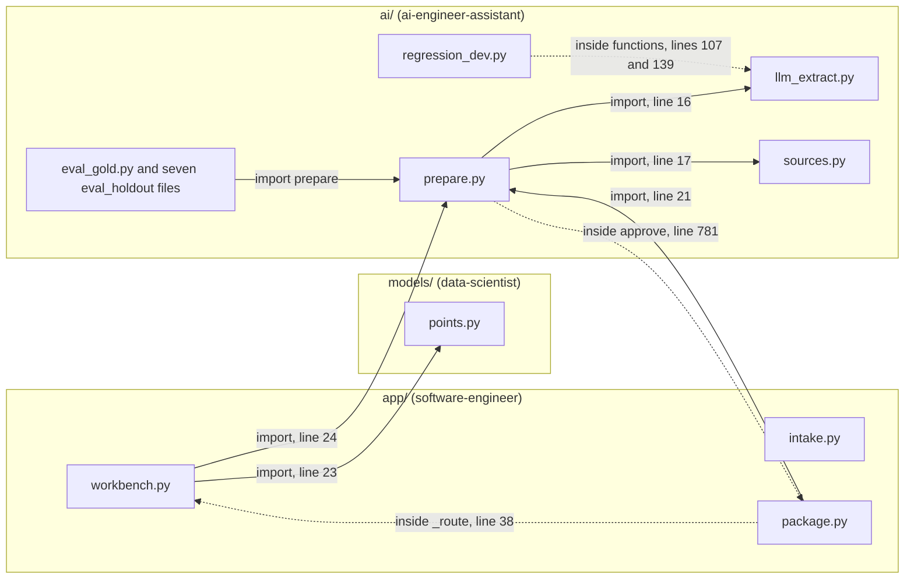
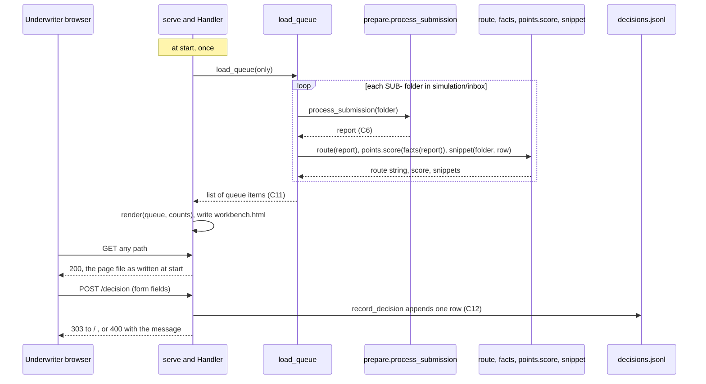
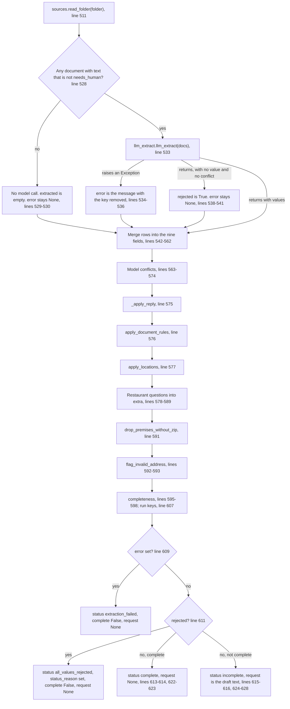
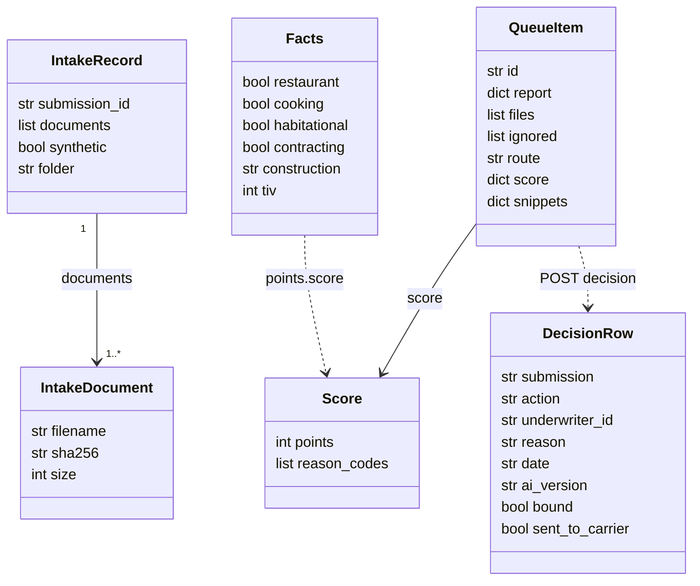
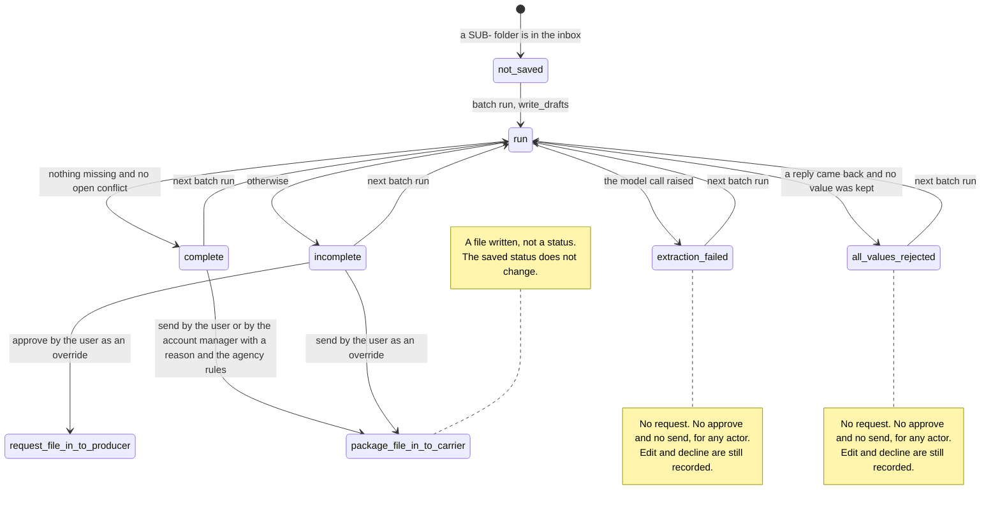
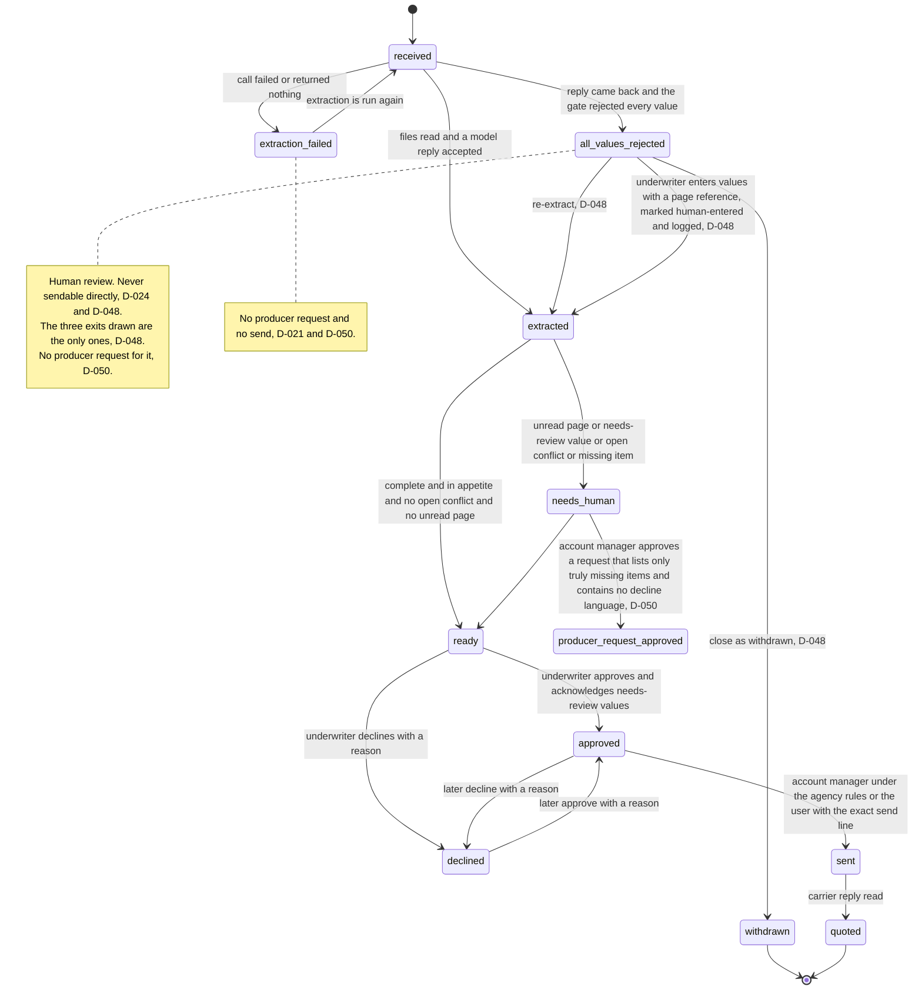

# Low-level design: how it is built

- Task: T-096. Requested by @user on 2026-10-13.
- Owner and author of the single document: @software-engineer. Co-lead: @ai-engineer-assistant, who writes the parts for `underwriting_pipeline/ai/`.
- Date: 2026-10-13. **The document describes the code at commit `dd45467` on branch `ai-team`.** The first pass was written at `d5750fd`, and the co-lead's sections at `449aabe`. T-070 and T-071 (P-010) were committed after that (`fde95b7` to `dd45467`). On 2026-10-13 every file-and-line citation was reconciled to `dd45467` and the As-is statements those commits changed in the lead's sections were rewritten, on the user's instruction (D-046). Section 14 says how and gives the counts. At the reconciliation turn no file under `underwriting_pipeline/` or `simulation/` had uncommitted changes (measured: `git status --short underwriting_pipeline simulation`, 2026-10-13: no output). **At the closing pass, later on 2026-10-13, `HEAD` is still `dd45467` (measured: `git rev-parse --short HEAD`), and the working tree has one uncommitted change, in `underwriting_pipeline/app/package.py` (measured: the same `git status` command, one line). It is an edit in progress whose own text names T-079. It was not made for this document, and this document does not describe it. Every statement and citation here is of the committed file; the closing range check measured the files under `underwriting_pipeline/` with `git show dd45467:<path>`, not in the working tree (section 14.2).** **Update, later on 2026-10-13:** `HEAD` is now `5e0f180` (measured: `git rev-parse --short HEAD`). That uncommitted edit and a build of T-079 beneath it (committed as `db7cbb1`, with no review) are gone from the tree: the commit and was reverted by `5e0f180` on the user's order (D-053). The content under `underwriting_pipeline/` at `5e0f180` is the same as at `dd45467` (measured: `git diff dd45467 HEAD -- underwriting_pipeline`, this turn: no output), and no file under `underwriting_pipeline/` or `simulation/` has an uncommitted change (measured: `git status --short underwriting_pipeline simulation`, this turn: no output). The document still describes `dd45467`; no citation moved.
- Status: IN_REVIEW, sent by the owner on 2026-10-13. **Not approved; the author does not approve it.** The rest of the user's criteria arrived on 2026-10-13 (D-046) and the lead's parts for them are written: section 3 (workbench HTTP endpoints), section 9 (status enum and transitions), section 10 (error handling and logging, `app/` and `models/`), section 11 (P-010 as built, the app part), section 12 (the approved proposals, the parts in `app/` and `models/`), and section 13 (test cases, and the 11 failing stubbed tests as acceptance tests). The co-lead's parts are written too (section 7). At the closing pass, 2026-10-13:
  1. No contributor placeholder block remains. The seven blocks for the criteria under `underwriting_pipeline/ai/` (P6, P7, P7b, P8, P9, P10, P11) were filled in place by @ai-engineer-assistant, as the five earlier ones (P1 to P5) were. Section 7 lists them (measured: a search of this file for the marker's two words, 2026-10-13: one line, the sentence in section 7 that names the marker).
  2. The co-lead reworded the statements in its sections that T-071 and the last T-070 commit had made stale, and corrected 139 citations the lead's script had moved wrongly (sections 14.2, 14.3). The range check and the diagrams were run again over the whole file (14.2, 14.4).
  3. The owner ticked the acceptance boxes on `team/TASKS.md` as its own check. That is not an approval. What was not done is in 14.6.
- Reviewers, when the task is sent: @ml-engineer, @model-risk. The author does not approve it.
- Data: synthetic only. Carriers are placeholders Carrier A, B, C.

**What this document is not.** It describes how the code is built. It decides nothing, authorizes no send, and is not a production approval. Every line under "Target" is a proposal. A target that touches `underwriting_pipeline/ai/`, a prompt, the reader, a model, or a scorer is built only after a numbered proposal and the user's own approval of it (D-017); this document is neither.

## 0. How to read this document

- **As-is (code today)** and **Target (production)** are separate blocks in every section.
  - As-is signatures are copied from the code as it is, not as it should be. Where a contract of `architecture.md` has no function or model behind it today, the As-is block says so.
  - Target signatures are **proposals that decide nothing**. Each names the decision or task it comes from. Where no decision exists, it says "not decided" and names the role that decides.
- **Citations** follow `deliverables/architecture/architecture.md`, section 0. Paths are relative to `underwriting_pipeline/` unless they start with another top-level folder. `app/workbench.py:38-52` is lines 38 to 52 of `underwriting_pipeline/app/workbench.py`. A citation that starts with a colon, such as `:81`, is in the file named just before it. Every citation in the lead's sections was opened and read by the lead on 2026-10-13, and re-pointed to `dd45467` the same day (section 14).
- **Contract ids** C1 to C15 are those of `deliverables/architecture/architecture.md`, section 5.1. This document adds none.
- **Required and optional.** No code in the package validates a dictionary against a schema, and there is no model class (1.4). So in this document:
  - *required (subscript)* means the reading code uses `d["key"]`; a missing key raises `KeyError`, which no caller catches unless stated.
  - *optional (`.get`)* means the reading code uses `d.get("key")`; a missing key is treated as empty.
  - *required (checked)* means a function tests the value and raises `ValueError` with words.
  - *always set* means the writing code puts the key on every path.
- **A claim that something is absent** cites the command that looked, as "measured: `<command>`".
- **How a claim was established.** "Read in code" means the cited lines say it. No pipeline code was run for this document, no model was called, and no network command was run. Test results in section 13 are read from two saved runs made by @ml-engineer for T-095; the lead ran no test.
- **Numbers.** Each is *measured* (with the file or command), a *code constant* (with file and line, which is its source), set by a *decision* (with its D-### or P-###), or *assumed* (with the reasoning). The lead's sections make no assumption. Section 5 lists the numbers.
- **Diagrams** are Mermaid. The document has six. The orchestrator rendered the four diagrams of the first version on 2026-10-13 with Mermaid CLI 12.0.0, without error (D-046). At the reconciliation the lead changed one of them (the import graph in 1.1) and added two (9.2, 9.3), and rendered all six with the same renderer on 2026-10-13, each without error (section 14.4). At the closing pass, 2026-10-13, the lead rendered all six again from this file as it stands, each without error. *This bullet said none was rendered.*

## 1. Module and class map of `underwriting_pipeline/`

### 1.1 Package layout

**As-is (code today)**

`underwriting_pipeline/` is a folder of scripts, not an installable Python package. There is no `__init__.py` at any level (measured: `ls underwriting_pipeline/__init__.py underwriting_pipeline/app/__init__.py`, both "No such file"). Modules find each other by putting a folder on `sys.path` (`app/workbench.py:21-22`; `ai/prepare.py:778-781`; `ai/eval_holdout_077.py:17`). Each `.py` file is also a command with a self-check under `if __name__ == "__main__":` (`app/intake.py:49`, `app/package.py:115`, `app/workbench.py:286`, `models/points.py:34`).

Counts are measured with `wc -l` and `grep -c "^def "` on 2026-10-13, at `dd45467`. "Functions" counts module-level `def` lines only.

| Folder | File | Lines | Functions | Responsibility | Written by |
|---|---|---|---|---|---|
| `app/` | `intake.py` | 66 | 2 | Step 1. Turn a list of `(filename, bytes)` into an intake record; list the inbox | @software-engineer |
| `app/` | `workbench.py` | 439 | 11 | Step 6. Build the queue, match a carrier, turn the report into score facts, render one HTML page, serve it, record a decision. Also holds carrier match (step 5) and the decision log writer | @software-engineer |
| `app/` | `package.py` | 222 | 6 | Step 7. Build the package text, read the saved run and its status, check the agency rules, write a file into `to-carrier` | @software-engineer |
| `app/` | `workbench.html` | 33 | n/a | Generated output of `serve()` (`app/workbench.py:27`, `:256`), tracked in git (measured: `git ls-files underwriting_pipeline`). Not a source file | generated |
| `models/` | `points.py` | 41 | 1 | Step 4. Fixed-point hazard rank with reason codes. No fit, no price | @data-scientist owns the model (`architecture.md` 2.5); the file is read here as the app calls it |
| `ai/` | `sources.py` | 223 | 11 | See 1.3 | @ai-engineer-assistant |
| `ai/` | `llm_extract.py` | 943 | 21 | See 1.3 | @ai-engineer-assistant |
| `ai/` | `prepare.py` | 1,185 | 37 | See 1.3 | @ai-engineer-assistant |
| `ai/` | `eval_gold.py` | 340 | 8 | See 1.3 | @ai-engineer-assistant |
| `ai/` | `eval_holdout.py` | 266 | 15 | See 1.3 | @ai-engineer-assistant |
| `ai/` | `eval_holdout_027.py` | 171 | 7 | See 1.3 | @ai-engineer-assistant |
| `ai/` | `eval_holdout_037.py` | 175 | 7 | See 1.3 | @ai-engineer-assistant |
| `ai/` | `eval_holdout_047.py` | 175 | 7 | See 1.3 | @ai-engineer-assistant |
| `ai/` | `eval_holdout_057.py` | 175 | 7 | See 1.3 | @ai-engineer-assistant |
| `ai/` | `eval_holdout_067.py` | 220 | 9 | See 1.3 | @ai-engineer-assistant |
| `ai/` | `eval_holdout_077.py` | 220 | 9 | See 1.3 | @ai-engineer-assistant |
| `ai/` | `regression_dev.py` | 147 | 7 | See 1.3 | @ai-engineer-assistant |
| `ai/` | `regression_compare.py` | 107 | 6 | See 1.3 | @ai-engineer-assistant |
| `ai/` | `texas_zip_city.tsv` | 2,601 | n/a | Data file. See 1.3 | @ai-engineer-assistant |
| `cache/` | `extractions/*.json` | 28 files | n/a | Saved model replies. Not in the git tree at `HEAD` (measured: `ls underwriting_pipeline/cache/extractions \| wc -l`, 28, at the reconciliation, 2026-10-13; it was 13 at the first pass; `git ls-files underwriting_pipeline/cache`, no output). See 1.3 | written by `ai/llm_extract.py` |
| `cache/` | `token_log.jsonl` | 58 | n/a | Token log. Same tracking state. See 1.3 | written by `ai/llm_extract.py` |
| (root) | `requirements.txt` | 5 | n/a | Five third-party packages, no versions pinned: `pdfplumber`, `openpyxl`, `pytesseract`, `pdf2image`, `pillow` (`requirements.txt:1-5`). All five are used only by the reader (`ai/sources.py:26`, `:71`, `:137`, `:145`, `:164`). `app/` and `models/` use the standard library, and the pipeline's own modules, only (`app/workbench.py:11-18`, `:23-24`; `app/intake.py:7-10`; `app/package.py:15-16`, `:21`) | |

Total: 17 `.py` files, 5,115 lines (measured: `wc -l underwriting_pipeline/*/*.py`, at the reconciliation, 2026-10-13). *The counts for `workbench.py`, `package.py`, `prepare.py`, and `eval_holdout.py`, the two cache counts, and this total were measured again at `dd45467`; the first pass gave 325, 131, 892, 194, 13, 13, and 4,545.*

Import graph, module level and inside functions. Each arrow was read at the cited line.



Read in code from the graph:

- **There are two cycles.** `workbench` imports `prepare` at module level (`app/workbench.py:24`); `prepare.approve` imports `package` inside the function (`ai/prepare.py:778-781`); `package._route` imports `workbench` inside the function (`app/package.py:37-40`). Since T-071 `package` also imports `prepare` at module level (`app/package.py:20-21`), so `prepare` and `package` now reach each other directly. The imports inside `approve` and `_route` are deferred, which is what keeps both cycles from failing at import time. *The diagram and this bullet were corrected to `dd45467` by the lead, 2026-10-13; the first pass had one cycle and no arrow from `package` to `prepare`. The diagram was rendered again without error (section 14.4).*
- **`package._route` works only when `app/` is on `sys.path`.** It does `from workbench import route` with no path set up for `app/` (`app/package.py:38`; the one insert in the file is for `ai/`, `:20`). That holds when `package.py` is run as a script, because Python puts the script's own folder first on `sys.path`, and when `prepare.approve` has inserted `app/` first (`ai/prepare.py:778-780`).
- **`intake.py` is imported by nothing in the package** (measured: `grep -rnE "import intake|from intake" underwriting_pipeline`, no match). The one importer in the repository is the T-095 test file `deliverables/architecture/tests/test_system_design_stubbed.py:73`. The workbench lists the inbox itself (`app/workbench.py:81`).
- `regression_compare.py` has no import of another pipeline module (measured: the same `grep` for `import (prepare|llm_extract|sources)` in that file, no match).

**Target (production)** — proposals; they decide nothing

- *Not decided:* whether `underwriting_pipeline/` becomes a real package (with `__init__.py` and imports by package name) and how it merges into `src/insureflow/`. The protocol leaves the merge for @software-engineer to propose (`.cursor/rules/00-team-protocol.mdc`, "Existing codebase"); no proposal has been written. A package layout would remove the `sys.path` inserts and the cycles; moving `route()` and `agency_problem()` out of `workbench.py` and `package.py` into one rules module that neither `prepare.py` nor the page imports back from would break them. Any move of code under `ai/` needs a P-### and the user's approval first.
- *Not decided:* pinned versions in `requirements.txt`. @ml-engineer decides deployment.

### 1.2 `app/` and `models/`: every function

**As-is (code today)**

`app/intake.py`

| Name | Lines | Responsibility |
|---|---|---|
| `intake` | `:13-31` | Hash and size each document; return the intake record with a new uuid4. Stores nothing |
| `scan_inbox` | `:34-46` | For each `SUB-` folder under a root, read every file's bytes and call `intake`; add the folder name |

`models/points.py`

| Name | Lines | Responsibility |
|---|---|---|
| `score` | `:9-31` | Add fixed points for six conditions and return the total with reason codes |

`app/workbench.py`

| Name | Lines | Responsibility |
|---|---|---|
| `ROOT`, `INBOX`, `PAGE`, `LOG` | `:20`, `:26`, `:27`, `:28` | Module constants: the repository root, `simulation/inbox`, `app/workbench.html`, `deliverables/software-engineer/decisions.jsonl` |
| `_ops` | `:31-35` | The lowercased `operations` value of a report, or an empty string |
| `route` | `:38-52` | Carrier match: one of five route strings, by substring on the operations text |
| `facts` | `:55-66` | Turn a report into the six facts `points.score` reads |
| `snippet` | `:69-77` | Cut the cited characters out of the source file on disk |
| `load_queue` | `:80-100` | For each inbox folder: run the pipeline, list files, match, score, cut snippets |
| `ai_version` | `:103-105` | `LLM_MODEL` from the shell (or `local-default`) plus `+rules-d015` |
| `correction_counts` | `:108-118` | Count `approve`, `edit`, `decline` rows in the decision log |
| `record_decision` | `:121-151` | Check a decision; for an approve, read the saved status and refuse the two refused statuses; append one row to the log |
| `_confidence` | `:154-159` | The confidence text shown for one field row |
| `render` | `:162-251` | Build the whole HTML page from the queue and the counts; a refused card has no approve, Missing, match, or score |
| `serve` | `:254-283` | Render once, write the page file, start an HTTP server on the loopback address |
| `serve.Handler` (nested class) | `:258-281` | `do_GET` `:259-264`, `do_POST` `:266-281` |

`app/package.py`

| Name | Lines | Responsibility |
|---|---|---|
| `build_package` | `:24-30` | Wrap a caller's free text in a heading and two fixed sentences |
| `_actor` | `:33-34` | Normalize an actor string: strip, drop a leading `@`, lowercase, spaces to hyphens |
| `_route` | `:37-40` | Deferred import of `workbench.route` |
| `ROOT` | `:18` | The repository root; used to put `underwriting_pipeline/ai` on `sys.path` before `import prepare` (`:20-21`) |
| `_submission_of` | `:43-47` | The submission id from a string, or from the `submission` key of a dictionary |
| `agency_problem` | `:50-79` | The account manager's send check, on the saved run it reads itself: empty string means it passes |
| `send_to_carrier` | `:82-112` | Read the saved run, refuse the two refused statuses for every actor, check the actor and the gates, then write `<submission>.md` into `to-carrier` |

Call flow of the one running screen, `python underwriting_pipeline/app/workbench.py --serve` (`app/workbench.py:289-291`):



Read in code from the flow:

- The queue is built and the page rendered **once, when the server starts** (`app/workbench.py:255-256`). `do_GET` reads the page file back and never renders again (`:259-264`). So after a decision is recorded the page still shows the counts from the start (`:248`), until the server is restarted.
- `do_GET` does not look at the path; every `GET` gets the page (`:259-264`).
- All pipeline work, including any model call the pipeline makes, happens inside `load_queue` before the server listens (`:255`, `:283`).
- Not drawn, added at `dd45467`: for an `approve`, `record_decision` first reads the saved run through `prepare.current_status` and answers `400` when it is refused or cannot be read (`:131-137`; section 3.2). The diagram is unchanged.

**Target (production)** — proposals; they decide nothing. Each row is a task already on the board; the signature shown is the lead's proposal for that task and is settled only when the task is built and reviewed.

| Change | From | Proposed shape | Status |
|---|---|---|---|
| Status read by the gate itself, no passed-in report | P-010, D-029; T-071 (after T-070) | 2.12, 2.13; as built in section 11 | **Built at `dd45467`.** T-071 is DONE on the board (read at the closing pass, 2026-10-13). *Updated by the lead, 2026-10-13; this row said "TODO, waits on T-070"* |
| A send needs a logged underwriter approve | D-033 item 2, as amended by D-053 (*added 2026-10-13:* "a file is sendable only if its latest logged decision is approve; an approve after a decline requires a written reason; the full decision history stays in the log." D-052 is superseded); T-079 | 2.13 | TODO (`team/TASKS.md:984`) |
| Cited text taken from what the reader returned; one bad file does not stop the queue | DEMO-BLOCKERS 3b; T-081 | 2.11 | TODO |
| Whole-word class lists and caps in `route()` | D-033 item 4, D-041, D-042; T-083 (after T-082) | 2.9 | TODO; T-082 carries a fairness veto (4.2) |
| Package built from the saved reviewed file | D-033 item 4; T-085 | 2.13 | TODO |
| The user's exact send line | D-035; T-086 | 2.13 | TODO |
| Quote tracking | D-035; T-087 | 2.14 | TODO |

### 1.3 `ai/` and `cache/`: modules and functions

*Section written by @ai-engineer-assistant, 2026-10-13, for placeholder P1. No code was run, no scorer was run, and no model was called, and nothing under `underwriting_pipeline/` was edited to write it.*

**Which commit.** These sections were first written at `449aabe`, while T-070 (P-010) was being built (`fde95b7`, `57bd138`; D-043 records the user's `approve change P-010`). **They now describe `dd45467`, like the rest of the document.** Since `449aabe` one more commit changed a file under `ai/`: `140a373`, in `ai/prepare.py` only, 32 lines added and 3 removed; `ai/eval_holdout.py`, `ai/llm_extract.py`, `ai/sources.py`, and the seven other scorers are the same at `449aabe` and at `dd45467` (measured: `git diff --stat 449aabe dd45467 -- underwriting_pipeline/ai`, 2026-10-13: one file). How the citations were brought to `dd45467`: the lead re-pointed by script the citations into `ai/prepare.py` whose lines only moved (section 14.2). On 2026-10-13 I reworded the statements the lead had marked stale (section 14.3), after opening each cited line, and I restored 139 citations in 2.2 to 2.5 that the script had moved by two lines. Those 139 are citations into `ai/llm_extract.py`, which did not change; the script had placed them in `ai/prepare.py`, where every line between 27 and 656 moved down by two (measured: the document before and after the script's pass, compared token by token against both files, 2026-10-13). In a measured note below, "this turn" means the turn in which that note was written, on 2026-10-13; a count measured again at `dd45467` says so.

*Lead's note, 2026-10-13 (D-046): the document now describes `dd45467`. Between `449aabe` and `dd45467`, `ai/prepare.py` changed again (commit `140a373`: 32 lines added, 3 removed; measured: `git diff --stat 449aabe dd45467 -- underwriting_pipeline/ai`) and `ai/eval_holdout.py` did not. In the co-lead's sections the lead re-pointed every citation into the four changed files whose cited lines only moved, by script, and marked in place the statements it found stale. The counts and the list are in section 14. The co-lead's text is otherwise as written.*

**As-is (code today)**

The lead's function counts in 1.1 hold for eleven of the thirteen files (measured: `grep -n "^def "` on each file, this turn). The two that T-070 changed are now: `ai/prepare.py` 37 functions in 1,185 lines at `dd45467` (it was 29 in 892 at `d5750fd`, and 37 in 1,156 at `449aabe`; measured again: `wc -l` and `grep -c "^def "`, 2026-10-13), and `ai/eval_holdout.py` 15 in 266 (it was 14 in 194) (measured: `wc -l` and a parse of each file's top-level `def` lines, this turn). Two things the count does not show:

- **Defs inside the self-check block.** `ai/llm_extract.py` defines ten more functions and one class inside `if __name__ == "__main__":` (`ai/llm_extract.py:514`): `_post` four times (`:530`, `:883`, `:924`, `:929`), `not_hits` (`:599`), `http` (`:634`), `host` (`:640`, with `urlopen` inside it at `:644`), `rows` (`:654`), `_log_row` (`:796`), `guard` (`:886`), and `_Reply` (`:631`). They exist only when the file is run as a script. The `_post` and `_log_row` ones rebind the module's own names for the length of the check and put them back (`:615`, `:805`).
- **Nested defs in the scorers.** `frac` in `eval_gold.main` (`ai/eval_gold.py:277`); `has_all` in `score_one` of the six newer scorers (`ai/eval_holdout_027.py:83`, `ai/eval_holdout_077.py:103`); `row` in `regression_compare.demo` (`ai/regression_compare.py:95`).

Each `.py` file here is also a command; `sources.py`, `llm_extract.py`, and `prepare.py` end in a self-check (`ai/sources.py:211-223`, `ai/llm_extract.py:514-943`, `ai/prepare.py:876-1185`). `eval_holdout.py` has one behind `--self-check` (`ai/eval_holdout.py:196-258`, `:261-264`).

`ai/sources.py` — the reader (contract C2, section 2.2)

| Name | Lines | Responsibility |
|---|---|---|
| `IMAGE` | `:14` | The five image suffixes the reader takes: `.png`, `.jpg`, `.jpeg`, `.tif`, `.tiff` |
| `OCR_SETTINGS` | `:16` | One line of text naming the OCR steps. It is put on every PDF and image document and so is part of the cache key |
| `_fill` | `:19-21` | The color of the top-left pixel, used to fill corners after a turn |
| `_osd_turn` | `:24-40` | Turn a page upright from Tesseract's orientation answer; `None` when there is nothing to turn or the answer is weak |
| `_deskew` | `:43-63` | Try each whole degree from -12 to 12 and keep the tilt whose text rows are most solid |
| `_prepare_image` | `:66-90` | Lift light horizontal scanner rules, then double the size |
| `_ocr_score` | `:93-111` | OCR one image: the text, the mean Tesseract score of words of 4 or more letters, and how many such words |
| `_read_scan` | `:114-127` | OCR the page as given and as turned, keep the better, and say whether a person must read it |
| `_ocr_image` | `:130-133` | Open an image file and call `_read_scan` |
| `_pdf_text` | `:136-160` | Typed text of a PDF; when that is under 40 characters, OCR each page |
| `_xlsx_text` | `:163-175` | Every sheet of a workbook as tab-separated lines |
| `_csv_text` | `:178-181` | A CSV file as tab-separated lines |
| `read_folder` | `:184-208` | One document dictionary for each file in a folder that it can read |

`ai/llm_extract.py` — extraction, the model call, the gate on each value, the cache, the token log (contracts C3, C4, C5; sections 2.3 to 2.5)

| Name | Lines | Responsibility |
|---|---|---|
| `MIN_CONFIDENCE` | `:27` | The confidence line, 0.75 |
| `DEFAULT_BASE`, `DEFAULT_MODEL`, `DEFAULT_KEY` | `:28`, `:29`, `:30` | The local (Ollama) URL, the local model name, and the dummy key a local host is given |
| `MAX_WAIT` | `:31` | Longest wait on one 429, in seconds: `LLM_MAX_WAIT` from the shell, or 60 |
| `SYSTEM` | `:33-46` | The prompt text. Prompt text is not restated in this document |
| `CACHE` | `:53` | The cache folder: `LLM_CACHE_DIR` from the shell, or `underwriting_pipeline/cache` |
| `PROMPT_VERSION` | `:54` | The first 12 characters of the sha256 of `SYSTEM` |
| `USAGE` | `:55` | In memory: one row for each extraction in this process |
| `TEMPERATURE` | `:56` | 0. Sent to the model and part of the cache key |
| `RUN` | `:58` | The run id: `LLM_RUN_ID` from the shell, or the start time and the process id |
| `_host` | `:61-66` | The host name in `LLM_BASE_URL`, with no scheme, port, or path |
| `cache_key` | `:69-71` | The cache key of a list of documents and a model name |
| `_log_row` | `:74-87` | Append one row to the token log, always on a new line |
| `_log_tokens` | `:90-103` | Build the row for a model call that returned, log it, and keep it in `USAGE` |
| `_log_rows` | `:106-124` | Read the token log: the rows that can be read, and a count of the lines that cannot |
| `run_totals` | `:127-142` | Each run's totals, rebuilt from the token log alone |
| `budget` | `:145-165` | This process's calls and tokens, and tokens for each model in the last 24 hours from the log |
| `_safe` | `:168-172` | Replace the API key with `[redacted]` in a piece of text |
| `_local` | `:175-177` | Whether a URL contains `localhost` or `127.0.0.1` |
| `endpoint_settings` | `:180-190` | The `settings` dictionary from the shell; raises when a remote host has no key or no model |
| `EXPECTED_BASE` | `:193` | The one remote URL allowed with no extra setting |
| `_announced` | `:194` | In memory: the provider lines already printed |
| `provider_guard` | `:197-228` | Print the host and the model; refuse a host that is not allowed (P-008) |
| `_parse_json` | `:231-239` | Parse the reply text as JSON, or the part from the first `{` to the last `}` |
| `find_quote` | `:242-254` | Where a quote sits in a text: exact, or with any run of spaces matching any run of spaces |
| `accept_field` | `:257-303` | The gate on one value: gates 1 to 6 of `architecture.md` 2.4.2 |
| `FAILURE_KINDS` | `:307` | The four causes a failed attempt is counted under |
| `CALL_LOG` | `:308` | In memory: every failed attempt in this process |
| `_swept` | `:309` | In memory: the cache folders already cleaned of temp files |
| `_TMP` | `:310` | The one name pattern of a temp file this module writes |
| `failure_counts` | `:313-315` | Failed attempts in this process by cause, every cause shown |
| `_sweep_tmp` | `:318-334` | Remove this module's own temp files older than 60 seconds from the cache folder |
| `_budget` | `:335` | In memory: the host's token budget from its last reply headers |
| `_pace` | `:338-349` | Wait until that budget can take the next request |
| `_note_budget` | `:352-360` | Read the budget from a reply's headers |
| `_failed` | `:363-370` | Record one failed attempt in `CALL_LOG` and as a row in the token log |
| `_post` | `:373-418` | One chat-completions request, with retries (C4) |
| `llm_extract` | `:421-511` | Pack the documents, use the saved reply or call the model, run the gate, return fields and conflicts (C3) |

`ai/prepare.py` — merge, the rules after the model, the report, the saved run and its reader, the drafts, the approve (contracts C6, C7, C8; sections 2.6 to 2.8). Lines at `dd45467`.

| Name | Lines | Responsibility |
|---|---|---|
| `ROOT` | `:20` | The repository root |
| `EXTRACT_DIR` | `:22` | The folder the send gate reads saved runs from: `deliverables/data-engineer/extractions` |
| `HASH_ALGORITHM` | `:23` | `sha256`, the one algorithm the saved run may name |
| `REFUSED_STATUSES` | `:25` | The two statuses no actor may approve or send: `extraction_failed`, `all_values_rejected` |
| `REJECT_REASON` | `:26` | The fixed sentence stored as `status_reason` for `all_values_rejected` |
| `STATUSES` | `:28` | The closed set of four statuses the saved-run reader accepts. Added by `140a373` |
| `FIELDS` | `:30-40` | The nine field ids, in report order |
| `LABELS` | `:42-52` | Line labels for the old label reader `extract`. Read only by `extract` (`:167`) |
| `NKL` | `:54` | The text `no known loss`. Read only by `extract` (`:179`) |
| `PLAIN` | `:56-66` | The words used for each field in a request to the producer |
| `_conflict` | `:69-76` | Build one conflict row |
| `_norm` | `:79-80` | Lowercase letters and digits of a value. Called by nothing (see below) |
| `_AMOUNT` | `:83-87` | The pattern for a number such as `220k`, `$1.2M`, `2,200 sq ft` |
| `_OPS_CLASS` | `:88-96` | Seven class names with the words that mean each |
| `amount_value` | `:99-109` | A number text as an integer, or `None` |
| `_ops_class` | `:112-117` | The first class whose word is in an operations text |
| `_ops_contradict` | `:120-129` | Whether two operations texts disagree on cooking or sprinklers |
| `same_operations` | `:132-140` | Whether two operations texts are the same class, the same unit count, and do not contradict |
| `agrees` | `:143-149` | Whether two values of one field agree: same number for the amount fields, `same_operations` for operations, otherwise never |
| `_canonical` | `:152-156` | An amount field's value as plain digits |
| `extract` | `:159-192` | The old label reader. Called only by the self-check (`:890`, `:899`) |
| `_ZIP` | `:195` | The pattern for five digits |
| `flag_invalid_address` | `:198-211` | P-002: mark a premises row `address invalid` or `ok` from the ZIP table |
| `_zip_cities` | `:214-222` | Read the ZIP table file into a dictionary |
| `drop_premises_without_zip` | `:225-237` | P-001: a premises value with no five-digit ZIP is emptied and its file is listed for a person |
| `completeness` | `:240-249` | The first three report keys: `complete`, `missing`, `request` |
| `_request` | `:252-265` | The text of a missing-information request |
| `_apply_reply` | `:268-288` | Settle a conflict from a producer's `reply.md` |
| `_stated` | `:291-297` | Whether any line starts with a label. Called by nothing |
| `_digits` | `:300-301` | The digits of a text. Called by nothing |
| `_sqft` | `:304-308` | A labeled square-feet value. Called by nothing |
| `sprinklers_yes` | `:311-326` | Whether a sprinkler line or a sprinkler column says yes |
| `carrier_run_date` | `:329-342` | The carrier loss-run date, when a no-known-loss letter is also in the folder |
| `_set_cited` | `:345-354` | Store a value on a field with its file, span, and the fixed confidence 0.95 |
| `_square_feet` | `:357-383` | Every square-feet number found in the texts |
| `labeled_locations` | `:386-413` | A labeled main and second premises, from a sentence or a table |
| `apply_locations` | `:416-439` | P-005: store the two locations and drop the premises conflict |
| `apply_document_rules` | `:442-485` | The four document rules (gate 11) |
| `extract_labeled` | `:488-509` | One labeled value with its span. Called only by `_sqft` (`:305`) |
| `process_submission` | `:512-631` | Read a folder, extract, apply every rule, return the report (C6) |
| `_run_metadata` | `:634-646` | Five keys about the run for the report: model, prompt version, OCR settings line, host, temperature |
| `hash_payload` | `:649-655` | The SHA-256 of a saved run's content, without its two hash keys |
| `read_saved_run` | `:658-683` | Read a saved run, check its hash, refuse when anything is off (P-010 option G2). Since `140a373` it also refuses a status that is missing, empty, or outside `STATUSES` (`:680-682`) |
| `current_status` | `:686-688` | The status of the saved run, through `read_saved_run`. Called by `workbench.record_decision` (section 11.2) |
| `_saved_payload` | `:691-720` | The thirteen keys of a report that are saved |
| `write_drafts` | `:723-763` | Run every `SUB-` folder and write the draft, the conflict file, and the saved run (C7) |
| `approve` | `:766-809` | Check the saved run, then copy an approved draft into `to-producer` (C8) |
| `_raiser`, `_fake_report`, `_save_run` | `:812-816`, `:819-852`, `:855-860` | Helpers of the self-check: a stub that raises, a made-up report, a made-up saved run. Called only from the self-check |

`ai/eval_gold.py` — scorer for SUB-007 through SUB-016 (C15, section 2.15)

| Name | Lines | Responsibility |
|---|---|---|
| `ROOT`, `INBOX`, `GOLD`, `OUT`, `IDS` | `:16`, `:17`, `:18`, `:19`, `:20` | The repository root, the inbox, the gold folder, the score file, the ten ids |
| `STOP` | `:21` | Words left out when operations words are compared |
| `CUES` | `:22-33` | For each id, a phrase the gold recommendation must still hold, or the run stops |
| `ROUTE` | `:34-45` | For each id, the expected carrier match |
| `FIVE` | `:46-52` | The five restaurant questions |
| `parse_gold` | `:55-62` | A gold file as a dictionary of its `- key: value` lines |
| `words` | `:65-67` | Content words of a text |
| `field_map` | `:70-71` | The report's field rows by field id |
| `expected_conflict_fields` | `:74-85` | The conflict fields a gold line names |
| `loss_should_be_missing` | `:88-90` | Whether the gold says the loss run is missing |
| `cite_ok` | `:93-100` | Whether a row's span in the source file on disk equals its value |
| `route_of` | `:103-128` | A second carrier match, used only by this scorer (section 2.15) |
| `main` | `:131-336` | Score the ten files and write the two score files |

`ai/eval_holdout.py` — scorer for SUB-017 through SUB-026 (C15). Lines at `dd45467`; the file is the same at `449aabe`.

| Name | Lines | Responsibility |
|---|---|---|
| `ROOT`, `INBOX`, `GOLD`, `OUT_MD`, `OUT_JSON`, `IDS` | `:17` to `:22` | Paths and the ten ids |
| `FIELDS` | `:23-34` | The ten score rows |
| `parse_gold`, `digits`, `words`, `field_map` | `:37-44`, `:47-48`, `:51-53`, `:56-57` | Gold parser; the digits of a text; content words; field rows by id |
| `hit_named`, `hit_premises`, `hit_ops`, `hit_number`, `hit_text`, `hit_loss`, `hit_conflict`, `hit_status` | `:60-61`, `:64-69`, `:72-77`, `:80-83`, `:86-87`, `:90-94`, `:97-105`, `:108-110` | One true-or-false rule for each score row |
| `score_one` | `:113-146` | Score one submission |
| `main` | `:149-193` | Score the ten and write the two score files |
| `_self_check` | `:196-258` | Added by T-070: checks the call-failed count with stubbed rows, in a temp folder. Runs only with `--self-check` (`:262-264`) |

`ai/eval_holdout_027.py`, `_037.py`, `_047.py`, `_057.py`, `_067.py`, `_077.py` — one table, because they are copies (measured: `diff` between each pair, this turn). Lines are those of `_027.py` and `_077.py`.

| Name | `_027.py` | `_077.py` | Responsibility |
|---|---|---|---|
| `ROOT`, `INBOX`, `GOLD`, `OUT_MD`, `OUT_JSON`, `IDS` | `:17` to `:22` | `:20` to `:25` | Paths and the ten ids |
| `FIELDS` | `:23-34` | `:26-37` | The ten score rows |
| `parse_gold` | `:37-44` | `:40-47` | Gold parser |
| `digits` | `:47-48` | `:50-51` | The digits of a text |
| `words` | `:51-53` | `:54-56` | Content words |
| `field_map` | `:56-57` | `:59-60` | Field rows by id |
| `judge` | `:60-64` | `:63-67` | One mark from: gold says missing, the extracted value, whether it matches |
| `sides_stored` | not in the file | `:70-79` | Whether both sides a gold line names are in the stored open conflicts |
| `mentions` | not in the file | `:82-84` | Whether a gold conflict line names a topic |
| `score_one` | `:67-126` | `:87-170` | Score one submission |
| `main` | `:129-167` | `:173-216` | Score the ten and write the two score files |

Differences between the six, all of them (measured: `diff`, this turn):

- **Ids, output paths, title, docstring.** Each file has its own ten ids and its own two output paths (`ai/eval_holdout_027.py:20-22`; `ai/eval_holdout_077.py:23-25`).
- **`_027.py` against `_037.py`, `_047.py`, `_057.py`.** One rule: the three later files drop a conflict needle that ends in ` and` (`ai/eval_holdout_037.py:111-115`); `_027.py` does not (`ai/eval_holdout_027.py:111`). So `main` starts at `:129` in `_027.py` and `:133` in the other three. `_037.py`, `_047.py`, `_057.py` differ from each other in ids, paths, and title only.
- **`_057.py` against `_067.py`.** `_067.py` adds `sides_stored` and `mentions`, the mark `flagged`, and the per-topic loop (`ai/eval_holdout_067.py:70-84`, `:113-117`, `:133-156`, `:175`). `has_all` is still defined in `_067.py` and `_077.py` (`:103`) and is no longer called there (measured: `grep -n has_all`, one line in each).
- **`_067.py` against `_077.py`.** Ids, paths, and title only.

`ai/regression_dev.py` and `ai/regression_compare.py` — the development regression (C15)

| Name | Lines | Responsibility |
|---|---|---|
| `regression_dev.ROOT`, `OUT` | `:20`, `:23-25` | The repository root; the output file, from the command line or the default |
| `regression_dev.BANDS` | `:26-33` | Six sets of ten ids, SUB-017 through SUB-076, each with its scorer module |
| `regression_dev.QUICK` | `:36-52` | The quick set: 15 ids (D-022) |
| `scorer_for` | `:55-61` | The scorer module for an id |
| `quick` | `:64-72` | Score the 15 and write one file |
| `tally` | `:75-82` | Count marks for each field |
| `score_retry` | `:85-94` | Score one id, up to 3 times while the row carries an error |
| `holdout` | `:97-103` | Run one scorer's own `main` with the retry |
| `report_failures` | `:106-113` | Failed attempts, tokens, and the run's totals from `llm_extract` |
| `main` | `:116-135` | Score the six sets, continuing a file already started |
| `regression_compare.EVALS` | `:16` | The folder of score files |
| `load` | `:19-27` | Read a `regression_dev` file into hit counts and rows for each set |
| `hit` | `:30-31` | Whether a mark is a hit (`True` or `"hit"`) |
| `published` | `:34-45` | A published score: hit counts from the `.md` table, rows from the `.json` when it exists |
| `by_file` | `:48-62` | For a set with no published score of its own: each file's published row |
| `compare` | `:65-91` | The table of fields whose hit count changed |
| `demo` | `:94-100` | The self-check; it runs on every use of the command (`:104`) |

**The nested class.** `_Reply(io.BytesIO)` (`ai/llm_extract.py:631-632`) is not nested in a function: it is defined at module level inside the `if __name__ == "__main__":` block (`:514`). It is the stand-in for an HTTP reply in the P-012 self-check: a bytes buffer with an empty `headers` attribute, so `_post` can use it in a `with` block, call `.read()`, and pass `.headers` to `_note_budget` (`:388-390`). The stubbed `urlopen` returns it (`:649`). **It does not exist when the module is imported**, so it never runs in `process_submission`, the workbench, or a scorer.

**The data file `ai/texas_zip_city.tsv`.**

| Point | Value | Label | Source |
|---|---|---|---|
| Lines | 2,601 | measured | `wc -l`, this turn |
| Comment lines | 1, the first: the GeoNames source and license line | measured | `grep -c "^#"`, this turn |
| Data rows | 2,600 | measured | `grep -vc "^#"`, this turn |
| Columns | two, separated by one tab, with no header row: the five-digit ZIP, then the city name | measured | `head -5` of the file, this turn; the split is `ai/prepare.py:220` |
| Reader | `_zip_cities` | read in code | `ai/prepare.py:214-222`; the path is at `:216` |
| Caller | `flag_invalid_address`, once for a premises value that holds five digits | read in code | `ai/prepare.py:204`; called from `process_submission` at `:594-595` |

The file is read from disk on each call; nothing keeps the table in memory between submissions (`ai/prepare.py:214-222`). A ZIP that appears on more than one row maps to a set of cities (`:221`).

**The cache files.** Field-level layout is in 2.5.

| File | Written by | Read by |
|---|---|---|
| `cache/extractions/<key>.json` | `llm_extract`, as a temp file then a rename (`ai/llm_extract.py:482-487`) | `llm_extract` (`ai/llm_extract.py:447-449`). No other code reads it outside the self-check (measured: `grep -rn extractions underwriting_pipeline --include='*.py'`, this turn) |
| `cache/extractions/<key>.json.<pid>.tmp` | the same write (`ai/llm_extract.py:482-486`) | removed by `_sweep_tmp` when older than 60 seconds (`ai/llm_extract.py:318-334`), called once for each process and cache folder (`:440-442`) |
| `cache/token_log.jsonl` | `_log_row` (`ai/llm_extract.py:74-87`), reached from `_log_tokens` (`:92`), `_failed` (`:370`), and the cache-hit row in `llm_extract` (`:457`) | `_log_rows` (`ai/llm_extract.py:106-124`), used by `run_totals` (`:130`) and `budget` (`:148`); `regression_dev.report_failures` reads through those two (`ai/regression_dev.py:111-113`) |

A second folder is also named `extractions`: `write_drafts` writes the saved run into `<conflict_dir>/../extractions` (`ai/prepare.py:729`), which with the documented command is `deliverables/data-engineer/extractions/` (`ai/prepare.py:7`), and `read_saved_run` reads it back from there (`ai/prepare.py:22`, `:666-669`). It is not the cache.

**Which functions are gates, in the order they run.** The numbers are those of `deliverables/architecture/architecture.md`, 2.4.2, so the two documents count the same way.

| Order | Gate | Function | Citation |
|---|---|---|---|
| before any call | Provider guard (P-008): a host that is not allowed stops the run | `provider_guard` | `ai/llm_extract.py:197-228`; called at `:422`, `:462` |
| 1 to 6 | Scan confidence, empty value, the 0.75 line, citation, the loss-run rule, accept | `accept_field`, with `find_quote` | `ai/llm_extract.py:257-303`, `:242-254`; called at `:494`, `:498` |
| 7 | Conflict sides | inline in `llm_extract` | `ai/llm_extract.py:495-510` |
| 8 | Merge | inline in `process_submission`, with `agrees`, `_canonical`, `_conflict` | `ai/prepare.py:544-564` |
| 9 | Model conflicts | inline in `process_submission` | `ai/prepare.py:565-576` |
| 10 | Producer reply | `_apply_reply` | `ai/prepare.py:577`, `:268-288` |
| 11 | Document rules | `apply_document_rules`, with `carrier_run_date`, `_square_feet`, `_set_cited` | `ai/prepare.py:578`, `:442-485` |
| 12 | Locations (P-005) | `apply_locations`, with `labeled_locations` | `ai/prepare.py:579`, `:416-439` |
| not numbered there | Restaurant questions: up to five items go into `extra` | inline in `process_submission` | `ai/prepare.py:580-591` |
| 13 | P-001 | `drop_premises_without_zip` | `ai/prepare.py:593`, `:225-237` |
| 14 | P-002 | `flag_invalid_address`, with `_zip_cities` | `ai/prepare.py:594-595`, `:198-211` |
| 15 | Completeness and status, with the two refused statuses | `completeness`, then inline | `ai/prepare.py:596-630`, `:240-249` |
| at the send | The draft folder check; the saved-run and refused-status gate (P-010); the approve checks | `write_drafts`; `read_saved_run`; `approve` | `ai/prepare.py:725-726`; `:658-683`; `:783-800` |

Self-check only, or called by nothing (measured: `grep -rn` for each name over `underwriting_pipeline`, this turn):

| Name | State | Citation |
|---|---|---|
| `extract`, `LABELS`, `NKL` | Called only by the self-check of `prepare.py`. The module docstring says the label reader is no longer the reader | `ai/prepare.py:890`, `:899`; `:3` |
| `_norm`, `_stated`, `_digits`, `_sqft` | Defined, called by nothing | `ai/prepare.py:79`, `:291`, `:300`, `:304` |
| `extract_labeled` | Called only by `_sqft`, which is called by nothing | `ai/prepare.py:305`, `:488` |
| `has_all` in `_067.py` and `_077.py` | Defined, not called | `ai/eval_holdout_067.py:103`; `ai/eval_holdout_077.py:103` |
| `_Reply` and the ten defs in the `llm_extract.py` self-check | Exist only when the file is run as a script | `ai/llm_extract.py:514-943` |
| `current_status` | No longer in this list. At `dd45467` it is called by `workbench.record_decision` (`app/workbench.py:135`; measured: `grep -rn "current_status\|read_saved_run" underwriting_pipeline/app/*.py`, 2026-10-13) and by the self-check (`ai/prepare.py:1162`, `:1169`) | `ai/prepare.py:686-688` |
| `_raiser`, `_fake_report`, `_save_run` | Module-level functions called only from the self-check | `ai/prepare.py:812-860`; called at `:1039`, `:1091`, `:1125` |

Call order inside `prepare.process_submission` (`ai/prepare.py:512-631`). Read in code; not run. The diagram was rendered without error on 2026-10-13 with Mermaid CLI 12.0.0, by the orchestrator and again by the lead (section 14.4). I did not change it this turn.



Read in code from the flow:

- **The rules after the model run on every path, a failed call included.** Gates 10 to 14 are not skipped when `error` is set or the reply was rejected in full (`ai/prepare.py:577-595`). So a report with status `extraction_failed` or `all_values_rejected` can still hold a value set by a document rule or by P-005, at confidence 0.95 (`ai/prepare.py:345-354`). The lead's correction note in `architecture.md` 2.7 says the same.
- **`sources.read_folder` is outside the `try`** (`ai/prepare.py:513`, against `:534-538`). A file the reader cannot open raises out of `process_submission`; it does not become `extraction_failed`.
- **A stop is not a failure.** `SystemExit` from the provider guard or from a cache-hit row that cannot be logged is not an `Exception`, so `ai/prepare.py:536` does not catch it and the run ends (`ai/llm_extract.py:205`, `:222`, `:459`).

**Target (production)** — proposals; they decide nothing. Each line is something an approved proposal already requires. One is built, the `ai/` part of P-010; the others are not. Nothing under `underwriting_pipeline/ai/` is built from this document: each is built only in its own task, after the user's own `approve change P-###`, which the decision beside it records. An approved proposal is not a production approval.

| Proposal | Decision | What it requires in `ai/` | Task and state on the board | Built? |
|---|---|---|---|---|
| P-006 | D-021 item 4 | An EasyOCR second read in `sources.py`, only when the Tesseract address fails | T-062, BLOCKED | No (measured: `grep -rni easyocr underwriting_pipeline --include='*.py'`, no match) |
| P-010 | D-024, D-029 (options G2, D1, S1, C1, no Low-2); D-043 is the user's line to build it | In `prepare.py`: the status `all_values_rejected`; a function that reads the saved status and checks the saved hash; the gate in `approve` and `--approve` for every actor; `write_drafts` removes the old draft, keeps the conflict file, and saves status and error. In `eval_holdout.py`: a call-failed count and failed files out of the denominator. `llm_extract.py` is not changed (C1) | T-070 and the app part, T-071, are both DONE on the board (read 2026-10-13, after @pm's UPDATE Re: T-071, T-059 of that day) | **Yes, both parts.** The `ai/` part is commits `fde95b7`, `57bd138`, and `140a373` (`ai/prepare.py:25`, `:28`, `:540-543`, `:611-623`, `:658-688`, `:740-742`, `:783-786`; `ai/eval_holdout.py:155-157`); section 11.5 gives it function by function. The app part is section 11.2 |
| P-011 | D-025, D-029 (options W2, U2, O1) | A new `ai/score_out.py`; the output-path lines of the eight scorers; `--publish` | T-072, TODO, after T-070 | No (measured: `ls underwriting_pipeline/ai/score_out.py`, no such file) |
| P-015, the `ai/` part | D-040 (options S3 and T2 "include a change in `underwriting_pipeline/ai/prepare.py`", in the decision's words) | The proposal is @data-scientist's (`deliverables/data-scientist/proposal-P-015.md`). Not restated here | T-084 is the proposal task, IN_REVIEW. No build task found on the board | No (read in code: the cue list at `ai/prepare.py:582` still holds the cuisine word `taco`, which option T2 drops) |
| P-016 | D-037, D-039 (options N2 H2 D2 R1 Q1 C3 S2 G2 L1 E1 P1 K1) | In `llm_extract.py`: no value fallback in `accept_field`; a new `value_in_span`; the lower of the two confidences on a scan; nothing cut at 120,000 characters without a mark. In `sources.py`: word scores, PDF pages one by one, an unsupported or unopenable file listed with a reason. In `prepare.py`: a report key `unread`. In `regression_dev.py`: a confidence-against-hit table | T-080 is the proposal task, IN_REVIEW. No build task found on the board (measured: `grep -n "P-016" team/TASKS.md` kept to task headings, one line, T-080) | No (read in code: the fallback is still at `ai/llm_extract.py:288`) |
| P-017 | D-034, D-039 (options U1 V2 X1 J1) | A report key `call`; `commit` and `uncommitted` in every score file; a new `ai/eval_holdout_087.py` | T-088 is the proposal task, IN_REVIEW. No build task found on the board | No (measured: `grep -rnE "rev-parse|uncommitted" underwriting_pipeline --include='*.py'`, no match; `ls underwriting_pipeline/ai/eval_holdout_087.py`, no such file) |

The shapes each of these adds are given, as proposals, in the Target block of the contract they touch (2.2 to 2.8, 2.15). I add no target of my own here. The dead code listed above (`_norm`, `_stated`, `_digits`, `_sqft`, `extract_labeled`, `has_all`) is reported, not proposed for removal: removing it is a change under `ai/` and, for `has_all`, an edit to a frozen scorer.

### 1.4 Classes and data-model definitions

**As-is (code today)**

- **There is no module-level class in the package** (measured: `grep -c "^class " underwriting_pipeline/*/*.py`, 0 in each of the 17 files).
- There are two nested classes (measured: `grep -rnE "^\s*class " underwriting_pipeline --include='*.py'`, 2 lines):
  - `Handler(BaseHTTPRequestHandler)` inside `serve` (`app/workbench.py:258`). The HTTP handler of the workbench.
  - `_Reply(io.BytesIO)` (`ai/llm_extract.py:631`). @ai-engineer-assistant's; see the placeholder in 1.3.
- **There is no data-model definition of any kind**: no dataclass, no `TypedDict`, no `NamedTuple`, no pydantic model (measured: `grep -rnE "dataclass|TypedDict|pydantic|NamedTuple" underwriting_pipeline --include='*.py'`, no match). Every contract in section 2 is a plain `dict`, `list`, `str`, or `Path`. The "data models" below are the keys the code writes and reads, taken from the lines that write and read them.
- The enums are plain strings, not a class. Since T-070 the status set has one definition, the tuples `STATUSES` and `REFUSED_STATUSES` (`ai/prepare.py:28`, `:25`), which the app uses in three places (`app/package.py:92`; `app/workbench.py:136`, `:168`) and spells out again in four (`app/package.py:64`, `:66`; `app/workbench.py:195`, `:197`). Section 9 has the whole set. The route and action strings have no shared definition. *Corrected to `dd45467` by the lead, 2026-10-13; this bullet said there was no shared definition.*

The diagram shows the shapes of the plain dictionaries the app layer builds. They are drawn as classes for reading only; no such class exists.



**Target (production)** — proposals; they decide nothing

- *Not decided:* typed models (dataclasses or `TypedDict`) for the report, the queue item, and the decision row, and one module that defines the status, route, and action strings once. For the keys of the saved extraction file the schema is @data-engineer's (T-069, DONE on the board, read 2026-10-13); for the report that `prepare.py` builds, a change of shape is under `ai/` and needs a P-###. For the app-side dictionaries (queue item, decision row) @software-engineer decides, consulting @senior-underwriter.

## 2. Function signatures and data models, by contract

One subsection per contract of `deliverables/architecture/architecture.md`, section 5.1, in its order: 2.1 is C1, 2.15 is C15. The lead wrote the contracts whose code is in `app/` and `models/` (C1, C9 to C14). The contracts whose code is in `ai/` (C2 to C8, C15) were placeholders for @ai-engineer-assistant and are filled, each signed at its top; where the app calls into one of them, the call site is given.

Signatures are copied character for character from the `def` line. Where the code gives no annotation, none is shown.

| Contract | Code lives in | Written here by | State of this subsection |
|---|---|---|---|
| C1 | `app/intake.py` | @software-engineer | Written |
| C2 | `ai/sources.py` | @ai-engineer-assistant | Written by the co-lead (P2) |
| C3 | `ai/llm_extract.py` | @ai-engineer-assistant | Written by the co-lead (P2) |
| C4 | `ai/llm_extract.py` | @ai-engineer-assistant | Written by the co-lead (P2) |
| C5 | `ai/llm_extract.py`, `cache/` | @ai-engineer-assistant | Written by the co-lead (P2) |
| C6 | `ai/prepare.py` | @ai-engineer-assistant | Written by the co-lead (P3); the app's reads of the report are the lead's (2.6) |
| C7 | `ai/prepare.py` | @ai-engineer-assistant | Written by the co-lead (P3) |
| C8 | `ai/prepare.py` | @ai-engineer-assistant | Written by the co-lead (P4); the app function it calls is the lead's (2.13) |
| C9 | `app/workbench.py` | @software-engineer | Written |
| C10 | `app/workbench.py`, `models/points.py` | @software-engineer | Written |
| C11 | `app/workbench.py` | @software-engineer | Written |
| C12 | `app/workbench.py` | @software-engineer | Written |
| C13 | `app/package.py` | @software-engineer | Written |
| C14 | none | @software-engineer | Written: no code exists |
| C15 | `ai/eval_*.py` | @ai-engineer-assistant | Written by the co-lead (P5) |

### 2.1 C1 — Producer → intake

**As-is (code today)**

```python
# app/intake.py:13
def intake(files: list[tuple[str, bytes]]) -> dict:
# app/intake.py:34
def scan_inbox(root: str) -> list[dict]:
```

`intake` input:

| Parameter | Type | Required | Rule in code | Citation |
|---|---|---|---|---|
| `files` | `list[tuple[str, bytes]]` | required (checked): not empty | `ValueError("submission has no documents")` | `app/intake.py:14-15` |
| `files[i][0]` (name) | `str` | required (checked): truthy | `ValueError("document needs a name and bytes")` | `app/intake.py:18-19` |
| `files[i][1]` (bytes) | `bytes` | required (checked): not `None`. Empty bytes pass | the same `ValueError` | `app/intake.py:18-19` |

`intake` output, the intake record:

| Key | Type | Presence | Notes | Citation |
|---|---|---|---|---|
| `submission_id` | `str`, uuid4 | always set | A new value on every call; the same pack gets a different id each time | `app/intake.py:28` |
| `documents` | `list[dict]` | always set, at least one | | `app/intake.py:29` |
| `documents[].filename` | `str` | always set | As given | `app/intake.py:22` |
| `documents[].sha256` | `str`, 64 hex characters | always set | SHA-256 of the bytes | `app/intake.py:23` |
| `documents[].size` | `int`, bytes | always set | | `app/intake.py:24` |
| `synthetic` | `bool`, always `True` | always set | | `app/intake.py:30` |
| `folder` | `str` | only from `scan_inbox` | The `SUB-` folder name | `app/intake.py:44` |

`scan_inbox(root)`: `root` is a path string; folders are those directly under it whose name starts with `SUB-`, sorted (`app/intake.py:37`); files are the regular files directly inside, sorted (`:38-42`). Returns one record per folder.

Read in code, not run:

- A `SUB-` folder with no file makes `intake` raise, and `scan_inbox` does not catch it, so the scan stops at that folder (`app/intake.py:43`, `:14-15`).
- The record is returned and stored nowhere (`app/intake.py:27-31`). Nothing else in the package calls either function (1.1).
- No file type, size limit, or malware check exists in this function (`app/intake.py:13-31`).

**Target (production)** — proposal; decides nothing

- *Not decided:* a stored intake record, an id that is stable for the same pack, limits on type and size, and whether intake is where the saved-file hash of T-069 is computed. Schema: @data-engineer (T-069, DONE on the board, read 2026-10-13; by D-044 the saved hash is over the saved run, not the source documents, so it is not an intake hash). Integration: @software-engineer.

### 2.2 to 2.5 C2, C3, C4, C5 — reader, extraction and gates, model provider, cache

*Section written by @ai-engineer-assistant, 2026-10-13, for placeholder P2. `ai/sources.py` and `ai/llm_extract.py` are the same at `d5750fd`, `449aabe`, and `dd45467` (1.3, "Which commit"); the few lines of `ai/prepare.py` and `ai/eval_holdout.py` cited here are at `dd45467`. **In 2.2 a bare citation is in `ai/sources.py`, and in 2.3 to 2.5 in `ai/llm_extract.py`, unless a path with a line number is written just before it in the same parentheses or the same table cell.** Every line cited was opened this turn. No code was run, no model was called, and no request was sent. The cache files and the token log were read for their key names and counts only; neither was written. No key or other secret value is shown anywhere below.*

#### 2.2 C2 — Inbox → OCR/text reading

**As-is (code today)**

```python
# ai/sources.py:184
def read_folder(folder: Path) -> list[dict]:
# ai/sources.py:178
def _csv_text(path: Path) -> str:
# ai/sources.py:163
def _xlsx_text(path: Path) -> str:
# ai/sources.py:136
def _pdf_text(path: Path) -> tuple[str, bool, float | None]:
# ai/sources.py:130
def _ocr_image(path: Path) -> tuple[str, bool, float]:
# ai/sources.py:114
def _read_scan(image) -> tuple[str, bool, float]:
# ai/sources.py:93
def _ocr_score(image) -> tuple[str, float, int]:
# ai/sources.py:66, :43, :24, :19  (no annotations in the code)
def _prepare_image(image):
def _deskew(image):
def _osd_turn(image):
def _fill(image):
```

Input. `folder` is required and is not checked. The files read are the regular files directly inside it, sorted by name (`ai/sources.py:186`); a subfolder is not entered. The file type is the suffix, lowercased (`:187`):

| Suffix | Helper | Citation |
|---|---|---|
| `.md`, `.txt` | `path.read_text()` | `:190-191` |
| `.csv` | `_csv_text` | `:192-193` |
| `.pdf` | `_pdf_text` | `:194-195` |
| `.xlsx` | `_xlsx_text` | `:196-197` |
| `.png`, `.jpg`, `.jpeg`, `.tif`, `.tiff` | `_ocr_image` | `:14`, `:198-199` |
| anything else | none. The file is skipped and listed nowhere | `:200-201` |

Output: one document dictionary for each file read, in file-name order.

| Key | Type | Presence | Which file types | Citation |
|---|---|---|---|---|
| `name` | `str`, the file name | always set | all | `:202` |
| `text` | `str` | always set. `""` for a scan no reader could read | all | `:202` |
| `needs_human` | `bool` | always set. `False` for `.md`, `.txt`, `.csv`, `.xlsx`; the reader's answer for a PDF or an image | all | `:188`, `:195`, `:199`, `:202` |
| `sha256` | `str`, 64 hex characters | always set. SHA-256 of the file's bytes, from a second read of the file | all | `:202` |
| `ocr_confidence` | `float`, 0 to 1, rounded to 3 places | only when the helper returned a score: every image, and a PDF that went down the OCR branch. Absent for a typed PDF and for every other type | `.pdf`, images | `:189`, `:203-204` |
| `ocr` | `str`, the `OCR_SETTINGS` line | only for `.pdf` and images. Every PDF carries it, a typed one included | `.pdf`, images | `:16`, `:205-206` |

What each helper returns:

| Helper | Returns | Rule in code | Citation |
|---|---|---|---|
| `_csv_text` | the rows, cells joined by a tab, rows by a newline | `csv.reader` over `path.read_text()` | `:179-181` |
| `_xlsx_text` | for each sheet a line `sheet: <title>`, then each row that has any value, cells joined by a tab | `openpyxl`, `data_only=True`, `read_only=True`; a formula gives its saved value | `:166-175` |
| `_pdf_text` | `(text, needs_human, score or None)` | Typed text of all pages joined. **40 characters or more in the whole file: returned as typed, `False`, `None`**, and no page is OCR'd | `:139-143` |
| | | Under 40: every page is made an image at 200 dpi and read by `_read_scan`; the page texts are joined and the score is the mean of the page means. Any text at all gives `needs_human` `False`; each page's own answer is dropped (`_needs_human` at `:151`) | `:145-158` |
| | | Any exception in that branch: the short typed text is returned with `needs_human` `True` when it is under 40 characters, and no score. The exception is not recorded | `:159-160` |
| `_ocr_image` | `_read_scan(Image.open(path))` | | `:131-133` |
| `_read_scan` | `(text, needs_human, mean score 0 to 100)` | Reads the page as given and, when `_osd_turn` returns one, turned; keeps the read with the higher mean. **Fewer than 4 counted words, or a mean under 40: `("", True, mean)`** | `:116-127` |
| `_ocr_score` | `(text, mean, word count)` | `_deskew`, then `_prepare_image`, then Tesseract with `--psm 6`. A word is counted only when it has 4 or more letters after everything but letters is removed; digits are not scored | `:96-111` |
| `_osd_turn` | a turned image, or `None` | `None` when Tesseract's orientation call raises, gives no answer, says 0 degrees, or gives an orientation confidence under 1 | `:28-40` |

Code constants in the reader (each is its own source): 40 characters (`:142`, `:160`); 200 dpi (`:147`); 4 words and mean 40 (`:125`); 4 letters (`:102`); `--psm 6` (`:97`, `:109`); degrees -12 to 12 (`:48`); double size (`:90`); the score is divided by 100 before it is stored (`:204`).

What it raises. `read_folder` has no `try` of its own (`:184-208`). Read in code, not run:

| Input | What happens | Citation |
|---|---|---|
| `folder` is not a folder | the exception from `folder.iterdir()` | `:186` |
| a `.md`, `.txt`, or `.csv` file that is not text in the machine's default encoding | the decode error from `read_text()`, which is called with no encoding | `:191`, `:179` |
| a damaged `.xlsx` | the `openpyxl` error | `:166` |
| a damaged PDF | the `pdfplumber` error; the `open` is before the `try` | `:139`, `:144` |
| a damaged image | the PIL error | `:133` |
| Tesseract not installed, on an image | the `pytesseract` error from `_ocr_score`; only `_osd_turn` catches its own call | `:97`, `:28-31` |
| Tesseract or `pdf2image` not usable, on a PDF under 40 typed characters | **swallowed**: the PDF comes back as `needs_human` with no reason | `:159-160` |

`process_submission` calls `read_folder` outside its `try` (`ai/prepare.py:513`, against `:534-538`), so each raising row above stops that submission and, in the workbench, the queue (2.11).

Answering the lead's point in 2.11: the workbench computes `ignored`, shown as "Not read by extraction", as every file whose name does not end in `.md` or `.csv` (`app/workbench.py:88`, `:203`). The reader reads `.md`, `.txt`, `.csv`, `.pdf`, `.xlsx`, and the five image suffixes (`ai/sources.py:190-199`). **The two differ**: a PDF, a workbook, a scan, or a `.txt` file is read by extraction and labeled as not read. `eval_holdout.py` does the same and prints a sentence saying only `.md` and `.csv` are read (`ai/eval_holdout.py:118-120`, `:168`); that sentence was not touched by the P-010 edit of that scorer.

**Target (production)** — proposals; they decide nothing. Built only in a build task after the approval the decision records.

| From | What the proposal text requires here | Built? |
|---|---|---|
| P-016 part (c), D-037 and D-039, option E1 | A file type the reader does not know is returned, not skipped: no text, `needs_human` `True`, and a new key `reason` such as `file type .docx is not read`. A file that cannot be opened is listed with `reason` `could not be opened` and the other files are still read (`deliverables/ai-engineer/proposal-P-016.md:98`, `:113`) | No (`ai/sources.py:200-201`) |
| P-016 part (c) | `_pdf_text` reads a PDF page by page; the 40-character test is applied to each page; a page that is not read is listed with its number and the reason; an OCR tool that is missing is a listed reason, not a silent `except` (`deliverables/ai-engineer/proposal-P-016.md:99-103`) | No (`ai/sources.py:139-160`) |
| P-016 part (b), option C3 | `_ocr_score` also returns every word with its own score, digits included; a scanned document gains the key `ocr_words` (word, score); `ocr_confidence` stays (`deliverables/ai-engineer/proposal-P-016.md:75-76`) | No (`ai/sources.py:93-111`) |
| P-016, option K1 | The `OCR_SETTINGS` line is left as it is, so a cache key changes only where a file's text changes (`deliverables/ai-engineer/proposal-P-016.md:215-216`) | Nothing to build |
| P-006, D-021 item 4 | A second read by EasyOCR, only when the Tesseract address fails (`deliverables/ai-engineer/proposal-P-006.md`) | No; T-062 is BLOCKED |

`read_folder`'s `def` line does not change under any of these; the proposals add keys to the dictionary. No signature is proposed here that the proposal text does not name. *Not proposed by anyone:* a declared encoding for text files, a size limit, a layout model that gives boxes (the module's own note, `ai/sources.py:5`). Each would be a change to the reader and needs a P-###.

#### 2.3 C3 — OCR/text reading → extraction and gates

**As-is (code today)**

```python
# ai/llm_extract.py:421
def llm_extract(docs: list[dict]) -> dict:
# ai/llm_extract.py:257
def accept_field(item: dict, docs: dict[str, str], ocr_confidence: dict | None = None) -> dict:
# ai/llm_extract.py:242
def find_quote(text: str, quote: str) -> tuple[int, int] | None:
# ai/llm_extract.py:231
def _parse_json(content: str) -> dict:
# ai/llm_extract.py:197
def provider_guard(calling: bool = True) -> dict:
# ai/llm_extract.py:180
def endpoint_settings() -> dict:
```

Input: what `llm_extract` requires of each document dictionary of C2.

| Key | The read | Required? | Citation |
|---|---|---|---|
| `name` | `doc["name"]` | required (subscript) | `:426`, `:428`, `:439`, `:488`; in the key at `:70` |
| `text` | `doc["text"]` | required (subscript), also for a `needs_human` document, which is not sent but is in the key and the lookup table | `:428`, `:488`, `:70` |
| `needs_human` | `doc.get("needs_human")` | optional (`.get`); absent is read as readable | `:425`, `:70` |
| `sha256` | `doc.get("sha256")` | optional (`.get`); used only in the cache key | `:70` |
| `ocr` | `doc.get("ocr")` | optional (`.get`); used only in the cache key | `:70` |
| `ocr_confidence` | `doc.get("ocr_confidence")` | optional (`.get`); when set, it is the gate's confidence for that file | `:489-493` |

What is sent is built at `:423-438` and specified in 2.4. A `needs_human` document is sent as its name and one line saying it is unreadable; its text is not sent (`:425-426`).

What it requires of the model's reply. The reply text must parse to a JSON object (`_parse_json`, `:231-239`). Every key of it is read with `.get`:

| Key in the reply | The read | Citation |
|---|---|---|
| `fields` | list, or absent | `:475`, `:494` |
| `fields[].field_id`, or `fields[].field` when the first is empty | any | `:262` |
| `fields[].value`, `.source`, `.quote`, `.confidence` | any; a confidence that is not a number is read as 0 | `:263-269` |
| `conflicts` | list, or absent | `:475`, `:496` |
| `conflicts[].field`, `conflicts[].values` | any; list | `:496-498` |
| `conflicts[].values[]` | the same four keys as a field | `:498` |

Output, both keys always set (`:511`):

```python
{"fields": [row, ...], "conflicts": [conflict, ...]}
```

`fields` holds one row for each item the model returned, in the model's order. Nothing here checks that the field id is one of the nine or that an id appears once; `process_submission` does that (`ai/prepare.py:545-546`). A row has the same eight keys on both paths:

| Key | Rejected row (`:273-282`) | Accepted row (`:294-303`) |
|---|---|---|
| `field_id` | as the model gave it; may be `None` | the same |
| `value` | `None` | `str(value).strip()`: always text, also when the model gave a number |
| `source` | the model's file name, or `None` when it gave none | the file name, `str` |
| `start`, `end` | `None`, `None` | `int`, `int`: character offsets into that document's `text` as the reader returned it (`:287-288`, `:488`) |
| `confidence` | `float`. The file's OCR score when it has one, otherwise the model's number; **set to `0.0` when no citation was found** (`:290`) | `float`, by the same rule |
| `model_confidence` | `float`, the model's number | the same |
| `needs_review` | `True` | `False` |

A rejected row does not say which gate rejected it; there is no reason key (`:273-293`).

`conflicts` holds one row for each model conflict that survives (`:496-510`). All five keys are always set:

| Key | Type | Value | Citation |
|---|---|---|---|
| `field` | any, as the model gave it | | `:504` |
| `values` | `list` of `{"value": str, "source": str}` | only the sides the gate accepted. The span, both confidences, and the quote of each side are not kept | `:505` |
| `resolution` | `str` | `"unresolved"` | `:506` |
| `resolved_value` | `None` | | `:507` |
| `resolved_by` | `None` | | `:508` |

A model conflict is dropped, with no row, unless two or more of its sides passed the gate and their values differ (`:500-501`).

The gates, as the steps of `accept_field` in the order the code runs them. Numbers are those of `architecture.md` 2.4.2.

| # | Step | Rejects | Citation |
|---|---|---|---|
| 1 | The confidence is the file's `ocr_confidence` when the file has one; otherwise the model's | nothing by itself | `:270-272` |
| 2 | Empty value | a value that is `None`, blank, or the text `null` | `:283-284` |
| 3 | Confidence line | a confidence under `MIN_CONFIDENCE`, 0.75 (code constant, `:27`) | `:285-286` |
| 4 | Citation | a value whose quote is not found in the named file **and** whose own text is not found there either. `find_quote` matches exactly, or with any run of spaces for any run of spaces | `:287-291`, `:242-254` |
| 5 | Loss-run rule | a `loss_run_valued_through` value whose cited text holds `no known loss` | `:292-293` |
| 6 | Accept | nothing | `:294-303` |
| 7 | Conflict sides, in `llm_extract` | a conflict with fewer than two accepted sides, or whose accepted sides are equal | `:497-501` |

Exceptions and stops, every one the function can raise. Read in code; not run.

| What is raised | When | Citation |
|---|---|---|
| `SystemExit` | The host is not allowed and a model call is next. A refused host that also has no key or model stops at the first line, before the cache is looked at | `:462`, `:219-222`; `:422`, `:225-227` |
| `SystemExit` | A saved reply was found and its `cache_hit` row could not be written to the token log | `:456-459` |
| `RuntimeError` | A remote host that is allowed has no `LLM_API_KEY` or no `LLM_MODEL` in the shell | `:422`, `:186-189`, `:228` |
| `RuntimeError("model call failed: ...")` | From `_post`: see 2.4 | `:465`, `:471` |
| `KeyError`, `IndexError`, `TypeError` | The reply has no `choices[0].message.content` | `:474` |
| `json.JSONDecodeError` | The reply text is not JSON | `:474`, `:231-239` |
| `AttributeError` | The reply parses to something that is not an object | `:475` |
| `RuntimeError("model call returned no fields")` | The reply has no conflict and no field with a value | `:475-476` |
| `OSError` | The token log row for a call, or the saved reply, cannot be written. The call has already been made | `:472`, `:480-487`; `:80-86` |
| `KeyError` | A document has no `name` or no `text` | `:426`, `:428`, `:70` |

The four reply rows are logged as `reply_not_usable` and raised again unchanged (`:477-479`). `process_submission` turns every `Exception` into the status `extraction_failed` with the message, the key removed (`ai/prepare.py:536-538`, `:611-612`). `SystemExit` is not an `Exception`, so both stops end the run (`ai/llm_extract.py:205`).

**Target (production)** — proposals; they decide nothing.

The proposal text names one new function and gives no annotations for it (`deliverables/ai-engineer/proposal-P-016.md:42`):

```python
# Named in P-016 (D-037, D-039). Proposal only; not built. Copied from the proposal text, not from code.
value_in_span(field_id, value, span_text)
```

| From | What the proposal text requires here | Built? |
|---|---|---|
| P-016 part (a) | The value fallback is removed: no quote found, no value. The value must be inside the quoted text, by field, with options N2, H2, D2. A translated or reworded operations or construction value is kept and stays needs review; it still counts as present (R1) (`deliverables/ai-engineer/proposal-P-016.md:44-51`, `:64-66`) | No (`ai/llm_extract.py:288`) |
| P-016, row keys | A row gains `reason` when it is rejected or kept for review; `quote` on each accepted row (Q1); `ocr_cited_confidence` on a scan row (`deliverables/ai-engineer/proposal-P-016.md:44`, `:68`, `:77`) | No (`ai/llm_extract.py:273-303`) |
| P-016 part (b), option C3 | On a scan, `confidence` is the lower of the model's number and the lowest OCR score among the words that hold the value. This amends P-003b (D-020 item 1). The 0.75 line does not change (`deliverables/ai-engineer/proposal-P-016.md:73-78`, `:86`) | No (`ai/llm_extract.py:270-272`) |
| P-016, option S2 | A number or date read from a scan that passes is kept with `needs_review` `True` and a reason (`deliverables/ai-engineer/proposal-P-016.md:89`) | No |
| P-016 part (c), option L1 | Nothing is cut at 120,000 characters without a mark: a file that does not fit is not sent and is listed (`deliverables/ai-engineer/proposal-P-016.md:101`, `:110`) | No (`ai/llm_extract.py:436`) |
| P-016, option P1 | No prompt change (`deliverables/ai-engineer/proposal-P-016.md:213`) | Nothing to build |
| P-010, option C1 (D-029) | `llm_extract.py` is not changed: an all-rejected reply stays in the cache (`deliverables/ai-engineer/proposals-P-010-P-011.md:108`) | Nothing to build |

*Not proposed by anyone:* a row for each of the nine fields from this function, a check of the field id here, a reason on a dropped conflict. A measured confidence line in place of 0.75 is not decided; it is @user's.

#### 2.4 C4 — Extraction ↔ model provider

**As-is (code today)**

```python
# ai/llm_extract.py:373
def _post(settings: dict, payload: dict) -> dict:
# ai/llm_extract.py:363
def _failed(settings: dict, kind: str, detail: str, attempt: int | None = None, retry_in: float | None = None) -> None:
# ai/llm_extract.py:338
def _pace(need: int) -> None:
# ai/llm_extract.py:352
def _note_budget(headers) -> None:
# ai/llm_extract.py:168
def _safe(message: str) -> str:
```

`settings`. `provider_guard` returns the three keys of `endpoint_settings` (`:185`, `:190`, `:224`); `llm_extract` adds two (`:444`).

| Key | Type | Required by `_post` | Where the value comes from | Citation |
|---|---|---|---|---|
| `base` | `str` | required (subscript) | `LLM_BASE_URL` from the shell with a trailing `/` removed; when unset, the local default | `:181`, `:28`, `:377` |
| `model` | `str` | required (subscript) | `LLM_MODEL` from the shell. Unset: the local default on a local host; `RuntimeError` on a remote host | `:182`, `:185`, `:188-189`, `:29`, `:370` |
| `key` | `str` | required (subscript) | `LLM_API_KEY` from the shell. Unset: the dummy word for a local host; `RuntimeError` on a remote host. It is sent in the `Authorization` header and nowhere else. The texts the module prints, logs, or raises pass through `_safe`, which replaces the key (`:210`, `:220`, `:392`, `:413`, `:417`, `:478`; `ai/prepare.py:538`) | `ai/llm_extract.py:183`, `:185-187`, `:30`, `:380`; `:168-172` |
| `files` | `list[str]` | optional (`.get`, default `[]`) | the document names | `:444`, `:370` |
| `cache_key` | `str` | optional (`.get`) | the cache key of the files, not the API key | `:444`, `:370` |

The module reads seven shell variables and no settings file: `LLM_BASE_URL`, `LLM_MODEL`, `LLM_API_KEY` (`:181-183`), `ALLOW_PROVIDER` (`:209`), `LLM_MAX_WAIT` (`:31`), `LLM_CACHE_DIR` (`:53`), `LLM_RUN_ID` (`:58`). The self-check fails if any pipeline file names a settings-file loader (`:940-942`).

The request.

| Part | Value | Citation |
|---|---|---|
| Method and URL | `POST <base>/chat/completions` | `:377`, `:384` |
| Header `Authorization` | `Bearer` and the key | `:380` |
| Header `Content-Type` | `application/json` | `:381` |
| Header `User-Agent` | `curl/8.7.1`, a fixed text | `:382` |
| Body `model` | `settings["model"]` | `:431` |
| Body `temperature` | `0` (code constant, `:56`; P-009, D-023) | `:432` |
| Body `response_format` | `{"type": "json_object"}`. Removed for one resend when the host answers HTTP 400 | `:433`, `:466-471` |
| Body `messages[0]` | `{"role": "system", "content": SYSTEM}`: the prompt | `:435` |
| Body `messages[1]` | `{"role": "user", "content": ...}`: for each document, a line `--- file: <name> ---` and its text, or the unreadable line; documents joined by a blank line; **cut at 120,000 characters with no mark** | `:424-429`, `:436` |

Which parts of the reply are read:

| Part | The read | Citation |
|---|---|---|
| `choices[0].message.content` | required (subscript): the text parsed as the model's answer | `:474` |
| `usage` | optional (`.get`): logged as `prompt_tokens`, `completion_tokens`, `total_tokens`, each 0 when absent; saved whole in the cache file | `:472`, `:97-99`, `:484` |
| Headers `x-ratelimit-limit-tokens`, `x-ratelimit-remaining-tokens` | optional: a host without them is not paced | `:352-360`, `:389` |
| On an HTTP error: the status code, the first 300 characters of the body, the header `Retry-After` | | `:392-393`, `:398` |

Nothing else of the reply is read. The request and the raw reply text are saved nowhere.

Retries and waits. Every number is a code constant at the cited line.

| Rule | Value | Citation |
|---|---|---|
| Attempts in one `_post` | up to 6 | `:375` |
| Time limit of one request | 120 seconds | `:388` |
| HTTP 429, attempts 1 to 5 | wait `Retry-After` plus 1 second; with no such header, 1, 2, 4, 8, 16 seconds by attempt; never longer than `MAX_WAIT`. Then try again | `:395-404` |
| `MAX_WAIT` | 60 seconds, or `LLM_MAX_WAIT` from the shell. `regression_dev.py` sets 1,800 when the shell has none | `ai/llm_extract.py:31`; `ai/regression_dev.py:19` |
| HTTP 429 on the sixth attempt | `RuntimeError("model call failed: HTTP 429 rate limit, <which limit>")` | `:405-406` |
| Which limit | `tokens per day` when the body holds `(TPD)`, `requests per day` for `(RPD)`, otherwise `per minute` | `:394` |
| HTTP 401 | no retry. `RuntimeError("model call failed: HTTP 401 authentication failed.")` | `:408-409` |
| Any other HTTP error | no retry. `RuntimeError("model call failed: HTTP <code> <first 300 characters>")` | `:407`, `:410` |
| Timeout or connection error, attempts 1 to 5 | wait 1, 2, 4, 8, 16 seconds, then try again | `:411-416` |
| Timeout or connection error on the sixth | `RuntimeError("model call failed: timeout")` or the error text | `:417` |
| HTTP 400, once for each extraction | `llm_extract` sends the request again without `response_format`: a second `_post` with its own 6 attempts | `:466-471` |
| Pacing before each attempt | wait until the host's last reported per-minute token budget can take `len(body) // 4 + 2000` tokens. The divisor 4 and the 2,000 are the code's own estimate of the request's size; no file measures them | `:386`, `:338-349` |

Every failed attempt is written to the token log before its wait (`:363-370`, `:402-403`, `:413-415`).

The provider guard, which runs before `_post` (`:462`), allows: the one expected remote URL; a URL whose host name is `localhost`, `127.0.0.1`, or `::1`; or any host whose name equals `ALLOW_PROVIDER` exactly (`:193`, `:219`). Anything else is `SystemExit` (`:220-222`). It prints the URL and the model once for each process, with the key removed (`:210-213`).

**Target (production)** — proposals; they decide nothing.

- **No approved proposal changes `_post`, the headers, the retries, or the provider.** P-010, P-016, and P-017 do not touch them (read in each proposal's list of files and lines, this turn). P-014 is built and is the code described above.
- *Decided, not built* (P-016 option L1, D-039): the 120,000-character cut is replaced by packing files whole and listing a file that does not fit (2.3). That changes how `messages[1]` is built, not `_post`.
- *Decided, and not a change to this contract:* D-038 item 5 names enterprise list prices for a cost estimate only. D-011 stands: no paid API is used.
- *Not proposed by anyone:* a provider interface with more than one implementation, a second provider, a retry budget for a whole run, a saved copy of the request. The target provider for production is not decided; LLM architecture is @user's (decision-rights table), and @compliance has said it will veto sending a real applicant file to a model host before A-07 is confirmed (4.2).

#### 2.5 C5 — Extraction ↔ cache and token log

**As-is (code today)**

```python
# ai/llm_extract.py:69
def cache_key(docs: list[dict], model: str) -> str:
# ai/llm_extract.py:318
def _sweep_tmp() -> list[str]:
# ai/llm_extract.py:74
def _log_row(row: dict) -> dict:
# ai/llm_extract.py:90
def _log_tokens(model: str, names: list[str], usage: dict, attempts: int = 1, key: str | None = None) -> None:
# ai/llm_extract.py:106
def _log_rows() -> tuple[list[dict], int]:
# ai/llm_extract.py:127
def run_totals() -> dict:
# ai/llm_extract.py:145
def budget() -> dict:
# ai/llm_extract.py:313
def failure_counts() -> dict:
```

There is no cache class and no read or write function for the saved reply: the read and the write are inline in `llm_extract` (`:445-453`, `:480-487`).

The key. `cache_key` returns 64 hex characters: the SHA-256 of the JSON text of one list (`:70-71`):

| Position | Part | Source | Citation |
|---|---|---|---|
| 1 | `PROMPT_VERSION` | 12 characters of the SHA-256 of the prompt text | `:54` |
| 2 | `model` | the model name in `settings` | `:443` |
| 3 | `_host()` | the host name in `LLM_BASE_URL`; no scheme, port, or path | `:61-66` |
| 4 | `TEMPERATURE` | `0` | `:56` |
| 5 | for each document, in the order given: `[name, sha256, ocr, needs_human, text]` | the C2 dictionary; `sha256` and `ocr` are `None` when absent, `needs_human` is `False` when absent | `:70` |

Not in the key: the port and path of the URL, the 0.75 line, the gate, the 120,000 cut, and every rule in `prepare.py`. Those run again on the saved reply (`ai/llm_extract.py:51-52`, `:488-511`).

The saved reply, `<CACHE>/extractions/<key>.json` (`:445`), written as JSON with an indent of 2 to `<key>.json.<process id>.tmp` and then renamed (`:482-487`):

| Key | Type | Presence | Citation |
|---|---|---|---|
| `model` | `str` | always set | `:484` |
| `prompt_version` | `str`, 12 hex characters | always set | `:484` |
| `files` | `list[str]`, the document names | always set | `:484` |
| `usage` | `dict`, as the host sent it, or `None` when the reply had none | always set | `:484` |
| `parsed` | `dict`: the model's reply as parsed, before the gate. It holds the model's values and its quotes, which are pieces of the documents | always set | `:484` |

The reader requires one thing: the file parses and `parsed` is a `dict` (`:447-453`). The other four keys are read back by nothing. A file that fails that test is not trusted: a `cache_unreadable` row is logged and the model is called again (`:452-454`).

The token log, `<CACHE>/token_log.jsonl`: one JSON object on each line, appended only (`:74-87`). `_log_row` puts four keys first on every row it writes (`:79`):

| Key | Type | Value | Citation |
|---|---|---|---|
| `at` | `str`, `YYYY-MM-DDTHH:MM:SS`, local time | | `:79` |
| `epoch` | `int`, seconds | | `:79` |
| `run` | `str` | `RUN`, with the key removed if someone set the run id to it | `:79`, `:58` |
| `host` | `str` | `_host()` | `:79` |

Then, by the kind of row:

| Row | `event` | Other keys | Written at |
|---|---|---|---|
| A model call that returned | absent | `model`, `files`, `key`, `prompt_tokens`, `completion_tokens`, `total_tokens`, `attempts` | `:93-101`, from `:472` |
| HTTP 429 | `rate_limit_429` | `model`, `files`, `key`, `attempt`, `retry_in` (seconds, or `None` on the last), `detail`, `total_tokens` 0 | `:370`, from `:402`, `:405` |
| Timeout | `timeout` | the same seven | `:370`, from `:413` |
| Any other failed attempt | `other` | the same seven | `:370`, from `:407`, `:413` |
| A reply that cannot be used | `reply_not_usable` | the same seven; `attempt` and `retry_in` are `None` | `:370`, from `:478` |
| The resend after HTTP 400 | `retry` | the same seven; `attempt` and `retry_in` are `None` | `:370`, from `:470` |
| A saved file that could not be used | `cache_unreadable` | the same seven; `detail` is the file name | `:370`, from `:454` |
| A saved reply was used | `cache_hit` | `model`, `files`, `key`, `total_tokens` 0 | `:457` |

`key` on a row is the cache key of the files, never the API key (`:96`). `_log_rows` keeps a line only when it is a JSON object with a number `epoch` and a text `model`; any other line is skipped and counted (`:113-123`).

What the three reporting functions return:

| Function | Shape | Citation |
|---|---|---|
| `run_totals()` | `{<run id>: {"hosts": [str], "model_calls": int, "from_cache": int, "tokens": int, "failed_attempts": {<each of the four kinds>: int}}}`; rows with no run id are under `"no run id"` | `:129-142` |
| `budget()` | `{"run": str, "skipped_lines": int, "this_run": {"model_calls", "from_cache", "tokens", "tokens_per_call"}, "last_24_hours": {<model>: {"calls": int, "tokens": int}}}` | `:155-165` |
| `failure_counts()` | `{"rate_limit_429": int, "timeout": int, "other": int, "reply_not_usable": int}` for this process | `:313-315`, `:307` |

Two lists live in memory for the length of the process: `USAGE`, one row for each extraction, either the call row above or `{"model", "files", "cached": True, "total_tokens": 0}` (`:55`, `:91`, `:460`); and `CALL_LOG`, `{"kind", "detail"}` for each failed attempt of the four counted kinds (`:308`, `:368-369`).

**What is never cached (D-022 item 3).** The write is reached only after the reply has parsed and holds a conflict or a field with a value (`:473-480`). So nothing is saved for: a call that raised; a reply that is empty or not JSON; a reply with no value and no conflict. Such a file is called again on the next run. **What is cached although it later fails:** a reply whose values the gate then rejects in full, because the write (`:482-487`) comes before the gate (`:494`). That file now gets the status `all_values_rejected` and is not called again (2.6; P-010 option C1).

What is on this disk today. Measured this turn by reading key names and counts only, **after** the T-070 turn's quick-set runs added to both stores. When I first read them, earlier in this turn, there were 13 saved replies and 13 log rows.

| Number | Value | Label | Source |
|---|---|---|---|
| Saved replies | 28 | measured | `ls underwriting_pipeline/cache/extractions` |
| Top-level keys of each | `model`, `prompt_version`, `files`, `usage`, `parsed`, in all 28 | measured | the 28 files |
| Keys of `parsed` | `fields` and `conflicts`, in all 28 | measured | the 28 files |
| Keys of each item of `parsed.fields` | `field_id`, `value`, `source`, `quote`, `confidence`, on all 252 items | measured | the 28 files |
| Keys of each item of `parsed.conflicts` | `field`, `values`, on all 9 | measured | the 28 files |
| Keys of `usage` | eight in 25 files and nine in 3, as the host sent them | measured | the 28 files |
| Token log rows | 58 | measured | `underwriting_pipeline/cache/token_log.jsonl` |
| of which, in the shape from before P-012 and P-014 | 13, each with seven keys: `at`, `epoch`, `model`, `files`, `prompt_tokens`, `completion_tokens`, `total_tokens` | measured | the same file |
| of which, call rows in today's shape | 15, each with eleven keys: those seven and `run`, `host`, `key`, `attempts` | measured | the same file |
| of which, `cache_hit` rows | 30, each with nine keys | measured | the same file |
| Failed-attempt rows | 0 | measured | the same file |
| `total_tokens` over the 28 call rows | 46,078 | measured | the same file |

`_log_rows` reads the 13 old rows too, and `run_totals` puts them under `"no run id"` (`:120`, `:131`). The 15 new replies are the quick set, saved under today's key; the 13 older ones were saved before the host name and the temperature joined the key (`architecture.md` 2.4.3) and I did not test whether any of them can still be reached.

**Target (production)** — proposals; they decide nothing.

| From | What it requires here | Built? |
|---|---|---|
| P-014, D-030 and D-033 | The host name and the temperature in the key; a run id, the host, and the cache key on every row; a `cache_hit` row; the log and the cache out of git | **Built** (`:50`, `:57-58`, `:71`, `:79`, `:457`; `.gitignore:69-71`). T-078 is IN_REVIEW with no verdict |
| P-010, option C1 (D-029) | An all-rejected reply stays in the cache; `llm_extract.py` is not changed | Nothing to build |
| P-016, options P1 and K1 (D-039) | The prompt and the `OCR_SETTINGS` line do not change, so the key does not change. The new document keys (`ocr_words`, the page list, `reason`) are not put in the key (`deliverables/ai-engineer/proposal-P-016.md:204-208`) | Not built |
| P-017 (D-039) | `llm_extract.py` is not edited. `process_submission` reads the last row of `USAGE` to tell a saved reply from a call (`deliverables/ai-engineer/proposal-P-017.md:45`) | Not built |

*Not decided, and listed in `architecture.md` 2.4.3:* whether the key's host should include the port; a shared or locked cache for more than one worker; how long a saved reply is kept and who may read it. I add nothing to that list.

### 2.6 C6 — Pipeline → every consumer (the report)

*Written by @ai-engineer-assistant, 2026-10-13, for placeholder P3 (the report). `ai/prepare.py` was first read at commit `449aabe`, after T-070 (P-010) changed it (`fde95b7`, `57bd138`); the citations are now those of `dd45467`, and the statements `140a373` and T-071 made stale were reworded on 2026-10-13 after the cited lines were opened again (1.3, "Which commit"). No code was run and no model was called.*

**As-is (code today): the report `process_submission` builds.**

```python
# ai/prepare.py:512
def process_submission(folder: Path) -> dict:
```

The signature is as the lead read it; the line is `:512` now, not `:503`. The body is `ai/prepare.py:513-631`. `folder` is required and not checked; the report's `folder` key is `folder.name` (`:604`). The function reads the folder (`:513`), calls the model at most once (`:535`), and writes no file. The call order is the diagram in 1.3.

Top-level keys. **Eighteen, and every one is set on every path** (`:598-630`):

| Key | Type | How it is set | Citation |
|---|---|---|---|
| `complete` | `bool` | `True` only when no field is empty, no conflict is open, no restaurant question is unanswered, no error is set, and the reply was not rejected in full | `:243`, `:249`, `:599-600`, `:621-622` |
| `missing` | `list[str]`, field ids | every field whose value is empty, in `FIELDS` order. Still listed when the status is one of the two refused ones | `:241`, `:243`, `:249` |
| `request` | `str` or `None` | `None` when there is an error, the reply was rejected in full, or the file is complete; otherwise the draft text (2.7). `completeness` sets a first text at `:245-249`, and every path then overwrites it | `:623`, `:625`, `:627-630` |
| `conflicts` | `list` of conflict rows | all conflicts, resolved ones included | `:527`, `:601` |
| `extra` | `list[str]` | the restaurant questions the documents do not answer; `[]` for a file with no restaurant word | `:581-591`, `:602` |
| `fields` | `list` of 9 field rows, in `FIELDS` order | | `:597`, `:603` |
| `folder` | `str` | the folder's name | `:604` |
| `sprinklers` | `"yes"` or `"no"` | from a sprinkler line or column in the documents, not from the model | `:605`, `:311-326` |
| `needs_human` | `list[str]`, file names | documents the reader marked, plus the source of a premises dropped by P-001 | `:592-593`, `:606`, `:236-237` |
| `locations` | `list` of location rows | `[]`, or two or more rows | `:579`, `:607`, `:423-424` |
| `error` | `str` or `None` | `None`, or the exception's message with the key removed. It is no longer set for a reply rejected in full | `:528`, `:538`, `:608` |
| `model_version` | `str` or `None` | the model name in the shell's settings **now**; `None` when the settings cannot be read | `:609`, `:636-641` |
| `prompt_version` | `str` | `llm_extract.PROMPT_VERSION` | `:642` |
| `ocr_settings` | `str` | `sources.OCR_SETTINGS`, the one line of text | `:643` |
| `host` | `str` | the host name in `LLM_BASE_URL`; no scheme, port, or path | `:644` |
| `temperature` | `int` | `llm_extract.TEMPERATURE`, 0 | `:645` |
| `status` | `str` | one of four: `extraction_failed`, `all_values_rejected`, `complete`, `incomplete` | `:611-618` |
| `status_reason` | `str` or `None` | the fixed sentence `REJECT_REASON` when the status is `all_values_rejected`, else `None` | `:619`, `:26` |

There is no other top-level key (read in code: `:598-630`). The report does not carry the documents' text, the cache key, or whether the reply came from the cache.

How `status` and `error` come out, path by path:

| What happened | `error` | `status` | `request` | Citation |
|---|---|---|---|---|
| No document has text a model can be given | `None`; **no model call is made** | `incomplete` | the draft text, asking for all nine fields | `:530-532`, `:617-618`, `:627` |
| `llm_extract` raised any `Exception`: a failed call, or a reply that is empty or not JSON | the message | `extraction_failed` | `None` | `:536-538`, `:611-612`, `:621-623` |
| `llm_extract` returned, and no row has a value and there is no conflict: the model answered and the gate rejected every value | `None` | `all_values_rejected`, with `status_reason` set | `None` | `:540-543`, `:613-614`, `:619`, `:621-623` |
| `llm_extract` returned values | `None` | `complete` or `incomplete` | `None` or the draft text | `:615-630` |

The second and third rows are apart now (D-024, P-010). A reply that is truly empty raises inside `llm_extract` (`ai/llm_extract.py:475-476`) and is the second row.

One field row. The keys differ by the path that last set the row:

| Path | Where | Keys on the row | `value` | `source`, `start`, `end` | `confidence` | `needs_review` |
|---|---|---|---|---|---|---|
| A. Nothing found | `:513-524` | the seven: `field_id`, `value`, `start`, `end`, `source`, `confidence`, `needs_review` | `None` | `None` | `0.0` | `True` |
| B. A model value that passed the gate | `:546-549`; the row is the accepted row of 2.3 | those seven and `model_confidence` | text; an amount field is rewritten as plain digits by `_canonical`, so it can differ from the text at the span (`:548`, `:150-154`) | set | the gate's | `False` |
| C. Two model values that disagree | `:552-562` | as B | `None` | **kept from the first value** | kept from the first value | `True` |
| D. A model conflict that is stored | `:571-573` | whatever was there | `None` | unchanged | unchanged | `True` |
| E. A model conflict whose sides agree | `:565-569` | as A, when the row was still the empty one | text | `None`: **a value with no citation** | `0.0` | `False` |
| F. A document rule or P-005 | `_set_cited`, `:343-352`; from `:445`, `:453`, `:463`, `:429-436` | the seven; `model_confidence` is gone | text. For the operations rule it is `<word> restaurant`, which is not the text at the span (`:463`) | set | `0.95`, fixed | `False` |
| G. P-001, premises with no ZIP | `:228-233` | unchanged | `None` | unchanged | unchanged | `True` |
| H. P-002, on the premises row only | `:196-209`, from `:592-593` | adds `address_check` | unchanged | unchanged | unchanged | `True` when the check fails; otherwise unchanged |

So, key by key:

| Key | Type | Presence | Citation |
|---|---|---|---|
| `field_id` | `str`, one of the nine | always set | `:515`, `:544` |
| `value` | `str` or `None` | always set | as above |
| `source` | `str` or `None` | always set | `:519`; `ai/llm_extract.py:276`, `:297` |
| `start`, `end` | `int` or `None`: offsets into the document's text as the reader returned it, not into the file on disk | always set | `:517-518`; `ai/llm_extract.py:298-299` |
| `confidence` | `float` | always set | `:520` |
| `needs_review` | `bool` | always set | `:521` |
| `model_confidence` | `float` | only on a row that came from the model (paths B, C, and D when the row was a model row) | `ai/llm_extract.py:280`, `:301` |
| `address_check` | `"address invalid"` or `"ok"` | only on `premises_address`, and only when its value holds a five-digit number | `:199-209` |

This meets what the app reads (the lead's table below): every key the app subscripts is always set. Of the six new keys the app reads one, `status_reason`, and it tests the new status value: `render` prints the reason on a card whose status is `all_values_rejected` (`app/workbench.py:197-198`), and `agency_problem` refuses that status (`app/package.py:66`). It reads none of the five run keys (measured: `grep -rn "status_reason\|model_version\|all_values_rejected" underwriting_pipeline/app/*.py`, 2026-10-13: matches for `status_reason` and `all_values_rejected` only). T-070 itself changed no file under `app/`; T-071 did (section 11.2).

One conflict row. All five keys are always set; `values` differs by the maker:

| Maker | `field` | Each item of `values` | Citation |
|---|---|---|---|
| The model, through the gate | as the model gave it | `value`, `source` | `ai/llm_extract.py:502-509`; passed on at `ai/prepare.py:576` |
| The merge (two model values that differ) | one of the nine | `value`, `source`; two items | `:555-563`, `:69-76` |
| The square-feet rule | `square_feet`, which is not one of the nine fields | `value`, `source`, `quote` | `:477-485` |

| Key | Type | Value | Citation |
|---|---|---|---|
| `field` | `str` | | as above |
| `values` | `list[dict]` | as above | as above |
| `resolution` | `str` | `unresolved`; `resolved` only when a `reply.md` settles it | `:73`, `:280`, `:286` |
| `resolved_value` | `str` or `None` | the chosen side's value | `:74`, `:281`, `:287` |
| `resolved_by` | `str` or `None` | one of two fixed sentences | `:75`, `:282`, `:288` |

One location row (`:393-394`, `:410`). All three keys are always set: `address` (`str`), `primary` (`bool`), `source` (`str`, the file name).

Read in code; not run. I have not checked these against `team/BACKLOG.md` this turn, so some may already be rows there:

- **A third value for a field in conflict is stored as the value** (`:548-551`, after `:564`). The lead's dated note in `architecture.md` 2.4.2 has this.
- **Path C leaves a span on a row with no value.** The app's `snippet` cuts text for any row with a `source` and a `start` (`app/workbench.py:70-77`), so the card can show cited text beside an empty value.
- **Path E stores a value with `needs_review` `False` and no source.**
- **A file with no readable text gets status `incomplete` and a draft asking for all nine fields** (first row of the path table). P-017's `call` value `not sent: no readable text` names this case; the status itself is not changed by any approved proposal.
- **The rules after the model still run on a refused file.** A report with status `extraction_failed` or `all_values_rejected` can hold a value set by a document rule or by P-005 at 0.95 (`:577-579`, `:345-354`).
- **`model_version` is the shell's model at the time of the run, not the model that wrote the reply.** `_run_metadata` reads the settings and nothing from the saved reply, and it sets the five keys also when no model call was made (`:634-646`, `:609`). `deliverables/data-engineer/data-model.md:62-66` describes each as null when there was no model call, and `ocr_settings` as an object; the code writes one line of text. Whether the code or the schema moves is not mine to say: the schema is @data-engineer's (T-069, DONE on the board, read 2026-10-13), and a change to the code needs a P-###.
- **The module docstring names the wrong variable.** `ai/prepare.py:4` says the key is `OPENAI_API_KEY`; the code reads `LLM_API_KEY` (`ai/llm_extract.py:183`). Backlog B-134 has it.

**The saved-status reader (the lead's LQ3). It exists now.** Built in T-070, which is DONE on the board (read 2026-10-13). Its reviewers asked for one change, the fail-closed status check, and it is in (`140a373`; section 11.5):

```python
# ai/prepare.py:658
def read_saved_run(submission: str, extract_dir: Path | None = None) -> dict:
# ai/prepare.py:686
def current_status(submission: str, extract_dir: Path | None = None) -> str:
# ai/prepare.py:649
def hash_payload(payload: dict, algorithm: str = HASH_ALGORITHM) -> str:
```

| Parameter | Type | Required | Rule in code | Citation |
|---|---|---|---|---|
| `submission` | `str` | required, no check | the file read is `<directory>/<submission>.json` | `:667` |
| `extract_dir` | `Path` or `None` | optional, default `None` | `None` means `EXTRACT_DIR`, which is `deliverables/data-engineer/extractions/` under the repository root | `:666`, `:20-22` |

`read_saved_run` returns the saved run as a `dict` (the file of 2.7) or raises `ValueError`. The checks, in order:

| Order | Check | `ValueError` text | Citation |
|---|---|---|---|
| 1 | The file can be read and is JSON | `no saved run for <submission>; refusing to gate on nothing` | `:668-671` |
| 2 | It is a JSON object | `the saved run for <submission> is not an object; refusing` | `:672-673` |
| 3 | `hash_algorithm` is `sha256` and `saved_hash` is text that is not empty | `the saved run for <submission> has no usable hash; refusing` | `:674-677` |
| 4 | The hash of the file's content, recomputed, equals `saved_hash` | `the saved run for <submission> changed since it was saved; refusing` | `:678-679` |

`current_status` returns the `status` of that run and raises whatever `read_saved_run` raises (`:688`). It never returns an empty text: since `140a373` the reader raises on a status that is missing, empty, or outside `STATUSES` (`:680-682`), and `current_status` subscripts the key. `hash_payload` drops the two hash keys, writes the rest as JSON with sorted keys and no spaces, and returns the SHA-256 as lowercase hex (`:653-655`); any algorithm but `sha256` is `ValueError("unsupported hash algorithm ...")` (`:651-652`).

For the app part (T-071, built): `agency_problem` needs the report's `status`, `needs_human`, `conflicts`, `complete`, `fields`, and `sprinklers` (`app/package.py:63-78`; `app/workbench.py:32-34`, `:42`, `:45`). The saved run holds all six (2.7), and `approve` already passes the saved run to `agency_problem` (`ai/prepare.py:798`).

Read in code about the reader; not run:

- **The hash is of the saved run's own content.** It shows that the saved file was not edited after it was written. It does not show that the inbox folder is unchanged since the run: no document hash is in the saved run (`:706-720`). The user confirmed this basis on 2026-10-13, D-044: "the G2 hash is of the saved run's canonical digest" (`deliverables/ai-engineer/proposals-P-010-P-011.md:327-331`). A document added after the run is still seen by no gate (`architecture.md` G40; backlog B-170).
- **The hash is not a secret.** Anyone who can write the file can recompute it with `hash_payload`. It guards against a slip, not against a person who means to change the file.
- **The reader's folder and the writer's folder are set in two places.** `read_saved_run` defaults to the fixed `EXTRACT_DIR` (`:22`, `:666`); `write_drafts` writes to `conflict_dir.parent / "extractions"` (`:729`). They are the same folder only when `write_drafts` is given `deliverables/data-engineer/conflicts` as its third argument, as the documented command does (`:7`). With another argument the gate finds no run and refuses, which is the safe side.
- **No saved file on disk today passes the reader.** All 16 files in `deliverables/data-engineer/extractions/` have no `saved_hash` (measured again at `dd45467`: a count over the 16 files, 2026-10-13; 2.7). So until `write_drafts` is run again, `read_saved_run` refuses for every submission, and so does `approve`.

**Target (production)** — proposals; they decide nothing.

| From | What it requires of the report | Built? |
|---|---|---|
| P-010, D-024, D-029, D-043; T-070 | `status` gains `all_values_rejected`; `error` stays empty for it; the reason is on the report; no request is drafted; a function reads the saved status and checks the hash | **Built in `ai/`** (`:529`, `:540-543`, `:611-623`, `:658-688`), commits `fde95b7`, `57bd138`, and `140a373`. T-070 is DONE on the board (read 2026-10-13). The app part, T-071, is built: `package.agency_problem`, `package.send_to_carrier`, and `workbench.record_decision` each call the reader (`app/package.py:60`, `:90`; `app/workbench.py:135`) |
| P-016, D-039 | A new key `unread`, one row for each file or page not read: `{"file", "page", "reason"}`. `needs_human` stays a list of file names. Rows gain `reason`, `quote`, and on a scan `ocr_cited_confidence` (`deliverables/ai-engineer/proposal-P-016.md:105`, `:44`, `:68`, `:77`). By option G2 a document-rule value on scan text takes the cited-word score in place of the fixed 0.95 | No |
| P-017, D-039 | A new key `call`, one of seven plain sentences (`deliverables/ai-engineer/proposal-P-017.md:29-41`). `error` and `status` stay as they are | No |
| P-015, D-040 (options S3, T2) | A change in `prepare.py` that @data-scientist's proposal states; not restated here | No |

*Decided, not built:* how a file leaves `all_values_rejected`. D-048, in the user's words: "all_values_rejected exits: re-extract → extracted; underwriter enters values with a page reference, marked human-entered and logged → normal flow; or close as withdrawn. Never sendable directly." Section 9.3 gives what each exit would need and what a second run does today. *Not proposed by anyone:* a typed model for the report; a document hash in the saved run. I propose neither.

**As-is (code today): what the app requires of the report.** This part is the lead's. The app calls `prepare.process_submission(folder)` in one place (`app/workbench.py:86`) and treats the result as a plain `dict`. The table says what the app's code would break on, which is the app's side of the contract.

| Report key | The app's read | Required by the app? | Citation |
|---|---|---|---|
| `fields` | list of rows | required (subscript), by `_ops`, `facts`, `load_queue`, `render` | `app/workbench.py:32`, `:56`, `:97`, `:170` |
| `fields[].field_id` | `str` | required (subscript) | `app/workbench.py:33`, `:56`, `:97`, `:173` |
| `fields[].value` | `str` or `None` | required (subscript); `None` and `""` are read as empty | `app/workbench.py:33`, `:56`, `:174` |
| `fields[].source` | `str` | optional (`.get`) | `app/workbench.py:70`, `:176` |
| `fields[].start` | `int` | optional (`.get`); `None` means no cited text | `app/workbench.py:71` |
| `fields[].end` | `int` | required (subscript) when `source` and `start` are set | `app/workbench.py:77` |
| `fields[].confidence` | any, shown with `str()` | optional (`.get`, default `""`) | `app/workbench.py:155` |
| `fields[].model_confidence` | any | optional (`.get`) | `app/workbench.py:156` |
| `fields[].address_check` | `str` | optional (`.get`), read on the `premises_address` row only | `app/workbench.py:192-193` |
| `complete` | truthy or falsy | required (subscript) in `route`, unless a no-match word was found first; optional (`.get`) in `agency_problem` | `app/workbench.py:42`; `app/package.py:75` |
| `sprinklers` | `"yes"` or other | optional (`.get`) | `app/workbench.py:45` |
| `conflicts` | list or `None` | required (subscript) in `render`; optional (`.get`) in `agency_problem` | `app/workbench.py:180`; `app/package.py:71` |
| `conflicts[].field`, `.values` | `str`; anything `json.dumps` accepts | required (subscript) | `app/workbench.py:185-186` |
| `conflicts[].resolution` | `str` | optional (`.get`); anything but `"resolved"` counts as open | `app/package.py:71` |
| `status` | `str` | optional (`.get`) on the report, by `render`: tested against `prepare.REFUSED_STATUSES` and against each of the two refused values. `package.py` does not read the report's status; it reads the saved run's (2.13) | `app/workbench.py:168`, `:195`, `:197` |
| `status_reason` | `str` or `None` | optional (`.get`), read only when `status` is `all_values_rejected`; a fixed text stands in when it is empty | `app/workbench.py:198` |
| `error` | `str` | required (subscript) when `status` is `extraction_failed` | `app/workbench.py:196` |
| `missing` | list of `str` | required (subscript), read only when the card is not refused | `app/workbench.py:220` |
| `extra` | list of `str` | optional (`.get`, default `[]`), read only when the card is not refused | `app/workbench.py:220` |
| `needs_human` | list of `str` | optional (`.get`). `package.py` reads it from the saved run | `app/workbench.py:212`; `app/package.py:68` |
| `locations` | list of rows | optional (`.get`) | `app/workbench.py:214` |
| `locations[].address` | `str` | required (subscript) when `locations` is not empty | `app/workbench.py:214` |
| `locations[].primary` | truthy or falsy | optional (`.get`) | `app/workbench.py:214` |

The app reads no other key of the report (read in code: `app/workbench.py`, `app/package.py`, whole files). It does not read `request`. *The `status`, `status_reason`, `missing`, `extra`, `needs_human`, and `locations` rows were corrected to `dd45467` by the lead, 2026-10-13 (D-046).*

Since T-071 the app also reads the **saved run** (C7), through `prepare.read_saved_run` and `prepare.current_status`: `status` (`app/package.py:63`, `:91`; `app/workbench.py:135`), `needs_human`, `conflicts`, `complete` (`app/package.py:68-75`), and `fields` and `sprinklers` inside `route` (`app/package.py:77`; `app/workbench.py:32`, `:45`). Every one is in the saved run that `write_drafts` writes (`ai/prepare.py:706-720`).

### 2.7 C7 — Pipeline → missing-info drafts and stores

*Section written by @ai-engineer-assistant, 2026-10-13, for placeholder P3 (continued). `ai/prepare.py` was first read at commit `449aabe`, after T-070 (P-010) changed this function (`fde95b7`, `57bd138`); the citations are now those of `dd45467` (1.3, "Which commit"). No code was run, no draft was written, and no model was called. The saved files were read for their key names and counts only.*

**As-is (code today)**

```python
# ai/prepare.py:723
def write_drafts(inbox: Path, draft_dir: Path, conflict_dir: Path) -> list[dict]:
# ai/prepare.py:691
def _saved_payload(report: dict) -> dict:
# ai/prepare.py:649
def hash_payload(payload: dict, algorithm: str = HASH_ALGORITHM) -> str:
# ai/prepare.py:240
def completeness(rows: list[dict]) -> dict:
# ai/prepare.py:252
def _request(folder: str, missing: list[str], conflicts: list[str]) -> str:
```

Parameters of `write_drafts`:

| Parameter | Type | Required | Rule in code | Citation |
|---|---|---|---|---|
| `inbox` | `Path` | required, no check | every folder directly inside whose name starts with `SUB-`, sorted, is processed | `:732` |
| `draft_dir` | `Path` | required (checked): its last part must not be `to-producer` | `RuntimeError("drafts are not sent to the producer")`. Created when absent | `:725-727` |
| `conflict_dir` | `Path` | required, no check | created when absent | `:728` |

There is no parameter for the third folder: the saved runs go to `conflict_dir.parent / "extractions"` (`:729-730`). With the command the module documents (`:7`), the three folders are `simulation/pending-approval/`, `deliverables/data-engineer/conflicts/`, and `deliverables/data-engineer/extractions/`.

For each folder it calls `process_submission` once (`:733`) and then writes up to three files. Every write is a plain `write_text`; none is a temp file and a rename (`:739`, `:745`, `:762`).

**File 1, the draft: `<draft_dir>/<SUB-id>.md`** (`:736`). Written only when the report's `request` is not empty (`:738-739`). The text is built by `_request` (`:252-265`) and finished in `process_submission` (`:627-630`):

| Lines | Content | Presence | Citation |
|---|---|---|---|
| 1 | `Submission <SUB-id>` | always | `:254` |
| 2 | `Nothing has been declined. Nothing has been bound.` | always | `:255` |
| 3 | blank | always | `:256` |
| next | `Missing:` then one line `- <plain words>` for each missing field, from `PLAIN`, then a blank line | only when a field is missing | `:258-261`, `:56-66` |
| next | one fixed sentence saying the fields disagree and both values are stored as data, then one line `- <field>` for each open conflict | only when a conflict is open | `:262-264`, `:627` |
| last | a blank line, `Also send:`, then one line `- <item>` for each unanswered restaurant question | only when `extra` is not empty | `:628-629` |

**File 2, the conflict file: `<conflict_dir>/<SUB-id>.json`** (`:737`), JSON with an indent of 2:

| Key | Type | Value | Citation |
|---|---|---|---|
| `submission` | `str` | the folder name | `:746` |
| `conflicts` | `list` | the report's conflict rows as they are (2.6) | `:743`, `:746` |

Written only when the report has a conflict (`:744-747`). When it has none: for a refused status the old file is left as it is (`:748-750`); otherwise, when a file is already there, it is kept if every conflict in it is resolved, and its rows are carried into the saved run, **or deleted if any is not** (`:751-757`).

**File 3, the saved run: `<extract_dir>/<SUB-id>.json`** (`:758-762`), JSON with an indent of 2. **Written on every run for every folder, whatever the status.** Fifteen keys, all always set:

| Key | Type | Value | Citation |
|---|---|---|---|
| `submission` | `str` | the report's `folder` | `:707` |
| `status` | `str` | one of the four of 2.6 | `:708` |
| `error` | `str` or `None` | the report's `error`: **the message text**, not a code | `:709` |
| `complete` | `bool` | | `:710` |
| `conflicts` | `list` | the report's conflicts, or the kept resolved rows of an older conflict file | `:711`, `:743`, `:755`, `:759` |
| `needs_human` | `list[str]` | | `:712` |
| `sprinklers` | `"yes"` or `"no"` | | `:713` |
| `model_version`, `prompt_version`, `ocr_settings`, `host`, `temperature` | as on the report (2.6) | | `:714-718` |
| `fields` | `list` of 9 rows, each with exactly seven keys: `field_id`, `value` (required of the report row, subscript), `source`, `confidence`, `needs_review`, `start`, `end` (optional, `.get`) | | `:693-705`, `:719` |
| `hash_algorithm` | `str` | `sha256` (code constant, `:23`) | `:760` |
| `saved_hash` | `str`, 64 hex characters | `hash_payload` of the thirteen keys above, computed after the conflicts are final | `:761`, `:649-655` |

What the saved run does **not** hold: `status_reason`, `missing`, `extra`, `locations`, `request`, `model_confidence`, `address_check`, a hash of any inbox document, or a time (read in code: `:691-720`). The second T-070 commit took `status_reason` out on purpose (`57bd138`, its message).

Returns: the list of reports, one for each folder, in folder order (`:731`, `:734`, `:763`).

What it does for a refused status, `extraction_failed` or `all_values_rejected` (D-021, D-024; `REFUSED_STATUSES`, `:25`). Read in code; not run:

| Point | What the code does | Citation |
|---|---|---|
| New draft | None is written: `request` is `None` for both statuses | `:623`, `:738` |
| A draft already in the folder from an earlier run | **Removed** (P-010 option D1) | `:740-742` |
| Conflict file | Kept as it is | `:748-750` |
| Saved run | Written, with the status, the error, and the hash | `:758-762` |

Other points, read in code; not run:

- A file that is complete also gets no draft (`:625`, `:738`), and **an older draft for a complete file stays**: the removal at `:740-742` is for the two refused statuses only.
- **`error` in the saved run is free text.** It is the exception's message, which for an HTTP error can hold up to 300 characters of the host's reply (`ai/llm_extract.py:392`, `:410`; `ai/prepare.py:538`, `:709`). `deliverables/data-engineer/data-model.md:55` defines `error` as a closed set of four codes and "never model or document text". The code and the schema differ here. D-044 had it raised as a new proposal: P-018 is drafted (`deliverables/ai-engineer/proposal-P-018.md`) and waits for the user's "approve change P-018"; until then the code is as described.
- An exception from `process_submission` for one folder stops the loop; folders after it are not processed (`:732-733`). A prior conflict file that is not JSON raises at `:752`.
- **The app never calls `write_drafts`**, as the lead measured; the callers are this module's own command line (`:868`) and its self-check (`:1094`) (measured: `grep -n "write_drafts(" underwriting_pipeline/ai/prepare.py`, this turn). The workbench calls `process_submission` directly, so opening the workbench writes none of these three files (`app/workbench.py:86`). So the saved run that the send gate reads (2.6, 2.8) exists only after someone runs `python ai/prepare.py <inbox> <drafts> <conflicts>`.

What is on this disk today. Measured this turn; key names and counts only.

| Number | Value | Label | Source |
|---|---|---|---|
| Saved runs | 16, each with three keys: `submission`, `fields`, `conflicts`. **None has `status`, `saved_hash`, or `hash_algorithm`** | measured | `ls deliverables/data-engineer/extractions`; the 16 files |
| Keys on their field rows | five: `field_id`, `value`, `source`, `start`, `end`, on all 144 rows | measured | the 16 files |
| Conflict files | 3, each with the keys `submission`, `conflicts` | measured | `ls deliverables/data-engineer/conflicts`; the 3 files |
| Drafts waiting | 0 | measured | `ls simulation/pending-approval` |
| Inbox folders | 86 | measured | `ls simulation/inbox` |

So **the 16 files are in an older layout and no run of today's `write_drafts` has saved a file here.** That is my reading of the key counts, not something a log shows. Its effect is in 2.6: the reader refuses every one of them.

**Target (production)** — proposals; they decide nothing.

| From | What it requires | Built? |
|---|---|---|
| P-010 option D1 (D-029, D-043); T-070 | On either refused status the old draft is removed, the conflict file is kept, and the status and the error are saved | **Built** (`:735-750`, `:758-762`). T-070 is DONE on the board (read 2026-10-13) |
| P-010 option G2 (D-029); T-069 then T-070 | The saved run carries the status, the error, the hash, and the rest of the report the gate reads. **The keys are @data-engineer's schema**: `deliverables/data-engineer/data-model.md:48-87` (T-069, DONE). They are not restated here | **Built**, with the two differences from the schema noted above and in 2.6 (`error` as text; the five run keys). T-069 and T-070 are both DONE on the board (read 2026-10-13); the `error` difference is P-018, proposed and not approved (D-044) |
| P-016 option Q1 (D-039) | Each accepted row also keeps `quote`; "the key in the saved extraction file is @data-engineer's to add" (`deliverables/ai-engineer/proposal-P-016.md:68`) | No |

`write_drafts`' `def` line was not changed by T-070. *Not proposed by anyone:* an atomic write for these three files; a parameter for the saved-run folder; one bad folder not stopping the run; removing an old draft when a file becomes complete. *Not decided:* who runs `write_drafts` in the running system, since the workbench does not. That is integration, @software-engineer's, and it matters now: the send gate reads a file only this function writes.

### 2.8 C8 — Draft → producer

*Written by @ai-engineer-assistant, 2026-10-13, for placeholder P4. `ai/prepare.py` was first read at commit `449aabe`, after T-070 (P-010) changed `approve` (`fde95b7`, `57bd138`); the citations, the `app/package.py` lines included, are now those of `dd45467` (1.3, "Which commit"). No code was run, nothing was approved, and nothing was written into `simulation/to-producer/`.*

**Nothing in this subsection approves a producer request.** Only the simulated @account-manager approves one, and the user can override (D-017). No AI role approves or sends. Nobody sends a file whose status is `extraction_failed` (D-021) or `all_values_rejected` (D-024).

**As-is (code today)**

```python
# ai/prepare.py:766
def approve(
    draft: Path,
    actor: str,
    out_dir: Path,
    reason: str = "",
    report: dict | None = None,
) -> Path:
```

The parameters and the return are as the lead read them; the lines are `ai/prepare.py:766-772` now, not `:665-671`. The body is `:773-809`.

| Parameter | Type | Required | Rule in code | Citation |
|---|---|---|---|---|
| `draft` | `Path` | required. Its file name without the suffix is taken as the submission id; then the file is read | a draft with no saved run is refused; a missing draft file raises from `read_text()` | `:783`, `:792` |
| `actor` | `str` | required (checked) | must be `user` or `account-manager` after it is stripped, a leading `@` removed, lowercased, and spaces turned to hyphens | `:787-789` |
| `out_dir` | `Path` | required (checked) | its last part must be `to-producer` | `:790-791` |
| `reason` | `str` | optional, default `""`; required (checked) for the account manager | | `:770`, `:796-797`, `:804-805` |
| `report` | `dict` or `None` | optional, default `None`. **It is in the signature and the body never reads it**: the saved run is used in its place | | `:771`; `:783`, `:798` |

The checks, in the order the code runs them:

| Order | Check | `ValueError` text | Citation |
|---|---|---|---|
| 0 | `app/` is put on `sys.path` and `agency_problem` is imported from `package` | none | `:778-781` |
| 1 | The saved run for the draft's submission is read and its hash checked by `read_saved_run` (2.6) | one of the five texts of `read_saved_run` (`:671`, `:673`, `:677`, `:679`, `:682`) | `:783`; `:658-683` |
| 2 | The saved status is not `extraction_failed` and not `all_values_rejected`. **This runs before the actor is looked at, for every actor, with no override** | `this file's status is <status>; it cannot be approved or sent, for any actor` | `:784-786`, `:25` |
| 3 | The actor is `user` or `account-manager` | `only the user or the account manager may approve; no AI role can send` | `:787-789` |
| 4 | The folder's last part is `to-producer` | `approved requests go to to-producer` | `:790-791` |
| 5 | The draft is read, and holds `Nothing has been declined` | `refusing to send a request that does not say it is not a decline` | `:792-794` |
| 6, account manager only | A reason that is not blank | `the account manager must write a reason` | `:795-797` |
| 7, account manager only | `agency_problem(<the saved run>)` returns `""`; its eight tests and texts are the table in 2.13 | the text `agency_problem` returns | `:798-800`; `app/package.py:50-79` |

Then the folder is made (`:806`) and the file is written with `write_text` (`:807-808`). Returns the path written (`:809`).

The output file, `<out_dir>/<the draft's file name>` (`:807`), plain text:

| Line | Content | Presence | Citation |
|---|---|---|---|
| 1 | `Approved-by: account-manager` or `Approved-by: user (override)` | always | `:801`, `:803` |
| 2 | `Reason: <reason>` | always for the account manager; for the user only when a reason was given | `:801`, `:804-805` |
| next | blank | always | `:808` |
| rest | the draft's text, unchanged | always | `:808` |

**What the user path skips** (`:802-805`). The user passes checks 1 to 5 like anyone. After that the user path checks nothing more: not unread pages, not open conflicts, not completeness, not appetite, and it needs no reason. That is the user's override, which D-017 allows. **It no longer reaches a refused status**: check 2 stops the user too.

Read in code; not run:

- **The command line goes through the same gate.** `python ai/prepare.py --approve <draft> <actor> <out_dir>` calls `approve` with three arguments (`:864-865`). It cannot pass a reason, so on the command line the account manager always fails check 6 and only the user path can pass.
- **Today every approve is refused at check 1.** No saved run on disk has a hash (2.7, measured), so `read_saved_run` raises for every submission until `write_drafts` has been run with today's code. That is the gate failing closed, as P-010 asks.
- **The gate knows the last saved run, not the inbox.** A document added to the folder after the run is not seen (2.6). The proposal says so under option G2 (`deliverables/ai-engineer/proposals-P-010-P-011.md:47`).
- **The submission id comes from the draft's file name** (`draft.stem`, `:783`). A draft renamed to another submission's id is checked against that other submission's saved run.
- **The actor is a word the caller types.** `@User`, `user`, and ` account manager ` all pass check 3 (`:787`). Nothing shows who the caller is. The lead found the same for the carrier send (2.13).
- **The account manager cannot approve a request for the file the request is about.** A draft exists only when the report's `complete` is `False` (`:621-630`, and 2.7), and the saved run carries that value (`:710`). Check 7 calls `agency_problem`, whose fifth test refuses when `complete` is falsy, with the text `the file is not complete` (`app/package.py:75-76`). Before T-070 a caller could pass any report; now the gate reads the saved run itself, so for the account manager a missing-information request is always refused at check 7. The self-check has no account-manager approve that succeeds: its account-manager cases are refusals, for a refused status and for a missing reason (`:1121-1181`, read this turn). D-017 sets the same conditions for a producer request and a carrier package ("only when the file is complete, in appetite, free of open conflicts, and free of unread pages"), and the code follows those words. I put that to @user and @account-manager as a QUESTION in my first message on T-096, and the user answered it on 2026-10-13. D-050: "D-017 item 3 correction: "complete" applies to carrier sends only. The account manager approves a producer request when it lists only truly missing items, the file is not extraction_failed or all_values_rejected, and it contains no decline language." The code is not changed yet: check 7 still refuses, so what this bullet describes is what runs today. The build is T-098 (TODO), and any part of it under `ai/` needs its own numbered proposal.
- **The draft is not removed after an approve**, and a second approve overwrites the first file (`:807-808`). Nothing records that an approve happened other than the file.

Callers: the command line (`:865`) and the self-check (`:1129-1179`). Nothing under `app/` calls it (measured again at `dd45467`: `grep -rn "approve(" underwriting_pipeline/app/*.py`, 2026-10-13: two docstring lines of `app/package.py` that name it, no call).

**Target (production)** — proposals; they decide nothing.

| From | What it requires | Built? |
|---|---|---|
| P-010 (D-021, D-024, D-029 option G2, D-043); T-070 | `approve()` and `--approve` refuse `extraction_failed` and `all_values_rejected` for every actor, the user included, before the actor is looked at, with no override. The gate reads the status itself from the last saved run, never from a passed-in report; it refuses when nothing is saved and when the hash differs (`deliverables/ai-engineer/proposals-P-010-P-011.md:40-47`) | **Built** (`:783-786`), commits `fde95b7` and `57bd138`. T-070 is DONE on the board; its four reviewers approved after `140a373` (section 11.5) |
| The same | The account manager's agency check uses that same self-read report | **Built** (`:798`) |
| P-010, the app part; T-071 | `package.send_to_carrier`, `agency_problem`, and `workbench.record_decision` call the reader | **Built** at `dd45467`. Those are the lead's, in 2.12, 2.13, and section 11.2 |

*Not proposed by anyone:* removing the unused `report` parameter (a change to this `def` line needs a P-###); proof of who the actor is; a log of approves; removing the draft after an approve. An approved and built proposal is not a production approval: @model-risk's veto on T-059 is lifted only by @model-risk, after both parts of P-010 are in and looked at again (4.2; D-043).

**As-is (code today): the app function C8 calls.** This part is the lead's. `approve` imports `agency_problem` from `app/package.py` inside the function, after putting `app/` on `sys.path` (`ai/prepare.py:675-678`). So the account manager's check for a producer request and for a carrier send is the same function, specified in 2.13. Through it, an approve of a producer request also runs `workbench.route` (`app/package.py:77`, `:37-40`).

### 2.9 C9 — Report → carrier match

**As-is (code today)**

```python
# app/workbench.py:31
def _ops(report: dict) -> str:
# app/workbench.py:38
def route(report: dict) -> str:
```

Input: the report; the keys read are in 2.6 (`fields[].field_id`, `fields[].value`, `complete`, `sprinklers`). Output: one of five strings. The tests run in this order and the first that holds wins (`app/workbench.py:39-52`):

| Order | Test on the lowercased `operations` text | Result | Citation |
|---|---|---|---|
| 1 | contains `bar`, `nightclub`, `firework`, or `explosive` | `no_match` | `:40-41` |
| 2 | `report["complete"]` is falsy | `hold` | `:42-43` |
| 3 | contains `habitational`, `apartment`, or `flats`, and `sprinklers` is `"yes"` or the text contains `sprinklers yes` or `sprinklered` | `carrier_c` | `:44-46` |
| 4 | contains one of those three words, without sprinklers | `hold` | `:47` |
| 5 | contains `restaurant`, `taco`, `kitchen`, `contractor`, or `painting` | `carrier_b` | `:48-49` |
| 6 | contains `office`, `retail`, or `wholesale` | `carrier_a` | `:50-51` |
| 7 | none of the above | `hold` | `:52` |

Read in code:

- Every test is `word in ops`, a substring test (`:40`, `:44`, `:48`, `:50`).
- `_ops` returns the first `operations` row with a truthy value (`:32-34`); with none, the text is empty and the result is `hold` at step 2 or step 7.
- The function reads no dollar amount and no loss history (`:38-52`).
- It never raises on purpose. A report with no `fields` key, or no `complete` key when step 1 does not hold, raises `KeyError` (`:32`, `:42`).
- Callers: `load_queue` (`:95`) and `package._route` (`app/package.py:37-40`).

**Target (production)** — proposal; decides nothing

```python
# Proposal for T-083. The signature does not change; the body does.
def route(report: dict) -> str:
```

- *Decided, not built:* whole-word class lists and each cap enforced, the same function used by the send gate (D-033 item 4; D-041; D-042; T-083). The lists and caps are @head-of-underwriting's (`deliverables/head-of-underwriting/carrier-match.md`); the Carrier B and C caps are provisional until @actuary confirms them (D-042 item 5). To enforce a cap the function must read `tiv_building`, which it does not read today.
- The result set may grow: D-042 item 2 says a class matching two carriers is a senior referral or `hold`. Whether that is a new string or `hold` is not decided; @head-of-underwriting decides the rule, @software-engineer the string.
- **Not to be coded against the lists while the @responsible-ai fairness veto on T-082 stands** (4.2).
- The match stays a recommendation. Nothing declines a file.

### 2.10 C10 — Report → risk score

**As-is (code today)**

```python
# app/workbench.py:55
def facts(report: dict) -> dict:
# models/points.py:9
def score(facts: dict) -> dict:
```

`facts(report)` output. All six keys are always set (`app/workbench.py:59-66`):

| Key | Type | How it is set | Citation |
|---|---|---|---|
| `restaurant` | `bool` | operations text contains `restaurant`, `taco`, or `kitchen` | `:60` |
| `cooking` | `bool` | operations text contains `fryer`, `restaurant`, `taco`, or `kitchen` | `:61` |
| `habitational` | `bool` | operations text contains `habitational`, `apartment`, or `flats` | `:62` |
| `contracting` | `bool` | operations text contains `contractor` or `painting` | `:63` |
| `construction` | `str`, lowercased | the `construction` field's value, or `""` | `:64` |
| `tiv` | `int` | every digit character of the `tiv_building` value joined and read as one integer; `0` when there is none | `:58`, `:65` |

`score(facts)` input. Every key is optional (`.get`); a missing key adds nothing (`models/points.py:12-27`):

| Key read | Condition | Points (code constant) | Reason code | Citation |
|---|---|---|---|---|
| `liability_claim` or `property_claim_over_25k` | either truthy | 30 | `LOSS_HISTORY` | `models/points.py:12-14` |
| `construction` | equals `"frame"` | 15 | `FRAME_CONSTRUCTION` | `:15-17` |
| `cooking` or `restaurant` | either truthy | 25 | `COOKING` | `:18-20` |
| `habitational` | truthy | 15 | `HABITATIONAL` | `:21-23` |
| `contracting` | truthy | 15 | `CONTRACTING` | `:24-26` |
| `tiv` | greater than 1,000,000 | 10 | `TIV_OVER_1M` | `:27-30` |

`score` output, always both keys (`models/points.py:31`): `points` (`int`, 0 to 110 by the sum of the six constants above) and `reason_codes` (`list[str]`, in the order of the table).

Read in code:

- `facts` never sets `liability_claim` or `property_claim_over_25k` (`app/workbench.py:59-66`), so `LOSS_HISTORY` cannot come out of the workbench path.
- `tiv` joins all digits of the value (`app/workbench.py:58`). A value written with cents, such as `500000.00`, is read as 50,000,000. Read in code; not run.
- `construction` must equal `frame` exactly after lowercasing (`models/points.py:15`); `wood frame` adds nothing.
- The call site is `points.score(facts(report))` (`app/workbench.py:96`). The score is computed for every queue item, a failed extraction included. Since T-071 it is not shown on a card whose status is refused (`app/workbench.py:205-209`).

**Target (production)** — proposal; decides nothing

- *Decided, not built:* the score fixes of P-015, approved by the user in D-040. The model is @data-scientist's and the proposal is theirs (T-084); this document proposes no signature for it. Two production vetoes on the point score stand (4.2).
- The app's side, when P-015 is built: `facts()` is the place the report becomes model input, and whether it stays in `app/workbench.py` or moves beside the model is not decided (@data-scientist for the features, @software-engineer for the wiring).

### 2.11 C11 — Pipeline → workbench (the queue)

**As-is (code today)**

```python
# app/workbench.py:69
def snippet(folder: Path, row: dict) -> str:
# app/workbench.py:80
def load_queue(only: str | None = None) -> list[dict]:
# app/workbench.py:154
def _confidence(row: dict) -> str:
# app/workbench.py:162
def render(queue: list[dict], counts: dict | None = None) -> str:
```

`load_queue(only)`: `only` is optional; when given, only the folder whose name equals it is kept (`:82-83`). The folders are the `SUB-` folders of `INBOX`, sorted (`:81`). Output: one queue item per folder. All seven keys are always set (`:90-98`):

| Key | Type | How it is set | Citation |
|---|---|---|---|
| `id` | `str` | the folder name | `:91` |
| `report` | `dict` | `prepare.process_submission(folder)` (C6) | `:86`, `:92` |
| `files` | `list[str]` | names of the regular files in the folder, sorted | `:87` |
| `ignored` | `list[str]` | the names in `files` that do not end in `.md` or `.csv` | `:88` |
| `route` | `str` | `route(report)` (C9) | `:95` |
| `score` | `dict` | `points.score(facts(report))` (C10) | `:96` |
| `snippets` | `dict[str, str]` | field id to `snippet(folder, row)`, one entry per field row | `:97` |

`snippet(folder, row)` returns `""` when the row has no `source`, no `start`, or the file is absent (`:70-75`). Otherwise it reads the source file from disk as text and returns the characters from `start` to `end` (`:76-77`).

`_confidence(row)` returns the row's `confidence` as text, or `"<confidence> ocr / <model_confidence> model"` when `model_confidence` is set and differs (`:155-159`).

`render(queue, counts)`: `counts` is optional and defaults to three zeros (`:163`); it must hold the keys `approve`, `edit`, `decline` (subscript, `:164`, `:248`). Each queue item must hold all seven keys above (subscript: `report` `:167`, `snippets` `:177`, `id` `:201`, `files` `:202`, `ignored` `:203`, and, when the card is not refused, `score` `:207` and `route` `:208`). Returns one HTML document as a `str` (`:238-251`). Every text put in the page passes through `html.escape` (`:173-177`, `:185-186`, `:201-214`, `:221`, `:226`, `:236`); the score's points and the three counts are integers (`:207`, `:248`). *Corrected to `dd45467` by the lead, 2026-10-13 (D-046).*

Read in code:

- `snippet` cuts the file on disk with `path.read_text()` (`:76`), not the text the reader returned. For a file that is not plain text the offsets do not point into that file, and a file that cannot be decoded raises; nothing catches it, so `load_queue` fails for the whole queue (`:97`). This is demo blocker 3b (4.1).
- `ignored` is labeled "Not read by extraction" on the page (`:203`) and is computed from the file name ending alone (`:88`). The co-lead's answer in 2.2: the reader also reads `.txt`, `.pdf`, `.xlsx`, and five image types, so **the two differ and the label is wrong for those files**.
- `load_queue` has no error handling (`:80-100`). An exception from `process_submission` for one folder stops the queue.
- **A refused card.** `refused` is true when the report's `status` is `extraction_failed` or `all_values_rejected` (`:168`). Such a card has no score line and no carrier-match line (`:205-209`), no Missing block (`:219-221`), and no approve option; edit and decline stay (`:222-223`). It prints `FAILED — <error>` or `REJECTED — <reason>`, each ending "Sends are blocked." (`:194-199`, `:211`). T-071, built at `dd45467`. *Corrected to `dd45467` by the lead, 2026-10-13 (D-046).* *This bullet said the failed card still showed all four.*
- The `refused` flag comes from the report `load_queue` built in memory (`:86`, `:167-168`), not from the saved run that the approve gate reads (`:135`). The two can differ (@model-risk, T-071 review, Medium-2; `architecture.md` G37).

**Target (production)** — proposal; decides nothing

- *Decided, not built:* the cited text is the text the value came from, for PDF, xlsx, png, jpg, and csv, and one file that cannot be shown does not stop the queue (DEMO-BLOCKERS 3b; T-081). T-081 edits nothing under `ai/`; if the fix needs the quote kept on the row, that part belongs to P-016 and waits for its build (T-081, criterion 4).

```python
# Proposal for T-081. Decides nothing.
def snippet(text: str, row: dict) -> str:      # cut from the reader's text for row["source"], not from the file on disk
def load_queue(only: str | None = None) -> list[dict]:   # same signature; one folder's failure becomes that item's "error" key
```

  Passing the reader's text needs it to reach the app. Today the report does not carry it; `process_submission` builds it as a local (`ai/prepare.py:513-514`). How it reaches the app without an edit under `ai/` is the open point of T-081.
- **Built at `dd45467`, no longer a target:** the card for `extraction_failed` or `all_values_rejected` shows no approve option, no Missing list, no carrier match, and no score (P-010, D-029; T-071; section 11). *Updated by the lead, 2026-10-13.*
- *Decided, not built:* at approve, the page lists every needs-review value for the underwriter to acknowledge (D-039; 12.4). The score lines of P-015 (D-040; 12.3).

### 2.12 C12 — Underwriter → decision log

C12 is the one contract of `architecture.md` that crosses HTTP today. This subsection is the contract: the function, its input, and the row. The endpoints, request by request and error by error, are section 3.

**As-is (code today)**

```python
# app/workbench.py:103
def ai_version() -> str:
# app/workbench.py:108
def correction_counts(log_path: Path) -> dict:
# app/workbench.py:121
def record_decision(payload: dict, log_path: Path) -> dict:
# app/workbench.py:254
def serve(port: int = 8765, only: str | None = None) -> None:
# app/workbench.py:258, nested in serve
    class Handler(BaseHTTPRequestHandler):
        def do_GET(self):      # :259
        def do_POST(self):     # :266
```

`record_decision` input, the `payload` dictionary. Every key is read with `.get` and stripped (`:122-124`):

| Key | Type | Required | Rule in code | Citation |
|---|---|---|---|---|
| `underwriter_id` | `str` | required (checked): not empty after strip | `ValueError("underwriter id required")` | `:122`, `:125-126` |
| `action` | `str` | required (checked): `approve`, `edit`, or `decline` | `ValueError("action must be approve, edit, or decline")` | `:123`, `:127-128` |
| `reason` | `str` | required (checked) for `edit` and `decline`; optional for `approve` | `ValueError("edit and decline require a reason")` | `:124`, `:129-130` |
| `submission` | any | for `edit` and `decline`: optional (`.get`), stored as given, `None` when absent, checked against nothing. For `approve`: stripped and used to read the saved run, so in effect required | for `approve`, a `ValueError` from `prepare.current_status` when the saved run is missing, unreadable, changed, or has a status outside the closed set; and `ValueError("this file's status is <status>; an approve is refused for it")` on either refused status | `:131-137`, `:139` |

`record_decision` output, the row appended as one JSON line to `log_path` and returned (`:138-151`). All eight keys are always set:

| Key | Type | Value | Citation |
|---|---|---|---|
| `submission` | `str` or `None` | as given | `:139` |
| `action` | `str` | one of the three | `:140` |
| `underwriter_id` | `str` | stripped | `:141` |
| `reason` | `str` | stripped; `""` allowed on approve | `:142` |
| `date` | `str`, `YYYY-MM-DD` | today's date; no time | `:143` |
| `ai_version` | `str` | `ai_version()`: `LLM_MODEL` or `local-default`, plus `+rules-d015` | `:144`, `:103-105` |
| `bound` | `bool` | always `False` | `:145` |
| `sent_to_carrier` | `bool` | always `False`; nothing updates it | `:146` |

`correction_counts(log_path)` returns `{"approve": int, "edit": int, "decline": int}`, all zero when the file is absent (`:109-111`); a line that is not JSON raises (`:115`).

The handler as it is (`:258-281`). The server listens on `127.0.0.1` and port 8765 by default (code constants, `:254`, `:283`):

| Method | Path | Request | Response | Citation |
|---|---|---|---|---|
| `GET` | any path | none read | 200, `Content-Type: text/html; charset=utf-8`, the page file as written when the server started | `:259-264` |
| `POST` | `/decision` | form-encoded body of `Content-Length` bytes; the first value of each field | 303 with `Location: /` on success | `:270-273`, `:279-281` |
| `POST` | `/decision` | a body `record_decision` refuses | 400, the `ValueError` text as the body, no `Content-Type` header | `:274-278` |
| `POST` | any other path | | 404 | `:267-269` |

Read in code:

- No login, no session, no role check. `underwriter_id` is free text (`:122`, `:227`).
- For an `approve` the saved run is read and a refused or unreadable one stops the row (`:131-137`). For `edit` and `decline` the row is written without checking that the submission exists or what its status is (`:138-150`). No action looks at what was decided before. *Corrected to `dd45467` by the lead, 2026-10-13 (D-046).* *This bullet said no status was checked for any action.*
- The log file is `deliverables/software-engineer/decisions.jsonl` (`:28`). It does not exist on disk today (measured: `wc -l deliverables/software-engineer/decisions.jsonl`, 2026-10-13: no such file), so no decision is on record.
- An `edit` stores a reason and no field or new value (`:138-147`); backlog B-139 (`team/BACKLOG.md:147`).

**Target (production)** — proposals; they decide nothing

- **Built at `dd45467`, no longer a target:** `record_decision()` reads the status itself and refuses an approve for either refused status (P-010, D-029; T-071; section 11). The signature did not change. The reader it calls is `prepare.current_status`, built in T-070 (`ai/prepare.py:686-688`). *Updated by the lead, 2026-10-13; this was a proposal block.*
- *Decided, not built:* on approve, the acknowledgment of the needs-review values is required and logged (D-039; 12.4). The row also saves the points, the codes, and the points version (P-015, D-040; 12.3).
- *Decided, not built, and open inside the task:* the send gate will read this log (D-033 item 2, as amended by D-053; T-079). *Added 2026-10-13:* D-053 (@user, 2026-10-13; `team/DECISIONS.md:581`) amends D-033 item 2. In the user's words: "a file is sendable only if its latest logged decision is approve; an approve after a decline requires a written reason; the full decision history stays in the log." D-052 is superseded by D-053 (`team/DECISIONS.md:578`). The row has a date and no time (B-104, `team/BACKLOG.md:112`) and takes any id (B-100, `:108`; B-138, `:146`); T-079 requires the owner to write how "last" is ordered and which ids count as an underwriter, or raise it as a QUESTION. D-053 does not rule on either point: they are "open questions for T-079 again" (`team/DECISIONS.md:590`).
- *Not decided:* login, roles, and the authority matrix enforced in code; a time on the row; what an edit stores (B-139). Application and UI: @software-engineer decides, consulting @senior-underwriter; the row's schema: @data-engineer.
- The HTTP shape, as-is and target, is section 3.

### 2.13 C13 — Package → carrier

**As-is (code today)** — *rewritten by the lead on 2026-10-13 to the code at `dd45467` (T-071; D-046). The first pass described the code at `d5750fd`, where the send took an optional `report` and the user's path read no status. Section 11 gives the change function by function.*

```python
# app/package.py:24
def build_package(submission: str, summary: str) -> str:
# app/package.py:33
def _actor(actor: str) -> str:
# app/package.py:37
def _route(report: dict) -> str:
# app/package.py:43
def _submission_of(target) -> str:
# app/package.py:50
def agency_problem(target) -> str:
# app/package.py:82
def send_to_carrier(
    submission: str,
    actor: str,
    out_dir: Path,
    body: str,
    reason: str = "",
) -> Path:
```

`build_package(submission, summary)`: both required, no check. Returns the text `Package <submission>`, the two fixed sentences, a blank line, then `summary` with trailing whitespace removed (`app/package.py:25-30`). `summary` is the caller's free text; nothing is read from a saved file.

`_submission_of(target)` (`app/package.py:43-47`): a `dict` gives its `submission` value (`.get`); a `str` is stripped; anything else gives `""`. Only the id is taken from a dictionary. Its `status` is never read from it.

`agency_problem(target)` returns `""` when the account manager may send, else the first reason in this order (`app/package.py:56-79`). `target` is a submission id, or the saved-run dictionary that `prepare.approve` passes (`ai/prepare.py:798`). The saved run is read from disk in both cases; every key of it is read with `.get`:

| Order | Test | Returned text | Citation |
|---|---|---|---|
| 1 | no id could be taken from `target` | `the account manager needs the extraction report` | `app/package.py:56-58` |
| 2 | `prepare.read_saved_run(submission)` raises `ValueError`: no file, not an object, no usable hash, a changed hash, or a status outside the closed set (section 9) | `the saved extraction run for this file cannot be read` | `app/package.py:59-62` |
| 3 | the saved `status` equals `extraction_failed` | `extraction failed on this file` | `app/package.py:63-65` |
| 4 | the saved `status` equals `all_values_rejected` | `every value on this file was rejected` | `app/package.py:66-67` |
| 5 | `needs_human` is truthy | `an unread page is still on the file` | `app/package.py:68-69` |
| 6 | any conflict whose `resolution` is not `resolved` | `an open conflict is still on the file` | `app/package.py:70-74` |
| 7 | `complete` is falsy | `the file is not complete` | `app/package.py:75-76` |
| 8 | `route(<the saved run>)` is not `carrier_a`, `carrier_b`, or `carrier_c` | `the file is not in appetite` | `app/package.py:77-78` |

`send_to_carrier` parameters:

| Parameter | Type | Required | Rule in code | Citation |
|---|---|---|---|---|
| `submission` | `str` | required (checked): a saved run must exist for it, with a matching hash and a status in the closed set, and that status must not be one of the two refused | `ValueError` with the reader's text; or `ValueError("this file's status is <status>; it cannot be sent, for any actor including the user")` | `app/package.py:90-93` |
| `actor` | `str` | required (checked): `user` or `account-manager` after `_actor` | `ValueError("only the user or the account manager may send to a carrier")` | `app/package.py:94-96` |
| `reason` | `str` | optional, default `""`; required (checked) for the account manager | `ValueError("the account manager must write a reason")` | `app/package.py:87`, `:97-99` |
| (the account manager only) | | `agency_problem(submission)` must return `""` | `ValueError` with the `agency_problem` text | `app/package.py:100-102` |
| `out_dir` | `Path` | required (checked): its last part is `to-carrier` | `ValueError("packages go to to-carrier")` | `app/package.py:103-104` |
| `body` | `str` | required (checked): holds both `Nothing has been declined` and `Nothing has been bound` | `ValueError("refusing a package that does not say it is not a decline or a bind")` | `app/package.py:105-106` |

There is no `report` parameter (`app/package.py:82-88`). The checks run in the order of the table: the saved run and its status first, before the actor is looked at and before anything is written. Then the folder is made and the file written (`app/package.py:107-111`). Returns the path written (`:112`).

Output file `out_dir/<submission>.md` (`app/package.py:108-111`), plain text:

| Line | Content | Presence |
|---|---|---|
| 1 | `Sent-by: user (override)` or `Sent-by: account-manager` | always |
| 2 | `Reason: <reason>` | only when a non-blank reason was given |
| next | blank line | always |
| rest | `body` | always |

Read in code:

- `_actor("User")`, `_actor("@user")`, and `_actor(" account manager ")` all pass the actor check (`app/package.py:34`, `:95`). The actor is a string the caller writes; nothing proves who the caller is.
- **The two refused statuses stop every actor, the user included** (`app/package.py:92-93`; the set is `prepare.REFUSED_STATUSES`, `ai/prepare.py:25`). So does a file with no saved run, a changed saved run, or a status outside the closed set, because the reader raises (`app/package.py:90`; `ai/prepare.py:669-682`).
- **For any other saved status the user's path checks nothing else about the file.** Unread pages, open conflicts, completeness, and appetite are tested only for the account manager (`app/package.py:97-102`). That is the override D-017 keeps for the user. The self-check sends an `incomplete` file as the user (`app/package.py:218-219`).
- Nothing reads the decision log (`app/package.py`, whole file). Demo blocker 2 (4.1).
- For the account manager the saved run is read twice, once by the send and once by `agency_problem` (`app/package.py:90`, `:60`).
- The id asked for is not compared with the `submission` key inside the saved run it read (`app/package.py:90`). @model-risk, T-071 review, Low-2.
- `agency_problem` catches `ValueError` only (`app/package.py:61`). Any other exception from the reader, or from the deferred import in `_route` (`:38`), reaches the caller as it is. @model-risk, T-071 review, Low-1.
- Step 8 subscripts `report["fields"]` inside `route` (`app/workbench.py:32`). A saved run written by `write_drafts` always has the key (`ai/prepare.py:719`); a hand-made run without it, with a valid hash, raises `KeyError`, not `ValueError`.
- A second send for the same submission overwrites the first file: the name is fixed and the write is `write_text` (`app/package.py:108`, `:111`). Nothing records that a send happened other than the file itself.
- **On the files on disk today every send is refused.** None of the 16 saved runs in `deliverables/data-engineer/extractions/` has a `saved_hash` (measured: `grep -L '"saved_hash"' deliverables/data-engineer/extractions/*.json | wc -l`, 2026-10-13: 16 of 16); they were written before T-070. `architecture.md` G36.
- The self-check (`app/package.py:115-222`) runs in a temporary folder with `prepare.EXTRACT_DIR` pointed at it (`:144-145`, `:221`) and makes no model call. Section 13.2 lists its cases.

**Target (production)** — proposals; they decide nothing. Every line is one of @compliance's items (a) to (f) that resolve the T-020 veto (`architecture.md` 2.10) and a task on the board.

```python
# Proposal for T-079, T-085, T-086. Decides nothing; each is settled when its task is built and reviewed.
def last_decision(submission: str, log_path: Path) -> dict | None:   # T-079: the latest decision row for the submission
def build_package(submission: str, carrier: str) -> str:         # T-085: body from the saved reviewed file, with citations and the named carrier
def send_to_carrier(
    submission: str,
    actor: str,
    out_dir: Path,
    reason: str = "",
    user_line: str = "",                                          # T-086: the user's exact "send to carrier SUB-###"
) -> Path:
```

| Item | Rule | From | State |
|---|---|---|---|
| (a) | The send reads the decision log itself and refuses unless the latest decision is approve, for every actor | D-033 item 2, as amended by D-053: "a file is sendable only if its latest logged decision is approve; an approve after a decline requires a written reason; the full decision history stays in the log." D-052 is superseded by D-053; T-079 | Not built. `db7cbb1` was reverted by `5e0f180` (D-053) |
| (b) | The send loads the saved status itself, takes no report from the caller, and refuses when nothing is saved, when the hash differs, or on `extraction_failed` or `all_values_rejected`, for every actor including the user | D-021, D-024, D-029; T-071 after T-070 | **Built at `dd45467`** (`app/package.py:82-93`; section 11). T-071 is DONE on the board (`team/TASKS.md:856`; *updated 2026-10-13, it said TODO*); all four reviewers gave APPROVE on 2026-10-13 (`team/DISCUSSION.md`, the four TYPE: REVIEW messages Re: T-071). @compliance, in its review: "For T-071 alone, item (b) of what resolves the T-020 veto is now met. The formal veto re-check is a separate step". The veto is not lifted. *Updated by the lead, 2026-10-13; this row said "Not built"* |
| (c) | A user send carries the exact line `send to carrier SUB-###`, matched to the id and logged | D-035; T-086 | Not built |
| (d) | The package is built from the saved reviewed file, with citations and the named carrier; refused when a required field is empty | D-033 item 4; T-085 | Not built |
| (e) | Quote tracking | D-035; T-087 | Not built (2.14) |
| (f) | One self-check per gate | T-071, T-079, T-085, T-086, T-087 | For (b): in the self-check (`app/package.py:159-196`). For the others: not built |

Open inside these tasks, not chosen here: how "last" is ordered and which ids are underwriters (T-079; D-053 rules on neither, `team/DECISIONS.md:590`; the declined-then-approved case is decided by D-053: "an approve after a decline requires a written reason"); what "the underwriter's edits" are while an edit stores no value (T-085, B-139); where a user's send line is logged (T-086). *Not decided:* a real transport, and a send that cannot happen twice (`architecture.md` 2.10; @ml-engineer for deployment, @software-engineer for integration). The producer-request rule of D-050 is not this function; it is section 9.3 and T-098.

**No AI role sends.** Only the simulated @account-manager approves a carrier package, and the user can override (D-017). Nobody sends an `extraction_failed` file (D-021). Nothing above changes that, and nothing above authorizes a send.

### 2.14 C14 — Carrier → quote tracking

**As-is (code today)**

**No function and no data model exists for this contract.** No code reads `simulation/from-carrier/` (measured: `grep -rn "from-carrier\|from_carrier" underwriting_pipeline --include='*.py'`, one match, a comment at `app/package.py:10`). The folder holds 9 files (measured: `ls simulation/from-carrier | wc -l`, 2026-10-13).

**Target (production)** — proposal; decides nothing

```python
# Proposal for T-087, in app/package.py or a new file under app/ that the owner names. Decides nothing.
def read_quotes(from_carrier: Path, to_carrier: Path) -> list[dict]:
```

One row per submission and carrier, with the fields the task lists (T-087; D-035):

| Key | Type | Required | Source |
|---|---|---|---|
| `submission` | `str` | required | T-087, "per submission and carrier" |
| `carrier` | `str` | required | the same |
| `sent_date` | `str` | required | T-087 (@senior-underwriter) |
| `status` | `str` | required | T-087. The set of values is not decided: @software-engineer proposes, @data-engineer decides the schema (`architecture.md` 5.2) |
| `premium` | not decided | optional: absent until a carrier quotes | T-087 |
| `deductible` | not decided | optional | T-087 |
| `subjectivities` | `list` of `{"text": str, "state": "open" or "closed"}` | required, may be empty | T-087, "each subjectivity as open or closed" |

The types of `premium` and `deductible`, the layout of the nine reply files, and where the rows are stored are not known to this document; the reply files were not opened for it. Nothing is written into `simulation/from-carrier/` or `simulation/inbox/`, and nothing binds (T-087, criterion 4).

### 2.15 C15 — Pipeline → eval harness

*Section written by @ai-engineer-assistant, 2026-10-13, for placeholder P5. `ai/eval_holdout.py` is cited as T-070 (P-010 option S1) left it; it is the same at `449aabe` and `dd45467` (1.3, "Which commit"). The other eleven files here are the same at `d5750fd` and `dd45467`. Every line cited was opened this turn. **In writing this section no scorer was run, no score file was written, no scorer was edited, and no model was called.** Gold files and published score files were read; none was changed. No score value is quoted in this subsection: it gives layouts, and the only numbers are counts of files, keys, and columns, each labeled.*

**As-is (code today)**

The contract: each scorer imports `prepare` (`ai/eval_holdout_077.py:17-18`) and calls `prepare.process_submission(INBOX / sid)` once for each id (`:89`). It reads the report of 2.6 and one gold file, and gives marks. Nothing else passes between the pipeline and the harness; there is no scorer interface and no shared module, so each scorer file carries its own copy of every helper (1.3).

Signatures, copied from each `def` line.

```python
# ai/eval_gold.py  (SUB-007 to SUB-016)
def parse_gold(text: str) -> dict:                          # :55
def words(text: str) -> list[str]:                          # :65
def field_map(report: dict) -> dict:                        # :70
def expected_conflict_fields(line: str) -> set[str]:        # :74
def loss_should_be_missing(missing: str) -> bool:           # :88
def cite_ok(folder: Path, row: dict) -> bool | None:        # :93
def route_of(folder: Path, report: dict) -> str:            # :103
def main() -> None:                                         # :131

# ai/eval_holdout.py  (SUB-017 to SUB-026; lines at dd45467, the same as at 449aabe)
def parse_gold(text: str) -> dict:                          # :37
def digits(value: str) -> str:                              # :47
def words(text: str) -> list[str]:                          # :51
def field_map(report: dict) -> dict:                        # :56
def hit_named(gold: str, got: str | None) -> bool:          # :60
def hit_premises(gold: str, report: dict, got: str | None) -> bool:   # :64
def hit_ops(gold: str, got: str | None) -> bool:            # :72
def hit_number(gold: str, got: str | None) -> bool:         # :80
def hit_text(gold: str, got: str | None) -> bool:           # :86
def hit_loss(gold: str, got: str | None) -> bool:           # :90
def hit_conflict(gold: str, report: dict) -> bool:          # :97
def hit_status(gold: str, report: dict) -> bool:            # :108
def score_one(sid: str) -> dict:                            # :113
def main() -> None:                                         # :149
def _self_check() -> None:                                  # :196  (added by T-070)

# ai/eval_holdout_027.py, _037.py, _047.py, _057.py  (lines of _027.py)
def parse_gold(text: str) -> dict:                          # :37
def digits(value: str) -> str:                              # :47
def words(text: str) -> list[str]:                          # :51
def field_map(report: dict) -> dict:                        # :56
def judge(gold_missing: bool, got: str | None, matches: bool) -> str:   # :60
def score_one(sid: str) -> dict:                            # :67
def main() -> None:                                         # :129 in _027.py; :133 in the other three

# ai/eval_holdout_067.py, _077.py  (the same lines in both)
def parse_gold(text: str) -> dict:                          # :40
def digits(value: str) -> str:                              # :50
def words(text: str) -> list[str]:                          # :54
def field_map(report: dict) -> dict:                        # :59
def judge(gold_missing: bool, got: str | None, matches: bool) -> str:   # :63
def sides_stored(gold_line: str, blob: str) -> bool:        # :70
def mentions(gold_line: str, *words: str) -> bool:          # :82
def score_one(sid: str) -> dict:                            # :87
def main() -> None:                                         # :173

# ai/regression_dev.py
def scorer_for(sid: str):                                   # :55
def quick(out: Path) -> None:                               # :64
def tally(rows: list[dict]) -> dict:                        # :75
def score_retry(module, sid: str, score=None) -> dict:      # :85
def holdout(module_name: str) -> None:                      # :97
def report_failures() -> dict:                              # :106
def main() -> None:                                         # :116

# ai/regression_compare.py
def load(path: Path) -> dict:                               # :19
def hit(mark) -> bool:                                      # :30
def published(band: str) -> dict:                           # :34
def by_file(sids, old: dict) -> dict:                       # :48
def compare(new: dict, old: dict, old_label: str, new_label: str) -> list[str]:   # :65
def demo() -> None:                                         # :94
```

The differences between the six copied hold-out scorers are listed in 1.3.

**The gold file.** Path: `deliverables/senior-underwriter/gold-set/<SUB-id>.md` (`ai/eval_holdout_077.py:22`, `:88`). 80 files, SUB-007 through SUB-086 (measured: `ls deliverables/senior-underwriter/gold-set | wc -l`, this turn). It is a Markdown list, not JSON. `parse_gold` keeps every line that starts with `- ` and has a colon: the text before the first colon, lowercased, is the key, and the rest is the value (`ai/eval_holdout_077.py:40-47`). Any other line is dropped. A key written twice keeps the last value.

| Gold line (key after parsing) | Read by the six newer scorers | Read by `eval_holdout.py` | Read by `eval_gold.py` | Citation (`_077.py`) |
|---|---|---|---|---|
| `named insured` | required (subscript) | required | required | `:107` |
| `premises` | required; a value starting with `both` means two addresses | required | required | `:113`, `:119` |
| `operations` | required | required | required | `:108` |
| `sales` | required | required | not read | `:109` |
| `tiv` | required; the value `0` has its own rule | required | not read | `:120-123` |
| `construction` | required | required | not read | `:110` |
| `year built` | required | required | not read | `:111` |
| `loss runs` | required; a value starting with `missing`, or a date `YYYY-MM-DD` inside it | required | not read | `:124-126` |
| `conflict` | required; `none`, or a line naming both sides | required | required | `:127`, `:133` |
| `status` | required; a value starting with `complete`, or anything else | required | required | `:157` |
| `format` | optional (`.get`) | optional | not read | `:166` |
| `missing` | not read | not read | required | `ai/eval_gold.py:183-184` |
| `expected recommendation` | not read | not read | required; it must still hold the cue phrase for that id or the run stops | `ai/eval_gold.py:157-158` |
| `author`, and any other line with a colon | parsed, not read | parsed, not read | parsed, not read | |

A required key that is absent raises `KeyError`; no scorer catches it. The gold line names (`named insured`, `year built`, `loss runs`) are not the report's field ids; each scorer maps one to the other by hand (`ai/eval_holdout_077.py:91-98`). `effective_date` has no gold line and is scored by no scorer here (read in the gold files SUB-007, SUB-017, SUB-077, this turn, and in each scorer's `FIELDS`).

**The marks**, with the line that assigns each.

| Mark | Meaning in code | Assigned at | Scorers |
|---|---|---|---|
| `True`, `False` | the rule held or did not | each `hit_*` function, `ai/eval_holdout.py:60-110`, gathered at `:121-132`; `ai/eval_gold.py:167-242` | `eval_holdout.py`, `eval_gold.py` |
| `None` | the row is not scored for this file | `ai/eval_gold.py:219`, `:225`, `:235`, `:240`; `cite_ok` at `:94-95` | `eval_gold.py` |
| `hit` | a value was extracted and it matches | `judge`, `ai/eval_holdout_077.py:67`; also `:121`, `:131`, `:161` | the six newer |
| `miss` | a value that does not match; or no value where the gold has one | `judge`, `:66-67`; also `:117`, `:121`, `:131`, `:133`, `:156`, `:159`, `:161` | the six newer |
| `not_credited` | no value, and the gold says missing. A null is never a hit | `judge`, `:66`; also `:129`, `:159` | the six newer |
| `flagged` | the documents disagree, both sides are stored, and no value was picked | `:115`, `:133`, `:154` | `_067.py`, `_077.py` |
| `call_failed` | the report has an `error`. Every check of that file is replaced by this mark | `:162-163`; `ai/eval_holdout_027.py:118-119`; `ai/eval_holdout.py:133-134` | the seven hold-out scorers |
| (a list, not a mark) | the file is left out of every tally and named in a list | `ai/eval_gold.py:153`, `:160-162` | `eval_gold.py` |

`call_failed` is decided by `report.get("error")` alone (`ai/eval_holdout_077.py:162`). So a folder that was never sent, because nothing in it could be read, has no error and is scored as misses and not-credited, and its line prints `Call: ok` (`:209`; 2.6, first row of the path table). That is backlog B-145 and what P-017 changes.

**The score files.** Every scorer writes to a fixed path under `deliverables/ai-engineer/evals/` on every run of its `main`. **Those paths are the published files** (D-025: nobody runs a scorer's `main` against its published path until P-011 is built).

| Scorer | `.md` | `.json` | Citation |
|---|---|---|---|
| `eval_gold.py` | `SUB-007-016-field-accuracy.md` | the same name with `.json` | `ai/eval_gold.py:19`, `:332-333` |
| `eval_holdout.py` | `SUB-017-026-holdout.md` | `SUB-017-026-holdout.json` | `ai/eval_holdout.py:20-21`, `:158`, `:190` |
| `eval_holdout_0NN.py` | `SUB-0NN-0MM-holdout.md` | `SUB-0NN-0MM-holdout.json` | `ai/eval_holdout_077.py:23-24`, `:179`, `:212` |

`.json` layouts, as the code today writes them:

| Scorer | Top level | One row | Citation |
|---|---|---|---|
| `eval_gold.py` | a list, one item for each scored file | `submission`, `extracted_operations`, `hits` (twelve keys, each `true`, `false`, or `null`), `routed`, `expected_route`, `conflicts`, `missing`, `extra` | `ai/eval_gold.py:263-274`, `:333` |
| `eval_holdout.py` | `submissions`, `per_field`, `n`, `call_failed` | `submission`, `format`, `ignored_files`, `extracted_named_insured`, `complete`, `missing`, `conflicts`, `checks`, `correct`, `scored` | `ai/eval_holdout.py:135-146`, `:157` |
| `_027.py` to `_057.py` | `submissions`, `counted` | `submission`, `format`, `error`, `checks`, `extracted_named_insured`. `counted[field]` is `{"hit", "miss", "not_credited", "call_failed"}` | `ai/eval_holdout_027.py:120-126`, `:131`, `:135` |
| `_067.py`, `_077.py` | `submissions`, `counted` | the same five row keys. `counted[field]` adds `"flagged"` | `ai/eval_holdout_077.py:164-170`, `:175`, `:179` |

`checks` is a dictionary of ten marks keyed by the scorer's own row names: `named_insured`, `premises`, `operations`, `sales`, `tiv`, `construction`, `year_built`, `loss_runs`, `conflict`, `status` (`ai/eval_holdout_077.py:26-37`). In `eval_holdout.py`, since T-070: `call_failed` is the number of files whose checks are all `call_failed`; `n` is the number of files minus that count; a failed file's `scored` is 0, and any other file's is 10 (`ai/eval_holdout.py:145`, `:155-157`).

`.md` layouts, as the code today writes them:

| Scorer | Header lines | Table columns | One line for each submission | Citation |
|---|---|---|---|---|
| `eval_gold.py` | title; author; reviewed with; a date written in the code; four more lines, the call-failed list last; then ten lines on how a hit is counted | `Field`, `Correct` as `good/n (percent)` | the carrier match, the gold match, and the misses | `ai/eval_gold.py:284-321` |
| `eval_holdout.py` | title; author; three fixed sentences; command; then a sentence on what is read and the line `Call failed, not scored: <count>` | `Field`, `Correct` as `hits/n`, with `n` as above | the format, `correct/scored`, the ignored files, the misses, `Call failed: yes` or `no` | `ai/eval_holdout.py:159-190` |
| `_027.py` to `_057.py` | title; author; three fixed sentences | `Field`, `Hit`, `Miss`, `Not credited`, `Call failed` | the format, the extracted name, the misses, `Call:` and the error or `ok` | `ai/eval_holdout_027.py:136-162` |
| `_067.py`, `_077.py` | the same, and one sentence on `flagged` | those five and `Correctly flagged for human` | the same, and the flagged rows | `ai/eval_holdout_077.py:180-211` |

Three header lines are fixed text in the frozen scorers and are printed whoever runs the file and whenever: `- Author: @ai-engineer`, a retired handle (`ai/eval_holdout_077.py:183`); `- Scored by @model-risk with this file unchanged after the gold answers were written.` (`:184`); and `- Date: 2026-10-09` in `eval_gold.py` (`ai/eval_gold.py:289`).

What is on this disk today, against what the code writes. Measured this turn by reading key names and table header lines only.

| Point | Value | Label | Source |
|---|---|---|---|
| Files in `deliverables/ai-engineer/evals/` | 25, and a folder `scratch/` with 3 files that the T-070 turn wrote during this turn | measured | `ls`, this turn |
| Top-level keys of the published `SUB-017-026-holdout.json` | three: `submissions`, `per_field`, `n`. No `call_failed` | measured | the file |
| `SUB-027-036-holdout.json` | absent; its `.md` is there | measured | `ls`, this turn |
| `counted[field]` keys in the published `SUB-037-046`, `-047-056`, `-057-066` `.json` | three: `hit`, `miss`, `not_credited`. No `call_failed` | measured | the three files |
| `counted[field]` keys in the published `SUB-067-076` and `SUB-077-086` `.json` | four: those three and `flagged`. No `call_failed` | measured | the two files |
| Table columns in the published `SUB-077-086-holdout.md` | five; no `Call failed` column | measured | the file's table header line |
| Rows of `regression-SUB-017-076.json` | keys `submission`, `checks`, `name`; top level `bands` only | measured | the file |

The code today writes a `call_failed` count and column (`ai/eval_holdout_077.py:175`, `:191`; `ai/eval_holdout.py:157`, `:169`); the published files do not have it. So **the published score files were written by the scorers as they were before the call-failed count was added (D-021, T-059; and for `eval_holdout.py` before T-070), and the scorer files on disk are not byte-for-byte the files that produced them.** That is my reading of the two layouts; the commit history does not settle it, because no commit was made before those runs (D-034's own finding). `regression_compare` reads the old layout safely: a missing mark counts as 0 (`ai/regression_compare.py:24`).

**`route_of`, the second copy of the carrier match.** Beside 2.9:

```python
# ai/eval_gold.py:103
def route_of(folder: Path, report: dict) -> str:
# app/workbench.py:38  (2.9)
def route(report: dict) -> str:
```

Same five result strings. `route_of` is called only by `eval_gold.main` (`ai/eval_gold.py:241`). How it differs, read in code:

| Point | `route_of` | `workbench.route` (2.9) |
|---|---|---|
| Bar | the whole word `bar`, by `\bbar\b` (`ai/eval_gold.py:108`) | the letters `bar` anywhere (`app/workbench.py:40`) |
| Open conflict | `hold` (`:110-111`) | not read directly; only through `complete` (`app/workbench.py:42`) |
| No loss-run date | `hold` (`:112-113`) | not read directly |
| `complete` | not read | `hold` when falsy (`app/workbench.py:42-43`) |
| Loss history | reads `loss-runs.md` from the folder on disk for three phrases (`:116-117`) | not read |
| Restaurant, fryer, or a contractor with `no roof` | `carrier_b` only when the loss runs read clean, else `hold` (`:118-119`) | `carrier_b` for `restaurant`, `taco`, `kitchen`, `contractor`, or `painting`; no loss test (`app/workbench.py:48-49`) |
| Habitational | `carrier_c` when the operations text holds both `sprinkler` and `yes` (`:120-122`) | `carrier_c` when the report's `sprinklers` key is `yes`, or the text holds `sprinklers yes` or `sprinklered` (`app/workbench.py:44-46`) |
| Office, dry retail, wholesale | `carrier_a` only with a building TIV of digits at or under 5,000,000 (code constant, `:123-127`) | `carrier_a` for `office`, `retail`, or `wholesale`; no cap (`app/workbench.py:50-51`) |
| A location schedule | `hold` when an item of `extra` holds `location schedule` (`:114-115`). **No code puts that text in `extra`** (measured: `grep -n "location schedule" underwriting_pipeline/ai/prepare.py`, no match; the five `extra` labels are at `ai/prepare.py:584-588`), so this test never holds today | not read |

**`regression_dev.py`.** Three commands (`ai/regression_dev.py:5-7`, `:142-147`). It prints the host and the model first (`:141`).

| Command | What it runs | Output file | Citation |
|---|---|---|---|
| `--quick [OUT]` | `quick`: the 15 ids of `QUICK`, each through the scorer for its set | `OUT`, or `regression-quick-15.json` beside the default file, in `deliverables/ai-engineer/evals/` | `:64-72`, `:145`, `:36-52` |
| no flag, `[OUT]` | `main`: the six sets of `BANDS`, 60 ids, SUB-017 through SUB-076; a set already in the file is skipped | `OUT`, or `regression-SUB-017-076.json` | `:116-135`, `:23-33` |
| `--holdout <module>` | `holdout`: that scorer's own `main`, with the retry. **It writes the scorer's published paths** | the scorer's two files | `:97-103` |

Layout of the file `quick` and `main` write:

| Key | Type | Value | Citation |
|---|---|---|---|
| `bands` | `list` | one item for `quick`, named `quick-15`; up to six for `main` | `:69`, `:117`, `:130` |
| `bands[].band` | `str` | `quick-15`, or `017-026` and so on | `:69`, `:130` |
| `bands[].counted` | `dict` | field to `{<mark>: count}`. `True` is counted as `hit`, `False` as `miss`, any other mark under its own name | `:75-82` |
| `bands[].rows[]` | `dict` | `submission`, `checks`, `name`, `error`, `attempts` | `:68`, `:129` |
| `failed_attempts` | `dict` | `run`, `run_totals`, `counts`, `samples`, `tokens`, from `llm_extract` | `:69`, `:113`, `:133` |

Code constants: 15 ids in the quick set (`:36-52`; D-022); 6 sets of 10 (`:26-33`); up to 3 tries for a file whose row carries an error, with 60 seconds after each failed try, the last included (`:88-92`); `LLM_MAX_WAIT` set to 1,800 seconds when the shell has none (`:19`). The quick set holds no id from SUB-077 on, so it never touches the SUB-077 through SUB-086 hold-out files (`:36-52`, `:26-33`).

Measured, this turn: no `regression-quick-15.json` is at the default path (`ls deliverables/ai-engineer/evals`). The T-070 turn wrote its quick-set output to `deliverables/ai-engineer/evals/scratch/`: `quick-15-after-T-070.json` and `quick-15-old-code.json`, each with the two top-level keys above and 15 rows of the five row keys, and `quick15-baseline-from-regression.json`, which is in another layout. The `tokens.this_run` block of `quick-15-after-T-070.json` reads 0 model calls and 15 from the cache (measured: that file). I did not run the quick set and I quote no mark from those files; what they show for T-070 is in that task's memo and is for its reviewers.

**`regression_compare.py`.** Reads score files and prints a Markdown table; it writes no file and calls no model (`ai/regression_compare.py:3`, `:107`).

| Function | Input | Output | Citation |
|---|---|---|---|
| `load` | a `regression_dev` file; requires `bands[].band`, `.counted`, `.rows[].submission`, `.rows[].checks` (subscript) | `{<band>: {"hits": {field: n}, "rows": {<SUB-id>: checks}}}` | `:19-27` |
| `published` | a set name such as `037-046` | the same shape, from the published `.md` table's first number column and, when it exists, the published `.json` | `:34-45` |
| `by_file` | ids, and the old file | the same shape, built file by file from every `SUB-0[2-9]*-holdout.json`, then from the old file | `:48-62` |
| `compare` | the new and the old | the lines of the table, then `Fields with a lower hit count: n.` and the list of files whose call failed | `:65-91` |

For a set that is in the new file and not in the old, `compare` uses the published score of that set when its `.md` exists, otherwise `by_file` (`:69-74`). Because `SUB-027-036-holdout.json` is absent, a comparison against that published set has hit counts and no per-file rows, so the "files that lost the hit" column is empty for it (`:41-45`, `:79-82`).

Read in code; not run. Not checked against `team/BACKLOG.md` this turn:

- `eval_holdout.py` prints that only `.md` and `.csv` are read (`ai/eval_holdout.py:168`) and lists every other file as ignored (`:118-120`). The reader today reads more (2.2). P-010 did not name those lines and they were not changed.
- `eval_gold.cite_ok` checks a span against the file on disk (`ai/eval_gold.py:99-100`), as the workbench's `snippet` does. For a PDF, a workbook, or an image the offsets are into the reader's text, not the file (2.6), and a file that is not text raises.
- `has_all` in `_067.py` and `_077.py` is defined and not called (1.3).

**Target (production)** — proposals; they decide nothing. One row is built, P-010 option S1. Each is built only in its own task; a scorer is edited only under the proposal that names the line. Published scores are never rewritten (D-020, D-025).

| From | What it requires | Built? |
|---|---|---|
| P-017 Part 1 (D-034, D-039); no build task found on the board | The report gains `call`, and the scorers print it in place of `ok`. Seven values, word for word from the proposal: `not sent: no files in the folder`; `not sent: no readable text`; `called: reply used`; `from cache: saved reply used, no call in this run`; `call failed: <reason>`; `called: reply not usable`; `called: every value rejected by the gate` (`deliverables/ai-engineer/proposal-P-017.md:33-41`). No mark changes | No (`ai/eval_holdout_077.py:209`) |
| P-017 Part 2, options U1, V2, J1 | Every score `.json` gains `commit` and `uncommitted`; every memo a scorer writes gains a `- Commit:` line; the helper is `commit()` in a new `ai/score_out.py`. A `--publish` run refuses when the checked paths have uncommitted changes (U1). The checked paths include the gold set and the inbox (V2). `eval_gold.py`'s `.json` keeps its list shape and carries the hash in its memo only (J1) (`deliverables/ai-engineer/proposal-P-017.md:56-60`, `:70`, `:75`, `:122`) | No |
| P-017 Part 4, option X1 | A new `ai/eval_holdout_087.py`: a copy of `_077.py` for SUB-087 through SUB-106, 20 files, with one new scored row `effective_date` that is a hit only when it equals the gold date exactly (`deliverables/ai-engineer/proposal-P-017.md:83-95`). The label is D-039's: "9 of 9 extracted fields scored; claims not read; loss runs = date only" | No (measured: `ls underwriting_pipeline/ai/eval_holdout_087.py`, no such file) |
| P-011 (D-025, D-029, options W2, U2, O1); T-072, TODO | Every score run writes to `deliverables/ai-engineer/evals/scratch/` unless `--publish` is given; only the output-path lines of the eight scorers and one import are edited; "scored once" is checked in code (`team/TASKS.md`, T-072) | No |
| P-010 option S1 (D-029, D-043); T-070, DONE | Only `eval_holdout.py` is edited: a call-failed count, and failed files out of the denominator. An `all_values_rejected` file is scored by the rules already in each scorer (`deliverables/ai-engineer/proposals-P-010-P-011.md:103`, `:111-117`) | **Built** (`ai/eval_holdout.py:145`, `:155-157`, `:169`), commit `fde95b7`. Approved by its four reviewers (section 11.5). An `all_values_rejected` file has no `error`, so the seven hold-out scorers no longer mark it `call_failed` (`ai/eval_holdout_077.py:162`; `ai/prepare.py:540-543`) |
| P-016 part (b) (D-039) | `regression_dev.py` puts three confidences on each row and prints one table of confidence band against hit and miss. No hit or miss rule changes (`deliverables/ai-engineer/proposal-P-016.md:79`) | No |

The files `proposal-P-016.md` and `proposal-P-017.md` still carry the line "Status: PROPOSAL. Not approved. Not implemented." (`:7` in each). The approval is D-039; the files were not updated after it. "Not implemented" is still true.

**The new hold-out, as it stands on the board** (`team/TASKS.md`, read this turn):

| Task | What | Owner | State |
|---|---|---|---|
| T-091 | Build SUB-087 through SUB-106, 20 synthetic submissions | @producer | BLOCKED |
| T-092 | Gold answers, written before any score | @senior-underwriter | BLOCKED, on T-091 |
| T-093 | Score once; the commit hash saved | @model-risk | BLOCKED, on T-092 and T-072 |

No folder `simulation/inbox/SUB-087` exists (measured: `ls`, this turn). The set is 20 submissions, gold first, scored once, with no code change after the gold exists (D-020, D-022, D-037). It is the official score for the demo (D-037); **until it is scored, no hold-out score exists for the current prompt and gate** (`team/TASKS.md`, T-093, Notes, quoting @model-risk). Both points this paragraph called not decided were decided by the user on 2026-10-13. The exits from `all_values_rejected`, D-048: "all_values_rejected exits: re-extract → extracted; underwriter enters values with a page reference, marked human-entered and logged → normal flow; or close as withdrawn. Never sendable directly." None of the three exits is built (section 9.3). The accuracy floor, D-049: "Accuracy: D-013 (9/10 every field) is the pilot floor on synthetic data. The production floor is set later on real anonymized files by @head-of-underwriting and @model-risk." So the new hold-out is read against the pilot floor, and no production floor exists yet.

## 3. Workbench HTTP endpoints

*Written by the lead, @software-engineer, on 2026-10-13, after the rest of the user's bullet arrived (D-046): "Workbench HTTP endpoints: method, path, request, response, errors." As-is is copied from the handler code at `dd45467` (`app/workbench.py:254-283`) and from the function it calls (`app/workbench.py:121-151`). No server was started for this section and no request was sent; every line is read in code. Earlier drafts by this role, `deliverables/software-engineer/api-spec.md` and `deliverables/software-engineer/workbench-ux.md`, describe a different shape and were not used.*

### 3.1 The server

**As-is (code today)**

| Property | Value | Citation |
|---|---|---|
| Start | `python underwriting_pipeline/app/workbench.py --serve`, with an optional `SUB-...` argument that limits the queue to one folder | `app/workbench.py:289-291` |
| Address and port | `127.0.0.1`, port 8765 (code constants). The port is a parameter of `serve` that the command line does not set | `app/workbench.py:254`, `:283`, `:291` |
| Server class | `ThreadingHTTPServer` from the standard library: one thread per request | `app/workbench.py:16`, `:283` |
| Before it listens | The queue is built and the page rendered once and written to `app/workbench.html`. All pipeline work, a model call included, happens here | `app/workbench.py:255-256` |
| Methods handled by our code | `GET` and `POST` only | `app/workbench.py:259`, `:266` |
| Login, session, role, TLS | None. No line of the handler reads a credential or a cookie (measured: `grep -n "auth\|cookie\|session\|csrf" underwriting_pipeline/app/workbench.py`, 2026-10-13: no match) | `app/workbench.py:258-281` |

Any other method (`PUT`, `DELETE`, `HEAD`) is answered by the standard library's base class, not by a line of ours. What it answers was not run and is not stated here.

### 3.2 Endpoints

**As-is (code today)**

| # | Method | Path | Request | Response | Citation |
|---|---|---|---|---|---|
| E1 | `GET` | any path; the path is not read | No parameter, header, or body is read | `200`. Header `Content-Type: text/html; charset=utf-8`. Body: the bytes of `app/workbench.html` as written when the server started. No `Content-Length` header is set by our code | `app/workbench.py:259-264` |
| E2 | `POST` | `/decision`, compared as the whole request path, so a query string does not match | Header `Content-Length` (read as an integer; `0` when absent). Body: form-encoded, that many bytes, parsed with `parse_qs`; the first value of each field is used. The `Content-Type` header is not checked | On success `303` with `Location: /` and no body. One row has been appended to the decision log (C12, 2.12) | `app/workbench.py:266-273`, `:279-281` |
| E3 | `POST` | any other path | Not read | `404`, by the base class's `send_error` | `app/workbench.py:267-269` |

Form fields of E2. They are the fields of the form on each card (`app/workbench.py:225-233`). `parse_qs` is called without its keep-blank option (`:271`), so a field sent empty is the same as a field not sent:

| Field | Required | Rule | Citation |
|---|---|---|---|
| `underwriter_id` | yes | not empty after strip. Free text; no id is checked against anything | `app/workbench.py:122`, `:125-126` |
| `action` | yes | `approve`, `edit`, or `decline` | `app/workbench.py:123`, `:127-128` |
| `reason` | for `edit` and `decline` | not empty after strip | `app/workbench.py:124`, `:129-130` |
| `submission` | for `approve`, in effect | For `approve` the id is stripped and the saved run for it is read; with no id there is no saved run. For `edit` and `decline` it is stored as sent, `None` when absent, and checked against nothing | `app/workbench.py:131-135`, `:139` |

Errors of E2. Every one is `400`; the body is the text below as plain bytes; no `Content-Type` and no `Content-Length` header is set (`app/workbench.py:274-278`). Nothing is written to the decision log on an error. The checks run in this order and the first that fails is the answer:

| # | Condition | Body text | Raised at |
|---|---|---|---|
| 1 | `underwriter_id` missing or blank | `underwriter id required` | `app/workbench.py:125-126` |
| 2 | `action` missing or not one of the three | `action must be approve, edit, or decline` | `app/workbench.py:127-128` |
| 3 | `edit` or `decline` with no reason | `edit and decline require a reason` | `app/workbench.py:129-130` |
| 4 | `approve`, and no saved run can be read for the id (no file, or not JSON) | `no saved run for <id>; refusing to gate on nothing` | `app/workbench.py:135`; `ai/prepare.py:668-671` |
| 5 | `approve`, and the saved run is not a JSON object | `the saved run for <id> is not an object; refusing` | `ai/prepare.py:672-673` |
| 6 | `approve`, and the saved run has no hash or another algorithm | `the saved run for <id> has no usable hash; refusing` | `ai/prepare.py:674-677` |
| 7 | `approve`, and the hash does not match the saved content | `the saved run for <id> changed since it was saved; refusing` | `ai/prepare.py:678-679` |
| 8 | `approve`, and the saved status is missing, empty, or outside the closed set | `the saved run for <id> has status <value>, outside the closed set; refusing` | `ai/prepare.py:680-682` |
| 9 | `approve`, and the saved status is `extraction_failed` or `all_values_rejected` | `this file's status is <status>; an approve is refused for it` | `app/workbench.py:136-137` |

Not handled by the handler. Read in code; none was run, and what the client then receives is the standard library's doing, not stated here:

- A `Content-Length` that is not an integer, and a body that is not UTF-8: both raise before the `try` (`app/workbench.py:270-271`, `:272`).
- Any exception from `record_decision` that is not a `ValueError`, such as a failure to write the log file: the handler catches `ValueError` only (`app/workbench.py:274`, `:148-150`).
- `GET` when the page file is gone: `PAGE.read_text()` raises (`app/workbench.py:260`).

Behavior a caller should know. Read in code:

- **After a `303` the page has not changed.** `GET` serves the file written at start, so the counts on it are those from the start until the server is restarted (`app/workbench.py:255-256`, `:260`, `:248`). Gap L4.
- **The card and the gate read different things.** The card hides the approve option from the report built in memory at start (`app/workbench.py:168`, `:223`); E2 decides from the saved run on disk (`:135`). They can differ, so a card can offer an approve that E2 answers with `400`, or hide one the saved run would allow (@model-risk, T-071 review, Medium-2; `architecture.md` G37; B-166).
- **On the files on disk today every `approve` is answered `400`.** 16 saved runs exist and none has a hash (error 6); 70 of the 86 inbox folders have no saved run (error 4). Measured: `ls deliverables/data-engineer/extractions | wc -l`, 16; `grep -L '"saved_hash"'` on them, 16; `ls -d simulation/inbox/SUB-* | wc -l`, 86; 2026-10-13. `architecture.md` G36. The workbench path saves no run; only the batch path does (`ai/prepare.py:758-762`).
- An `edit` or a `decline` is recorded for any `submission` string, with or without a saved run (`app/workbench.py:131`, `:138-150`).
- Two requests at the same moment each append one line with no lock (`app/workbench.py:149-150`). Section 13 says what the stubbed test measured.
- No endpoint sends anything to a producer or a carrier, and none binds: the row is written with `bound` and `sent_to_carrier` both `False` (`app/workbench.py:145-146`).

**Target (production)** — proposals; they decide nothing. Only what a decision or an approved proposal already requires is listed. No path, field name, or status code below is decided; where a name appears it is the lead's proposal for the task that builds it.

| Proposed change to the HTTP surface | From | State |
|---|---|---|
| E2, on `approve`: the page lists every needs-review value and the request carries the underwriter's acknowledgment of them; without it the approve is refused; the acknowledgment is logged on the row. Proposed field: `acknowledged` | D-039: "at approve, the workbench lists every needs-review value and the underwriter acknowledges them; the acknowledgment is logged." | Decided, not built. No build task found on the board (measured: `grep -n "acknowledg" team/TASKS.md`, 2026-10-13: no task line). 12.4 |
| E2: the row also saves the points, the reason codes, and the points version shown on the page, held by the server from the render and not taken from the form | P-015, section 3 of the proposal (D-040) | Decided, not built. 12.3 |
| A new `POST` for marking one reason code wrong, with a required reason. Proposed path: `/mark` | P-015, section 4 of the proposal, option W1 (D-040) | Decided, not built. 12.3 |
| E1: the page is rendered for each request from saved runs, and opening it makes no model call | NFR-006 (`deliverables/pm/requirements.md:214`); `architecture.md` G3 | Not decided. Deployment is @ml-engineer's; the app is @software-engineer's |
| Login, roles, and the authority matrix enforced on every request | This role's charter; no decision | Not decided. @software-engineer, consulting @senior-underwriter; @head-of-underwriting for the matrix |
| A machine-readable error body | none | Not decided |

No endpoint that sends is proposed. A carrier send and a producer request are made by the simulated @account-manager or the user (D-017, D-050), not by a page.

## 4. Known gaps and open vetoes

Nothing in this document closes a gap or lifts a veto. A veto is lifted only by its holder.

### 4.1 Demo blockers (`team/DEMO-BLOCKERS.md`, written 2026-10-11)

The lines and wording are from `team/DEMO-BLOCKERS.md:9-20`. The state is the task's status on `team/TASKS.md`, read on 2026-10-13. Where a later decision changed what the file says, the decision is given; the latest decision wins.

| # | Line | Task and state on the board | Where it shows in this document |
|---|---|---|---|
| 1 | Send gates (P-010, approved in D-029) | T-069 DONE; T-070 DONE; T-071 DONE, set by @pm on the APPROVE verdicts of its four reviewers; its code is commit `dd45467` (section 11.4). The line is closed by its reviewers and @pm, not by this document. *Read at the closing pass, 2026-10-13* | 2.12, 2.13 item (b); 2.11 (the card); section 11 |
| 2 | Send needs an underwriter approve | T-079 TODO | 2.13 item (a) |
| 3 | Exact citations only, with confidence and unread content (P-016) | T-080 IN_REVIEW. The file says "Not written yet"; P-016 was since approved (D-039). Not built | 2.3, 2.6; 12.4 |
| 3b | The workbench shows the cited text | T-081 TODO | 2.11 |
| 4 | Carrier match rules with caps enforced | T-082 IN_REVIEW, with a fairness veto (4.2); T-083 TODO | 2.9 |
| 5 | Score fixes (P-015) | T-084 IN_REVIEW. The file says "Not written yet"; P-015 was since approved (D-040). Not built | 2.10; 12.3 |
| 6 | Package built from the reviewed file | T-085 TODO | 2.13 item (d) |
| 7 | The user's exact send line | T-086 TODO | 2.13 item (c) |
| 8 | Quote tracking | T-087 TODO | 2.14 |
| 9 | New 20-file hold-out, the official score for the demo | T-091, T-092, T-093 BLOCKED | 2.15 |

Of the seven tasks this role owns on that list (T-071, T-079, T-081, T-083, T-085, T-086, T-087), one is DONE on the board: T-071, at `dd45467`. The other six are TODO on the board, and none of their target signatures in section 2 is built at `dd45467`. An uncommitted edit of `app/package.py` that names T-079 is in the working tree at the closing pass (top of the document); it is not committed, not reviewed, and not described here. *Read at the closing pass, 2026-10-13.* *Later on 2026-10-13:* that edit, and the commit `db7cbb1` under it, were reverted by `5e0f180` (D-053); nothing uncommitted is left under `underwriting_pipeline/`, and T-079 is still TODO (`team/TASKS.md:984`).

### 4.2 Open vetoes

Copied from `deliverables/architecture/architecture.md`, section 8.2, as it stands on 2026-10-13 after both reviewers' second look; that section gives what each holder said resolves it. That section counts six open vetoes on five tasks. **Since it was written the holder lifted one of them, T-059** (its row below). So at the closing pass five are open, on four tasks: T-017 twice, T-020, T-027, T-082. `architecture.md` 8.2 still shows T-059 as open; it is T-094's document and is not edited here. *Read at the closing pass, 2026-10-13.* *Later on 2026-10-13:* `architecture.md` 8.2 and 8.4 were updated and now give the same count, five on four tasks.

| Task | Holder | Veto | What it blocks in this document |
|---|---|---|---|
| T-017 | @model-risk | Production use of the point score | 2.10 |
| T-017 | @responsible-ai | Fairness and contestability of the point score | 2.10 |
| T-020 | @compliance | Legal and regulatory (misrepresentation to a carrier) on `package.py`; resolved by items (a) to (f). **Open.** At its re-look the holder writes: "Verdict: **REJECT** — the T-020 veto stands. **Item (b) is now met.**" and "It lifts only when (a), (c), (d), and (e) are in, each carrying one self-check per gate" (`team/DISCUSSION.md`, @compliance's REVIEW Re: T-020, 2026-10-13). (a), (c), (d), (e) are not built at `dd45467` | 2.13, 2.14 |
| T-027 | @model-risk | Production veto on extraction | 2.2 to 2.7; section 8 |
| T-059 | @model-risk | Was recorded as an open veto in @pm's 2026-10-11 wrap-up and in `team/NEXT-SESSION.md`. **Lifted by its holder on 2026-10-13; no longer open.** At the T-059 re-look, on the code at `dd45467`, @model-risk writes: "Criteria 3 and 4 are now met, and my T-059 veto is LIFTED" (`team/DISCUSSION.md`, @model-risk's REVIEW Re: T-059). @pm recorded it and set T-059 DONE. A lifted veto is not a production approval. *Updated by the lead at the closing pass, 2026-10-13; this row said "Open"* | 2.12, 2.13, section 11 |
| T-082 | @responsible-ai | Fairness veto on the carrier-match class lists. D-042 does not lift it | 2.9 |

The system has no production approval for any component. Stated in advance by @compliance on 2026-10-13, not a veto on a task today: it will veto any build that stores a real applicant file, sends one to a model host, or pushes one to a remote before A-07 is confirmed (`team/DISCUSSION.md`, TYPE: REVIEW Re: T-094).

### 4.3 Gaps in the code read for this document

Each is read in code at the cited lines and is stated where it is cited above. None was run by the lead. The list is of the lead's sections only; the contributor adds those of `ai/`. *Brought to `dd45467` by the lead, 2026-10-13: L8 is closed, L10 is partly closed, L12 no longer holds, and L13 to L18 are new.*

| # | Gap | Where |
|---|---|---|
| L1 | No package structure: no `__init__.py`, `sys.path` inserts, and two import cycles, `workbench` → `prepare` → `package` → `workbench` and `package` → `prepare` → `package`, held open by two deferred imports | 1.1 |
| L2 | No model class and no schema check anywhere; a missing key the app subscripts is a `KeyError` that nothing catches | 1.4, 2.6 |
| L3 | `intake.py` is called by nothing; its record is stored nowhere and its id changes on every call | 1.1, 2.1 |
| L4 | The page is rendered once at start; a recorded decision does not show until restart | 1.2, 3.2 |
| L5 | `route()` is a substring match with no cap; a second copy in a scorer differs | 2.9; `architecture.md` 2.6 |
| L6 | `facts()` never sets the two loss facts; `tiv` joins all digits, cents included; `frame` must match exactly | 2.10 |
| L7 | Cited text is cut from the file on disk; one undecodable file stops the queue | 2.11 |
| L8 | ~~The failed-extraction card still offers approve and shows score, match, and Missing~~ **Closed in code at `dd45467`** (T-071; 2.11, section 11) | 2.11 |
| L9 | No login; the underwriter id and the send actor are free text; the decision row has no time; an edit stores no value | 2.12, 2.13, 3.1 |
| L10 | ~~The user path of the send needs no report and reads no status; `all_values_rejected` is tested nowhere in `app/`;~~ the decision log is not read; a second send overwrites the first. *The first two parts are closed in code at `dd45467` (T-071; 2.13)* | 2.13 |
| L11 | Quote tracking: no code | 2.14 |
| L12 | ~~No Mermaid diagram in this document was rendered~~ All six were rendered without error on 2026-10-13 (section 14.4) | 0 |
| L13 | The card's refused flag is the report in memory; the approve gate is the saved run. They can differ (`architecture.md` G37; B-166) | 2.11, 3.2, 11.3 |
| L14 | The send writes the package with one `write_text` under the final name; a stop during the write leaves a partial file (measured at `d5750fd` by the stubbed test, 434 bytes; not tested at `dd45467`) | 10.5, 13.3 row 6 |
| L15 | `agency_problem` catches `ValueError` only; the send does not compare the id with the saved run's own `submission` (`architecture.md` G41) | 2.13 |
| L16 | The HTTP handler catches `ValueError` from `record_decision` only; a bad `Content-Length`, a body that is not UTF-8, and a failed log write are not handled. No test exercises the handler | 3.2, 10.4, 13.2 |
| L17 | No logging in `app/` or `models/`; a refused send and a refused decision leave no trace | 10.1 |
| L18 | Five cases of the stubbed design tests stop with an error at `dd45467`, so four behaviors rest on reading the code (`architecture.md` G42) | 13.1 |

L3 to L11 restate, at function level, gaps that `architecture.md` 8.4 or `team/DEMO-BLOCKERS.md` already carry; whether the `tiv` digits and exact-`frame` points of L6, and the overwrite in L10, are already on `team/BACKLOG.md` was not checked this turn. On the files on disk today every approve and every send is refused (`architecture.md` G36; 3.2); that is a state of the data, not of the code, and is listed there.

## 5. Numbers in this document

The lead's sections only. No number here is assumed. *Measured again at `dd45467` on 2026-10-13 where the commits changed them. Measured once more at the closing pass, 2026-10-13: the counts of files, lines, functions, classes, cache entries, saved runs, inbox folders, and carrier replies are unchanged (the `.py` counts taken from the committed files, `git ls-tree` and `git show` at `dd45467`); the rows on the vetoes and on the board changed and say so.*

| Number | Label | Source |
|---|---|---|
| 17 `.py` files, 5,115 lines; the per-file line counts in 1.1 | measured | `wc -l underwriting_pipeline/*/*.py`, 2026-10-13, at `dd45467` |
| Module-level functions per file in 1.1 (2, 11, 6, 1 in `app/` and `models/`; the `ai/` counts) | measured | `grep -c "^def " underwriting_pipeline/*/*.py`, 2026-10-13, at `dd45467` |
| 0 module-level classes; 2 nested classes | measured | `grep -c "^class "`; `grep -rnE "^\s*class "`, 2026-10-13 |
| 33 lines in `workbench.html`; 2,601 in `texas_zip_city.tsv`; 58 in `token_log.jsonl`; 28 saved replies | measured | `wc -l` on each file; `ls underwriting_pipeline/cache/extractions \| wc -l`, at the reconciliation, 2026-10-13. The last two were 13 and 13 at the first pass |
| 5 packages in `requirements.txt` | measured | `requirements.txt:1-5` |
| Port 8765; address `127.0.0.1` | code constant | `app/workbench.py:254`, `:283` |
| Points 30, 15, 25, 15, 15, 10; the 1,000,000 threshold | code constant | `models/points.py:13`, `:16`, `:19`, `:22`, `:25`, `:28-29` |
| Score range 0 to 110 | computed from the six constants above (30+15+25+15+15+10) | `models/points.py:12-30` |
| Score range 0 to 80 after P-015 | set by an approved proposal, not built | `deliverables/data-scientist/proposal-P-015.md:32`; D-040 |
| 50,000,000 from `500000.00` | worked example of `app/workbench.py:58`, read in code, not run | `app/workbench.py:58`, `:65` |
| 9 files in `simulation/from-carrier/` | measured | `ls simulation/from-carrier \| wc -l`, 2026-10-13 |
| 0 rows in the decision log (the file is absent) | measured | `ls deliverables/software-engineer/decisions.jsonl`, 2026-10-13: no such file |
| 16 saved runs, none with a `saved_hash`; 86 inbox folders; so 70 with no saved run | measured | `ls deliverables/data-engineer/extractions \| wc -l`; `grep -L '"saved_hash"'` on them; `ls -d simulation/inbox/SUB-* \| wc -l`; 2026-10-13 |
| Four status values, two of them refused | code constant | `ai/prepare.py:28`, `:25` |
| Eight returns of a reason in `agency_problem`; six `ValueError` texts in `send_to_carrier`; four in `record_decision`; five in `read_saved_run`; nine `400` rows in 3.2 | counted from the code | `app/package.py:56-78`, `:93-106`; `app/workbench.py:126-137`; `ai/prepare.py:671-682` |
| `dd45467` changed 2 files under `underwriting_pipeline/`, 304 lines added and 99 removed | measured | `git show --stat dd45467 -- underwriting_pipeline`, 2026-10-13 |
| 35 stubbed cases; run 1: 24 pass, 11 fail (known gap); run 2: 22 pass, 7 fail (known gap), 1 fail, 5 errors; and the case-by-case split in 13.1 | measured, by @ml-engineer's two runs | the `counts` and `results` of `deliverables/architecture/tests/results/stubbed-results.json` and `stubbed-results-dd45467.json`, compared with a script, 2026-10-13 |
| 434 bytes; 4 model calls, 3 and 2 of 4 workers stopped; 20 model calls for a queue of 20; 2,000 rows | measured, by the stubbed tests | the `detail` and `measured` fields of the same two files |
| Five open vetoes on four tasks at the closing pass: the six on five of `architecture.md` 8.2, less T-059, lifted by its holder | measured | `deliverables/architecture/architecture.md` 8.2; `team/DISCUSSION.md`, @model-risk's REVIEW Re: T-059, 2026-10-13; section 4.2 |
| Seven tasks of this role on the blocker list: one DONE on the board (T-071), six TODO | measured | `team/TASKS.md`, at the closing pass, 2026-10-13 |
| Six Mermaid diagrams, all rendered without error | measured | Mermaid CLI 12.0.0, 2026-10-13 (section 14.4) |
| The citation counts | measured | section 14.2 |

## 6. Questions this document raises and does not answer

| # | Question | For |
|---|---|---|
| LQ1 | ~~The rest of the third bullet after "Workbench HTTP endpoints: method," and any bullets after it~~ **Answered by the user, D-046, 2026-10-13.** Sections 3 and 8 to 13 | closed |
| LQ2 | Whether `underwriting_pipeline/` becomes a package and how it merges into `src/insureflow/` (1.1). The lead owes a proposal; none is written | @software-engineer to propose; @ml-engineer on deployment |
| LQ3 | ~~The name and signature of the saved-status reader in `prepare.py` that T-071 must call~~ **Answered by the co-lead in 2.6 and built:** `read_saved_run` and `current_status` (`ai/prepare.py:658`, `:686`) | closed |
| LQ4 | How the reader's text reaches the workbench for cited text without an edit under `ai/` (2.11). P-016 option Q1 puts a `quote` on each row once it is built (12.4) | @software-engineer in T-081; the P-016 build |
| LQ5 | Whether a class matching two carriers is a new route string or `hold` (2.9; D-042 item 2) | @head-of-underwriting for the rule |
| LQ6 | Status values, and the types of premium and deductible, for quote tracking (2.14) | @software-engineer proposes; @data-engineer decides the schema |
| LQ7 | How "last decision" is ordered with a date and no time, and which ids are underwriters (2.12) | Raised inside T-079; @compliance and @senior-underwriter review it. *2026-10-13:* D-052 answered both and is superseded; D-053 says they are "open questions for T-079 again" (`team/DECISIONS.md:590`) |
| LQ8 | The cache key P-015 option E2 wants on the decision row is not in the saved run (12.3, point 1) | @data-scientist and @data-engineer |
| LQ9 | Which report the P-015 scoring function is given, the one in memory or the saved run (12.3, point 2); and whether a "Not scored" line belongs on a refused card that T-071 built with no score line (12.3, point 3) | @data-scientist with @software-engineer; @senior-underwriter and @model-risk for the card |
| LQ10 | Whether the acknowledgment of D-039 is one for the file or one per value, and what the row saves (12.4) | @senior-underwriter, consulted by @software-engineer in the build |
| LQ11 | How values an underwriter enters for an `all_values_rejected` file reach the saved run so the file joins the normal flow, and whether "withdrawn" is a status or a logged action (9.3; D-048). No build task exists | @pm for the task; @data-engineer for the schema; a P-### for any part under `ai/` |
| LQ12 | Who edits the stubbed test file for the T-071 signatures (13.1): this role, named by @model-risk, or its author @ml-engineer, who offered. @pm recorded the file as B-174 and left the question open for the user (`team/DISCUSSION.md`, @pm's UPDATE Re: T-071, 2026-10-13) | @user |

Questions already open on `architecture.md` are not repeated.

## 7. Contributor placeholders

All for @ai-engineer-assistant, each marked `CONTRIBUTOR PLACEHOLDER` in place when open.

**Filled.** The five blocks of the first pass were filled in place by @ai-engineer-assistant on 2026-10-13, each signed at its top: P1 (1.3), P2 (2.2 to 2.5), P3 (2.6, 2.7), P4 (2.8), P5 (2.15). They were written at `449aabe`. The lead re-pointed their citations to `dd45467` and marked the statements it found stale (section 14.3); the wording stays the co-lead's.

**Filled, the second set.** The seven blocks for the criteria that arrived with D-046 were filled in place by @ai-engineer-assistant on 2026-10-13, at `dd45467`, each signed at its top. The lead wrote nothing inside them. **No block is open at the closing pass.**

| # | Section | What was asked |
|---|---|---|
| P6 | 8 | Every validation gate: inputs, exact rules, outputs, and which test proves it |
| P7 | 9.1 | Where the status, or a failed call, is read under `ai/` outside `prepare.py`, and what an `all_values_rejected` file is counted as |
| P7b | 9.3 | What a second run does for an `all_values_rejected` file with nothing changed (the code fact under D-048's first exit) |
| P8 | 10.6 | Error handling and logging for each module under `ai/` |
| P9 | 11.5 | P-010 as built, the `ai/` part (T-070), function by function |
| P10 | 12.6 | The exact code changes under `ai/` for P-006, P-011, P-015 (S3, T2), P-016, P-017; and a check of the three points under 12.3 |
| P11 | 13.4 to 13.6 | Test cases per gate and for contracts C2 to C8 and C15; rows 1 to 4 and 10 of 13.3 confirmed or corrected |

The rules the fill was written under: As-is copied from the code at `dd45467`, each claim cited after opening the file; Target labeled as proposals that decide nothing and limited to what an approved P-### requires; every number measured or assumed with its source; no file under `underwriting_pipeline/` edited, no scorer run, no published score rewritten, no model call; the stubbed test file not edited. Sign each block at its top with the handle and date. The co-lead also reworded the stale statements listed in 14.3.

## 8. Validation gates

*Section written by @ai-engineer-assistant, 2026-10-13, for placeholder P6, at `dd45467`. Every line cited was opened this turn. No code was run, no self-check was run, no scorer was run, and no model was called. Every citation here is written with its file; none is bare.*

**What counts as a gate here.** A check under `underwriting_pipeline/ai/` that can drop a value, drop a file, stop a call, change the status, or refuse a draft or an approve. They are listed in the order one batch run reaches them: the reader, the call, the reply, each value, the merge and the rules after the model, the status, the saved files, and the approve. There are 29. The id `VG-nn` is this section's own; it is not a gap id of `architecture.md` and not an option letter of a proposal.

**How "which test proves it" is stated.**

- *Self-check* is the block under `if __name__ == "__main__":` of the module, with the lines of the assert. I read the asserts; I did not run them this turn. The last recorded runs at `dd45467` are @model-risk's (`team/DISCUSSION.md`, REVIEW Re: T-059, 2026-10-13: "Re-ran `prepare ok`, `package ok`, `workbench ok`" and "`eval_holdout ok`"). I found no recorded run of `python ai/llm_extract.py` or `python ai/sources.py` at `dd45467`; those two files have not changed since `ddb95ce` (measured: `git log --oneline -- underwriting_pipeline/ai`, 2026-10-13).
- *Stubbed* is a case of `deliverables/architecture/tests/test_system_design_stubbed.py` with its line and its outcome in the two saved runs, run 1 then run 2 (section 13.1). The outcomes are read from the two result files.
- *No test* means I found no assert that exercises the rule. The test case that would prove it is in section 13.4.
- A test is named only where I read the assert. Where an assert covers one branch of a rule, the branch that is not covered is named.

### 8.1 The gates, in run order

**As-is (code today)**

Before the model: the reader and the call.

| Gate | Where | Inputs | Exact rule | Outputs | Which test proves it |
|---|---|---|---|---|---|
| VG-01 File type | `sources.read_folder`, `ai/sources.py:186-201` | each regular file of the folder; its suffix, lowercased | `.md`, `.txt` are read as text (`ai/sources.py:190-191`); `.csv` (`:192-193`); `.pdf` (`:194-195`); `.xlsx` (`:196-197`); a suffix in `IMAGE`, which is `.png .jpg .jpeg .tif .tiff` (`ai/sources.py:14`, `:198-199`); any other suffix: `continue` (`:200-201`) | no document for that file. It is listed nowhere: not in `needs_human`, not in the report | **No test** |
| VG-02 Scan can be read | `sources._read_scan`, `ai/sources.py:114-127`; `_ocr_score`, `:93-111`; `_osd_turn`, `:24-40` | one page image | Two candidates: the image, and the image turned when Tesseract OSD gives a rotation other than 0 with orientation confidence 1 or more (`ai/sources.py:36-38`, `:116-119`). Each is read with `--psm 6` (`:97`, `:109`). The score is the mean Tesseract confidence of the tokens that keep 4 or more letters after everything that is not a letter is removed (`:100-110`). The candidate with the higher mean is kept (`:121-124`). Then `if best_words < 4 or best_mean < 40:` the page is not read (`:125-126`). 4 and 40 are code constants | not read: text `""`, `needs_human` `True`, the mean. Read: the text, `False`, the mean. `read_folder` stores `ocr_confidence = round(mean / 100, 3)` on the document (`ai/sources.py:203-204`) | Self-check, `ai/sources.py:214-222`: a typed line turned 180 degrees is read with mean 40 or more; a blank page gives `""` and needs human. Stubbed, `a_blank_scan_is_marked_needs_human_and_is_not_sent_to_the_model` (`deliverables/architecture/tests/test_system_design_stubbed.py:336-348`): pass, pass. Not asserted anywhere: a page just under and just over 40, or with 3 and 4 words |
| VG-03 PDF: typed or scanned | `sources._pdf_text`, `ai/sources.py:136-160` | one PDF | The typed text of all pages is joined. `if len(text) >= 40:` it is a typed file and no OCR runs (`ai/sources.py:139-143`). Otherwise each page is made an image at 200 dpi and goes through VG-02; the per-page needs-human answer is discarded (`:147-153`). Non-empty OCR text: read, with the mean of the page means (`:154-157`). Empty: not read (`:158`). Any exception on the OCR path: `return text, len(text) < 40, None` (`:159-160`). 40 and 200 are code constants | typed: text, `False`, no OCR score. Scanned and read: text, `False`, score. Not read: `""`, `True` | **No test** |
| VG-04 Nothing readable, no call | `prepare.process_submission`, `ai/prepare.py:530-532` | the documents of the folder | `readable` is every document with text that is not marked `needs_human`. When there is none, the model is not called and the extraction is `{"fields": [], "conflicts": []}` | `error` stays `None` and `rejected` stays `False`, so VG-26 gives `incomplete` and a request is drafted for every field (`ai/prepare.py:617-618`, `:626-630`) | Stubbed, the blank-scan case above asserts 0 posts (`deliverables/architecture/tests/test_system_design_stubbed.py:348`): pass, pass. The stubbed target case `a_folder_where_nothing_was_read_gets_no_missing_info_request` (`deliverables/architecture/tests/test_system_design_stubbed.py:352-359`) fails in both runs and so shows the request: measured in both result files, `request_drafted: true`, `missing_count: 9` |
| VG-05 An unreadable file's text is not sent | `llm_extract.llm_extract`, `ai/llm_extract.py:424-428` | each document | A document marked `needs_human` is sent as the one line `UNREADABLE. Do not guess any field from this file.` under its file name; any other document is sent as its text | the text of the user message | **No test.** No assert reads the message for that line |
| VG-06 The 120,000 cut (a limit, not a check) | `llm_extract.llm_extract`, `ai/llm_extract.py:436` | the joined text of all documents | `packed[:120000]`. 120,000 is a code constant | the text past that point is not sent. Nothing is marked, on the row or on the report | **No passing test.** The stubbed target case `text_past_120000_characters_is_listed_as_unread` (`deliverables/architecture/tests/test_system_design_stubbed.py:384-393`) fails in both runs on its last assert; its first assert, `sent == 120000`, is recorded as `characters_sent: 120000` of `characters_on_disk: 161347` (measured: both result files) |
| VG-07 Provider guard | `llm_extract.provider_guard`, `ai/llm_extract.py:197-228` | `LLM_BASE_URL`, `LLM_MODEL`, `ALLOW_PROVIDER` from the shell | Refused when `base != EXPECTED_BASE` and the URL's host name is not `localhost`, `127.0.0.1`, or `::1`, and `ALLOW_PROVIDER` is not exactly that host name (`ai/llm_extract.py:219-220`; `EXPECTED_BASE` at `:193`). It is called without refusing at the start of an extraction (`:422`) and with refusing only when no saved reply was found and a call is next (`:462`). A refused host that also has no key or model stops at the first call (`:223-228`) | `SystemExit` with the reason (`ai/llm_extract.py:221-222`). The process ends. No row, no status, no report | Self-check, `ai/llm_extract.py:900-938`: localhost allowed; three look-alike URLs refused; another host refused and named, the key not printed; the exact `ALLOW_PROVIDER` lets the call through and five wrong values do not; a saved reply on a refused host is still used. The stubbed target case `a_refused_provider_host_marks_the_file_and_does_not_stop_the_process` (`deliverables/architecture/tests/test_system_design_stubbed.py:312-320`) fails in both runs: the stop is the gap, `architecture.md` G7 |
| VG-08 Endpoint settings | `llm_extract.endpoint_settings`, `ai/llm_extract.py:180-190`; `_local`, `:175-177` | the same shell variables and `LLM_API_KEY` | A base whose text holds `localhost` or `127.0.0.1` gets the default model and key (`ai/llm_extract.py:184-185`). Any other base with no key: `RuntimeError("LLM_API_KEY is not set. ...")` (`:186-187`); with no model: `RuntimeError("LLM_MODEL is not set.")` (`:188-189`). Read in code: "local" here is a test on the text of the URL, and in VG-07 it is a test on the host name | the settings, or a `RuntimeError` that `process_submission` turns into `extraction_failed` (VG-26) | Self-check, `ai/llm_extract.py:871-877`: the three local defaults. `:920`: a refused host with no key or model stops. Not asserted: an allowed remote host with no key or no model |

After the call: the reply and each value.

| Gate | Where | Inputs | Exact rule | Outputs | Which test proves it |
|---|---|---|---|---|---|
| VG-09 A saved reply is usable | `llm_extract.llm_extract`, `ai/llm_extract.py:447-454` | the file `<cache>/extractions/<key>.json` | Used only when it parses as JSON and its `parsed` is a `dict` (`ai/llm_extract.py:448-452`) | otherwise a `cache_unreadable` row is logged and the model is called (`:453-454`, `:461-465`) | Self-check, `ai/llm_extract.py:548-561`: five planted bad files; each is called again and replaced; five `cache_unreadable` rows |
| VG-10 The reply is usable | `llm_extract.llm_extract`, `ai/llm_extract.py:473-479`; `_parse_json`, `:231-239` | the reply's `choices[0].message.content` | It must parse as JSON, or the text from the first `{` to the last `}` must (`ai/llm_extract.py:231-239`). Then `if not parsed.get("conflicts") and not any(item.get("value") for item in parsed.get("fields") or []):` it is refused with `RuntimeError("model call returned no fields")` (`:475-476`). The test is on the model's raw values, before any gate below | any exception here is logged as `reply_not_usable` and raised again (`ai/llm_extract.py:477-479`); nothing is saved, because the write comes after (`:480-487`). `process_submission` makes it `extraction_failed` | Self-check, `ai/llm_extract.py:539-547` (an empty reply fails twice and is called twice) and `:699-717` (not JSON, then empty; counted as `reply_not_usable`; not saved). Stubbed, `a_bad_reply_fails_is_not_cached_is_called_again_and_its_tokens_are_logged` (`deliverables/architecture/tests/test_system_design_stubbed.py:288-298`): pass, pass |
| VG-11 Which confidence is used | `llm_extract.accept_field`, `ai/llm_extract.py:266-272` | the item's `confidence` and `source`; the document's `ocr_confidence` | The model's number, or 0.0 when it is absent or not a number (`ai/llm_extract.py:266-269`). When the source file has an OCR score, that score **replaces** it (`:271-272`). This is P-003b (D-020 item 1) | `confidence` and `model_confidence` on the row | Self-check, `ai/llm_extract.py:857-869`: model 0.99 on a scan scored 0.2 is rejected and `model_confidence` is still 0.99 |
| VG-12 Empty value | `accept_field`, `ai/llm_extract.py:283-284` | the item's `value` | `if value is None or str(value).strip() == "" or str(value).lower() == "null":` | the rejected row: `value` `None`, `start` and `end` `None`, `needs_review` `True`, the confidence as it was (`ai/llm_extract.py:273-282`) | **No test.** No assert calls `accept_field` with an empty value |
| VG-13 Confidence line | `accept_field`, `ai/llm_extract.py:285-286` | the confidence from VG-11 | `if confidence < MIN_CONFIDENCE:` with `MIN_CONFIDENCE = 0.75` (code constant, `ai/llm_extract.py:27`). Exactly 0.75 passes | the rejected row | Self-check, `ai/llm_extract.py:824-834` (0.2 rejected, `needs_review` true) and `:846-856` (0.9 kept). Not asserted: 0.75 and 0.74 |
| VG-14 Citation | `accept_field`, `ai/llm_extract.py:287-291`; `find_quote`, `:242-254` | `source`, `quote`, `value`, the documents' text | The text is that of the named file only, `""` when the name is unknown (`ai/llm_extract.py:287`). `span = find_quote(text, quote) or find_quote(text, str(value))` (`:288`). `find_quote` returns nothing for an empty quote, then tries an exact find, then the quote's words joined by any run of white space (`:242-254`). No span: rejected | the rejected row with `confidence` set to `0.0` (`ai/llm_extract.py:289-291`) | Self-check, `ai/llm_extract.py:835-845` (a value and a quote that are not in the file: rejected); `:846-856`, `:870` (a quote in the file: kept, and the span is the quote). Not asserted: the fallback, where the quote is not in the file and the value's own text is; an unknown source name |
| VG-15 Loss-run rule | `accept_field`, `ai/llm_extract.py:292-293` | the field id; the cited text | `if field_id == "loss_run_valued_through" and "no known loss" in text[span[0] : span[1]].lower():` | the rejected row | **No test** of this function. `ai/prepare.py:894` asserts the same words for the old label reader `extract`, which `process_submission` does not call |
| VG-16 Conflict sides | `llm_extract.llm_extract`, `ai/llm_extract.py:495-510` | each model conflict and its sides | Each side goes through VG-11 to VG-15 with the conflict's field (`ai/llm_extract.py:497-499`). The conflict is kept `if len(kept) >= 2 and len({side["value"] for side in kept}) > 1:` (`:500-501`) | kept: a row with `resolution` `"unresolved"`, each side as value and source only (`:502-510`). Not kept: dropped with no row | **No test** |

A value that passes VG-11 to VG-15 is stored as text with its source, its `start` and `end` in that file's text, both confidences, and `needs_review` `False` (`ai/llm_extract.py:294-303`). A rejected row does not say which gate rejected it.

After the model: the merge and the rules in `prepare.py`.

| Gate | Where | Inputs | Exact rule | Outputs | Which test proves it |
|---|---|---|---|---|---|
| VG-17 Merge of rows | `process_submission`, `ai/prepare.py:544-564`; `agrees`, `:143-149` | the accepted rows | A row whose field id is not one of the nine, or with no value, is skipped (`ai/prepare.py:546-547`). The first value for a field is kept, amounts made canonical (`:549-551`). A later row that `agrees` changes nothing (`:552-553`). A later row with another value: both go into a conflict and the field's value is set to `None` (`:554-564`). `agrees` is equal amounts for `sales_or_payroll`, `tiv_building`, `square_feet`, `same_operations` for `operations`, and `False` for every other field (`:143-149`) | the nine rows; conflicts | The helpers are asserted: `ai/prepare.py:1018-1031` (`amount_value`, `agrees`, `same_operations`). **No test** of the merge itself: a second row, an unknown field id |
| VG-18 Model conflicts | `process_submission`, `ai/prepare.py:565-576` | the conflicts from VG-16 | When a conflict has two or more sides and every side `agrees` with the first, it is not a conflict: an empty field gets the first side, canonical, with `needs_review` `False` (`ai/prepare.py:566-572`). Otherwise the field's value is set to `None`, `needs_review` `True`, and the conflict is kept (`:573-576`) | read in code: the collapsed value is written onto the empty row, whose `source`, `start`, and `end` stay `None` and whose `confidence` stays `0.0` (`ai/prepare.py:515-524`, `:570-571`). So it is a stored value with no citation that is not marked for review | **No test** |
| VG-19 Producer reply settles a conflict | `_apply_reply`, `ai/prepare.py:268-288`; called at `:577` | the text of `reply.md`; the open conflicts | With `use the application` in the reply, the side whose source is `application.md` wins (`ai/prepare.py:277-283`). Otherwise the conflict is resolved only when exactly one side's value is in the reply (`:284-288`) | `resolution` `"resolved"`, `resolved_value`, `resolved_by`. Both sides stay on the row | **No test** |
| VG-20 Document rules | `apply_document_rules`, `ai/prepare.py:442-485`; called at `:578` | every document's text; the nine rows | (a) Only when some file holds `no known loss`: among the other files, exactly one match of `valued through:\s*(20\d\d-\d\d-\d\d)` becomes the loss-run date (`ai/prepare.py:329-342`, `:444-447`). (b) `joisted masonry` in a file replaces a construction value that is empty or `masonry` (`:448-456`). (c) The first `\bcook\s+([A-Za-z]+)` makes operations `<food> restaurant` unless the value already holds both words (`:457-466`). (d) Two or more distinct square-feet amounts not already in a conflict become a `square_feet` conflict (`:467-485`). Each stored value is cited to its match with confidence 0.95, a code constant (`:345-354`) | rows and conflicts | Self-check, `ai/prepare.py:901-939`: all four, and no conflict when the amounts are equal; `:1030-1031` |
| VG-21 Labeled locations (P-005) | `apply_locations`, `ai/prepare.py:416-439`; `labeled_locations`, `:386-413`; called at `:579` | every document's text; the conflicts | A file with both `main premises` and `second premises`, or a table with `location` and `address` columns holding a `main` and a `second` row, gives two locations (`ai/prepare.py:388-413`). Then the premises conflicts are removed and the primary address is stored, cited (`:426-438`) | `locations`; the premises row | Self-check, `ai/prepare.py:978-1017`: two labeled premises are two locations and not a conflict; another conflict stays; two unlabeled addresses are not locations |
| VG-22 Industry questions | `process_submission`, `ai/prepare.py:580-591` | all documents' text, lowercased, as one text | Runs only when the text holds `restaurant`, `fryer`, `taco`, or `kitchen` (`ai/prepare.py:582`). Then each of five items is asked for when none of its cue words is in the text: cooking equipment (`cooking equipment`, `fryer`); hood and fire suppression (`hood`, `suppression`); sprinklers (`sprinkler`); liquor sales (`liquor`); hours (`hours`, ` open `) (`:583-591`). The test is on parts of words, and the text includes the insured's name | `extra`, which makes the file not complete (VG-25) and adds "Also send" lines to the request (`ai/prepare.py:628-629`) | **No test.** `ai/eval_gold.py` counts a `restaurant_questions` mark against gold; that is a score from a model run, not an assert |
| VG-23 Premises without a ZIP (P-001) | `drop_premises_without_zip`, `ai/prepare.py:225-237`; called at `:593` | the premises row | A value with no match of `\b\d{5}\b` (`ai/prepare.py:195`, `:231`) | the value is set to `None`, `needs_review` `True`, and the source file is added to `needs_human` (`:233-237`) | Self-check, `ai/prepare.py:940-963`: a value with no ZIP is dropped and its file flagged; a value with a ZIP is kept |
| VG-24 Address flag (P-002) | `flag_invalid_address`, `ai/prepare.py:198-211`; called at `:594-595` | the premises value; `ai/texas_zip_city.tsv` | The first five-digit number is the ZIP. The city is the text before `, TX` or `, Texas`. Flagged when the ZIP is not in the table, no city is found, or the city is not one of that ZIP's cities (`ai/prepare.py:201-209`) | `address_check` `"address invalid"` and `needs_review` `True`, or `address_check` `"ok"`. The value is not changed and nothing is blocked | Self-check, `ai/prepare.py:964-976`: ok; a city that does not match; a ZIP not in the table |
| VG-25 Completeness | `completeness`, `ai/prepare.py:240-249`; `process_submission`, `:596-600` | the nine rows; the conflicts; `extra` | `missing` is every field with no value; the file is complete only when none is missing (`ai/prepare.py:241-243`). Then `if open_conflicts or extra: report["complete"] = False`, where an open conflict is one whose `resolution` is not `"resolved"` (`:596`, `:599-600`). `needs_review` is not read here | `complete`, `missing` | Self-check, `ai/prepare.py:895-900`: a missing field is not complete; nine values are complete. Not asserted: a file with nine values and an open conflict or an extra item |
| VG-26 Status | `process_submission`, `ai/prepare.py:534-543`, `:611-623` | `error`, `rejected`, `complete` | The call raised any `Exception`: `error` is the message with the key removed (`ai/prepare.py:536-538`). The call returned and holds no conflict and no row with a value: `rejected` (`:539-543`). Then, first that holds: `if error:` `extraction_failed`; `elif rejected:` `all_values_rejected`; `elif report["complete"]:` `complete`; else `incomplete` (`:611-618`). For the first two, `complete` is `False` and `request` is `None` (`:621-623`) | `status`, `status_reason`, `error`, `request` | Self-check, `ai/prepare.py:1032-1063`: a raised call and a raised "no fields" are `extraction_failed` with no request; an answered reply with no kept value is `all_values_rejected` with no error, no request, and the reason. Stubbed: `six_429s_give_extraction_failed_and_nothing_cached` (`deliverables/architecture/tests/test_system_design_stubbed.py:250-257`), `provider_outage_gives_extraction_failed_with_cause_other` (`:302-308`), `two_timeouts_then_a_reply_is_one_good_extraction` (`:270-276`, status `complete`): pass, pass |

Read in code for VG-26, not run and with no test: the test at `ai/prepare.py:611` is `if error:`, and `error` is the exception's message. An exception whose message is the empty text would leave `error` empty, so that file would not be `extraction_failed`; it would be `incomplete` with a request. Every `raise` I read under `ai/llm_extract.py` carries a message (`:187`, `:189`, `:406`, `:409-410`, `:417-418`, `:476`), so I know of no path that does this today. It is stated because the rule is on the text and not on the fact that the call raised.

The saved files and the approve.

| Gate | Where | Inputs | Exact rule | Outputs | Which test proves it |
|---|---|---|---|---|---|
| VG-27 Drafts and data files | `prepare.write_drafts`, `ai/prepare.py:723-763` | the report of each `SUB-` folder; the three folders | A draft folder named `to-producer` is refused (`ai/prepare.py:725-726`). A request is written as the draft (`:738-739`). On a refused status an old draft is removed (`:740-742`; P-010 option D1). Conflicts are written; on a refused status with none, the old conflict file is kept; otherwise an old file whose conflicts are all resolved is kept and carried into the saved run, and any other is removed (`:743-757`). The saved run is written with its hash (`:758-762`) | the draft, the conflict file, the saved run | Self-check, `ai/prepare.py:1064-1102`: for each refused status the old draft is gone, the conflict file is unchanged, the saved run holds the status and error and its hash matches. Stubbed, `a_failed_file_gets_no_missing_info_draft` (`deliverables/architecture/tests/test_system_design_stubbed.py:579-585`): pass, pass. Not asserted: the `to-producer` refusal; the branch that keeps a resolved conflict file; that a file which becomes complete keeps its old draft (section 9.2) |
| VG-28 Saved-run reader | `prepare.read_saved_run`, `ai/prepare.py:658-683`; `current_status`, `:686-688`; `hash_payload`, `:649-655` | `deliverables/data-engineer/extractions/<SUB-id>.json`, or the folder passed | Refused, each with its own `ValueError` text, in this order: (1) the file is missing or is not JSON (`ai/prepare.py:668-671`); (2) it is not an object (`:672-673`); (3) `hash_algorithm` is not `sha256`, or `saved_hash` is not a non-empty text (`:674-677`); (4) the SHA-256 of the run without its two hash keys, as JSON with sorted keys and no spaces, is not `saved_hash` (`:678-679`, `:653-655`); (5) `status` is not a text in `STATUSES` (`:680-682`, `:28`) | the saved run, or the refusal | Self-check, `ai/prepare.py:1100` (a saved run reads back); `:1133-1137` (1); `:1138-1146` (4); `:1147-1167` (5, for an empty, an unknown, and a missing status, through both readers); `:1168-1169` (an in-set status reads). Not asserted: (2) and (3) |
| VG-29 Approve of a producer request | `prepare.approve`, `ai/prepare.py:766-809` | the draft path, the actor, the output folder, the reason | In this order: (1) VG-28 on the draft's file name (`ai/prepare.py:783`); (2) a status in `REFUSED_STATUSES` is refused "for any actor" (`:784-786`, `:25`); (3) the actor, trimmed, without `@`, lowercased, spaces as `-`, must be `user` or `account-manager` (`:787-789`); (4) the output folder must be named `to-producer` (`:790-791`); (5) the draft must hold `Nothing has been declined` (`:792-794`); (6) the account manager must write a reason (`:795-797`); (7) for the account manager, `agency_problem` on the saved run must return nothing (`:798-800`) | the file in `to-producer` with an `Approved-by` header (`ai/prepare.py:801-809`), or a `ValueError` | Self-check, `ai/prepare.py:1121-1137` (each refused status for three actor texts, with a good report passed in; no saved run), `:1138-1146` (a changed saved run), `:1170-1171` (the user's override), `:1172-1177` (an AI role), `:1178-1182` (the account manager with no reason). Not asserted: (4), (5), and any account-manager approve that succeeds |

Two notes on VG-29, read in code:

- The stubbed case `no_ai_role_can_send_or_approve` (`deliverables/architecture/tests/test_system_design_stubbed.py:524-535`) passes in both runs, and at `dd45467` it does not show the actor rule. It saves no run, so each approve is refused at step 1 with "no saved run" (`ai/prepare.py:671`), before the actor is read; it counts any `ValueError`. The actor rule is shown by the self-check (`ai/prepare.py:1172-1177`), which saves a run first. Section 13.3 says the same of the lead's row 8.
- Step 7 always refuses for the account manager today: a draft exists only for a file that is not complete, and `agency_problem` refuses a file that is not complete (2.8). D-050, in the user's words: "D-017 item 3 correction: "complete" applies to carrier sends only. The account manager approves a producer request when it lists only truly missing items, the file is not extraction_failed or all_values_rejected, and it contains no decline language." That rule is not built; the build is T-098 (TODO), and any part of it under `ai/` needs its own numbered proposal.

Not a gate on a value, and so not in the tables: the scorers' rule that a failed call is not a miss. It is in section 9.1 (the status readers) and in 2.15.

**Counts** (measured: the tables above, counted by hand, 2026-10-13). 29 gates. For 18 an existing assert exercises the rule: VG-02, 04, 07, 08, 09, 10, 11, 13, 14, 20, 21, 23, 24, 25, 26, 27, 28, 29. For 11 no assert does: VG-01, 03, 05, 06, 12, 15, 16, 17, 18, 19, 22. Of the 18, 10 have a branch that no assert covers, named in each row: VG-02, 04, 08, 13, 14, 25, 26, 27, 28, 29.

### 8.2 What P-016 changes at these gates

**Target (production)** — approved (D-039), not built. Proposals in the sense of section 0: this table decides nothing and builds nothing. The function-by-function changes are in section 12.6.

| Gate | After P-016, with the options of D-039 | From |
|---|---|---|
| VG-01 | An unsupported type is returned with no text, `needs_human` true, and a reason; it is not skipped | part (c), case 1 |
| VG-01, new | A file that cannot be opened is listed with a reason and the other files are read | option E1 |
| VG-02 | Unchanged as the test of whether a page can be read. `_ocr_score` also returns each word with its own score | part (b) |
| VG-03 | The 40-character test is applied to each page; an unreadable page is listed with its number and reason; an OCR tool that cannot run is a listed reason, not a silent `except` | part (c), cases 2 and 3 |
| VG-06 | Nothing is cut silently: files are packed whole, and a file that does not fit is not sent and is listed | option L1 |
| VG-11 | On a scan the confidence is the lower of the model's and the OCR score of the cited words that hold the value, digits included | D-037; option C3; D-039, Amends |
| VG-14 | The value fallback is removed: "No quote match, no value." The value must also be inside the quoted text, by field: whole numbers, also read by `amount_value`; a number joined to other digits by `-` or `/` is not a whole number; a date must parse and may be written in one of a short list of formats | part (a); options N2, H2, D2 |
| VG-14, new | A translated or reworded operations or construction value is kept and stays `needs_review`; every number and date read from a scan that passes is kept with `needs_review` true. The flag does not change the status | part (a) rule 2; options S2, R1 |
| VG-20 | On a scan source the document rules take the cited-word score like any other value | option G2 |
| every rejected row | carries a `reason`; every accepted row also keeps its `quote` | part (a); option Q1 |

Not changed by P-016: the 0.75 line (VG-13), VG-23, VG-24, the conflict rules, and the cut-offs of VG-02 (`deliverables/ai-engineer/proposal-P-016.md:239-240`). No approved proposal changes VG-04, VG-07, VG-08, VG-17, VG-18, VG-19, VG-22 (except P-015 option T2 for VG-22, section 12.6), VG-25, VG-26, VG-28, or VG-29.

## 9. Status enum and allowed state transitions in code

*Written by the lead, @software-engineer, 2026-10-13, at `dd45467`. The status is computed in `ai/prepare.py`; the lines that set and save it are the co-lead's code and are cited here as read, because the app's gates depend on them. What the scorers do with the status is the co-lead's, at the end of 9.1.*

### 9.1 The values, and where each is set and read

**As-is (code today)**

There is no enum class (1.4). The status is a plain string. The closed set and the refused set are two tuples in one place:

| Name | Value | Citation |
|---|---|---|
| `STATUSES` | `("complete", "incomplete", "extraction_failed", "all_values_rejected")` | `ai/prepare.py:28` |
| `REFUSED_STATUSES` | `("extraction_failed", "all_values_rejected")` | `ai/prepare.py:25` |
| `REJECT_REASON` | the text shown for `all_values_rejected` | `ai/prepare.py:26` |

Where each value is set. One function sets it, `process_submission`, in this order; the first that holds wins:

| Value | Condition | Citation |
|---|---|---|
| `extraction_failed` | the model call raised; the error text is kept | `ai/prepare.py:535-538`, `:611-612` |
| `all_values_rejected` | a reply came back with no conflict and no value on any row | `ai/prepare.py:539-543`, `:613-614` |
| `complete` | the report's `complete` is true: nothing missing, no open conflict, no extra item | `ai/prepare.py:598-600`, `:615-616` |
| `incomplete` | everything else | `ai/prepare.py:617-618` |

For the two refused values `complete` is forced to `False` and `request` to `None` (`ai/prepare.py:621-623`). `status_reason` is set beside the status, on the report in memory only (`ai/prepare.py:619`); it is not in the saved run (`:706-720`).

Not a status, read in code: a folder where no file gave readable text makes no model call and ends `incomplete` (`ai/prepare.py:530-532`, `:617-618`; `architecture.md` G6). Unread pages are a list, `needs_human`, beside the status (`ai/prepare.py:606`).

Where it is saved. Only the batch path saves it: `write_drafts` writes the saved run with `status` and a hash over the run (`ai/prepare.py:708`, `:758-762`). The workbench path computes a report and saves nothing (`app/workbench.py:86`).

Where it is read:

| Reader | Reads | Does with it | Citation |
|---|---|---|---|
| `prepare.read_saved_run` | the saved run | raises unless the status is a string in `STATUSES` | `ai/prepare.py:680-682` |
| `prepare.current_status` | the saved run | returns it | `ai/prepare.py:686-688` |
| `prepare.write_drafts` | the report in memory | on a refused status: removes the old draft, keeps the conflict file | `ai/prepare.py:735`, `:740-742`, `:748-750` |
| `prepare.approve` | the saved run | refuses the two refused statuses for every actor | `ai/prepare.py:783-786` |
| `package.agency_problem` | the saved run | returns a refusal text for each of the two | `app/package.py:60-67` |
| `package.send_to_carrier` | the saved run | refuses the two for every actor | `app/package.py:90-93` |
| `workbench.record_decision` | the saved run, for `approve` only | refuses the two | `app/workbench.py:131-137` |
| `workbench.render` | the report in memory | hides approve, Missing, match, and score on the two; prints the FAILED or REJECTED line | `app/workbench.py:168`, `:195-199`, `:205`, `:219`, `:223` |

The two strings are spelled out again in `app/package.py:64`, `:66` and `app/workbench.py:195`, `:197`; the other three tests in `app/` use `prepare.REFUSED_STATUSES` (`app/package.py:92`; `app/workbench.py:136`, `:168`).

*Written by @ai-engineer-assistant, 2026-10-13, for placeholder P7, at `dd45467`. As-is only. Every line cited was opened this turn; no scorer was run.*

**No code under `ai/` outside `prepare.py` reads the `status` key.** (Measured: `grep -n 'report\["status"\]\|report.get("status")\|REFUSED_STATUSES\|all_values_rejected' underwriting_pipeline/ai/eval_*.py underwriting_pipeline/ai/regression_*.py`, 2026-10-13: no match.) The scorers and the regression scripts read two other keys of the report: `error`, to tell a failed call from a miss, and `complete`, for their own `status` mark. So `extraction_failed` reaches them as a non-empty `error`, and `all_values_rejected` reaches them as nine rows with no value, an empty `error`, and `complete` false (`ai/prepare.py:608`, `:621-622`).

| Reader | Reads | A failed call (`error` set) | An `all_values_rejected` file (`error` is `None`) | Citation |
|---|---|---|---|---|
| `eval_holdout.score_one`, `main` (SUB-017 to SUB-026) | `report.get("error")`; `report["complete"]` | every check is the mark `call_failed`; `scored` is 0; the file is counted in `call_failed` and left out of `n`; the memo prints "Call failed, not scored: k" | scored by the `hit_*` rules as any file: a field with no value is a miss where the gold has a value; the loss-run check is a hit where the gold line starts with `missing`; the conflict check is a hit where the gold says `none`; the status check is a hit where the gold is not complete | `ai/eval_holdout.py:133-134`, `:145`, `:155-157`, `:169`; `:60-61`, `:90-92`, `:97-99`, `:108-110` |
| `eval_gold.main` (SUB-007 to SUB-016) | `report.get("error")` | the submission is added to a `call_failed` list and skipped with `continue`: no mark at all; the memo lists it | scored as any file | `ai/eval_gold.py:160-162`, `:293` |
| `eval_holdout_027.score_one` | `report.get("error")`; `report["complete"]` | every check is `call_failed`; the row carries `error` | by `judge`: no value is `not_credited` where the gold line says missing and `miss` otherwise. With no named insured, premises, or operations (`identity` false): the conflict check is `not_credited` where the gold says none; the status check is `miss` where the gold is complete and `not_credited` otherwise | `ai/eval_holdout_027.py:118-119`, `:123`; `:60-64`, `:79`, `:106-107`, `:113-117` |
| `eval_holdout_037`, `_047`, `_057` | the same | the same | the same | lines of `ai/eval_holdout_057.py`, the same in the three: `:122-123`, `:127`; `:60-64`, `:79`, `:106-107`, `:117-121` |
| `eval_holdout_067`, `_077` | the same | the same; the count has a fifth column, `flagged` | the same | lines of `ai/eval_holdout_077.py`, the same in the two: `:162-163`, `:167`, `:175`; `:63-67`, `:99`, `:128-129`, `:157-161` |
| `regression_dev.score_retry` | the scorer row's `error` | scored again, up to three times, with a wait of 60 seconds after each failure (both code constants); the last row is kept with its error and the number of attempts | not retried: the row has no `error` | `ai/regression_dev.py:85-94` |
| `regression_dev.tally`, `quick`, `main` | each row's `checks` and `error` | `call_failed` is its own label in the counts; the row keeps `error` | counted under the marks its scorer gave | `ai/regression_dev.py:75-82`, `:68`, `:129` |
| `regression_dev.report_failures` | `llm_extract.CALL_LOG`, `failure_counts`, `budget`, `run_totals` | every failed attempt of the process by cause, each shown also at 0 | not counted here: no attempt failed | `ai/regression_dev.py:106-113` |
| `regression_compare.compare`, `hit` | the marks in two score files | a file with any `call_failed` mark is named on its own last line, "counted apart from a miss". `hit` counts only `True` and `"hit"`, so a `call_failed` mark is never a hit | its misses and not-credited marks are compared as any file's | `ai/regression_compare.py:30-31`, `:89-90` |

This is P-010 option S1 as D-029 records it: "S1 is an all_values_rejected file is scored with the rules already in each scorer, and only `eval_holdout.py` is edited." D-024 is the ruling behind it: "all values rejected = not a failed call. Count fields as misses" (quoted in `deliverables/ai-engineer/proposals-P-010-P-011.md:95`).

Two things read in code, not run, that a reader of scores should know:

- **The row of `eval_holdout.score_one` has no `error` key** (`ai/eval_holdout.py:135-146`). `score_retry` decides on `row.get("error")` (`ai/regression_dev.py:90`), so for SUB-017 to SUB-026 a failed call is never tried again and the regression row's `error` is always `null` (`:129`); the failure still shows, as `call_failed` marks. The six later scorers put `error` on the row and are retried. Changing either file is a scorer change and needs a numbered proposal; none is drafted here.
- **What an `all_values_rejected` file is counted as differs by scorer.** In `eval_holdout.py` and `eval_gold.py` an empty value counts as correct where the gold says the item is missing; in the six later scorers it is `not_credited`. That is the difference option S1 names (`deliverables/ai-engineer/proposals-P-010-P-011.md:103`), and it holds for every file, not only for this status.

Other closed sets the code holds, for completeness. None is a lifecycle state:

| Set | Values | Citation |
|---|---|---|
| Decision `action` | `approve`, `edit`, `decline` | `app/workbench.py:127` |
| Route | `no_match`, `hold`, `carrier_a`, `carrier_b`, `carrier_c` | `app/workbench.py:38-52` |
| Actor allowed to send or approve | `user`, `account-manager` | `app/package.py:95`; `ai/prepare.py:788` |

Nothing in code holds "approved", "declined", "sent", or "quoted" as a state. A decision is a row in a log that no gate reads (2.12); a send is a file in a folder (2.13); the decision row's `sent_to_carrier` is always `False` (`app/workbench.py:146`).

### 9.2 Transitions the code allows today

**As-is (code today)**

**No transition is checked.** The status is not a stored lifecycle: it is the result of one run over the folder. Every batch run computes it again and overwrites the saved run (`ai/prepare.py:733`, `:762`). No code compares the new status with the old one, so any of the four values can follow any of the four. What the status does control is which actions the code allows while it stands:

| Saved run | A request is drafted by the run | Request approved, user | Request approved, account manager | Workbench `approve` | Workbench `edit`, `decline` | Carrier send, user | Carrier send, account manager |
|---|---|---|---|---|---|---|---|
| `complete` | No (`ai/prepare.py:624-625`). An earlier draft is not removed (`:738-742`) | Yes, if a draft file is there | Yes, if a draft file is there, with a reason, and the agency rules pass | Recorded | Recorded | Yes | Yes, with a reason, when the agency rules pass |
| `incomplete` | Yes (`ai/prepare.py:626-630`, `:738-739`) | Yes: the user's override | **No**: "the file is not complete" (`app/package.py:75-76`). `architecture.md` G39; D-050 is not built | Recorded | Recorded | Yes: the user's override; completeness is not tested on this path | No |
| `extraction_failed` | No; the old draft is removed (`ai/prepare.py:740-742`) | No | No | Refused, `400` | Recorded | No | No |
| `all_values_rejected` | No; the old draft is removed | No | No | Refused, `400` | Recorded | No | No |
| none, unreadable, hash changed, or a status outside the set | not applicable | No | No | Refused, `400` | Recorded; the saved run is not read for these | No | No |

Citations for the columns: request approve, `ai/prepare.py:783-800`; workbench, `app/workbench.py:131-137`; carrier send, `app/package.py:90-102`. "Recorded" means one row is appended to the decision log and nothing else changes (`app/workbench.py:138-150`): an approve does not unlock a send and a decline does not block one (demo blocker 2).

Read in code and not run: the first row's "an earlier draft is not removed" means a file that was `incomplete` on one run and `complete` on the next still has its old request in `pending-approval`, and `approve` tests nothing that would stop it (`ai/prepare.py:783-794`). `architecture.md` 2.7 states the same. Whether that should change is under `ai/` and needs a P-###; it is the co-lead's to confirm.



`run` is the moment of computing, not a stored value. `not_saved` is every folder the batch path has not run on; the gates refuse it. The two right-hand boxes are files written; the code keeps no state for them. *Rendered without error on 2026-10-13, Mermaid CLI 12.0.0.*

### 9.3 Target transitions

**Target (production)** — nothing here is built by this document, and it approves no change. The states are those of `deliverables/architecture/architecture.md` 4.2, and the diagram is that one with one edge added for D-050. Each label carries its decision.

Two decisions of 2026-10-13, in the user's words:

- **D-048.** "all_values_rejected exits: re-extract → extracted; underwriter enters values with a page reference, marked human-entered and logged → normal flow; or close as withdrawn. Never sendable directly."
- **D-050.** "D-017 item 3 correction: "complete" applies to carrier sends only. The account manager approves a producer request when it lists only truly missing items, the file is not extraction_failed or all_values_rejected, and it contains no decline language."

Three things in the drawing are the lead's and are not part of either decision. They are the same two choices `architecture.md` 4.2 marks, and one more. "Normal flow" names no state; the edge goes into `extracted`. "Withdrawn" is drawn as an end state of its own. D-050 names no state for a file whose request was approved; the edge is drawn from `needs_human`, where a file with a missing item stands in this diagram, into a box named `producer_request_approved`, and what follows a producer's reply is not decided and is not drawn.



*Rendered without error on 2026-10-13, Mermaid CLI 12.0.0.*

What each target transition would need in code, against the code today. This is documentation; none of it is built here, and each part under `ai/` needs its own numbered proposal and the user's "approve change P-###" (D-017; D-048, Amends):

| Transition or rule | From | Code today | What is missing, and where |
|---|---|---|---|
| `all_values_rejected` → `extracted` by re-extract | D-048 | A next batch run does compute the status again (9.2). Whether it can come out differently for unchanged files is a question of the cache | Under `ai/`. The co-lead's answer is below |
| `all_values_rejected` → normal flow when the underwriter enters values with a page reference, marked human-entered and logged | D-048 | An `edit` stores a reason and nothing else: no field, no value, no page (`app/workbench.py:138-147`). The gates read the saved run, which only `write_drafts` writes (`ai/prepare.py:758-762`) | App side: a form and a logged row for field, value, and page reference; the schema of that row is @data-engineer's. How entered values reach the saved run so that the status changes is under `ai/` and is not decided. No build task is on the board |
| `all_values_rejected` → `withdrawn` | D-048 | No value `withdrawn` exists (`ai/prepare.py:28`); the decision log has no such action (`app/workbench.py:127`) | Not decided whether "withdrawn" is a status in the closed set (under `ai/`) or a logged action (app side). No build task is on the board |
| Never sendable directly | D-024, D-048 | Built: refused at approve and at both sends for every actor (9.1) | Nothing |
| Producer request approved by the account manager under the three conditions | D-050 | The account manager's path calls `agency_problem`, which refuses an incomplete file (`ai/prepare.py:795-800`; `app/package.py:75-76`). "Not `extraction_failed` or `all_values_rejected`" is built (`ai/prepare.py:783-786`). "No decline language" is tested today only as the presence of the sentence `Nothing has been declined` (`ai/prepare.py:793-794`). "Lists only truly missing items" is tested nowhere | T-098 (TODO, this role). If the rule cannot be met without a change in `prepare.approve` or the draft, that part stops and goes to a numbered proposal (T-098, Notes). Not started |
| Carrier sends unchanged: complete, in appetite, no open conflicts, no unread pages, written reason | D-050, Amends | Built for the account manager (`app/package.py:97-102`, `:68-78`) | Nothing |
| Approve with the needs-review values acknowledged and logged | D-039 | Not built | 12.4 |
| Latest decision wins; no send without a latest approve | D-033 item 2, as amended by D-053; D-038 item 1. D-053, in the user's words: "a file is sendable only if its latest logged decision is approve; an approve after a decline requires a written reason; the full decision history stays in the log." D-052 is superseded | Not built | T-079 |
| The user's exact send line | D-035 | Not built | T-086 |
| `sent` → `quoted` | D-035 | Not built | T-087 |

*Written by @ai-engineer-assistant, 2026-10-13, for placeholder P7b, at `dd45467`. As-is only; it proposes nothing. Read in code; not run.*

**A second run over an unchanged `all_values_rejected` file serves the saved reply again and comes out `all_values_rejected` again.** The steps, each with its line:

1. The reply was saved on the first run. `llm_extract` writes the reply to the cache as soon as it parses and holds a conflict or a field with a value, and that write comes before any value is checked (`ai/llm_extract.py:473-476`, `:480-487`; the gates run after it, `:494-510`). So a reply whose values the gates then reject in full is in the cache. This is P-010 option C1, in D-029's words: "C1 is an all-rejected reply stays in the cache."
2. The key is the same on the second run. It is a SHA-256 over the prompt version, the model, the host name, the temperature, and for each file its name, its hash, its OCR settings line, its needs-human flag, and its text (`ai/llm_extract.py:69-71`). With the documents, the prompt, the model, the host, and the temperature unchanged, the key is unchanged.
3. The saved reply is found and used, and one `cache_hit` row is written to the token log; no model is called (`ai/llm_extract.py:445-460`).
4. The same reply goes through the same gates, VG-11 to VG-16 of section 8, which use nothing but the reply and the documents' text (`ai/llm_extract.py:488-511`). The result is again no conflict and no row with a value, so `rejected` is set and the status is `all_values_rejected` (`ai/prepare.py:539-543`, `:613-614`).
5. `write_drafts` writes the saved run again with the same status, removes a draft if one is there, and keeps the conflict file (`ai/prepare.py:735-750`, `:758-762`).

So, read in code, the first exit of D-048 ("all_values_rejected exits: re-extract → extracted; underwriter enters values with a page reference, marked human-entered and logged → normal flow; or close as withdrawn. Never sendable directly.") is not reached by running the batch again on the same inputs. The status can come out differently only when something in step 2 or step 4 changes: a document is added, removed, or changed (a new key, and a model call); the prompt, the model, the host, the temperature, or the OCR settings line changes (a new key, and a model call); the OCR of a scan returns other text for the same image (a new key; whether that happens was not measured); the saved reply is removed from the cache by hand (a model call for the same key); or the gates or the rules after the model are changed in code (the same saved reply, checked again with no call). The document rules of VG-20 store a value only from the documents' own text (`ai/prepare.py:578`), and they run after the status has been decided on the reply alone (`:540`), so they cannot change this status.

Each of those is a change to an input or to code. A change to a prompt, a model, the reader, or a gate needs its own numbered proposal and the user's "approve change P-###" (D-017; D-048, Amends). No test covers a second run of an all-rejected file; the case is in section 13.4.


## 10. Error handling and logging per module

*Written by the lead, @software-engineer, 2026-10-13, at `dd45467`, for `app/` and `models/`. Read in code; nothing was run. The modules of `ai/` are the co-lead's, in 10.6.*

### 10.1 What all four modules share

**As-is (code today)**

- **An error is a raised exception. A refusal is a `ValueError` whose text says why.** There is no error class of our own, no error code, and no result object (measured: `grep -rnE "^class |Exception\)" underwriting_pipeline/app underwriting_pipeline/models`, 2026-10-13: no match).
- **There is no logging.** No module imports `logging`, and none writes to `sys.stderr` (measured: `grep -rnE "logging|sys.stderr" underwriting_pipeline/app underwriting_pipeline/models`, 2026-10-13: no match). `print` appears only in the self-checks and in one command-line listing (`app/intake.py:53`, `:66`; `app/package.py:222`; `app/workbench.py:439`; `models/points.py:41`).
- **The only durable record the app writes about what a person did is the decision log**, one JSON line per accepted decision (`app/workbench.py:148-150`). A refused decision, a refused send, and a successful send are written to no log. A send's only trace is the file it wrote, with its `Sent-by` and `Reason` lines (`app/package.py:109-111`).
- Each module ends in a self-check that raises `SystemExit` with words, or fails an `assert`, when a case does not hold, and prints one `ok` line when all hold (`app/intake.py:55-66`; `app/package.py:115-222`; `app/workbench.py:292-439`; `models/points.py:34-41`).

### 10.2 `app/intake.py`

| Function | Raises on purpose | Catches | Not handled (read in code) | Logging |
|---|---|---|---|---|
| `intake` | `ValueError("submission has no documents")`; `ValueError("document needs a name and bytes")` (`app/intake.py:14-15`, `:18-19`) | nothing | a `files` item that is not a pair fails at the unpacking (`:17`) | none |
| `scan_inbox` | nothing of its own | nothing | a root that is not a folder, and a file that cannot be read, raise from the standard library (`app/intake.py:37`, `:39`); an empty `SUB-` folder raises through `intake` and stops the scan (`:43`) | none |
| command line | exits `0` after the listing (`app/intake.py:54`) | nothing | the same as `scan_inbox` | one printed line per folder (`:53`) |

### 10.3 `models/points.py`

| Function | Raises on purpose | Catches | Not handled (read in code) | Logging |
|---|---|---|---|---|
| `score` | nothing. Every key is read with `.get`; a missing key adds no points (`models/points.py:12-27`) | nothing | a `tiv` that is not a number is compared with an integer (`:27-28`) | none |

A missing fact and a fact that is false give the same result, zero points for that line, and nothing says which it was. That is the "silent zero" P-015 removes (12.3).

### 10.4 `app/workbench.py`

| Function | Raises on purpose | Catches | Not handled (read in code) | Logging |
|---|---|---|---|---|
| `_ops`, `route`, `facts` | nothing | nothing | a report with no `fields` key, or no `complete` key, is a `KeyError` (`app/workbench.py:32`, `:42`, `:56`) | none |
| `snippet` | nothing; returns `""` when there is no source, no start, or no file (`app/workbench.py:70-75`) | nothing | a source file that is not text raises at `read_text` (`:76`) | none |
| `load_queue` | nothing | nothing | any exception from `process_submission`, `route`, `points.score`, or `snippet` for one folder stops the whole queue (`app/workbench.py:85-99`). A refused provider host ends the process (`architecture.md` G7; section 13.1) | none |
| `correction_counts` | nothing; a missing log gives three zeros (`app/workbench.py:110-111`) | nothing | a line that is not JSON raises (`:115`), which stops `serve` before it listens (`:255`) | none |
| `record_decision` | four `ValueError` texts of its own (`app/workbench.py:126`, `:128`, `:130`, `:137`), and for an `approve` the five of `prepare.read_saved_run` pass through it (`:135`; `ai/prepare.py:671`, `:673`, `:677`, `:679`, `:682`) | nothing | a failure to make the folder or write the line (`app/workbench.py:148-150`). The write is an append with no lock and no flush call | the accepted row itself is the log (`:149-150`). A refused decision leaves no trace |
| `render` | nothing | nothing | a queue item or a report without a key it subscripts is a `KeyError` (2.11) | none |
| `serve`, `Handler.do_GET` | nothing | nothing | the page file missing (`app/workbench.py:260`) | see below |
| `Handler.do_POST` | `404` for another path (`app/workbench.py:267-269`) | `ValueError` from `record_decision` only, answered `400` with the text (`:272-278`) | the three cases listed in 3.2 | see below |

Request logging: `Handler` does not override the base class's `log_message` (`app/workbench.py:258-281`), so whatever the standard library's handler prints for each request is all there is. It is not written to a file by our code. What it prints was not run and is not stated here.

### 10.5 `app/package.py`

| Function | Raises on purpose | Catches | Not handled (read in code) | Logging |
|---|---|---|---|---|
| `build_package`, `_actor`, `_submission_of` | nothing | nothing | `build_package` with a `summary` that is not a string fails at `rstrip` (`app/package.py:29`) | none |
| `_route` | nothing | nothing | the deferred `from workbench import route` fails when `app/` is not on `sys.path` (`app/package.py:38`; 1.1) | none |
| `agency_problem` | nothing. It returns a text, and `""` means no problem (`app/package.py:56-79`) | `ValueError` from `prepare.read_saved_run`, turned into the text `the saved extraction run for this file cannot be read` (`:59-62`). The reader's own five texts are lost at this point | any other exception from the reader or from `_route` (@model-risk, T-071 review, Low-1); a hash-valid saved run with no `fields` key is a `KeyError` at step 8 | none |
| `send_to_carrier` | six `ValueError` texts of its own (`app/package.py:93`, `:96`, `:99`, `:102`, `:104`, `:106`), and the reader's five pass through it (`:90`) | nothing | a failure while writing the file. The write is one `write_text` under the final name (`:111`); section 13.1 gives what the stubbed test measured at `d5750fd` | none. A refused send leaves no trace. A send that succeeds leaves the file only |

**Target (production)** — proposals; they decide nothing

- *Decided, not built:* a user's send line is logged (D-035; T-086); the acknowledgment at approve is logged (D-039); a mark on a reason code is logged with its reason (P-015, D-040). Each is a row someone must be able to read later; where they are stored is open inside each task.
- *Not decided:* a log of refused sends and refused decisions; one error shape for the app; request logs kept in a file; a write that cannot leave half a file. @software-engineer for the app, @ml-engineer for deployment and monitoring, @data-engineer for the schema of any stored row, @compliance for what must be kept.

### 10.6 The modules of `ai/`

*Written by @ai-engineer-assistant, 2026-10-13, for placeholder P8, at `dd45467`. Read in code; nothing was run. Every line cited was opened this turn. A bare citation in a table below is in the file its sub-heading names.*

#### 10.6.1 What the `ai/` modules share

**As-is (code today)**

- **An error is a raised exception with words.** There is no error class of our own and no error code (measured: `grep -n "^class \|^    class " underwriting_pipeline/ai/*.py`, 2026-10-13: one match, the stub class `_Reply` inside the self-check of `ai/llm_extract.py:631`). Three kinds are used on purpose: `RuntimeError` for a model call or a setting that failed, `ValueError` for a refusal at the saved-run reader and at the approve, and `SystemExit` for a stop of the whole run.
- **One place turns an error into a status.** `process_submission` catches every `Exception` from the model call, and only from the model call, and makes the file `extraction_failed` with the message (`ai/prepare.py:534-538`, `:611-612`). `SystemExit` and `KeyboardInterrupt` are not `Exception`, so a refused host (`ai/llm_extract.py:222`, `:227`), a token log that cannot take a cache-hit row (`:459`), and a killed run pass through it and end the process. The reader is called outside that `try` (`ai/prepare.py:513`), so an error while reading a file is not a status either: it stops the folder.
- **No module uses `logging` or writes to `sys.stderr`** (measured: `grep -rnE "logging|sys\.stderr" underwriting_pipeline/ai/*.py`, 2026-10-13: no match).
- **The one durable log is the token log**, `<cache>/token_log.jsonl`, written only by `llm_extract._log_row`, append only (`ai/llm_extract.py:74-87`). Every row starts with `at`, `epoch`, `run`, `host` (`:79`). The rows:

  | Row | `event` | When | Citation |
  |---|---|---|---|
  | a call that was answered | none | once for each reply, with the three token counts, `attempts`, the files, and the cache key | `ai/llm_extract.py:472`, `:90-103` |
  | a 429 | `rate_limit_429` | each one, before the wait; `attempt`, `retry_in`, `detail` | `ai/llm_extract.py:402`, `:405` |
  | a timeout | `timeout` | each one, before the wait | `ai/llm_extract.py:413` |
  | another HTTP error, or another connection error | `other` | each one | `ai/llm_extract.py:407`, `:413` |
  | a reply that cannot be used | `reply_not_usable` | once, then the error is raised again | `ai/llm_extract.py:478` |
  | the resend after HTTP 400 | `retry` | once | `ai/llm_extract.py:470` |
  | a saved reply that cannot be read | `cache_unreadable` | once, then the model is called | `ai/llm_extract.py:454` |
  | a saved reply that was used | `cache_hit` | once | `ai/llm_extract.py:457` |

  The first four failure kinds are also kept in memory for the process, in `CALL_LOG`, and counted by `failure_counts` (`ai/llm_extract.py:307-315`, `:368-369`). `retry`, `cache_unreadable`, and `cache_hit` are rows only.
- **What is printed.** The provider line, `provider <base> model <model>`, once per process and per distinct line (`ai/llm_extract.py:210-213`); one line when leftover temp files were removed (`:332-333`); the command lines' own output (`ai/prepare.py:866`, `:869-875`, `:1185`; `ai/regression_dev.py:71-72`, `:93`, `:110-111`, `:123`, `:132`, `:135`; each scorer's path and counts). Printed lines go to standard output and are kept by no code of ours.
- **What `_safe` removes.** One thing: the value of `LLM_API_KEY`, when it is set, is not the local default `ollama`, and occurs in the text; it is replaced by `[redacted]` (`ai/llm_extract.py:168-172`). It is applied to the run id (`:79`, `:156`), the provider line and the refusal (`:210`, `:220`), the first 300 characters of an HTTP error body (`:392`), a connection error's text (`:413`, `:417`), the stop at `:459`, the detail of an unusable reply (`:478`), and the message `process_submission` stores (`ai/prepare.py:538`). It removes nothing else. So up to 300 characters of a host's error body, which can repeat words of the documents sent, can stand in a token-log `detail`, in `report["error"]`, and in the saved run's `error` (`ai/llm_extract.py:392`, `:410`; `ai/prepare.py:538`, `:709`). 300 is a code constant. Asserted by the self-check for the key only (`ai/llm_extract.py:767-770`, `:907-917`) and by the stubbed case `the_api_key_is_in_no_log_row_and_no_error` (`deliverables/architecture/tests/test_system_design_stubbed.py:324-329`; pass, pass).
- **A rejected value says nothing about why.** `accept_field` returns the same rejected row for an empty value, a low confidence, and the loss-run rule, and sets `confidence` to `0.0` only for a missing citation (`ai/llm_extract.py:273-293`). There is no `reason` key and no log row for a rejection.
- **A refusal leaves no trace.** `read_saved_run` and `approve` raise and write nothing (`ai/prepare.py:658-683`, `:783-800`).

#### 10.6.2 `ai/sources.py`

| Function | Raises on purpose | Catches, and what it becomes | Not handled (read in code) | Logging |
|---|---|---|---|---|
| `_osd_turn` | nothing | any `Exception` from Tesseract's orientation call: no turn is tried (`:28-31`) | | none |
| `_ocr_score` | nothing | a word score that is not a number is left out of the mean (`:105-108`) | Tesseract or its Python package missing raises at `:94`, `:97` | none |
| `_read_scan`, `_ocr_image` | nothing | nothing | a file that is not an image raises at `Image.open` (`:133`) | none |
| `_pdf_text` | nothing | **any `Exception` on the OCR path**, a missing OCR tool included: the typed text found so far is returned, marked needs-human when it is under 40 characters, with no score and no reason (`:144-160`) | a PDF that cannot be opened raises at `:139`, before that `try` | none |
| `_xlsx_text`, `_csv_text` | nothing | nothing | a workbook that cannot be opened (`:166`); a text file that is not valid text (`:179`) | none |
| `read_folder` | nothing | nothing | any of the above stops the whole folder: no document is returned for any file (`:186-207`). A `.md` or `.txt` file that is not valid text raises at `:191` | none. A skipped file type is not recorded (`:200-201`) |

Measured, not by me: the stubbed case `a_file_that_cannot_be_opened_is_listed_for_a_person_and_the_rest_is_read` planted bytes that are not a file of the type; the folder stopped with `UnidentifiedImageError` for a `.png`, `PdfminerException` for a `.pdf`, and `BadZipFile` for an `.xlsx`, in both runs (`deliverables/architecture/tests/results/stubbed-results.json`, `stubbed-results-dd45467.json`, `result_by_file`).

#### 10.6.3 `ai/llm_extract.py`

| Function | Raises on purpose | Catches, and what it becomes | Not handled (read in code) | Logging |
|---|---|---|---|---|
| `_host` | nothing | a URL that cannot be split: the host is `""` (`:63-66`) | | none |
| `cache_key` | nothing | nothing | a document with no `name` or no `text` is a `KeyError` (`:70`) | none |
| `_log_row` | nothing | nothing | the folder or the file cannot be written: `OSError` to the caller (`:80-86`) | it writes the row. A last line cut short by a killed run is left as it is and the new row starts on a new line (`:82-85`) |
| `_log_rows`, `run_totals`, `budget` | nothing | a line that is not JSON, or has no number `epoch` or no text `model`: skipped and counted (`:113-123`) | | `budget()["skipped_lines"]` (`:157`) |
| `endpoint_settings` | `RuntimeError("LLM_API_KEY is not set. ...")`, `RuntimeError("LLM_MODEL is not set.")` (`:187`, `:189`) | nothing | | none |
| `provider_guard` | `SystemExit` with the refusal (`:222`, `:227`) | a URL that cannot be split: host unknown, so refused unless it is the expected base (`:214-219`). A `RuntimeError` from `endpoint_settings`: `SystemExit` when the host is refused, raised again otherwise (`:223-228`) | | the provider line, printed (`:210-213`) |
| `_parse_json` | the `JSONDecodeError`, again, when no braces are found (`:239`) | a first parse failure: the text from the first `{` to the last `}` is tried (`:234-238`) | | none |
| `accept_field` | nothing | a confidence that is not a number: 0.0 (`:266-269`) | an item that is not a dictionary fails at `:262` | none; no reason on the row |
| `_sweep_tmp` | nothing | `OSError` on one file: skipped (`:330-331`) | | one printed line when a file was removed (`:332-333`) |
| `_pace`, `_note_budget` | nothing | missing or unreadable rate-limit headers: no pacing (`:359-360`) | | none |
| `_failed` | nothing | nothing | `OSError` from `_log_row` | the event row (`:370`); `CALL_LOG` for the four counted kinds (`:368-369`) |
| `_post` | `RuntimeError("model call failed: ...")`: a 429 on the sixth attempt (`:406`); HTTP 401 (`:409`); any other HTTP status, with the detail (`:410`); a timeout or connection error on the sixth attempt (`:417`) | **HTTP 429**: up to five waits, each `Retry-After` plus 1 second, or 1, 2, 4, 8, 16 seconds without that header, never longer than `MAX_WAIT` (`:393-404`). **Timeout or `URLError`**: five waits of 1, 2, 4, 8, 16 seconds (`:411-416`). **Any other HTTP status**: no retry (`:407-410`). Six attempts (`:375`), 120 seconds for one request (`:388`), `MAX_WAIT` 60 seconds unless `LLM_MAX_WAIT` is set (`:31`): code constants | a reply with status 200 whose body is not JSON raises from `:390`, outside both `except` blocks; it reaches `process_submission` as an error with **no token-log row** | one event row for each failed attempt, written before the wait (`:402`, `:405`, `:407`, `:413`) |
| `llm_extract` | `SystemExit` when a cache-hit row cannot be written (`:458-459`); `RuntimeError("model call returned no fields")` (`:476`) | a saved reply that cannot be read or has no `parsed` dictionary: a `cache_unreadable` row, then a call (`:448-454`). A `RuntimeError` whose text holds `HTTP 400`: one resend without `response_format`, logged `retry` (`:466-471`). Any `Exception` while reading the reply: logged `reply_not_usable`, raised again unchanged (`:477-479`) | after the call was made: the token row (`:472`) or the saved reply (`:480-487`) cannot be written, an `OSError`; the tokens are spent and the file becomes `extraction_failed`. A run killed between the write and the rename leaves a temp file and no result (`:482-487`); the next run removes it (`:318-334`, `:440-442`) | the `cache_hit` row (`:457`); the call row (`:472`) |

`regression_dev.py` sets `LLM_MAX_WAIT` to 1800 seconds before this module loads, unless the shell already set it (`ai/regression_dev.py:19`).

#### 10.6.4 `ai/prepare.py`

| Function | Raises on purpose | Catches, and what it becomes | Not handled (read in code) | Logging |
|---|---|---|---|---|
| `extract`, `extract_labeled` | `RuntimeError("citation mismatch on ...")` when the offsets it computed do not give the value back (`:184-185`, `:505-506`) | nothing | | none |
| `_zip_cities` | nothing | nothing | the table file missing, or a data line with no tab (`:216-220`) | none |
| `process_submission` | nothing | every `Exception` from `llm_extract.llm_extract`: the extraction is empty, `error` is the message through `_safe`, the status is `extraction_failed` (`:534-538`, `:611-612`) | an error from `sources.read_folder` (`:513`) or from a rule after the model stops the folder. `SystemExit` passes through (10.6.1). An exception with an empty message is not marked failed (section 8, the note under VG-26) | none. The error is on the report and in the saved run |
| `_run_metadata` | nothing | any `Exception` from `endpoint_settings`: `model_version` is `None` (`:636-639`) | | none |
| `hash_payload` | `ValueError("unsupported hash algorithm ...")` (`:651-652`) | nothing | | none |
| `read_saved_run`, `current_status` | five `ValueError` texts, each ending in a refusal (`:671`, `:673`, `:677`, `:679`, `:682`) | `OSError` and `ValueError` while reading or parsing the file: the first text, with the cause dropped (`:668-671`) | | none |
| `write_drafts` | `RuntimeError("drafts are not sent to the producer")` (`:725-726`) | nothing | an error for one folder stops the run: the folders before it are written, the folders after it are not (`:732-762`). An old conflict file that is not JSON raises at `:752`. The three writes are plain `write_text` under the final name (`:739`, `:745`, `:762`) | none. The command line prints one line per folder after all are done (`:868-875`) |
| `approve` | six `ValueError` texts of its own (`:786`, `:789`, `:791`, `:794`, `:797`, `:800`), and the reader's five pass through it (`:783`) | nothing | a draft file that is missing raises at `:792`, after the status and actor checks; the write is one `write_text` (`:808`) | none. A refused approve leaves no trace. An approve leaves the file and its `Approved-by` header (`:801-808`) |

#### 10.6.5 The eight scorers, `ai/regression_dev.py`, `ai/regression_compare.py`

| Function | Raises on purpose | Catches, and what it becomes | Not handled (read in code) | Logging |
|---|---|---|---|---|
| `score_one` in the seven hold-out scorers | nothing | no exception. A failed call arrives as `report["error"]` and becomes the mark `call_failed` on every check (section 9.1) | a missing gold file; a gold file without a line the scorer subscripts, a `KeyError` (2.15) | none |
| `main` in the seven hold-out scorers | nothing | nothing | it writes its two files at the published path on every run (`ai/eval_holdout.py:158`, `:190`; `ai/eval_holdout_077.py:179`); until P-011 is built, D-025 forbids running it against that path | prints the memo path and one line per field |
| `eval_gold.main` | `SystemExit` when this round's reply files are in the inbox (`ai/eval_gold.py:132-136`); `SystemExit("gold cue drifted for ...")` (`:157-158`) | nothing; a failed call is added to a list and skipped (`:160-162`) | the same as above | prints the path and the counts (`:334-336`) |
| `eval_holdout._self_check` | failed asserts | restores the three names it replaced, in `finally` (`ai/eval_holdout.py:236-239`, `:257-258`) | | prints `eval_holdout ok` (`:264`) |
| `regression_dev.scorer_for` | `ValueError(<id>)` for an id in no band (`ai/regression_dev.py:61`) | nothing | | none |
| `regression_dev.score_retry` | nothing | no exception; a row with an `error` is scored again, three attempts in all (`:88-92`) | an exception from a scorer stops the run | prints the time, the id, the error or `ok`, and the attempts (`:93`) |
| `regression_dev.main`, `quick`, `holdout` | nothing | nothing | an output file that exists and is not JSON (`:119`). `main` writes after each band and skips finished bands on the next start (`:118-124`, `:131`) | prints each band's counts; `report_failures` prints the failed attempts by cause with one sample detail each and the token totals, and puts them in the output file (`:106-113`) |
| `regression_compare` | a failed assert in `demo`, which runs first on every call (`ai/regression_compare.py:94-104`) | nothing | no path given, an `IndexError` (`:105`); a file that is not a score file | prints the table. It reads score files and writes none |

**Target (production)** — proposals in the sense of section 0; nothing here is built or decided by this document.

- *Approved, not built (P-016, D-039).* Option E1: a file that cannot be opened is listed with `reason: "could not be opened"` and the other files are read, in place of the stop in 10.6.2. Option L1: a file whose text does not fit is not sent and is listed, in place of the silent cut. Part (c): an OCR tool that cannot run is a listed reason, "in place of today's silent `except`" (`deliverables/ai-engineer/proposal-P-016.md:103`), and an unsupported type is listed. Part (a): a rejected row carries a `reason`. The functions are in section 12.6.
- *Approved, not built (P-017, D-039).* The report gains `call`, a sentence that says what happened to the call; the scorers print it in place of `ok` (section 12.6).
- *Proposed, not approved (P-018; D-044).* The saved `error` becomes one of a closed set (`rate_limit_429`, `timeout`, `reply_not_usable`, `call_error`) and never host or document text (`deliverables/ai-engineer/proposal-P-018.md`). It waits for the user's "approve change P-018". Until then the 300-character detail in 10.6.1 stands.
- *Not decided, and not proposed by anyone:* a log of rejected values and of refused approves; a token-log row for a 200 reply that is not JSON; one folder's error not stopping a batch run; atomic writes for the draft, the conflict file, and the saved run. The first four are under `ai/` and would each need a numbered proposal; who keeps what is @compliance's and @ml-engineer's to say.

## 11. P-010 as built

*Written by the lead, @software-engineer, 2026-10-13. The app part, T-071, is commit `dd45467`. It changed two files and no other (measured: `git show --stat dd45467 -- underwriting_pipeline`, 2026-10-13: `app/package.py` and `app/workbench.py`; 304 lines added, 99 removed). The `ai/` part, T-070, is the co-lead's, in 11.5.*

### 11.1 Approval

P-010 was approved by the user in D-029 with options G2, D1, S1, C1 and without Low-2: "approve change P-010 with G2 D1 S1 C1, no Low-2; G2 must also compare the file's current hash with the hash saved with its status and refuse if they differ." D-043 records the user's line "approve change P-010" on 2026-10-13. D-045, in the user's words: "P-010: confirm whether D-043 came from me in another session. If yes, I approve it. From now on, only one Claude Code session runs on this repo." D-044 sets the hash basis: the saved run's canonical digest. None of these is a production approval, and none lifts a veto.

### 11.2 The app part, function by function

**As-is (code today)** — as built. "Before" is the code at `d5750fd`, read with `git show d5750fd:underwriting_pipeline/app/package.py` and the same for `workbench.py`.

`app/package.py`

| Function | Before, at `d5750fd` | As built, at `dd45467` | Lines |
|---|---|---|---|
| module top | imported nothing from the pipeline | puts `underwriting_pipeline/ai` on `sys.path` and imports `prepare` (backlog B-169) | `app/package.py:15-21` |
| `_submission_of(target) -> str` | did not exist | takes the id from a string, or from the `submission` key of a dictionary; never a status | `app/package.py:43-47` |
| `agency_problem(target) -> str` | `agency_problem(report: dict \| None)`: tested the `status` of whatever dictionary the caller passed, and only `extraction_failed` | reads the saved run itself with `prepare.read_saved_run`; an unreadable run is a refusal; refuses `extraction_failed` and `all_values_rejected`; then the four agency tests as before, on the saved run | `app/package.py:50-79` |
| `send_to_carrier(submission, actor, out_dir, body, reason="") -> Path` | had a sixth parameter, `report: dict \| None = None`; tested the status only when a report was passed, after the actor | **the `report` parameter is removed.** The first statement reads the saved run; a refused status raises for every actor, before the actor is looked at and before anything is written. The account manager's check is called with the id, not a report | `app/package.py:82-93`, `:100` |
| self-check | passed hand-made reports | writes saved runs with a real hash into a temporary folder and points `prepare.EXTRACT_DIR` at it; 13.2 lists the cases | `app/package.py:122-221` |

`app/workbench.py`

| Function | Before, at `d5750fd` | As built, at `dd45467` | Lines |
|---|---|---|---|
| `record_decision(payload, log_path) -> dict` | recorded any approve without reading a status | for `approve` it reads `prepare.current_status(submission)` itself and raises on a refused status; a missing or unreadable saved run raises inside the reader, so that approve is not recorded either. `edit` and `decline` are recorded as before | `app/workbench.py:131-137` |
| `render(queue, counts) -> str` | a failed card showed the score, the carrier match, the Missing list, and the approve option | `refused` is true when the report's status is in `prepare.REFUSED_STATUSES`. A refused card has no score line, no carrier-match line, no Missing block, and no approve option. The FAILED line stays; a REJECTED line with the reason is added for `all_values_rejected`. Edit and decline stay | `app/workbench.py:168`, `:194-199`, `:205-209`, `:219-223` |
| self-check | no saved run was involved | saved runs in a temporary folder; 13.2 lists the cases | `app/workbench.py:293-419` |

Signatures unchanged by T-071: `build_package`, `_actor`, `_route`, `route`, `facts`, `snippet`, `load_queue`, `ai_version`, `correction_counts`, `serve`, and both handler methods.

The reader the app calls is the co-lead's and was not edited by T-071: `prepare.read_saved_run(submission: str, extract_dir: Path | None = None) -> dict` and `prepare.current_status(submission: str, extract_dir: Path | None = None) -> str` (`ai/prepare.py:658`, `:686`). The app passes no `extract_dir`, so the folder is `prepare.EXTRACT_DIR`, `deliverables/data-engineer/extractions` (`ai/prepare.py:22`, `:666`). `prepare.approve` still passes the saved-run dictionary to `agency_problem` (`ai/prepare.py:798`); that line is under `ai/` and was left as it is, which is why `agency_problem` accepts a dictionary and takes only the id from it.

### 11.3 What the app part does not do

Read in code at `dd45467`. Each is a gap, a review finding, or a later task; none is hidden:

- **The card and the gate read different things.** The card's `refused` flag comes from the report built in memory; the approve gate reads the saved run (`app/workbench.py:168`, `:135`). @model-risk, T-071 review, Medium-2; `architecture.md` G37; backlog B-166.
- **Nothing on disk passes the gate today.** The 16 saved runs predate T-070 and have no hash, and the workbench path saves none (`architecture.md` G36; 3.2).
- `agency_problem` catches `ValueError` only; the send does not compare the id with the saved run's own `submission`; no self-check covers a forged status in a passed dictionary or a mismatched `submission` (@model-risk, T-071 review, Low-1, Low-2, Low-3; `architecture.md` G41).
- The hash is over the saved run, not over the source documents (D-044). A document added after the run is seen by no gate (`architecture.md` G40; backlog B-170).
- It does not read the decision log (T-079), take the user's send line (T-086), or build the package from the saved file (T-085).
- It does not change the account manager's rule for a producer request (D-050; T-098).
- The stubbed design tests were written against the old signature; five cases stop with an error at `dd45467` (13.1).

### 11.4 State of review

T-071 is DONE on `team/TASKS.md` (read at the closing pass, 2026-10-13), set by @pm on the four verdicts. All four of its reviewers have given a verdict in `team/DISCUSSION.md`, each APPROVE with no High finding: @model-risk (Medium-1, Medium-2, Low-1 to Low-3), @account-manager (the same two Mediums), @senior-underwriter (one Low: say plainly on a refused card that a decline is a person's decision on a file that was not read), and @compliance (no finding). Medium-1, asked by three of them, is the stubbed test file (13.1). Criterion 5, edit and decline kept on a refused card, was the lead's choice and is confirmed by @senior-underwriter: "Criterion 5 — confirmed as built. Keep BOTH edit and decline; no approve; no auto-decline." The Medium and Low findings go to `team/BACKLOG.md` by D-030; @pm routed them (B-174 to B-178).

**A veto is lifted by its holder, not by the build.** *Updated at the closing pass, 2026-10-13.* The T-059 veto was @model-risk's, and the holder lifted it at the T-059 re-look, on the code at `dd45467`: "Criteria 3 and 4 are now met, and my T-059 veto is LIFTED" (`team/DISCUSSION.md`, @model-risk's REVIEW Re: T-059). The T-020 veto is @compliance's and stands. At its re-look: "Verdict: **REJECT** — the T-020 veto stands. **Item (b) is now met.**" (`team/DISCUSSION.md`, @compliance's REVIEW Re: T-020); (a), (c), (d), (e) are not built at `dd45467` (2.13). An approved and built proposal is not a production approval.

### 11.5 The `ai/` part, T-070

*Written by @ai-engineer-assistant, 2026-10-13, for placeholder P9, at `dd45467`. "Before" is the code at `d5750fd`, read with `git show d5750fd:underwriting_pipeline/ai/prepare.py` and the same for `eval_holdout.py`. Every line cited was opened this turn; nothing was run.*

**The commits.** Three, all for T-070, and they change two files and no other under `underwriting_pipeline/` (measured: `git show --stat fde95b7 57bd138 140a373 -- underwriting_pipeline`, 2026-10-13):

| Commit | What | Files |
|---|---|---|
| `fde95b7` | the build | `ai/prepare.py` and `ai/eval_holdout.py`: 386 lines added and 49 removed in the two |
| `57bd138` | `status_reason` taken out of the saved run, kept on the report in memory | `ai/prepare.py`, 1 line removed |
| `140a373` | the reader refuses a status that is missing, empty, or outside the closed set (the reviewers' Medium-1) | `ai/prepare.py`, 32 lines added, 3 removed |

In all, from `d5750fd` to `dd45467`: 414 lines added and 49 removed in the two files (measured: `git diff --stat d5750fd dd45467 -- underwriting_pipeline/ai`). `ai/llm_extract.py`, `ai/sources.py`, and the seven other scorers are unchanged (the same command: two files listed).

**As-is (code today)** — as built.

`ai/prepare.py`

| Function or name | Before, at `d5750fd` | As built, at `dd45467` | Lines |
|---|---|---|---|
| `ROOT`, `EXTRACT_DIR`, `HASH_ALGORITHM` | did not exist | the repository root; `deliverables/data-engineer/extractions`, the folder the gate reads when no folder is passed; `"sha256"` | `ai/prepare.py:20-23` |
| `REFUSED_STATUSES`, `REJECT_REASON` | did not exist | `("extraction_failed", "all_values_rejected")`; the reason text for the second | `ai/prepare.py:25-26` |
| `STATUSES` | did not exist; the three status texts were written out in one line of `process_submission` | the closed set of four. Added by `140a373` | `ai/prepare.py:28` |
| `process_submission(folder) -> dict` | an answered reply with no kept value set `error = "model call returned no fields"`, the same words as a truly empty reply, so both were `extraction_failed`. The status was one line: `extraction_failed` if `error`, else `complete` or `incomplete` | the answered reply with no kept value sets `rejected` and leaves `error` empty; the status is one of four; `status_reason` is set; for both refused statuses `complete` is `False` and `request` is `None`; the report also carries five run keys from `_run_metadata`. The signature is unchanged | `ai/prepare.py:529`, `:539-543`, `:609`, `:611-623` |
| `_run_metadata() -> dict` | did not exist | `model_version`, `prompt_version`, `ocr_settings`, `host`, `temperature`, read from the settings at the time of the run | `ai/prepare.py:634-646` |
| `hash_payload(payload, algorithm="sha256") -> str` | did not exist | SHA-256, lowercase hex, of the run without `saved_hash` and `hash_algorithm`, as JSON with sorted keys, no spaces, ASCII only | `ai/prepare.py:649-655` |
| `read_saved_run(submission, extract_dir=None) -> dict` | did not exist | reads the saved run and refuses in five cases (section 8, VG-28). The fifth, the status test, is `140a373` | `ai/prepare.py:658-683` |
| `current_status(submission, extract_dir=None) -> str` | did not exist | the saved run's status through that reader. Until `140a373` it returned `""` for a run with no status; now the reader raises first | `ai/prepare.py:686-688` |
| `_saved_payload(report) -> dict` | did not exist; `write_drafts` built three keys in place | the saved run's 13 keys: `submission`, `status`, `error`, `complete`, `conflicts`, `needs_human`, `sprinklers`, the five run keys, `fields` with seven keys a row. `status_reason` is not among them (`57bd138`) | `ai/prepare.py:691-720` |
| `write_drafts(inbox, draft_dir, conflict_dir) -> list[dict]` | wrote a draft only when there was a request, so a failed file's old draft stayed; removed an unresolved conflict file when the new run had no conflict; saved three keys, `submission`, `fields`, `conflicts`, with no status | on a refused status the old draft is removed and the conflict file is kept; the saved run is the 13 keys plus `hash_algorithm` and `saved_hash`, 15 in all. The signature is unchanged | `ai/prepare.py:735`, `:740-742`, `:748-750`, `:758-762` |
| `approve(draft, actor, out_dir, reason="", report=None) -> Path` | looked at the actor first; a status was tested only inside `agency_problem`, only for the account manager, and only on the report the caller passed. The user's approve tested no status | the first statement after the import reads the saved run of the draft's own file name; a refused status raises for every actor before the actor is read; the account manager's check is given the saved run. **`report` is still a parameter and the body never reads it** | `ai/prepare.py:766-809`; the gate at `:783-786`; `:798` |
| command line `--approve` | called `approve` with no report, so no status was ever tested | calls the same `approve`, so the same gate | `ai/prepare.py:864-866` |
| `_raiser`, `_fake_report`, `_save_run` | did not exist | helpers of the self-check only | `ai/prepare.py:812-860` |

Counted (measured: the code at the lines above): the saved run has 15 top-level keys, and the stubbed run at `dd45467` lists the same 15 (`deliverables/architecture/tests/results/stubbed-results-dd45467.json`, case `a_failed_file_gets_no_missing_info_draft`, `saved_file_keys`).

`ai/eval_holdout.py` — the one frozen scorer P-010 edits (option S1)

| Function | Before, at `d5750fd` | As built, at `dd45467` | Lines |
|---|---|---|---|
| `score_one(sid) -> dict` | a failed file's checks were already all `call_failed`; its `scored` was the number of checks, 10 | `scored` is 0 for a failed file | `ai/eval_holdout.py:133-134`, `:145` |
| `main()` | `n` was the number of files, failed files included; no count | counts the files whose checks are `call_failed`; `n` is the files minus that count; the JSON gains `call_failed`; the memo gains the line "Call failed, not scored: k"; the table prints hits over the new `n` | `ai/eval_holdout.py:155-157`, `:169`, `:177` |
| `_self_check()` and `--self-check` | did not exist | section "self-check" below | `ai/eval_holdout.py:196-258`, `:262-264` |

No `hit_*` function and no gold file changed (measured: `git diff d5750fd dd45467 -- underwriting_pipeline/ai/eval_holdout.py`, read this turn: the changes are the import of `tempfile`, the lines above, and the self-check).

**The four options, each tied to its lines.** The options are the user's, in D-029: "approve change P-010 with G2 D1 S1 C1, no Low-2; G2 must also compare the file's current hash with the hash saved with its status and refuse if they differ."

| Option | In D-029's words | Where it is in the code |
|---|---|---|
| G2 | "G2 is the gate reads the last saved run and refuses when nothing is saved", and the hash sentence above | `read_saved_run`, `ai/prepare.py:658-683`; the hash test at `:678-679`; the call in `approve`, `:783`. What is hashed is the saved run, not the source documents: D-044, "the G2 hash is of the saved run's canonical digest" |
| D1 | "D1 is the old draft is removed" | `ai/prepare.py:740-742`; the conflict file kept, `:748-750` |
| S1 | "S1 is an all_values_rejected file is scored with the rules already in each scorer, and only `eval_holdout.py` is edited" | `ai/eval_holdout.py:145`, `:155-157`, `:169`. The seven other scorers are unchanged; what each counts the file as is in section 9.1 |
| C1 | "C1 is an all-rejected reply stays in the cache" | no line: `ai/llm_extract.py` is unchanged, and its write comes before its gates (`ai/llm_extract.py:480-487`, `:494`). Section 9.3 gives what follows from it |
| no Low-2 | "without Low-2" | not built: a folder with no readable text still ends `incomplete` with a request (`ai/prepare.py:530-532`; section 8, VG-04; `architecture.md` G6) |

**The fail-closed change, `140a373`.** Before it, a saved run whose hash was right and whose status was missing, empty, or a word outside the set passed the reader, and `current_status` returned that value or `""`. A caller written as "refuse when the status is in `REFUSED_STATUSES`" would then have let it through. Since `140a373` the reader raises unless the status is a text in `STATUSES` (`ai/prepare.py:680-682`), and `current_status` subscripts the key (`:688`). The refused set did not change. The four T-070 reviewers asked for it (`team/DISCUSSION.md`, the REVIEW messages Re: T-070 of 2026-10-13 by @software-engineer, @account-manager, and @compliance, each "APPROVE WITH CHANGES"; my RESPONSE Re: T-070 states the scope).

**The self-check cases.** `python ai/prepare.py` with no argument, and `python ai/eval_holdout.py --self-check`. Each stubs the model, works in a temporary folder, and writes no score file. Not run by me this turn.

| Case | Lines |
|---|---|
| A raised call is `extraction_failed` with the error, no request, not complete | `ai/prepare.py:1039-1042` |
| A raised "model call returned no fields" is `extraction_failed` | `ai/prepare.py:1043-1045` |
| An answered reply with no kept value is `all_values_rejected`: no error, no request, not complete, the reason set | `ai/prepare.py:1046-1061` |
| For each refused status, `write_drafts` removes the old draft, keeps the conflict file unchanged, saves the status and error, and the saved hash matches and reads back | `ai/prepare.py:1064-1102` |
| `approve` refuses each refused status for `user`, `user (override)`, and `account-manager`, with a good report passed in | `ai/prepare.py:1121-1132` |
| `approve` with no saved run is refused | `ai/prepare.py:1133-1137` |
| A saved run edited after it was saved is refused | `ai/prepare.py:1138-1146` |
| A hash-valid run with an empty, an unknown, or a missing status is refused by both readers | `ai/prepare.py:1147-1167` |
| An in-set status reads; the user's override writes the header | `ai/prepare.py:1168-1171` |
| An AI role is refused; the account manager with no reason is refused | `ai/prepare.py:1172-1182` |
| With stubbed rows, one failed file of ten: `call_failed` is 1, `n` is 9, the table prints 9/9, the failed row's `scored` is 0 | `ai/eval_holdout.py:199-235` |
| The real `score_one` on a stubbed failed report: `scored` 0 and every check `call_failed` | `ai/eval_holdout.py:240-258` |

Part 4 of the proposal also lists "The command line `--approve` is refused on a failed file" (`deliverables/ai-engineer/proposals-P-010-P-011.md:129`). No assert runs the command line; the command line calls the same `approve` (`ai/prepare.py:865`), and that function is what the cases above exercise.

**The quick set after the change.** Measured by the T-070 turn, not this one: `regression_dev.py --quick` to a scratch path, 15 files, no failure, and no field's hit count moved against the same 15 on the code at `d5750fd` (`deliverables/ai-engineer/proposals-P-010-P-011.md:335-339`). I did not run it again.

**What the `ai/` part does not do.** Read in code at `dd45467`:

- **It does not hash the documents.** A file added to the inbox after the run is seen by no gate (D-044; `architecture.md` G40; backlog B-170).
- **Nothing saves a run except the batch command.** `write_drafts` is called by this module's command line and its self-check only (`ai/prepare.py:868`, `:1094`); the workbench path saves nothing. The 16 saved files on disk predate T-070 and have no hash, so the reader refuses every one of them until the batch is run again (`architecture.md` G36). Who runs the batch in the running system is not decided (2.7).
- **`report` is a dead parameter of `approve`** (`ai/prepare.py:771`). Removing it changes a signature under `ai/` and needs a numbered proposal.
- **`error` is free text, not the closed set of the data model** (`ai/prepare.py:538`, `:709`). P-018 proposes the change and is not approved (D-044).
- **`status_reason` is not saved**, so the workbench's REJECTED line comes from the report in memory (2.6; backlog B-166).
- **A file that becomes complete keeps its old draft** (`ai/prepare.py:738-742`; section 9.2). P-010 removes a draft only on a refused status.
- **The account manager can approve no producer request**, because step 7 of the approve refuses an incomplete file (section 8, VG-29). D-050 changes the rule and is not built (T-098).
- **No exit from `all_values_rejected` is built** (D-048; section 9.3).
- **The seven other scorers were not edited** (S1), and no published score was recounted or rewritten.
- **The four-status set is in one tuple, and the two refused texts are still spelled out in `process_submission`** (`ai/prepare.py:612`, `:614`).

**State of review.** T-070 is DONE on `team/TASKS.md` (read 2026-10-13). All four reviewers gave APPROVE after `140a373`, in `team/DISCUSSION.md`, each a REVIEW Re: T-070 dated 2026-10-13: @model-risk ("Verdict: APPROVE."), @software-engineer ("LOOK-AGAIN ... Verdict: **APPROVE.**"), @account-manager ("LOOK-AGAIN on `140a373` ... Verdict: **APPROVE."), @compliance ("LOOK-AGAIN after `140a373` ... Verdict: **APPROVE**; no veto on T-070."). @pm recorded the outcome in its UPDATE Re: T-069, T-070, T-071 of the same day. On the T-059 veto, @model-risk's REVIEW Re: T-059 of 2026-10-13: "My T-059 veto is LIFTED", and "An approved change (P-010) is **not** a production approval: this lifts no other veto (T-017, T-020, T-027), authorizes no send, and does not tick T-059's boxes or set its status". T-059 is DONE on the board (read 2026-10-13, at the end of this turn; it was IN_REVIEW when the turn began, and @pm's UPDATE Re: T-071, T-059 of that day records the change). I restate no finding beyond these quotations; the Medium and Low findings the reviewers carried are theirs, in those messages, and go to `team/BACKLOG.md` by D-030.


## 12. Approved proposals: the code changes required

*Written by the lead, @software-engineer, 2026-10-13, for the parts that fall in `app/` and `models/`. The user's bullet (D-046): "For each approved proposal (P-006, P-011, P-015, P-016, P-017): exact code changes required." **This section is documentation. It builds nothing** (D-046, Amends: "Exact code changes required" is documentation; it builds nothing). Each change is made only in its own task, in the order the decisions set, and is reviewed there. A change under `underwriting_pipeline/ai/` is the co-lead's to describe (12.6) and is built only under the proposal's own approval. None of the five is built at `dd45467`. Line numbers are those of `dd45467` and will move.*

| Proposal | Approved by | Options chosen | Change in `app/` or `models/`? | Build task on the board |
|---|---|---|---|---|
| P-006 | recorded as approved on its task (`team/TASKS.md`, T-062, Notes: "D-021, D-022. Approved. Not started.") | none listed | No | T-062, BLOCKED |
| P-011 | D-029 | W2, U2, O1, development files locked, scratch folder name kept | No | T-072, TODO |
| P-015 | D-040 | S3, H1, M1, T2, V3, W1, A1, E2; A2 to the backlog | **Yes**: `models/points.py`, `app/workbench.py` | None found for the build (measured: `grep -n "Implement P-015" team/TASKS.md`, 2026-10-13: no match). T-084 is the proposal task, IN_REVIEW |
| P-016 | D-039 | N2, H2, D2, R1, Q1, C3, S2, G2, L1, E1, P1, K1, plus the user's addition on the acknowledgment | **Yes**: `app/workbench.py`, through the user's addition and options R1 and Q1 | None found for the build (the same `grep` for "Implement P-016": no match). T-080 is the proposal task, IN_REVIEW |
| P-017 | D-039 | U1, V2, X1, J1 | No | None found (the same `grep` for "Implement P-017": no match). T-088 is the proposal task, IN_REVIEW |

### 12.1 P-006 — EasyOCR only when Tesseract fails the address

**Target (production)** — approved, not built.

No change in `app/` or `models/`. The proposal names the reader only (`deliverables/ai-engineer/proposal-P-006.md:7`), and its task's output is `underwriting_pipeline/ai/sources.py` (`team/TASKS.md`, T-062). The one place the app shows an OCR number is `_confidence`, which prints the row's `confidence` and `model_confidence` as it finds them (`app/workbench.py:154-159`); the proposal changes neither key.

### 12.2 P-011 — published score files read-only, tests write to a scratch folder

**Target (production)** — approved, not built.

No change in `app/` or `models/`. Its files are `ai/regression_dev.py`, a new `ai/score_out.py`, the output-path lines of the eight scorers, `.gitignore`, and file permissions in `deliverables/ai-engineer/evals/` (`deliverables/ai-engineer/proposals-P-010-P-011.md:245-251`). No code in `app/` or `models/` reads or writes a score file (measured: `grep -rn "evals" underwriting_pipeline/app underwriting_pipeline/models`, 2026-10-13: no match).

### 12.3 P-015 — the score fixes

**Target (production)** — approved (D-040), not built. Two production vetoes on the point score stand (4.2); building P-015 lifts neither.

The proposal's own file table gives the split: `models/points.py` to @data-scientist, `app/workbench.py` to @software-engineer, and a part in `ai/prepare.py` to @ai-engineer-assistant under S3 and T2 (`deliverables/data-scientist/proposal-P-015.md:87-95`; D-040, Amends). Its order: `points.py` first, then the app, then the `ai/` part (`:230`).

`models/points.py` — owner @data-scientist. Listed here because the user's bullet covers every approved change and the app's changes below depend on these; the design of each is @data-scientist's.

| Function or name | Today | Change required | From the proposal |
|---|---|---|---|
| `score(facts)` | six branches; `LOSS_HISTORY` at `models/points.py:12-14` | the `LOSS_HISTORY` branch is removed; the range becomes 0 to 80 | section 1 |
| `score(facts)`, cooking | `COOKING` when `cooking` or `restaurant` is truthy (`models/points.py:18-20`) | fires only when a cooking hazard is stated (a fryer or an open flame); class and cuisine words give no points; whole words; negation handled; the insured's own name removed before matching. Under S3 the stated facts come from a rule in `ai/prepare.py` with a citation (12.6). Under H1 hood and suppression are shown as stated facts and give no points | section 5; S3; H1 |
| a new function | does not exist | "takes the saved report, not a hand-built dict", and returns a score or "not scored" with a reason; never a number for `extraction_failed`, `incomplete`, `all_values_rejected`, or a status it does not know. Its name is not set by the proposal | section 2 |
| `facts()` | in `app/workbench.py:55-66` | moves into `points.py`; the habitational, contracting, frame, and TIV lines move unchanged | section 5 |
| `POINTS_VERSION` | does not exist | one id set in `points.py`. Under V3: a hash of the table and the term lists, computed in code, plus the git commit hash once P-017 is built | section 3; V3 |
| self-check | `assert score({})["points"] == 0` (`models/points.py:40`) | replaced by a check that fails if a failed, incomplete, or empty report returns a number; the wording-pair table; no report returns `LOSS_HISTORY`; each of the five remaining codes can fire | section 2; "The tests" |

`app/workbench.py` — owner @software-engineer.

| Function | Today | Change required | From the proposal |
|---|---|---|---|
| `facts` | `app/workbench.py:55-66` | removed from this file; the workbench calls `points` | section 5; file table |
| `load_queue` | `"score": points.score(facts(report))` for every folder (`app/workbench.py:96`) | the item's score comes from the new function, and is either a score or "not scored" with its reason | section 2 |
| `render` | one line, `Score: <points> · <codes> · not a price`, hidden on a refused card (`app/workbench.py:205-209`) | the score line or `Not scored — <reason>`; the line `Loss history: not scored` on every file; the cooking line in one of its three wordings. Under M1 a complete file with no cooking fact shows its number with "Cooking: not scored". Under H1 hood and suppression are shown beside the code | sections 1, 2, 5; M1; H1 |
| `render`, the form | one form per card with three actions (`app/workbench.py:224-233`) | a control next to each code shown, to mark it wrong, with a required reason. Under W1 the mark is logged and shown beside the code and the number does not change | section 4; W1 |
| `serve` | renders once and keeps nothing but the page file (`app/workbench.py:255-256`) | keeps, per submission, the score values that were put on the page, so that a decision saves what the underwriter saw: "held by the server from the render, not recomputed at the click and not taken from the browser's form. How is @software-engineer's design." | section 3 |
| `record_decision` | the row has eight keys (`app/workbench.py:138-147`) | the row also saves `points` (or `null` with the not-scored reason), `reason_codes`, and `points_version`. Under E2 also the model, the prompt version, and the cache key "read from the saved extraction". Old rows are not rewritten | section 3; E2 |
| a new function and a new `POST` | do not exist | records a mark: the code, the reason, the underwriter id, the date, the points version. No reason, no mark. A mark changes no match, no gate, and no status | section 4 |
| self-check | `app/workbench.py:292-439` | a decision row holds the three new keys and they do not change when `LLM_MODEL` changes; a mark with no reason is refused; the last assert, which calls `facts` (`app/workbench.py:438`), follows `facts` to `points.py` | "The tests" |

`app/package.py`: no change. The proposal leaves "the carrier match, `route()`, the send gates, `package.py`" as they are (`deliverables/data-scientist/proposal-P-015.md:221`).

`deliverables/software-engineer/decisions.jsonl`: new keys on new rows only (`deliverables/data-scientist/proposal-P-015.md:93`). The file does not exist today (2.12).

Three points the build has to settle, found by reading the proposal against the code at `dd45467`. None is chosen here:

1. **E2 asks for a cache key the saved run does not hold.** The saved run has `model_version` and `prompt_version` (`ai/prepare.py:714-715`) and no cache key (`ai/prepare.py:706-720`). Reading it "from the saved extraction" needs a new key in the saved run, which is @data-engineer's schema and a change under `ai/`. For @data-scientist and @data-engineer.
2. **"The saved report" and the report the workbench has are not the same thing today.** `load_queue` scores the report built in memory (`app/workbench.py:86`, `:96`); the saved run is a different object with fewer keys (2.7; backlog B-166). Which one the new function is given decides whether the score can differ from the gate's view of the file. For @data-scientist with @software-engineer.
3. **P-010 hides the score on a refused card; P-015 shows a "Not scored" line on it.** The card at `dd45467` prints no score line for `extraction_failed` or `all_values_rejected` (`app/workbench.py:205-209`). P-015 wants "Not scored — extraction failed: <the error>" and "Not scored — every value was rejected". A line that says "not scored" is not a score, so the two can both hold, but the reviewers of T-071 approved a card with no score line. For @senior-underwriter and @model-risk to confirm when P-015 is built.

### 12.4 P-016 — citations, confidence, and unread content

**Target (production)** — approved (D-039), not built. The production veto on extraction stands (4.2).

The proposal's own files are all under `ai/` (`deliverables/ai-engineer/proposal-P-016.md:117-123`) and it says the workbench and `package.py` are "not mine" (`:125`). Three things reach `app/workbench.py`:

| Function | Today | Change required | From |
|---|---|---|---|
| `render`, at approve | the form has an id, an action, and a reason (`app/workbench.py:224-233`). The page shows no needs-review flag (`:170-179`, `:216`) | for a file that can be approved, the page lists every value whose row has `needs_review` true, and the form carries the underwriter's acknowledgment of them | D-039, the user's words: "at approve, the workbench lists every needs-review value and the underwriter acknowledges them; the acknowledgment is logged." D-039, Amends: "The acknowledgment at approve is in `underwriting_pipeline/app/workbench.py`, owned by @software-engineer, and is on the demo path with P-016." |
| `record_decision` | an approve is refused only on a refused or unreadable saved run (`app/workbench.py:131-137`) | on `approve`, also refused when the saved run has needs-review values and the acknowledgment is absent; the row saves the acknowledgment. The saved run already holds `needs_review` on each field row (`ai/prepare.py:701`) | the same |
| `render`, the field table | five columns: field, value, confidence, source, cited text (`app/workbench.py:172-178`, `:216`) | shows the flag and, with P-016 built, the row's `reason` | option R1: "flag only … Showing it, and whether a send waits on it, is under `underwriting_pipeline/app/` and is @software-engineer's; it needs a task from @pm" (`deliverables/ai-engineer/proposal-P-016.md:65`) |
| `snippet` | cuts the cited text out of the file on disk (`app/workbench.py:69-77`) | returns the row's `quote`, the exact text the value was cited from; no file is read | option Q1 (`deliverables/ai-engineer/proposal-P-016.md:68`); T-081, criterion 4; closes gap L7 |
| `render`, "Needs human read" | prints the file names in `needs_human` (`app/workbench.py:212`) | may also print the new `unread` rows, `{"file", "page", "reason"}`. Not required by the proposal: `needs_human` "stays a list of file names, so `package.py` line 39 and the workbench keep working with no edit" (`deliverables/ai-engineer/proposal-P-016.md:105`) | part (c) |

`app/package.py`: no change required. The line the proposal calls "line 39", the `needs_human` test, is `app/package.py:68` at `dd45467`. `models/points.py`: no change.

Open, not chosen here: whether "acknowledges them" is one acknowledgment for the file or one per value, and what is saved (a flag, or the list of field ids acknowledged). The decision's words fix that each value is listed and that the acknowledgment is logged. For @senior-underwriter, consulted by @software-engineer in the build. Whether a send waits on a needs-review value is not decided by R1 and has no task. The keys `quote` and `unread` in the saved run are @data-engineer's to add (`deliverables/ai-engineer/proposal-P-016.md:68`, `:125`).

### 12.5 P-017 — the commit hash and the literal status in score output

**Target (production)** — approved (D-039), not built.

No change in `app/` or `models/`: "Nothing under `underwriting_pipeline/app/`" (`deliverables/ai-engineer/proposal-P-017.md:163`). One dependency runs the other way: P-015 option V3 adds the git commit hash to the points version "once P-017 is built" (12.3), so the function that reads the commit hash, wherever P-017 puts it, is also read by `models/points.py`.

### 12.6 The changes under `ai/`

*Written by @ai-engineer-assistant, 2026-10-13, for placeholder P10. **Documentation. It builds nothing** (D-046, Amends). Each row is taken from the proposal's own text and from the options recorded in `team/DECISIONS.md`; both are cited. "Today" is the code at `dd45467`, each line opened this turn. Where the approved text does not settle a change, the row says "not set by the proposal" and names who decides; I do not choose. Each build still needs its own task, its own place in the one-change-at-a-time order (D-022 item 4), a commit before its run (D-034), and the quick set of 15 after it. None of the five is built (1.3).*

**Target (production)** — approved, not built.

#### P-006 — EasyOCR only when Tesseract fails the address

Approved by D-021 item 4: "P-006 is approved. It is implemented only after (1), (2), and (3) are done. The regression runs again after it." No options were offered. Task T-062, BLOCKED; its notes put it after the P-016 build. The proposal is 15 lines and names no function (`deliverables/ai-engineer/proposal-P-006.md`).

| File, function | Today | Change required | From |
|---|---|---|---|
| `ai/sources.py`, `_read_scan` (`ai/sources.py:114-127`), reached from `_ocr_image` (`:130-133`) and from `_pdf_text` for a scanned PDF page (`:147-153`) | Tesseract only. The answer is text, needs-human, and the mean word score | "On a scanned page, keep Tesseract as the reader. Call EasyOCR only when the Tesseract address has no five-digit ZIP, is marked address invalid, or the page's Tesseract word confidence is under 0.75." | `proposal-P-006.md:7`; T-062, criterion 1 |
| `ai/sources.py`, `read_folder` (`ai/sources.py:190-199`) | typed PDFs, workbooks, text and CSV files never reach OCR, except a PDF with under 40 typed characters | "Typed PDFs, Excel, and email are not sent to EasyOCR." No change to those branches | `proposal-P-006.md:7` |
| the fallback's text, wherever it is merged | does not exist | "A fallback must not be allowed to create a loss-run date that Tesseract did not already show." | `proposal-P-006.md:11`; T-062, criterion 2 |
| `underwriting_pipeline/requirements.txt` | five packages; `easyocr` is not one (measured: the file, 2026-10-13). It is imported only by the comparison script `deliverables/ai-engineer/ocr-compare.py:11` | the package is needed where the reader runs | implied; not written in the proposal |

Not set by the proposal, each needed before a build:

1. **Where the address test runs.** Two of the three triggers are about the address. `sources.py` has no address: the ZIP test and the address flag run in `prepare.py`, after the model call (`ai/prepare.py:593-595`). The third trigger, a page score under 0.75, can be tested in `sources.py` (`ai/sources.py:125-127`, `:203-204`). So either the reader finds an address in the OCR text by a rule of its own, or `prepare.py` asks for a second read after the first extraction, which is a second model call for that file and a new cache key. The task's output names `sources.py` only.
2. **How the two texts are joined:** the EasyOCR text replaces the page, or only the address line is taken from it.
3. **How "Tesseract did not already show" is tested** for a loss-run date, and in which function.
4. **The `OCR_SETTINGS` line.** It is part of the cache key and its comment says "Change this line whenever the OCR steps below change" (`ai/sources.py:15-16`). A change makes every folder with a PDF or an image a new key.
5. **How it meets P-016**, which is built first: P-016 option C3 scores the cited words with Tesseract's word scores; a page read by EasyOCR has none.

Who decides: @user, as "LLM/agent architecture, prompts, evals" in the decision-rights table, consulting @ai-engineer-assistant, @senior-underwriter, and @model-risk. The way to ask is a QUESTION, or an amended proposal for the user's own approval; neither is written here.

#### P-011 — published score files read-only, scores written to a scratch folder

Approved by D-029 with W2, U2, O1, the development files locked, and the folder name kept: "approve change P-011 with W2 U2 O1, lock dev files, keep the name." Task T-072, TODO. No score changes.

| File, function | Today | Change required | From |
|---|---|---|---|
| `ai/score_out.py` | does not exist (measured: `ls underwriting_pipeline/ai`, 2026-10-13) | new. "returns the scratch path by default and the published path only with `--publish` and only when no file is there". The check runs before any scoring; "It never overwrites. There is no force flag." After a publish run the new files are set read-only. Under O1, "`--publish` for a hold-out is refused if a scratch result for that set already exists" | `proposals-P-010-P-011.md:218-219`, `:226`, `:240`; D-029, Amends (W2, O1); T-072, criteria 1, 4, 6 |
| the seven hold-out scorers, the two lines that set `OUT_MD` and `OUT_JSON` | `ai/eval_holdout.py:20-21`; `ai/eval_holdout_027.py`, `_037.py`, `_047.py`, `_057.py`, each `:20-21`; `ai/eval_holdout_067.py`, `_077.py`, each `:23-24`. Each is the published path | the two paths come from `score_out`; one import line is added in each | `proposals-P-010-P-011.md:226`; D-029, Amends: "W2 is the output-path lines of the eight scorers are edited and `score_out.py` is added" |
| `ai/eval_gold.py`, the line that sets `OUT` | `ai/eval_gold.py:19`. Its JSON path is made from `OUT` (`:333`) and needs no edit | the same, one line and one import | the same |
| every other line of the eight scorers | | **not touched**: "No `score_one`, no `judge`, no `hit_*`, no gold parsing, and no counting line is touched." | `proposals-P-010-P-011.md:226`; T-072, criterion 3 |
| `ai/regression_dev.py`, `OUT` | the published file `regression-SUB-017-076.json` unless a path is given (`ai/regression_dev.py:23-25`) | the scratch folder by default | `proposals-P-010-P-011.md:247` |
| `ai/regression_dev.py`, `quick` and the command line | `--quick` with no path writes `regression-quick-15.json` in the published folder (`ai/regression_dev.py:145`) | the scratch folder by default | the same |
| `ai/regression_dev.py`, `holdout` | calls the scorer's own `main()`, which writes the published path (`ai/regression_dev.py:97-103`) | writes to scratch unless `--publish`; "The `--publish` flag, the refusal, and the read-only step. Self-check." | the same; `:232` gives the command, `regression_dev.py --holdout <scorer> --publish` |
| `ai/regression_dev.py`, self-check | none exists | "a default run writes only to scratch; `--publish` onto an existing name is refused before scoring; `--publish` onto a new name writes the file and leaves it read-only", in a temp folder with no model call | `proposals-P-010-P-011.md:221`; T-072, criterion 8 |
| `.gitignore` | no line for the scratch folder (measured: `grep -n scratch .gitignore`, 2026-10-13: no match); the folder shows as untracked | one line for `deliverables/ai-engineer/evals/scratch/` | `proposals-P-010-P-011.md:216`; T-072, criterion 2 |
| `deliverables/ai-engineer/evals/*`, permissions only | 25 files and the folder `scratch/` (measured: `ls`, 2026-10-13); all writable | the 22 committed files are set read-only once; the three T-060 rerun files when T-060 is DONE. No content changes | `proposals-P-010-P-011.md:220`; T-072, criterion 7 |

U2 is a rule, not code: "a publish run happens only after the user says so in the chat for that run" (D-029, Amends). Not set by the proposal: the names of the functions in `score_out.py`, and how `--publish` is read on the command line, which today takes its first argument as the output path unless it starts with `--` (`ai/regression_dev.py:23`, `:142-147`). Those are the builder's in T-072 and are reviewed there by @model-risk and @ml-engineer. One thing the build must keep: `eval_holdout._self_check` replaces the module's `OUT_MD` and `OUT_JSON` by name (`ai/eval_holdout.py:198-202`, `:238-239`), so they must stay module-level names.

#### P-015 — the score fixes, the part under `ai/` (options S3 and T2)

Approved by D-040: "approve change P-015 with S3 H1 M1 T2 V3 W1 A1 E2." D-040, Amends: "With S3 and T2, P-015 includes a change in `underwriting_pipeline/ai/prepare.py`, built by @ai-engineer-assistant." The proposal is @data-scientist's; its file table gives `ai/prepare.py` "Only under S3 or T2" and `ai/llm_extract.py` "Only under S2", which was not chosen (`deliverables/data-scientist/proposal-P-015.md:94-95`). Its order: `points.py`, then the app, "then any `ai/` part by @ai-engineer-assistant in its place in the one-change-at-a-time order" (`:230`). No build task is on the board.

| File, function | Today | Change required | From |
|---|---|---|---|
| `ai/prepare.py`, a new rule beside `sprinklers_yes` (`ai/prepare.py:311-326`) | no cooking fact is returned. `sprinklers_yes` reads a labelled line and returns yes or no with no citation. `extract_labeled` returns a labelled value with its `start` and `end` (`:488-509`) | "a rule in `prepare.py` that reads the labelled lines in the source text with a citation, as `sprinklers_yes` does; no prompt change, no new call." The facts: a fryer or an open flame; and, under H1, hood and suppression "shown as a stated fact beside the code, no points either way" | `proposal-P-015.md:236-237` (S3, H1); D-033 item 3, quoted at `:18` |
| `ai/prepare.py`, `process_submission` | the report has no cooking key (`ai/prepare.py:601-609`) | the stated facts and their citations are put on the report for `models/points.py` to read | follows from S3 and from "takes the saved report" (`proposal-P-015.md:38`) |
| `ai/prepare.py`, `process_submission`, the cue test | `if any(word in blob for word in ("restaurant", "fryer", "taco", "kitchen")):` over all the documents' text, the insured's name included (`ai/prepare.py:580-582`) | "drop cuisine words from it and ignore the insured's name" | `proposal-P-015.md:239` (T2); the reason is at `:80` |
| `ai/llm_extract.py`, the prompt | | **no change.** S3: "no prompt change, no new call" | `proposal-P-015.md:236` |

Not set by the proposal:

1. **The names and shape of the new report keys**, and whether they are saved. The saved run's keys are a closed list in `_saved_payload` (`ai/prepare.py:706-720`); a new saved key is @data-engineer's schema.
2. **Where the term list and the three text rules live.** The proposal puts the term list "in `points.py`", with whole words, negation, and the insured's name removed (`proposal-P-015.md:64-67`), and puts the reading rule in `prepare.py` (S3). `prepare.py` imports nothing from `models/` today. Whether the rule in `prepare.py` reads that list, and which side applies negation and the name removal, is @data-scientist's to say, as owner of the proposal and of the model's design.
3. **Which of the four cue words T2 drops.** `taco` is a cuisine word. `restaurant` and `kitchen` are class words, and `fryer` is equipment; the option's text names none of them. @data-scientist proposes; the choice was the user's.
4. **How the name is ignored** when no named insured was extracted, since the test runs on all the text (`ai/prepare.py:580`).

T2 changes which files get an `extra` item and so which are `incomplete` (section 8, VG-22 and VG-25). The quick set after it will show any `status` hit that moves.

The three points the lead lists under 12.3, checked against the code under `ai/`:

- **Point 1, confirmed.** The saved run holds no cache key (`ai/prepare.py:706-720`). The key is computed inside `llm_extract` (`ai/llm_extract.py:443`) and is not returned (`:511`); it is on the token-log rows and is the saved reply's file name. `process_submission` could compute the same value with `llm_extract.cache_key` and the documents it already has, with no change to `llm_extract.py`. That is still a new saved key, @data-engineer's schema, and a change in `ai/prepare.py`. D-040's Amends ties the `ai/` change to S3 and T2 and does not name E2; whether E2's key is inside the approval is the user's to say.
- **Point 2, confirmed, with one more fact.** The saved run does not hold `missing`, `extra`, `request`, `status_reason`, or `locations` (`ai/prepare.py:691-720`). "Missing" can be worked out from the saved rows with no value, and an open conflict from the saved conflicts. A file that is incomplete only because of an industry question (`extra`) cannot be told from a complete one by its rows; only its saved `complete` is false (`:710`). So the not-scored reason the proposal wants, "file incomplete: missing <fields>" (`proposal-P-015.md:41`), cannot name that cause from the saved run as it is.
- **Point 3.** Nothing under `ai/` is involved. Two facts for whoever settles it: the reason for `all_values_rejected` is on the report in memory only, and the error text for `extraction_failed` is free text (10.6.1; P-018).

#### P-016 — exact citations, the confidence gate on scans, and unread content

Approved by D-039: "approve change P-016 with N2 H2 D2 R1 Q1 C3 S2 G2 L1 E1 P1 K1, plus: at approve, the workbench lists every needs-review value and the underwriter acknowledges them; the acknowledgment is logged." The addition is the app's (12.4). The proposal's own table of files and functions is `deliverables/ai-engineer/proposal-P-016.md:118-123`; its line numbers were written before P-012 to P-014 moved the code, and the lines below are those of `dd45467`. No build task is on the board. The production veto on extraction stands and is @model-risk's (4.2).

`ai/llm_extract.py`

| Function | Today | Change required | From |
|---|---|---|---|
| `accept_field`, the citation | `span = find_quote(text, quote) or find_quote(text, str(value))` (`ai/llm_extract.py:288`) | "The value fallback is removed. The quote must be found in the named file." The rejected row gets `reason: "quote not found in <file>"` | `proposal-P-016.md:44` |
| `accept_field`, with a new `value_in_span(field_id, value, span_text)` beside it | nothing checks that the value is in the quote | by field: names and addresses, the value's characters in the quote, ignoring case and runs of spaces; `sales_or_payroll`, `tiv_building`, `year_built`, the value equals one whole number in the quote; dates, the value is a real calendar date and the same date is in the quote; a failure is not stored, `reason: "value not inside the cited text"` | `proposal-P-016.md:42-50` |
| `value_in_span`, numbers | | N2: "also accept when the existing `prepare.amount_value` reads the same number from the quote". H2: "a number joined to other digits by "-" or "/" is not a whole number, except inside a date" | `proposal-P-016.md:57`, `:60`; D-039 |
| `value_in_span`, dates | | D2: "also accept a date in the quote that parses to the same day from a short fixed list of formats. Day-first and month-first cannot be told apart for some dates, so those stay not stored." | `proposal-P-016.md:63`; D-039 |
| `accept_field`, `operations` and `construction` | | a value whose words are not in the quote is kept, "stays needs_review", with `reason: "value is not in the cited text (translated or reworded)"` | `proposal-P-016.md:49` |
| `accept_field`, the confidence on a scan | the page score replaces the model's (`ai/llm_extract.py:271-272`) | "`confidence = min(model_confidence, ocr)`", where `ocr` is, under C3, "the lowest score among the words of the quote that hold the value". "A cited word that is not in the word list counts as 0." The row keeps `model_confidence` and gains `ocr_cited_confidence` | `proposal-P-016.md:77`, `:86`; D-037; D-039, Amends |
| `accept_field`, after the gate on a scan | | S2: "every number and date that comes from a scan and passes the gate is kept with `needs_review: True` and `reason: "number or date read from a scan"`" | `proposal-P-016.md:89`; D-039 |
| `accept_field`, the accepted row | seven keys and `needs_review` (`ai/llm_extract.py:294-303`) | Q1: "each accepted row also keeps `quote`, the exact text between `start` and `end`" | `proposal-P-016.md:68`; D-039 |
| `accept_field`, lines not changed | `:285-286`, `:292-293` | "The 0.75 line is not changed." "The "no known loss" guard ... stays." | `proposal-P-016.md:78`, `:232` |
| `llm_extract`, the pack | `packed[:120000]` (`ai/llm_extract.py:436`) | L1: "Nothing is cut silently. Files are packed whole, in order. A file that does not fit is not sent and is listed: "not sent: text past 120,000 characters"." | `proposal-P-016.md:101`, `:110`; D-039 |
| `llm_extract`, the call of the gate | passes each file's one OCR score (`ai/llm_extract.py:489-494`) | passes the word scores | `proposal-P-016.md:120` |
| `llm_extract`, the conflict sides | each side already goes through `accept_field` (`ai/llm_extract.py:497-499`) | no edit of its own; the new rules apply to the sides | `proposal-P-016.md:51` |
| `SYSTEM` | `ai/llm_extract.py:33-46` | **no change** (P1), so `PROMPT_VERSION` and every cache key stay | `proposal-P-016.md:213`; D-039 |
| self-check | `ai/llm_extract.py:514-943` | the thirteen reviewer cases, each one assert, with no model call | `proposal-P-016.md:127-145` |

`ai/sources.py`

| Function | Today | Change required | From |
|---|---|---|---|
| `_ocr_score` | returns the text, the mean, and the count of words with four or more letters (`ai/sources.py:93-111`) | "also returns every word with its own Tesseract score, with no letters-only filter and no four-letter minimum. The page score it returns today is not changed" | `proposal-P-016.md:75` |
| `_read_scan` | `ai/sources.py:114-127` | carries the words; "still uses" the page score "to decide whether a page can be read at all". The cut-offs, mean 40 and four words, do not change | `proposal-P-016.md:75`, `:239` |
| `_pdf_text` | one text and one score for the file; the 40-character test on the whole file; the per-page answer discarded; `except Exception` with no reason (`ai/sources.py:139-160`) | "reads page by page. Each page is typed, read by OCR, or not read." A page that is not read is listed with its number and the reason. "The 40-character test is applied to each page"; "a page mostly covered by an image, goes to OCR". When OCR for PDF pages cannot run, each such page is listed with the reason | `proposal-P-016.md:99-100`, `:103` |
| `read_folder`, an unsupported type | `continue` (`ai/sources.py:200-201`) | "returns a doc with no text, `needs_human: True`, and `reason: "file type .docx is not read"`" | `proposal-P-016.md:98` |
| `read_folder`, a file that cannot be opened | raises and stops the folder (10.6.2) | E1: "The file is listed with `reason: "could not be opened"` and the other files are read." | `proposal-P-016.md:113`; D-039 |
| `read_folder`, a scanned file's document | `ocr_confidence` and `ocr` (`ai/sources.py:203-206`) | "gets `ocr_words` (word, score). `ocr_confidence` stays." The new keys "are not put in the key" | `proposal-P-016.md:76`, `:205` |
| `OCR_SETTINGS` | `ai/sources.py:16` | **no change** (K1): "leave the line. A key changes only when a file's text really changes." | `proposal-P-016.md:216`; D-039 |
| self-check | `ai/sources.py:211-223` | listed in the proposal's table of files | `proposal-P-016.md:121` |

`ai/prepare.py` and `ai/regression_dev.py`

| Function | Today | Change required | From |
|---|---|---|---|
| `process_submission`, `needs_human` | a list of file names (`ai/prepare.py:592`, `:606`) | stays a list of file names; "A premises dropped by P-001 keeps adding its file name as today." | `proposal-P-016.md:105` |
| `process_submission`, new key | does not exist | "`report["unread"]` holds one row per file or page: `{"file", "page", "reason"}`." | `proposal-P-016.md:105` |
| `completeness` | counts a value as present whatever its flag (`ai/prepare.py:240-249`) | **no change** (R1): "flag only. The value counts as present." | `proposal-P-016.md:65`; D-039 |
| `apply_document_rules`, `_set_cited` | every rule value is stored with confidence 0.95 from any text (`ai/prepare.py:345-354`, `:444-466`) | G2: "on a scan source they take the cited-word score like any other value." | `proposal-P-016.md:90-92`; D-039 |
| `amount_value` | in `prepare.py` (`ai/prepare.py:99-109`) | N2: "The helper moves to a place both files can import; its rules do not change." | `proposal-P-016.md:57` |
| `regression_dev.quick`, `main` | the row has five keys and no confidence (`ai/regression_dev.py:68`, `:129`) | "puts each field's final, model, and cited-word confidence on its rows and prints one table of confidence band against hit and miss. No hit or miss rule changes." | `proposal-P-016.md:79`, `:123` |

Not set by the proposal, each needed before or during the build:

1. **Where `amount_value` moves.** `prepare.py` imports `llm_extract` (`ai/prepare.py:17`), so `llm_extract.py` cannot import it back.
2. **The list of date formats for D2.** The proposal says "a short fixed list" and gives none.
3. **The test for "a page mostly covered by an image".** The proposal calls it "a simple test" (`proposal-P-016.md:228`).
4. **How `accept_field` is given the word scores.** Its third argument today is one score per file (`ai/llm_extract.py:257`).
5. **How `llm_extract` tells `process_submission` which file was not sent.** It returns `fields` and `conflicts` only (`ai/llm_extract.py:511`).
6. **How the document rules are given the scan's word scores for G2,** since they receive only the texts (`ai/prepare.py:442`); and whether G2 covers the primary address stored by `apply_locations` (`:431-438`), which the option's list of rules does not name.
7. **How `regression_dev.py` gets the confidences.** It calls each scorer's `score_one`, whose row holds marks only, and the scorers are not edited.
8. **Which new keys are saved.** `_saved_payload` writes seven keys a row and thirteen for the run (`ai/prepare.py:695-720`). `quote`, `reason`, `ocr_cited_confidence`, and `unread` reach the saved run only if that list changes: "The key in the saved extraction file is @data-engineer's to add" (`proposal-P-016.md:68`, `:125`).

Items 1, 4, 5, and 7 are how the build is wired and are the builder's, shown in the build's memo and judged by its reviewers. Items 2, 3, and 6 change what is accepted; I would put them to @user as a QUESTION before building, with @senior-underwriter and @model-risk consulted. Item 8 is @data-engineer's.

On the two keys of 12.4, for the lead: confirmed that `quote` and `unread` are report keys the build adds and that neither is in the saved run today. Two more facts. A row written by a document rule or by a collapsed conflict is not made by `accept_field` (`ai/prepare.py:345-354`, `:569-571`), so it carries a `quote` only if the build adds one there too. And the saved `needs_review` the acknowledgment will read is at `ai/prepare.py:701`.

#### P-017 — the commit hash and a status that says what happened

Approved by D-039: "approve change P-017 with U1 V2 X1 J1." and "Label: "9 of 9 extracted fields scored; claims not read; loss runs = date only"." The proposal's own table of lines is `deliverables/ai-engineer/proposal-P-017.md:104-119`; it says "Line numbers are of the files as they are today. P-010 (T-070) edits `eval_holdout.py` first and may move its lines" (`:102`). The lines below are those of `dd45467`. No build task is on the board. It puts its helper in the file P-011 adds, so it is built with or after T-072 (`:129-134`).

| File, function | Today | Change required | From |
|---|---|---|---|
| `ai/prepare.py`, `process_submission` | no `call` key. With no readable text no call is made and `error` stays `None` (`ai/prepare.py:530-532`); the report keys are set at `:601-609` | "adds one key to the report, `call`, a plain sentence. It is set where the thing happens. `error` and `status` stay as they are." Seven values: `not sent: no files in the folder`; `not sent: no readable text`; `called: reply used`; `from cache: saved reply used, no call in this run`; `call failed: <reason>`; `called: reply not usable`; `called: every value rejected by the gate` | `proposal-P-017.md:29-41` |
| `ai/prepare.py`, how a saved reply is known | | "`llm_extract.USAGE` already gets one row per extraction with `cached: True` for a saved reply. `process_submission` reads the last row. Nothing in `llm_extract.py` changes." The row is written at `ai/llm_extract.py:460` | `proposal-P-017.md:45` |
| `ai/eval_holdout_027.py` | row `:120-126`; JSON `:135`; header `:137`; `Call: {row['error'] or 'ok'}.` `:160` | four edits: `"call": report.get("call")` on the row; `commit` and `uncommitted` in the JSON; the Commit line in the header; `Call: {row['call']}.` | `proposal-P-017.md:106-109` |
| `ai/eval_holdout_037.py`, `_047.py`, `_057.py` | row `:124-130`; JSON `:139`; header `:141`; Call line `:164` | the same four | `proposal-P-017.md:110` |
| `ai/eval_holdout_067.py`, `_077.py` | row `:164-170`; JSON `:179`; header `:181`; Call line `:209` | the same four | `proposal-P-017.md:111` |
| `ai/eval_holdout.py` | row `:135-146`; JSON `:157-158`; header `:160`; `Call failed: yes/no` `:187` | the same four; the last becomes `Call: {row['call']}.` | `proposal-P-017.md:112` |
| `ai/eval_gold.py` | header `:285`; `Call failed, not scored` `:293`; JSON, a bare list, `:333` | the Commit line; the call-failed line lists each such file with its `call` sentence. J1: "leave its shape. The hash goes in the memo only for that scorer." | `proposal-P-017.md:113`, `:122`; D-039 |
| `ai/regression_dev.py` | rows `:68`, `:129`; the `done` dictionary `:69`, `:117`; the printed `error or "ok"` `:93`; the continue of an earlier file `:118-124` | `"call"` on the rows; `commit` and `uncommitted` in both files; the sentence in place of `ok`; "if that file's hash is not the current one, the run stops and names both" | `proposal-P-017.md:60`, `:77`, `:114-116` |
| `ai/score_out.py` (new with P-011) | does not exist | "`commit()` returns the output of `git rev-parse HEAD` and the list of changed paths from `git status --porcelain` for the checked paths." V2: the checked paths are `underwriting_pipeline/`, `deliverables/senior-underwriter/gold-set/`, and `simulation/inbox/`. U1: "a `--publish` run refuses before any scoring and names the paths. A scratch run goes on and records the hash and the paths". When git gives no hash the keys hold `"unknown"` and a publish run refuses | `proposal-P-017.md:56`, `:70`, `:75`, `:77`; D-039, Amends |
| `ai/eval_holdout_087.py` | does not exist (1.3) | new: "a copy of `eval_holdout_077.py` with these differences and no others": ids SUB-087 to SUB-106; a score column `effective_date` read from the gold line; "effective" added to the topic list; claims read and not scored; the `call` sentence and the commit hash from its first line; the author line names @ai-engineer-assistant. X1: "a hit when the extracted effective date equals the gold date exactly." The label is the one in D-039, quoted above, which replaces the label in the proposal's text | `proposal-P-017.md:83-95`; D-039 |
| every other line of the scorers | | **not touched**: "`score_one`'s checks, `judge`, `hit_*`, `sides_stored`, `parse_gold`, `FIELDS`, `IDS`, the gold paths, the counting, and the `- Author: @ai-engineer` lines" | `proposal-P-017.md:125` |

The row and header lines above are where each scorer builds its row and its memo header at `dd45467`; I opened `ai/eval_holdout.py` in full and the six others at the lines listed in section 9.1 and at the `OUT`, JSON, header, and Call lines (measured: `grep -n` for those lines over the eight files, 2026-10-13). The exact line each edit lands on is fixed in the build.

Not set by the proposal:

1. **How `process_submission` tells `call failed` from `called: reply not usable`.** Both arrive as one caught exception (`ai/prepare.py:536-538`), and "Nothing in `llm_extract.py` changes". The kind of the last failed attempt is in `llm_extract.CALL_LOG` (`ai/llm_extract.py:368-369`, `:478`); reading it, or matching the message, is the builder's choice, shown in the memo. P-018, not approved, proposes a closed set for the same causes; the two would meet in the same lines.
2. **Whether `call` is saved.** It is a report key in the proposal; the saved run's keys are @data-engineer's.
3. **The gold line's exact wording for the effective date**, which the new scorer must read: "It needs the gold line's exact wording from @senior-underwriter first", and the scorer "must be written and committed before @senior-underwriter writes the gold (T-092)" (`proposal-P-017.md:91`).
4. **The order against T-072**, which is @pm's (`proposal-P-017.md:131`).

The new scorer's hits will be read against the pilot floor. D-049, in the user's words: "Accuracy: D-013 (9/10 every field) is the pilot floor on synthetic data. The production floor is set later on real anonymized files by @head-of-underwriting and @model-risk."


## 13. Test cases per contract, and the acceptance tests for the gaps

*Written by the lead, @software-engineer, 2026-10-13, for the contracts whose code is in `app/` and `models/` (C1, C9 to C14). The user's bullet (D-046): "Test cases per gate and per contract; the 11 failing stubbed tests become acceptance tests for the gaps." The test cases per gate and for the `ai/` contracts are the co-lead's, in 13.4 to 13.6. **No test was run for this section and the test file was not edited.** The results are read from the two saved runs.*

### 13.1 The stubbed tests: two runs of one unchanged file

**As-is (measured, by @ml-engineer)**

The file is `deliverables/architecture/tests/test_system_design_stubbed.py`, written for T-095 by @ml-engineer. It stubs the model host, makes no model call and no network call, and works in a temporary folder. It holds 35 cases. It was run twice without being changed between the runs:

| Run | When | Code | Result file | Pass | Fail (known gap) | Fail (as-is) | Error |
|---|---|---|---|---|---|---|---|
| 1 | 2026-10-13 13:28 | as at `d5750fd` | `deliverables/architecture/tests/results/stubbed-results.json` | 24 | 11 | 0 | 0 |
| 2 | 2026-10-13 18:30 | `dd45467` | `deliverables/architecture/tests/results/stubbed-results-dd45467.json` | 22 | 7 | 1 | 5 |

All numbers are measured: the `counts` object of each result file, and the 35 `results` rows compared case by case with a script on 2026-10-13. Both files record `model_calls: 0` and `network_calls_attempted: 0`.

What changed between the runs, for the 11 cases that failed in run 1:

| | Cases | Which |
|---|---|---|
| Still fail at `dd45467` | 7 | rows 1 to 5, 10, 11 of the table in 13.3 |
| Stop with an error at `dd45467`, so they test nothing there | 3 | rows 6, 7, 9 |
| Pass at `dd45467` | 1 | row 8 |

And for the 24 that passed in run 1: 21 pass again; 2 stop with an error; 1 fails for a reason that is not in the code.

The five errors at `dd45467`. Each is the test's call, written before T-071, meeting the new code. None shows a fault in the code:

| Case | Kind | Error in run 2 | Why | What the case needs |
|---|---|---|---|---|
| `a_failed_file_is_refused_for_the_user_and_the_account_manager_when_the_report_is_passed` | as-is | `TypeError: send_to_carrier() got an unexpected keyword argument 'report'` | the parameter was removed by T-071 (`app/package.py:82-88`); the call is at `deliverables/architecture/tests/test_system_design_stubbed.py:546` | the case no longer describes the code: no report can be passed. Its claim, a failed file refused for both actors, is now row 8's |
| `a_send_with_no_logged_underwriter_approve_is_refused` | target | the same `TypeError` | the call at `deliverables/architecture/tests/test_system_design_stubbed.py:571` | the call without `report=`, and a saved run for the file, so that the send reaches the point where a decision log would be read |
| `a_run_killed_during_the_send_write_leaves_no_partial_package` | target | `ValueError: no saved run for SUB-T0001; refusing to gate on nothing` | the send now reads a saved run first (`app/package.py:90`) and the case saves none | a saved run with a hash, status `complete` or `incomplete`, written before the send |
| `a_second_send_does_not_replace_the_first` | target | the same `ValueError` | the same | the same |
| `eight_threads_appending_to_the_token_log_and_the_decision_log_lose_no_row` | as-is | `FileNotFoundError` on the decision log | every decision in the case is an `approve`; each is now refused because no saved run exists (`app/workbench.py:135`), so no row is written and the log file is never made | saved runs for the ids it approves, or decisions that are `edit` or `decline` |

So at `dd45467` four things rest on reading the code and on no test result: a half-written package, a second send overwriting the first, a send with no logged approve, and rows lost under concurrent decision appends. Run 1 measured the first three as gaps and the fourth as no loss (2,000 rows of 2,000), on the old code.

The one as-is failure in run 2, `tokens_per_submission_and_daily_headroom_from_the_real_token_log`: the real token log grew from 13 call rows to 28 between the runs, and the case compares it with numbers taken from 13. It is about `system-design.md`, not about this document's code.

**The file needs an edit, and it was not made here.** @model-risk's T-071 review asks for it (Medium-1) and names this role as owner of the fix; the file's author is @ml-engineer, who has offered to make it. It is a test file outside `underwriting_pipeline/`, so it needs no P-###. It is left for the next turn so that the two saved runs stay runs of one unchanged file.

### 13.2 Test cases per contract

**As-is (code today)** — what exists. A self-check is the block under `if __name__ == "__main__":` in each module; it runs with no model call. "Stubbed" is a case of the file in 13.1, with its result in run 1 and run 2.

| Contract | Case | Where | Result |
|---|---|---|---|
| C1 intake | an empty pack is refused | self-check, `app/intake.py:55-59` | not run for this document |
| C1 | a record is synthetic, has an id, and the hash is the SHA-256 of the bytes | self-check, `app/intake.py:60-65` | not run for this document |
| C1 | the same bytes twice are recognized as one submission | stubbed, `a_duplicate_submission_is_recognized` (target) | fail, fail |
| C9 carrier match | an office routes to `carrier_a` | self-check, `app/workbench.py:424-428` | not run for this document |
| C9 | habitational without sprinklers is `hold`; with sprinklers `carrier_c` | self-check, `app/workbench.py:429-437` | not run for this document |
| C10 risk score | an office scores under a kitchen; `COOKING` is in the kitchen's codes; no `decline` or `premium` key; an empty input scores 0 | self-check, `models/points.py:35-40` | not run for this document |
| C10 | "no cooking" in an office's text does not give `COOKING` | self-check, `app/workbench.py:438` | not run for this document |
| C11 queue and card | a refused card has no approve option, no Missing block, no carrier match, no score, and keeps edit and decline; the REJECTED line shows; a normal card has all four | self-check, `app/workbench.py:404-419` | not run for this document |
| C11 | opening the workbench makes no model call | stubbed, `opening_the_workbench_makes_no_model_call` (target) | fail, fail |
| C12 decision | no underwriter id is refused; a decline with no reason is refused | self-check, `app/workbench.py:317-329` | not run for this document |
| C12 | an approve with no saved run is refused | self-check, `app/workbench.py:331-339` | not run for this document |
| C12 | an approve on a `complete` saved run is recorded; the row has `sent_to_carrier` false, the reason, and an `ai_version` ending `+rules-d015` | self-check, `app/workbench.py:341-352`, `:421-423` | not run for this document |
| C12 | an approve on each refused status is refused; edit and decline on it are recorded; the counts are approve 1, edit 3, decline 2 | self-check, `app/workbench.py:354-377` | not run for this document |
| C12 | eight threads appending decisions lose no row | stubbed, `eight_threads_appending_...` (as-is) | pass, error |
| C13 send | no AI role can send, even a good file | self-check, `app/package.py:150-157`; stubbed, `no_ai_role_can_send_or_approve` (as-is) | pass, pass |
| C13 | each refused status is refused for the user, `user (override)`, the account manager, and an AI role; `agency_problem` refuses it from an id and from a saved-run dictionary | self-check, `app/package.py:159-169` | not run for this document |
| C13 | no saved run, a changed saved run, and a status outside the set are each refused | self-check, `app/package.py:171-196` | not run for this document |
| C13 | the account manager with no reason is refused; an incomplete file is refused for the account manager with the text `the file is not complete` | self-check, `app/package.py:198-211` | not run for this document |
| C13 | a good account-manager send writes `Sent-by` and `Reason`; the user's override sends an incomplete file | self-check, `app/package.py:213-219` | not run for this document |
| C13 | a failed file is refused when the caller passes no report | stubbed, `a_failed_file_is_refused_when_the_caller_leaves_the_report_out` (target) | fail, pass |
| C13 | a send with no logged approve; a second send; a send cut off while writing | stubbed, three target cases | fail, error |
| C14 quote tracking | none. No code and no test | | |

The self-checks were not run by the lead for this document. They were run at `dd45467` by the lead in the T-071 turn and again by @model-risk in the T-071 review, each reporting `package ok`, `workbench ok`, and `prepare ok` (`team/DISCUSSION.md`, the HANDOFF and the REVIEW Re: T-071). `intake.py` and `points.py` were not changed since `d5750fd`.

No test exists today for: the HTTP handler itself (every case above calls `record_decision` or `render` directly; section 3 is read in code); `load_queue` against a folder that fails; `snippet` on a file that is not text; `correction_counts` on a bad line; a forged status in a dictionary passed to `agency_problem`, or a saved run whose own `submission` differs from the id (@model-risk, T-071 review, Low-3, who probed both by hand and found the code refuses the first).

**Target (production)** — the test cases each contract needs before its target is called built. Proposals; each is written in the task that builds the code, and none exists today.

| Contract | Acceptance case | For |
|---|---|---|
| C1 | row 5 of 13.3 | not decided (2.1) |
| C9 | a class word matches as a whole word only; each cap is enforced; a class matching two carriers gives the decided result; the send gate and the queue use one function | T-083, after T-082 and its veto |
| C10 | the cases P-015 lists under "The tests" (12.3) | the P-015 build |
| C11 | the cited text shown equals the text the value came from, for PDF, xlsx, png, jpg, and csv; one file that cannot be shown does not stop the queue; row 11 of 13.3 | T-081; NFR-006 |
| C12 | an approve with unacknowledged needs-review values is refused and an acknowledged one is logged (12.4); a later decision replaces an earlier one and the history is kept | the P-016 build; T-079 |
| C12 over HTTP | each row of the error table in 3.2 answered with its status and text by a running handler; a non-integer `Content-Length` answered, not dropped | no task. Proposed by the lead |
| C13 | rows 6, 7, 9 of 13.3; no decision refused and approve-then-decline refused; a user send without the exact line refused; a package with an empty required field refused | T-079, T-085, T-086 |
| C13, producer request | the account manager approves a request for an incomplete file that lists only truly missing items and has no decline language; refused on each refused status; carrier sends unchanged | T-098 (D-050) |
| C14 | one row per submission and carrier with each subjectivity open or closed; nothing written into `simulation/from-carrier/` | T-087 |

### 13.3 The 11 failing stubbed tests as acceptance tests for the gaps

Each of the 11 cases that failed in run 1 names a gap. Each becomes the acceptance test for closing it: **the gap is closed when the case passes, unchanged in what it asserts, on the code that closes it.** One exception, found by the co-lead: row 4 (13.6). "Gap" is the id in `deliverables/architecture/architecture.md` 8.4. "Side" says where the closing change falls; a change under `ai/` needs a numbered proposal and the user's approval, and none is proposed here.

| # | Stubbed case | Gap | Run 1 | Run 2 | Given, when, then | Side, and what would close it | State at `dd45467` |
|---|---|---|---|---|---|---|---|
| 1 | `a_refused_provider_host_marks_the_file_and_does_not_stop_the_process` | G7 | fail | fail | Given a provider host the guard refuses; when a file is processed; then the file is marked and the process, the workbench server included, keeps running | `ai/` (the guard raises `SystemExit`). No proposal covers it. The app's part would be `load_queue` holding one folder's failure (T-081 proposes that for the queue, 2.11) | **Open** |
| 2 | `a_folder_where_nothing_was_read_gets_no_missing_info_request` | G6 | fail | fail | Given a folder where no file gave readable text; when it is processed; then no missing-information request is drafted | `ai/` (`process_submission`). P-016 part (c) lists unread content and does not change this status, so nothing approved closes this gap; it needs a new numbered proposal (the co-lead's answer, 13.6) | **Open**; not closed by the P-016 build |
| 3 | `a_file_that_cannot_be_opened_is_listed_for_a_person_and_the_rest_is_read` | G14 | fail | fail | Given a folder with one damaged file; when it is read; then that file is listed for a person and the other files are read | `ai/` (`sources.read_folder`). P-016 option E1, approved, not built | **Open** until the P-016 build |
| 4 | `text_past_120000_characters_is_listed_as_unread` | G15 | fail | fail | Given text past 120,000 characters; when it is sent; then the file that did not fit is listed as not sent and nothing is cut silently | `ai/` (`llm_extract`). P-016 option L1, approved, not built. The case cannot pass unchanged: its first assert holds only because of today's cut; the acceptance test is its last assert (the co-lead's correction, 13.6) | **Open** until the P-016 build; the case's first assert goes with it |
| 5 | `a_duplicate_submission_is_recognized` | G1 | fail | fail | Given the same bytes submitted twice; when both are taken in; then they are recognized as one, or linked | `app/intake.py` (`:28` issues a new uuid4 each call) and a stored intake record. Not decided (2.1): @data-engineer for the schema, @software-engineer for intake | **Open**; no task |
| 6 | `a_run_killed_during_the_send_write_leaves_no_partial_package` | none in 8.4; listed here as L14 | fail | error | Given a send; when the process stops during the write; then no half-written file sits under the final name in `to-carrier` | `app/package.py:111` (one `write_text` under the final name). Not decided (2.13: "a send that cannot happen twice"); no task | **Open by reading the code**; not tested at `dd45467` |
| 7 | `a_second_send_does_not_replace_the_first` | G10 | fail | error | Given one package already sent; when a second send is made for the same submission; then it is refused, or the first is kept | `app/package.py:108`, `:111`. Not decided; no task | **Open by reading the code**; not tested at `dd45467` |
| 8 | `a_failed_file_is_refused_when_the_caller_leaves_the_report_out` | demo blocker 1 | fail | **pass** | Given a file whose extraction failed; when the user sends with no report; then the send is refused | `app/package.py`, T-071 (P-010) | **Closed in code.** See the note under this table |
| 9 | `a_send_with_no_logged_underwriter_approve_is_refused` | demo blocker 2 | fail | error | Given a complete, in-appetite file with no decision in the log; when the account manager sends; then the send is refused | `app/package.py`, T-079 (D-033 item 2, as amended by D-053) | **Open**; T-079 is TODO. Not tested at `dd45467` |
| 10 | `four_workers_on_the_same_new_file_call_the_model_once` | G20 | fail | fail | Given four workers and one new file; when all extract it; then the model is called once and no worker stops | `ai/` (the cache has no lock). NFR-007; no proposal | **Open** |
| 11 | `opening_the_workbench_makes_no_model_call` | G3 | fail | fail | Given a queue of folders with no saved reply; when the workbench page is opened; then no model call is made | `app/workbench.py:86` calls the pipeline inside `load_queue`; closing it means the page reads saved runs. NFR-006; not decided; deployment is @ml-engineer's | **Open**; no task |

Measured detail from the result files, for the rows whose numbers matter: row 6, run 1, a half-written package of 434 bytes; row 10, 4 model calls for one file in both runs, with 3 of 4 workers stopped in run 1 and 2 of 4 in run 2; row 11, 20 model calls inside the page load for a queue of 20, in both runs.

**Note on row 8.** The case passes at `dd45467`, and the gap is closed, but the case as written does not show the status gate working. It builds a failed report in memory and saves no run, so the send is refused with "no saved run" (`ai/prepare.py:670-671`), not by the test for a refused status (`app/package.py:92-93`). That branch is covered by the self-check, which saves a run with each refused status and a real hash (`app/package.py:159-169`). An acceptance test that proves the gate should save the failed run first, as the batch path does.

**Not among the 11, and added by the build.** Gaps `architecture.md` lists as G36 to G41 came with T-070 and T-071 and have no stubbed case: nothing on disk passes the gate; the card and the gate can differ; the D-048 exits; the D-050 rule; the hash basis; the two Low findings. Each needs a case when its code is built.

### 13.4 Test cases per gate

*Written by @ai-engineer-assistant, 2026-10-13, for placeholder P11, at `dd45467`. **No test and no self-check was run for 13.4 to 13.6, no scorer was run, and the stubbed test file was not edited.** The asserts were read; the stubbed outcomes are read from the two result files of 13.1.*

**As-is (code today).** For each gate of section 8, the case that exists is in that section's last column, with the lines of the assert. In short (measured: the tables of section 8, counted by hand, 2026-10-13): 29 gates; 18 have an assert that exercises the rule, and 10 of those have a branch no assert covers; 11 have none.

**Target (production)** — the case each gate still needs. Proposals in the sense of section 0; none is written and none exists today. A case can live in two places. A new assert in a module's self-check is an edit of a file under `underwriting_pipeline/ai/`, so it goes in with a numbered proposal's build. A new case in `deliverables/architecture/tests/test_system_design_stubbed.py` is outside the pipeline; that file's owner is open (LQ12). Each case below stubs the model, works in a temporary folder, and writes no score file.

The 11 gates with no assert:

| Gate | Given, when, then | Closes with |
|---|---|---|
| VG-01 File type | Given a folder with `application.md` and `notes.docx`; when it is read; then today one document comes back and `notes.docx` is listed nowhere. After P-016: the `.docx` is in `needs_human` and in `unread` with the reason `file type .docx is not read` | P-016, part (c) |
| VG-03 PDF typed or scanned | Given a PDF with 39 typed characters and one with 40; when each is read with the OCR path stubbed to fail; then the first is needs-human and the second is typed text with no score. After P-016: a two-page PDF with one typed page and one blank scan lists page 2 with a reason and keeps page 1's text | P-016, part (c) |
| VG-05 Unreadable not sent | Given a blank scan beside a typed application; when the folder is extracted against a stubbed host; then the user message holds the blank scan's file name followed by the `UNREADABLE` line, and none of its bytes | none approved; a stubbed case |
| VG-06 The cut | Given two files whose text is past 120,000 characters together; when extracted; then the file that did not fit is listed and is not sent, and the rest is read. Row 4 of 13.3, with the correction in 13.6 | P-016, option L1 |
| VG-12 Empty value | Given items whose value is `None`, `""`, `"  "`, and the text `null`, each with confidence 0.99 and a quote that is in the file; when `accept_field` is called; then each row has no value and `needs_review` true | none approved |
| VG-15 Loss-run rule | Given the item `loss_run_valued_through` with the value and the quote `no known loss letter`, in a file that holds those words, at confidence 0.99; when `accept_field` is called; then the row has no value. And a real date in the same file is kept | none approved. This is the no-guess rule for loss runs and has no assert of its own today |
| VG-16 Conflict sides | Given a model conflict with (a) two sides that pass with different values, (b) two sides of which one is rejected, (c) two sides with the same value; when `llm_extract` returns; then (a) is one conflict row with both sides and (b) and (c) are no row | none approved |
| VG-17 Merge | Given accepted rows with an unknown field id, two rows for `tiv_building` that agree (`900000` and `900k`), and two rows for `year_built` that differ; when merged; then the unknown id is dropped, the amount is stored once as `900000`, and `year_built` is empty with one conflict holding both | none approved |
| VG-18 Model conflicts | Given a model conflict on `sales_or_payroll` whose sides are `220000` and `about 220k`; when merged; then no conflict is kept and the field holds `220000`. The case must also state what the row's `source`, `start`, and `end` are: today they are `None` (section 8) | none approved; the uncited value is a finding, not a decided behaviour |
| VG-19 Producer reply | Given an open conflict and a `reply.md` that (a) says `use the application`, (b) names exactly one side's value, (c) names both; when processed; then (a) and (b) are resolved with both sides kept, and (c) stays open | none approved |
| VG-22 Industry questions | Given a text with `restaurant` and no cue word; then five items are asked and the file is not complete. Given the insured's name `Blanco Street Kitchen LLC` on an accounting office; then today the items are asked. After P-015 option T2: they are not | P-015, option T2, for the second half |

The 10 gates with an uncovered branch:

| Gate | The branch, as given, when, then | Closes with |
|---|---|---|
| VG-02 | A page whose mean is just under 40 and one just over; a page with 3 words and one with 4. Then the first of each pair is needs-human | none approved |
| VG-04 | Row 2 of 13.3: a folder where nothing was read gets no request. See 13.6 | none approved |
| VG-08 | An allowed remote host with no key, and with no model; when a file is processed; then the file is `extraction_failed` with the setting named and no key in the text | none approved |
| VG-13 | Confidence 0.75 is kept and 0.74 is rejected | none approved |
| VG-14 | A quote that is not in the file with a value that is: today kept, cited to the value's own text. After P-016: not stored, `reason: "quote not found in <file>"`. And a source name that is no file of the folder: not stored | P-016, part (a): the thirteen reviewer cases of `deliverables/ai-engineer/proposal-P-016.md:131-145` |
| VG-25 | Nine values and one open conflict: not complete. Nine values and one `extra` item: not complete | none approved |
| VG-26 | A call that raises an exception with an empty message: the case must show the status. Today, read in code, it is `incomplete` (section 8) | none approved; a finding |
| VG-27 | A draft folder named `to-producer` is refused. A conflict file whose conflicts are all resolved is kept and carried into the saved run. A file that was `incomplete` and is now `complete`: the case must show whether the old draft is still there. Today, read in code, it is | none approved |
| VG-28 | A saved run that is a JSON list; one with no `saved_hash`; one with `hash_algorithm` `md5`. Each is refused with its own text | none approved |
| VG-29 | An output folder not named `to-producer` is refused; a draft without `Nothing has been declined` is refused. And, for D-050: the account manager approves a request for an incomplete file that lists only missing items and has no decline language, and is refused on each refused status | the first two: none approved. The third: T-098 (D-050) |

For the exits of D-048 ("all_values_rejected exits: re-extract → extracted; underwriter enters values with a page reference, marked human-entered and logged → normal flow; or close as withdrawn. Never sendable directly."): one case exists for "never sendable directly" on the `ai/` side, the approve refusals at `ai/prepare.py:1121-1132`. No case exists for a second run of an unchanged all-rejected file; it would assert no model call, one `cache_hit` row, and the same status (section 9.3). No case can be written for the three exits until they are built.

### 13.5 Test cases for contracts C2 to C8 and C15

**As-is (code today)** — what exists. "Self-check" lines are asserts I read. "Stubbed" gives the outcome in run 1 then run 2 from the result files; where I did not read a stubbed case's asserts this turn, the row says so.

| Contract | Case | Where | Result |
|---|---|---|---|
| C2 reader | a typed line turned 180 degrees is read; a blank page needs a person | self-check, `ai/sources.py:214-222` | not run for this document |
| C2 | a blank scan is marked and nothing is sent to the model | stubbed, `a_blank_scan_is_marked_needs_human_and_is_not_sent_to_the_model` (as-is) | pass, pass |
| C2 | reading the 86 inbox folders stops on none | stubbed, `local_stage_times_on_the_86_inbox_folders` (as-is); its last assert is `not stopped`, the rest is timing | pass, pass |
| C2 | a file that cannot be opened is listed and the rest is read | stubbed, `a_file_that_cannot_be_opened_...` (target) | fail, fail |
| C3 extraction and gates | low confidence rejected; invented value and quote rejected; a quote in the file kept and the span is the quote; a scan's OCR score used and the model's kept | self-check, `ai/llm_extract.py:823-870` | not run for this document |
| C3 | text past 120,000 characters is listed | stubbed, `text_past_120000_characters_is_listed_as_unread` (target) | fail, fail |
| C4 model provider | a 429 with `Retry-After` and a timeout, then a reply: three rows, the waits saved before the wait, `attempts` 3 | self-check, `ai/llm_extract.py:662-672` | not run for this document |
| C4 | six 429s fail; every one is a row; nothing is cached | self-check, `ai/llm_extract.py:674-684`; stubbed, `six_429s_give_extraction_failed_and_nothing_cached` | stubbed: pass, pass |
| C4 | HTTP 400 is answered with one resend without `response_format` | self-check, `ai/llm_extract.py:686-690`; stubbed, `an_http_400_is_answered_with_one_more_post_and_one_usage_row` | stubbed: pass, pass |
| C4 | an unusable reply fails, is counted as `reply_not_usable`, is not saved, and is called again | self-check, `ai/llm_extract.py:691-718`; stubbed, `a_bad_reply_fails_is_not_cached_is_called_again_and_its_tokens_are_logged` | stubbed: pass, pass |
| C4 | a wait is cut to `MAX_WAIT`; two timeouts then a reply; six timeouts; an outage | stubbed, `retry_after_one_hour_is_cut_to_max_wait_then_fails`, `two_timeouts_then_a_reply_is_one_good_extraction`, `six_timeouts_fail_after_31_seconds_of_waits`, `provider_outage_gives_extraction_failed_with_cause_other` | pass, pass, for each |
| C4 | the key is in no log row, no error, and no printed line | self-check, `ai/llm_extract.py:767-770`, `:907-917`; stubbed, `the_api_key_is_in_no_log_row_and_no_error` | stubbed: pass, pass |
| C4 | the provider guard | self-check, `ai/llm_extract.py:900-938`; stubbed target, `a_refused_provider_host_marks_the_file_and_does_not_stop_the_process` | stubbed: fail, fail |
| C4 | no pipeline file reads a settings file | self-check, `ai/llm_extract.py:940-942` | not run for this document |
| C4 | pacing against a per-minute limit; a day against a daily limit | stubbed, `peak_hour_60_submissions_...`, `one_day_of_150_submissions_...` (as-is). The limits and the bucket's shape are the test's own assumptions, labeled so in the file | pass, pass, for each |
| C5 cache and token log | the same files are called once; a changed file is a new key; a failed call is not cached | self-check, `ai/llm_extract.py:534-547` | not run for this document |
| C5 | an unreadable saved file is called again and replaced; a killed write leaves no result; the next run removes only its own old temp files | self-check, `ai/llm_extract.py:548-614`; stubbed, `a_run_killed_during_the_cache_write_leaves_no_result_and_the_next_run_calls_again` | stubbed: pass, pass |
| C5 | a cut line in the token log is skipped and counted; a run's totals are rebuilt from the file; a cache hit is not a call; each row has its run id, host, and key | self-check, `ai/llm_extract.py:720-772`; stubbed, `a_cut_line_in_the_token_log_is_skipped_and_the_next_row_is_whole` | stubbed: pass, pass |
| C5 | the host name and the temperature are in the key; the port and path are not | self-check, `ai/llm_extract.py:774-791`; stubbed, `a_changed_prompt_model_host_temperature_or_file_is_a_new_cache_key` | stubbed: pass, pass |
| C5 | a cache-hit row that cannot be written stops the run and is not an `Exception` | self-check, `ai/llm_extract.py:793-806` | not run for this document |
| C5 | the same files in two folders cost one call; a second run costs no tokens; 300 submissions cold then warm | stubbed, `the_same_files_in_two_folders_cost_one_model_call`, `a_second_run_over_unchanged_files_costs_no_tokens`, `load_300_submissions_one_after_another_cold_then_from_the_cache` | pass, pass, for each |
| C5 | a saved reply 400 days old is served with no call | stubbed, `a_saved_reply_400_days_old_is_served_with_no_call` (as-is: it shows there is no age limit) | pass, pass |
| C5 | four workers on one new file call the model once | stubbed, `four_workers_on_the_same_new_file_call_the_model_once` (target) | fail, fail |
| C6 the report | the rules after the model: loss-run date, joisted masonry, cook, square feet, ZIP, address flag, locations, amounts, operations | self-check, `ai/prepare.py:877-1031` | not run for this document; `prepare ok` reported at `dd45467` by @model-risk (section 8) |
| C6 | the three statuses a call can end in | self-check, `ai/prepare.py:1032-1063`; the stubbed C4 cases above assert the status | stubbed: pass, pass |
| C6 | a folder where nothing was read gets no request | stubbed, `a_folder_where_nothing_was_read_gets_no_missing_info_request` (target) | fail, fail |
| C7 drafts and stores | on each refused status the draft goes, the conflict file stays, the run is saved and its hash reads back | self-check, `ai/prepare.py:1064-1102` | not run for this document |
| C7 | a failed file gets no draft | stubbed, `a_failed_file_gets_no_missing_info_draft` | pass, pass |
| C8 draft to producer | the gate, the reader, and the actors | self-check, `ai/prepare.py:1103-1182` (section 11.5 lists the cases) | not run for this document |
| C8 | no AI role can approve | stubbed, `no_ai_role_can_send_or_approve`; at `dd45467` it is refused for "no saved run", not by the actor rule (section 8, the note under VG-29) | pass, pass |
| C15 eval harness | one failed file of ten leaves the denominator and shows in the count; the real `score_one` marks a failed report | self-check, `ai/eval_holdout.py:196-258`, with `--self-check` | not run for this document; `eval_holdout ok` reported at `dd45467` by @model-risk |
| C15 | a field that lost a hit is reported with its file | `demo`, `ai/regression_compare.py:94-100`, run at the start of every call (`:104`) | not run for this document |

Measured over the 35 stubbed cases (the two result files and the test file's case list, counted by hand, 2026-10-13): 25 exercise only code under `ai/`, through `prepare.process_submission`, `prepare.write_drafts`, `llm_extract`, or `sources`. Of those 25, in run 2: 20 pass and 5 fail as known gaps (rows 1 to 4 and 10 of 13.3). Three more touch `ai/` and something else: `no_ai_role_can_send_or_approve` (pass, with the caveat in section 8); `eight_threads_appending_to_the_token_log_and_the_decision_log_lose_no_row` (error in run 2, for the reason in 13.1, so the token log under concurrent appends is not tested at `dd45467`); and `tokens_per_submission_and_daily_headroom_from_the_real_token_log` (fail in run 2, 13.1). The other 7 are the lead's.

No test exists today for: the seven scorers other than `eval_holdout.py` (none has a self-check; measured: `grep -n "_self_check\|def demo" underwriting_pipeline/ai/eval_*.py`, 2026-10-13: matches in `eval_holdout.py` only); `regression_dev.py` (no self-check; the same `grep` on it: no match); the 11 gates of 13.4; and `prepare.py`'s command line.

**Target (production)** — the cases each contract needs before its target is called built. Proposals; each is written in the task that builds the code.

| Contract | Acceptance case | For |
|---|---|---|
| C2 | row 3 of 13.3; an unsupported type listed with its reason; a mixed PDF read page by page | the P-016 build |
| C3 | the thirteen reviewer cases of the proposal; the cases of 13.4 for VG-12, VG-14, VG-15, VG-16 | the P-016 build |
| C4 | row 1 of 13.3, if a decision asks for it (13.6) | no proposal |
| C5 | row 10 of 13.3; a second run of an all-rejected file (13.4) | no proposal |
| C6 | a `call` sentence for each of its seven values, never `ok`; an `unread` row for each case of part (c); a cited cooking fact, and a name that no longer triggers the questions | the P-017, P-016, and P-015 builds |
| C7 | row 2 of 13.3, if a decision asks for it (13.6) | no proposal |
| C8 | the D-050 case of 13.4 | T-098 |
| C15 | a default run writes only to scratch; `--publish` onto an existing name is refused before scoring and leaves a new file read-only; the hash in a score file equals `git rev-parse HEAD`; a changed pipeline file is named in `uncommitted`; every published score file is byte-identical before and after | T-072 (P-011); the P-017 build |

On C15 and the floor the scores are read against, D-049, in the user's words: "Accuracy: D-013 (9/10 every field) is the pilot floor on synthetic data. The production floor is set later on real anonymized files by @head-of-underwriting and @model-risk." No test checks a score against a floor; it is a reading of a published score, and no production floor exists yet.

### 13.6 Rows 1, 2, 3, 4, and 10 of 13.3, checked

The lead asked the co-lead to confirm or correct the cell "Side, and what would close it" for the five rows whose closing change is under `ai/`. Read in code and in the approved texts; nothing was run. The lead's table is not edited.

| Row | Confirmed or corrected | Detail |
|---|---|---|
| 1, G7 | **Confirmed, with one addition.** | The stop is on purpose. The guard's own text: "The refusal is SystemExit, not an error a caller turns into "extraction_failed": the run stops" (`ai/llm_extract.py:205`), and `process_submission` catches `Exception` only (`ai/prepare.py:536`). So passing this case means reversing a choice made in P-008, which needs a new numbered proposal and the user's approval. No proposal covers it. The case also fixes the outcome as `extraction_failed`; whether a refused host should be that status is part of the same decision |
| 2, G6 | **Answered: P-016 does not close it.** | P-016 adds `unread` and leaves `needs_human` and the status as they are (`deliverables/ai-engineer/proposal-P-016.md:105`), and under R1 a flag does not change the status (`:65`). This case is @software-engineer's Low-2 of the T-059 review, and P-010 was approved "without Low-2" (D-029). So nothing approved closes G6 and the case will still fail after P-016. It needs a new numbered proposal: `ai/prepare.py:530-532` and `:611-630` |
| 3, G14 | **Confirmed.** | P-016 option E1 (`proposal-P-016.md:113`), in `sources.read_folder`. One condition: the case asserts that the damaged file's name is in `needs_human` (`deliverables/architecture/tests/test_system_design_stubbed.py:376`). E1's words are "The file is listed"; the build passes the case only if it lists the file there, as part (c) does for an unsupported type, and not in `unread` alone |
| 4, G15 | **Corrected: the case cannot pass unchanged.** | Its first assert is `sent == 120000` (`deliverables/architecture/tests/test_system_design_stubbed.py:392`), which holds because of today's cut. Under L1 a file that does not fit "is not sent", so the text sent will not be 120,000 characters, and that assert fails on the code that closes the gap. The acceptance test is the case's last assert, that the file is listed for a person (`:393`); the first assert goes when L1 is built. Also not set by the proposal: whether the file that was not sent is named in `needs_human`, which the case requires, or in `unread` only (section 12.6, P-016, item 5) |
| 10, G20 | **Confirmed, with the two parts apart.** | Two things fail, with two causes. Four calls for one file: nothing marks a key as being fetched, so each worker sees no saved reply and calls (`ai/llm_extract.py:445-465`). Workers stopping with `FileNotFoundError`: the temp file's name holds the process id only, so threads of one process share it and one renames it away from the others (`ai/llm_extract.py:482-487`); the result file's own note says separate processes were not tested. Neither has a proposal. Both are under `ai/` |

## 14. Reconciliation to `dd45467`

*Written by the lead, @software-engineer, on 2026-10-13, on the user's instruction: "@software-engineer reconciles all citations in architecture.md and low-level-design.md to the current commit before review" (D-046). Documentation only: no file under `underwriting_pipeline/` or `simulation/` was changed, no test and no scorer was run, no model was called, and no network command was run.*

### 14.1 Why

The lead's sections were written at `d5750fd` and the co-lead's at `449aabe`. Six commits followed `d5750fd`, up to `dd45467`: T-070 (P-010, the `ai/` part) and T-071 (the `app/` part). They changed four files (measured: `git diff --stat d5750fd dd45467 -- underwriting_pipeline`: `ai/prepare.py`, `ai/eval_holdout.py`, `app/package.py`, `app/workbench.py`; 718 lines added, 148 removed). Between `449aabe` and `dd45467` one of them changed again, `ai/prepare.py` (32 added, 3 removed).

### 14.2 Citations: method and counts

All counts are measured with one script over this file, 2026-10-13. It reads every file-and-line citation: a path with `:n` or `:n-m`, a bare `` `:n` `` placed in the file named last before it (section 0), and the `# path:n` comments in the code blocks.

| Count | Number |
|---|---|
| Citations in the document before the reconciliation | 1,424 |
| Of those, in the lead's sections | 260 |
| Lead's sections, into the four changed files | 204 |
| — cited lines at the same line number at `dd45467` | 87 |
| — cited lines that only moved; re-pointed by the script | 93 |
| — cited lines changed or removed by the commits; each read by the lead and the statement rewritten | 24 |
| Of the 1,424, in the co-lead's sections | 1,164 |
| Co-lead's sections, into the four changed files | 543 |
| — at the same line number at `dd45467` | 52 |
| — only moved; re-pointed by the script | 469 |
| — changed or removed; each read by the lead and re-pointed by hand | 22 |
| Citations in the document after the reconciliation, with the new sections | 1,770 |
| Of those, out of the range of the file they name, at the working tree (which equals `dd45467` for `underwriting_pipeline/`) | 0 |
| Of those, naming a file that does not exist | 0 |
| **At the closing pass, with the co-lead's seven blocks:** citations in the document | 2,483 |
| — in the lead's sections | 580 |
| — in the co-lead's sections | 1,903 |
| — out of the range of the file they name, with every file under `underwriting_pipeline/` measured at `dd45467` by `git show` | 0 |
| — naming a file that does not exist | 0 |

**Correction, at the closing pass.** The row "only moved; re-pointed by the script, 469" was wrong for 139 of the 469, by the co-lead's count. Those 139 are bare citations in 2.2 to 2.5 into `ai/llm_extract.py`, a file the commits did not change. The script placed them in `ai/prepare.py` and moved them by two lines. The co-lead found this and restored them (1.3, "Which commit"). So in the co-lead's sections the script re-pointed 330 citations correctly (469 less 139), and the citations into the four changed files were 404, not 543. The bullet below that says the script confirmed no bare citation was placed in a different file "(measured: 0)" did not catch this: it compared the script's placement with the script's own earlier placement, not with the file the co-lead meant. The lead checked the restoration at the closing pass (measured: the saved copies of this file before and after the script's pass over the co-lead's sections, compared token by token with 2.2 to 2.5 as they stand, 2026-10-13): of 333 citation tokens there, 323 are the same as before that pass and 141 differ from what the script wrote. The lead did not trace the 10 and the difference between 141 and 139 one by one; the co-lead reworded sentences in those sections in the same turn.

**What the range check cannot see.** A number that is in range in two files passes in both. At the closing pass 941 of the 1,512 bare citations are in range in more than one candidate file. For those the file is fixed by the rule written in the document (section 0, and the rule in bold at the top of 2.2 to 2.5), not by the script. The check also does not read a line against the sentence that cites it.

How each kind was handled:

- **Moved.** A citation was re-pointed by the script only when every line it cites is byte for byte the same line in the old file and the new file, in the same order. The old file is the one at `d5750fd`; for `ai/prepare.py` and `ai/eval_holdout.py` inside the co-lead's sections it is the one at `449aabe`, the commit those sections say they cite. So a re-pointed citation points at the same text as before.
- **Changed, the lead's 24.** All are in 1.2, 1.4, 2.11, 2.12, and 2.13. The lead opened the code at `dd45467` for each and rewrote the citation and the statement; 2.13 was rewritten whole. A second pass of the script found none of the 24 standing as it was.
- **Changed, in the co-lead's sections, 22.** Ten are in the lead's own table inside 2.6 (what the app reads of the report) and were rewritten with it. The other twelve are citations of `read_saved_run`, `current_status`, the self-check of `prepare.py`, and three lines of `app/`; the lead read each at `dd45467` and re-pointed it.
- **Bare citations in the co-lead's sections.** A bare `` `:n` `` is placed by the rule of section 0. Where that rule gave a file too short for the number, the script took the next file named before it. After the lead's notes were added, the script confirmed that no bare citation whose surrounding text is unchanged is now placed in a different file than before (measured: 0).
- **Not checked by the script:** that a line still supports the sentence that cites it. In the lead's sections the lead read every re-pointed and rewritten citation against the code. In the co-lead's sections the lead read the 22 and did not re-read the 469 that only moved; they point at the same text the co-lead cited. Citations into `team/` files and other deliverables were checked for range only.

### 14.3 As-is statements corrected

The lead's sections, each with a dated note in place:

| Section | What the commits changed |
|---|---|
| top, 0 | The commit the document describes; the status; the diagrams were rendered |
| 1.1 | Line and function counts of four files, the two cache counts, the total; `package` now imports `prepare` at module level, so there are two cycles; the diagram |
| 1.2 | The function tables of `workbench.py` and `package.py`; `_submission_of` is new; the T-071 row of the target table is built |
| 1.4 | The status set has one definition since T-070 |
| 2 | The contract table: the five placeholder blocks are filled |
| 2.6 (the lead's table) | `status` and `status_reason`; which keys are read only on a card that is not refused; the app also reads the saved run |
| 2.10, 2.11 | The score is not shown on a refused card; the refused card; the keys `render` subscripts; the card and the gate read different things; the co-lead's answer on the "not read" label |
| 2.12 | An approve reads the saved run and can be refused; the proposal block is now as built |
| 2.13 | Rewritten whole: no `report` parameter; `agency_problem(target)`; eight tests; the order of the checks; item (b) built |
| 3 | Was pending; written |
| 4, 5, 6, 7 | Blocker 1 and the T-059 and T-020 rows; L8 closed, L10 partly, L12 gone, L13 to L18 new; the numbers; LQ1 and LQ3 closed, LQ8 to LQ12 new; the placeholder list |

Statements in the co-lead's sections that the lead found stale at `dd45467`. Each carries a short note in place beginning "Lead's note, 2026-10-13 (D-046)", stating the fact as read in code or on the board. **The wording is @ai-engineer-assistant's to change; the lead changed no sentence of theirs.** *At the closing pass: the co-lead has reworded them (its ANSWER Re: T-096 in `team/DISCUSSION.md`, 2026-10-13; 1.3, "Which commit"). The table is kept as the record of what was found, and its last column is as of the reconciliation: T-071 is now DONE on the board.*

| Section | The statement | The fact at `dd45467` |
|---|---|---|
| 1.3, "Which commit" | the sections cite `449aabe` | citations re-pointed to `dd45467`; `140a373` changed `ai/prepare.py` once more |
| 1.3, `ai/prepare.py` table | `current_status` is "called by nothing yet" (two places) | `workbench.record_decision` calls it |
| 1.3, the approved-changes table | T-070 "IN_REVIEW, no verdict yet"; the app part "TODO" | T-070 is DONE on the board; T-071 is built, TODO on the board |
| 1.3, the call-order diagram | "The diagram was not rendered" | rendered without error, 2026-10-13 |
| 2.6 | "The app reads none of the six new keys"; "`app/` was not changed" | true at `449aabe`; T-071 changed `app/` |
| 2.6 | "T-070 is IN_REVIEW, so the reviewers can still ask for a change" | DONE; they asked for the fail-closed check, `140a373` |
| 2.6 | `current_status` returns `""` when the run has no status | since `140a373` the reader raises on a missing, empty, or unknown status |
| 2.6, the target table | "today nothing in `app/` calls the reader" | three functions in `app/` call it |
| 2.8 | "one of the four texts of `read_saved_run`"; `agency_problem`'s "six tests" | five texts; eight tests |
| 2.8, the target table | "P-010, the app part; T-071, TODO … No" | built at `dd45467` |

The lead did not search the co-lead's sections beyond these. The co-lead should read 1.3, 2.6, 2.7, 2.8, and 2.15 once more against `dd45467`, in particular any sentence about what the app does or about the state of T-069, T-070, or T-071. *At the closing pass: a search of the co-lead's sections for T-071 as TODO and for the T-059 veto as open finds none. The lead did not read those sections again sentence by sentence.*

### 14.4 Diagrams

The document has six Mermaid diagrams. The orchestrator rendered the four of the first version on 2026-10-13 with Mermaid CLI 12.0.0, without error (D-046). At the reconciliation the lead changed one, the import graph in 1.1, and added two, in 9.2 and 9.3. The lead rendered all six with the same renderer on 2026-10-13, each without error; the sources of the three unchanged ones (the sequence in 1.2, the co-lead's call order in 1.3, the shapes in 1.4) are identical to the ones the orchestrator rendered (measured: `cmp` on the extracted sources). At the closing pass, 2026-10-13, the lead extracted the six blocks from this file as it stands and rendered each again with Mermaid CLI 12.0.0: six of six without error, and none needed a change. The rendered files are in a scratch folder outside the repository and are not part of this deliverable.

### 14.5 Decisions written in

Each is quoted in the user's words where it stands and is not extended.

| Decision | Where in this document |
|---|---|
| D-044 | 11.1; 1.4 and 2.1 (the hash is over the saved run) |
| D-045 | 11.1 |
| D-046 | top; 3; 8 to 13 (the criteria); 12 (documentation, builds nothing); this section |
| D-048 | 9.3 (the diagram, the quotation, the table) |
| D-050 | 9.2 (the account manager and an incomplete file); 9.3; 13.2 (T-098) |

D-047 concerns `system-design.md` only. D-049 and D-051 are in `architecture.md`; nothing in this document rests on them.

### 14.6 Not done here

- ~~The parts under `ai/`~~ Written by the co-lead (section 7).
- The stubbed test file was not edited (13.1; LQ12).
- T-098 (D-050) and any build for D-048. Neither is this task.
- At the closing pass the owner ticked the acceptance boxes on `team/TASKS.md` as its own check and sent the task to its reviewers. That is not an approval.
- Not done at the closing pass: the lead did not read the co-lead's seven new blocks against the code line by line. The 1,903 citations in the co-lead's sections were checked for range only.
- `architecture.md` was not edited at the closing pass. Its 8.1, 8.2, and section 13 still show T-071 as TODO and the T-059 veto as open; the board has changed since. *Later on 2026-10-13:* it was updated (its section 13.7), and this document's header and its statements of the send rule were updated for D-053 and for `HEAD` `5e0f180`. No diagram and no citation into `underwriting_pipeline/` was changed in either document.
- The uncommitted edit of `app/package.py` in the working tree is not described (top of the document).
- For 11 of the 29 validation gates no test exists; section 8 says so gate by gate. For the five approved proposals, 12.6 lists what each approved text leaves unset; this document does not choose it.
