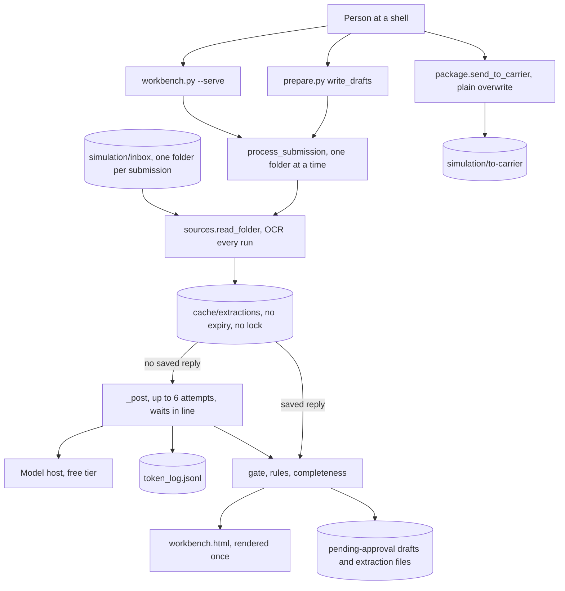
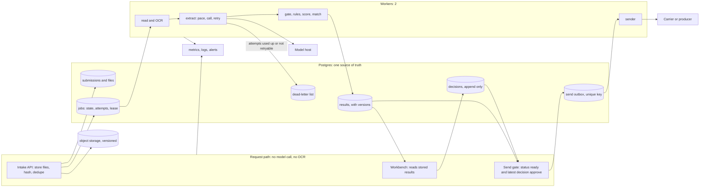
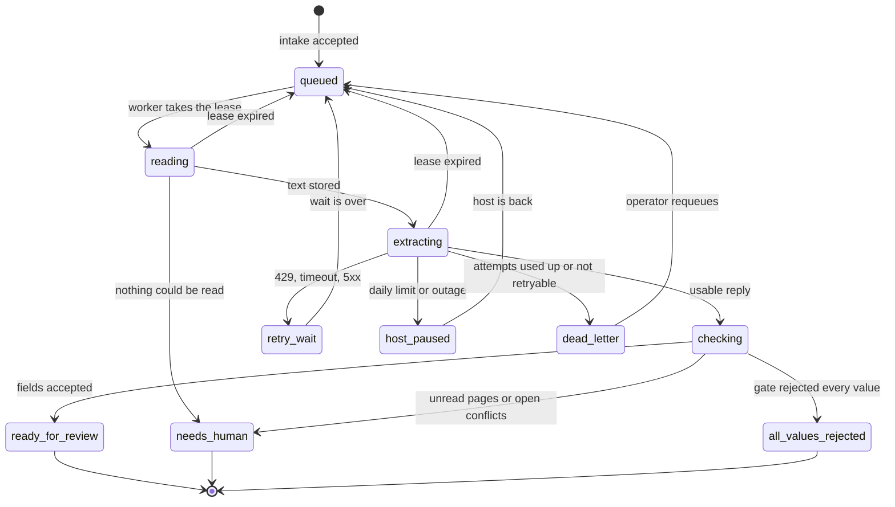
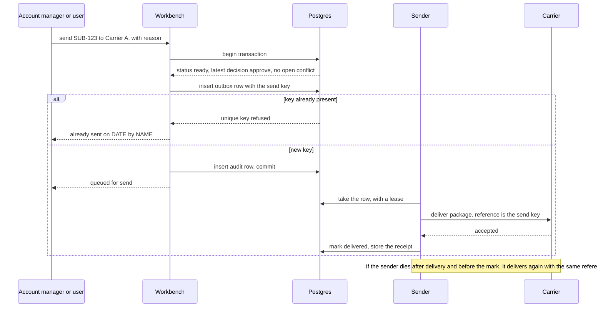

# System design: how it behaves at scale

- Task: T-095, requested by @user on 2026-10-13 ("HOW IT BEHAVES AT SCALE")
- Lead and author: @ml-engineer. Contributors: @pm (section 1.1, section 2.1), @actuary (section 8.3). All three contributor sections are filled (2026-10-13); section 13 lists them. No placeholder block remains.
- Reviewers: @software-engineer, @model-risk, @compliance (@compliance added by the user, D-046: "Add @compliance as a reviewer of system-design.md.")
- Status: **IN_REVIEW**, set by the owner on 2026-10-13 at the closing pass; not approved by anyone. Every section is filled. The criterion that was open is met: the five prices in 8.3 were read on 2026-10-13 from dated captures of the provider's pages saved in `deliverables/architecture/sources/` (D-047). Section 13 says what the lead checked after the contributors wrote and at the closing pass.
- Date: 2026-10-13
- This document is not a production approval, authorizes no send, and proposes no purchase. D-011 stands: no paid API is used. Every cost figure is a projection.
- Synthetic data only. Every file read for this document is synthetic.
- Documentation only. No file under `underwriting_pipeline/` or `simulation/` was changed. No model was called. The lead made no network call. The one exception to "no network call" on this task is the read of the two price pages that D-047 allows, made on 2026-10-13 by @actuary (a fetch that returned no price) and by the orchestrator (a browser capture, saved to `deliverables/architecture/sources/`); 8.3 records both. The tests in section 10 run with the model host stubbed.
- **Code state.** As-is statements describe commit `dd45467` (HEAD on 2026-10-13, 15:13). The draft was written against `d5750fd`. T-070 and T-071 (P-010) were committed in between (`fde95b7` to `dd45467`) and changed four files: `ai/prepare.py`, `ai/eval_holdout.py`, `app/package.py`, `app/workbench.py` (measured: `git diff --stat d5750fd..dd45467 -- underwriting_pipeline simulation`). Every citation of those files was reconciled to `dd45467` at the closing pass (section 13). Where the behavior changed, the text says what it was at `d5750fd` and what it is now.

## 0. How to read this document

- **As-is (code today)** and **Target (production)** are separate blocks in every section. As-is is what the code does at commit `dd45467` (2026-10-13). Target is a design that is **proposed, not decided and not built**, unless a decision id is given.
- **Citations.** `ai/llm_extract.py:375` means `underwriting_pipeline/ai/llm_extract.py`, line 375. `ai/`, `app/`, and `models/` are folders under `underwriting_pipeline/`. I opened each cited file at the draft, and again at the closing pass for the four files that T-070 and T-071 changed; their line numbers are those of `dd45467`.
- **Numbers.** Each number is one of:
  - **measured**: read from a file on disk or produced by a test run this turn; the source is named.
  - **recorded**: a figure another role wrote into a team file; counted as measured from that file, with the file and line. I did not see the raw source.
  - **derived**: arithmetic on measured or assumed numbers; the inputs are named.
  - **assumed**: no file backs it; the reasoning and the role that decides it are given.
- **Test results** are from two runs of the same, unchanged test file, `deliverables/architecture/tests/test_system_design_stubbed.py`; a test named in backticks is a case in it. **Run 1**: `results/stubbed-results.json`, `run_at` 2026-10-13T13:28:54, against the code as it was at `d5750fd`. **Run 2**: `results/stubbed-results-dd45467.json`, `run_at` 2026-10-13T18:30:57, against `dd45467`. Unless a sentence names run 2, a quoted test figure is from run 1. Section 10 puts the two runs side by side; 7 of the 35 cases changed outcome, and 5 of those 7 can no longer run as written. The test file was not edited to make any case pass.
- **Component names, contract ids (C1 to C15), and gap ids (G1 to G29)** are the ones in `deliverables/architecture/architecture.md` (T-094, IN_REVIEW, not final). Where I repeat a claim from it, I checked the code myself and cite the code. Requirement ids (`NFR-###`, `FR-###`) are from `deliverables/pm/requirements.md`.
- **Two limits of the evidence, stated once and holding everywhere:**
  1. The token numbers come from **13 calls** on 2026-10-10, all on small synthetic files (measured: rows 1 to 13 of `underwriting_pipeline/cache/token_log.jsonl`). That is a small sample. The log has grown since the draft: 58 rows at the closing pass (2.2).
  2. The synthetic inbox is far smaller than a real commercial submission: 2.2 files per folder and 327 typed characters per folder on average (measured, section 2). Every figure that depends on document size is therefore given twice: for the synthetic files as measured, and for a real-size file as **assumed**.

## 1. Requirements and SLOs

### 1.1 Requirements list

Contributed by @pm, 2026-10-13. Everything else in section 1 is @ml-engineer's.

- **Source.** Every row is copied from `deliverables/pm/requirements.md` (T-097, DONE; 72 FR and 61 NFR), cited as `req:<line>`. The register is the authority. Where this table and the register differ, the register is right and this table is corrected.
- **What the list is.** @pm's mapping of the sixteen T-095 acceptance criteria (`team/TASKS.md:1255-1270`, the user's bullets, copied) onto register rows. It adds no requirement and sets no target number. Targets are in 1.2.
- **"Must address"** means this document states the as-is and a target for the row. It does not mean the system meets the row.
- **Answer to the lead's expected list.** All 28 ids are confirmed: NFR-001 to NFR-011, NFR-017 to NFR-026, NFR-030, NFR-041, NFR-044, NFR-050, NFR-051, NFR-054, NFR-055. None is removed. Added: 8 NFR rows (NFR-012, NFR-014, NFR-015, NFR-029, NFR-034, NFR-042, NFR-043, NFR-046) and 13 FR rows, because the failure-modes, send, and audit criteria reach them. Total 49 rows (counted from the two tables below).

**As-is (the register's state today, 2026-10-13)**

Non-functional rows:

| ID | Requires, in short | T-095 criterion it serves | State in the register | Source |
|---|---|---|---|---|
| NFR-001 | A target time per submission is set and met | Requirements and SLOs | Not decided. No target number; the number is @user's | `req:204` |
| NFR-002 | A latency budget per stage is set and met | Latency budget | Not decided | `req:205` |
| NFR-003 | One model call per submission; a file that does not fit is listed, not cut | Load model; failure modes | Partial. Text is cut silently at 120,000 characters (G15) | `req:206` |
| NFR-004 | Retries respect the host limits and the configured wait | Capacity; latency | Built. At most 6 posts, `LLM_MAX_WAIT` 60 s default, 120 s per request (code constants) | `req:207` |
| NFR-005 | The design is sized for 300 / 1,000 / 3,000 a month and a peak hour, with a capacity plan | Load model; capacity; scaling plan | Not decided. The register labels the volumes ASSUMED; see 2.1 for what that label means | `req:213` |
| NFR-006 | The model call runs off the request path, behind a queue and workers | Reliability design | Not built (G3) | `req:214` |
| NFR-007 | The cache has an expiry, a size limit, and a lock | Capacity; failure modes (stale cache) | Partial. None of the three exists (G20) | `req:215` |
| NFR-008 | An availability target is set and met | Requirements and SLOs | Not decided | `req:221` |
| NFR-009 | The failure-modes table, with the five columns the user named | Failure modes | Partial. Some cases handled, others are gaps (G14, G19) | `req:222` |
| NFR-010 | Sends are idempotent; a second send does not replace the first | Reliability design | Not built. A second send overwrites (G10) | `req:223` |
| NFR-011 | A failed model call is its own state, never "no data" | Failure modes | Partial. `extraction_failed` is built; `all_values_rejected` is not | `req:224` |
| NFR-012 | 9/10 or better on every scored field before pilot (D-013 item 3) | Requirements and SLOs (accuracy) | Not met. The register holds the baseline with its label; it is not quoted here | `req:230` |
| NFR-014 | Every quoted score carries its label and source file | Any score this document quotes | Partial. No score file prints the label | `req:232` |
| NFR-015 | An accuracy floor for the score, the match, and the request text | Requirements and SLOs (accuracy floor) | Not decided. @user's | `req:233` |
| NFR-017 | LLM settings from the shell only; no key written, printed, or logged | Security | Built | `req:240` |
| NFR-018 | The provider guard refuses a host that is not allowed | Security; failure modes | Built | `req:241` |
| NFR-019 | The guard refuses an unencrypted host that is not this machine | Security | Not built. The guard compares the host name only | `req:242` |
| NFR-020 | Login, roles, and a real underwriter id tied to a session | Security; audit trail | Not built. The mechanism is undefined | `req:243` |
| NFR-021 | An application server with a health check | Reliability; observability | Not built | `req:244` |
| NFR-022 | Synthetic data only | Privacy | Built as a team rule. No code enforces it (G25) | `req:250` |
| NFR-023 | A synthetic flag on every stored record | Privacy | Not built | `req:251` |
| NFR-024 | Only the data needed leaves in a model call | Privacy | Not built. The whole text of every readable file is sent | `req:252` |
| NFR-025 | A retention period and a deletion rule per store | Privacy; backup | Not decided. 7 years is ASSUMED in the register, pending counsel | `req:253` |
| NFR-026 | Access to each store is controlled | Security | Not built | `req:254` |
| NFR-029 | A package is built only after the underwriter approves, with citations kept | Failure modes (can a send happen); reliability | Open. @compliance veto on T-020 | `req:262` |
| NFR-030 | An audit trail of input, model and version, and human decision | Observability (audit trail) | Partial | `req:263` |
| NFR-034 | Every legal-confirmation item is resolved before any real file | Privacy | Open | `req:267` |
| NFR-041 | The decision record can reconstruct what the AI showed and what the human did | Observability (audit trail) | Not built | `req:286` |
| NFR-042 | Nothing in production while a High finding is open | Known gaps and open vetoes | Open. The register reads "6 vetoes on 5 tasks"; see the note below the tables | `req:287` |
| NFR-043 | No auto-decline and no auto-bind, ever | Reliability design (no send by itself) | Built (rule) | `req:293` |
| NFR-044 | A failed or all-rejected file can never be approved or sent, by any actor | Failure modes (can a send happen) | Not built | `req:294` |
| NFR-046 | Needs-review values are acknowledged at approve, and the acknowledgment is logged | Observability (audit trail) | Not built | `req:296` |
| NFR-050 | A README explains how to run the pipeline | Test plan (a test must be runnable by someone else) | Not built | `req:310` |
| NFR-051 | The self-checks run in CI | Test plan | Not built | `req:311` |
| NFR-054 | No paid API; a cost estimate uses public list prices and is labeled an estimate | Capacity; cost model | Built (free-tier or local host; no paid API) | `req:319` |
| NFR-055 | A cost model per submission at the three volumes | Cost model | Not decided. Tokens are measurable from the token log today | `req:320` |

Functional rows the failure-modes, reliability, and observability criteria reach:

| ID | Requires, in short | T-095 criterion it serves | State in the register | Source |
|---|---|---|---|---|
| FR-002 | Intake records arrival and detects a duplicate | Failure modes (duplicate submissions); load model (no arrival time exists) | Not met. No arrival record, no duplicate detection (G1) | `req:54` |
| FR-006 | Every file and page is read or listed for a person | Failure modes (partial files) | Not built (G15). P-016 (c) is approved | `req:63` |
| FR-009 | One file that cannot be opened does not stop the submission | Failure modes (unreadable files) | Not built (G14) | `req:66` |
| FR-026 | A failed or all-rejected file gets no missing-info request | Failure modes | Not built (G21) | `req:98` |
| FR-027 | A saved reply is reused only under a matching key | Failure modes (stale cache) | Built | `req:104` |
| FR-028 | A failed or empty call is never cached | Failure modes | Built | `req:105` |
| FR-029 | An all-rejected reply is kept and is never sendable | Failure modes | Partial. The status does not exist in code (T-070) | `req:106` |
| FR-030 | Every call, failed attempt, retry, and cache hit is in the token log | Observability (logs); cost model | Built | `req:107` |
| FR-031 | Writes are atomic and a killed run is recoverable | Failure modes (crash mid-write) | Built, for the cache and the token log, which is all the row covers | `req:108` |
| FR-051 | A file is sendable only if its latest logged decision is approve | Failure modes (can a send happen) | Not built | `req:148` |
| FR-056 | The send reads the decision log itself | Failure modes; reliability | Open. T-020 veto; not built | `req:158` |
| FR-057 | The send loads the saved status itself and checks the file hash | Failure modes; reliability | Open. T-020 veto; not built | `req:159` |
| FR-059 | Only the account manager or the user sends; no send is silently repeated | Reliability (idempotent send) | Open. T-020 veto; a name check only; a second send overwrites (G10) | `req:161` |

Three places where the register is behind and this document should not copy it without the note. None is corrected this turn; they are @pm's to fix in the register:

1. **NFR-005 and NFR-055 label the volumes ASSUMED and "TBD by @ml-engineer".** The three numbers are the user's (2.1). What is assumed is that they describe the agency's real volume. The register's wording does not make that difference.
2. **NFR-042 reads "6 vetoes on 5 tasks".** @model-risk recorded the T-026 veto as lifted later on 2026-10-13 (`team/DISCUSSION.md:1729`). The register row predates that message. The current list of open vetoes is section 11.2, which is the lead's.
3. **The register's header still reads "Status: IN_REVIEW"** (`req:6`). T-097 is DONE (`team/TASKS.md:1297`).

Added by the lead (@ml-engineer) at the closing pass, 2026-10-13. The tables above are @pm's copy of the register and are left as written. Two things happened after they were written:

- **T-070 and T-071 (P-010) were committed** (`fde95b7` to `dd45467`). The "State in the register" cells of NFR-011, NFR-044, FR-026, FR-029, and FR-057 describe the code before those commits. What the code does now is in 5.1. Whether a register row is met is @pm's to record, after the reviewers of T-071 and the holders of the T-059 and T-020 vetoes have looked; this document does not mark any row met.
- **D-049 decided the accuracy floor.** In the user's words: "Accuracy: D-013 (9/10 every field) is the pilot floor on synthetic data. The production floor is set later on real anonymized files by @head-of-underwriting and @model-risk." NFR-012 is that pilot floor. The NFR-015 cell ("Not decided. @user's") predates D-049; see 1.2.

**Target (stated by the user for this task; no register row yet)**

The user's T-095 criteria name four things that no `FR` or `NFR` row carries (measured: a search of the register for "observab", "alert", "dead-letter", "backup", "disaster", "load test", and "failure injection" on 2026-10-13 found no requirement row). They are criteria for this document today. No id is assigned here, because an id is given only in the register. No number for any of them is decided; the figures in sections 6.4, 7, 9, and 10 are the lead's proposals, each labeled assumed there.

| The user's words | Where | Nearest register row | What no row carries |
|---|---|---|---|
| "Observability: metrics, logs, alerts, audit trail" | `team/TASKS.md:1261` | NFR-030 and NFR-041 (audit trail); FR-030 (token log) | Metrics and alerts |
| "dead-letter handling" | `team/TASKS.md:1260` | NFR-009, NFR-011 | What happens to a file whose retries are used up |
| "Security, privacy, backup and disaster recovery" | `team/TASKS.md:1263` | NFR-017 to NFR-026 (security, privacy); NFR-025 (retention) | Backup, restore, and recovery targets |
| "Test plan for reliability, traffic, latency, failure and cost: load test, failure injection, cost test" | `team/TASKS.md:1264` | NFR-051 (self-checks in CI) | A load test, failure injection, and a cost test as required verifications |

The user gave no requirement for this task outside the sixteen criteria. I did not see the user's chat message; the criteria on the board are recorded as the user's bullets, copied, with none added (`team/TASKS.md:1272`).

### 1.2 SLOs

**As-is (code today)**

- No SLO exists. No decision sets a time per submission, a throughput, or an availability target (measured: `deliverables/pm/requirements.md:204`, `:205`, `:213`, `:221` each read "Not decided").
- Nothing measures any of them. The pipeline has no timer, no metric, and no health check (section 7).
- There is no service to be available. The pipeline is a set of scripts a person runs from a shell: `ai/prepare.py:863-868`, `app/workbench.py:286-291`. The workbench is a page rendered once at start and served on `127.0.0.1` (`app/workbench.py:254-256`, `:283`).
- **Accuracy.** The floor is decided, not assumed (D-049, @user, 2026-10-13, `team/DECISIONS.md:537`): "Accuracy: D-013 (9/10 every field) is the pilot floor on synthetic data. The production floor is set later on real anonymized files by @head-of-underwriting and @model-risk." D-013 item 3 reads: "The target before pilot is 9/10 or better on every field, and a loss-run date is never guessed" (`team/DECISIONS.md:142`). **No production floor exists yet** (D-049, Amends). The register row for a floor on the score, the carrier match, and the request text still reads "Not decided" (`deliverables/pm/requirements.md:233`, NFR-015); D-049 does not name those three, and this document does not read it either way. The current published score and its label are in `deliverables/model-risk/holdout-SUB-077-086.md`; I do not quote it here. No hold-out score exists for the current prompt and gate (`team/DEMO-BLOCKERS.md`, line 9).

**Target (production)**

Every number in this table is **assumed**. None is decided. The last column names who decides.

| SLO | Proposed target | Label and reasoning | Decides |
|---|---|---|---|
| Time per submission, machine part: intake accepted to "ready for review" | p50 60 s, p95 5 min | assumed. The measured parts sum to a few seconds (section 4); the budget leaves room for a queue wait and two retries. A producer does not wait on this, an underwriter does | @ml-engineer proposes; @user and @head-of-underwriting accept |
| Time per submission, human part: workbench open to decision (NFR-001) | not proposed here | assumed nothing. The roadmap defines the metric (`deliverables/pm/roadmap.md:27`) and no baseline has been timed. A target before a baseline is a guess | @user sets the number (register, NFR-001); @head-of-underwriting consulted |
| Workbench page load | p95 2 s, with no model call and no OCR on the request path | assumed. Today the page start does both (section 4) | @software-engineer, with @ml-engineer |
| Throughput | 60 submissions in a peak hour, 300 in a peak day, with no file ending `extraction_failed` because of a rate limit | derived from 2.3 at 3,000 a month: 55 in the peak hour of a peak day and 273 in a peak day, rounded up. The volumes are the user's; the peak-day and peak-hour factors are assumed (2.1). Corrected at the consistency pass: the draft read 30, which is the peak hour of a mean day | @head-of-underwriting confirms the arrival pattern (2.1); @ml-engineer sizes |
| Availability, workbench | 99.5 % of business hours (07:00 to 19:00 Central, Monday to Friday) | assumed. About 1.3 hours down in a 260-hour month. One agency, business-hours use; a higher target needs a second region, which the volume does not justify | @ml-engineer, consulting @software-engineer (decision-rights table); @head-of-underwriting accepts the business effect |
| Availability, pipeline | No accepted submission is ever lost. 99 % reach a final state (ready, needs human, or failed with a reason) within 15 min | assumed. Durability matters more than speed here: a lost file is a lost account | same |
| Model host outage | Files wait in the queue; none is marked "no data"; nothing is sent | decided for the "not no data" and "no send" parts (D-021). The queue is assumed | D-021 stands; @ml-engineer for the queue |
| Recovery | RPO 5 min for decisions and sends, 24 h for the cache. RTO 4 h | assumed (section 9) | @ml-engineer; @compliance for records |
| Accuracy floor | **Pilot: 9/10 or better on every field, on synthetic data (D-013 item 3). Production: none yet.** | decided (D-049): "D-013 (9/10 every field) is the pilot floor on synthetic data. The production floor is set later on real anonymized files by @head-of-underwriting and @model-risk." Not set by this document. The register row NFR-015 (score, match, request text) still reads "Not decided" | Pilot floor: @user (D-013, D-049). Production floor: @head-of-underwriting and @model-risk, later (D-049); @model-risk approves production |
| Cost per submission | Not a target yet | projection only, section 8.3 | @actuary models; @user decides any spend (D-011) |

## 2. Load model

### 2.1 Volumes and peak hour

Contributed by @pm, 2026-10-13. Everything else in section 2 is @ml-engineer's.

**What the user set**

| Item | Value | Label | Source |
|---|---|---|---|
| Monthly volumes to size for | 300, 1,000, and 3,000 submissions per month | set by @user | `team/TASKS.md:1256`: "Load model at 300 / 1,000 / 3,000 submissions per month and a peak hour". The criteria are the user's bullets, copied (`team/TASKS.md:1272`) |
| Peak | "a peak hour" | set by @user as a thing to model; **no number given** | same line |
| Any other load figure | none | — | The user gave no business days, no hours, no peak size, no page count, and no word on which of the three volumes is the pilot |

- The three volumes are **sizing points the user chose**. They are not measured and they are not a forecast. No file in the repo records how many submissions Sanger & Altgelt receives (searched `team/DECISIONS.md`, `team/RISKS.md`, `deliverables/pm/roadmap.md`, and the @senior-underwriter, @head-of-underwriting, and @actuary deliverables for a per-day, per-week, or per-month count on 2026-10-13; none found).
- That is how the register's label reads with the task text: the numbers are the user's; that any of them is the agency's real volume is assumed (`deliverables/pm/requirements.md:213`, `:320`). The agency's real volume, and which point is the pilot, is for @head-of-underwriting to give and @user to accept.
- **The peak hour has no number from anyone.** I do not set one: it is not a priority, scope, or timeline call. @ml-engineer sizes for it (decision rights: deployment and infra) from an arrival pattern that @head-of-underwriting confirms; @user has the last word.

**As-is (what is recorded or measurable today)**

| Item | Value | Label | Source |
|---|---|---|---|
| Arrival times of submissions | none exist | measured (absence) | Nothing records when a submission arrived (FR-002, `deliverables/pm/requirements.md:54`). The 86 inbox folders are synthetic test files, not a month of intake, so no peak can be measured from them |
| Business days, desk hours, peak day, peak hour | not recorded in any team file or deliverable | measured (absence) | same search as above |
| Pages per real submission | not recorded | measured (absence) | `deliverables/senior-underwriter/current-workflow.md:12-13` names the documents (ACORD 125, 126, 140, five-year loss runs, a schedule of values when there is more than one location, sometimes a brochure) and gives no page count. No real file may be read to count one (synthetic data only) |
| What one submission is, in code | one inbox folder | measured in code | section 5.1, F14 |
| Duplicate submissions happen at the desk | named as a pain, no rate | recorded | `deliverables/senior-underwriter/current-workflow.md:12` |
| Share of submissions that need a producer round | no rate. "First submission often has 3-year runs" | recorded | `deliverables/senior-underwriter/current-workflow.md:13`. Its times and remarks are "typical file times, not a time study" (`:6`) |

**Target (working inputs for sizing): every row is assumed**

None of these is decided and none is a requirement. Each is the value the tables in 2.3 already use, kept so that nothing changes without a reason, with the reasoning and the role that confirms it. A confirmed value replaces the row.

| Input | Value | Reasoning | Confirms |
|---|---|---|---|
| Business days per month | 22 | assumed. 2026 has 261 weekdays (derived from the calendar), 21.75 a month, rounded up. No holiday is taken out because the agency's holiday calendar is not recorded. Fewer days means more per day: at 21 days the mean day is 14.3 / 47.6 / 142.9, at 20 days 15.0 / 50.0 / 150.0 (derived), which is 5 % and 10 % above the figures in 2.3 | @head-of-underwriting |
| Desk hours per day | 8 | assumed. An ordinary office day, Monday to Friday. No file gives the agency's hours. This is when people open the workbench; producers can send mail at any hour. The 07:00 to 19:00 window in 1.2 is the lead's availability assumption and is a different thing | @head-of-underwriting |
| Peak day | 2 × the mean day | assumed; the lead's working figure, kept. Reason given: renewal dates cluster at month end. No file measures it | @head-of-underwriting, consulting @senior-underwriter |
| Peak hour | 20 % of its day | assumed; the lead's working figure, kept. It is 1.6 × an even hour of an 8-hour desk day (derived: 20 / 12.5). A reason it could be the first hour: mail sent after the desk closed is all waiting at the start of the next day. No file measures it | @ml-engineer proposes; @head-of-underwriting confirms the pattern |
| What counts as one submission | one new account file with one submission id: new business, or a renewal that is marketed again | assumed. It matches the user's unit ("submissions") and the code's (one folder), and FR-001 (`deliverables/pm/requirements.md:53`) | @head-of-underwriting |
| A producer reply or a corrected resubmission | **not** a new submission in the monthly count, but it is processed again | assumed. FR-018 treats a producer reply as a later document on the same file (`deliverables/pm/requirements.md:85`). A changed file set is a new cache key (2.2), so each such round is one more model call. Model calls a month are therefore above the submission count by a factor nobody has recorded. I give no number for it | @senior-underwriter gives the share of files that need a round; @ml-engineer carries the factor |
| An exact duplicate | not a new submission | assumed. Same files, same cache key, no model call (5.1, F14) | — |
| Pages per real submission | 20, as in 2.2 | assumed; the lead's figure, kept. I have no better one and no file to count from | @senior-underwriter, from desk practice. It will be an estimate until a decision permits reading real files (NFR-034) |
| Share of pages that are scans | 30 %, as in 2.2 | assumed; the lead's figure, kept | @senior-underwriter |

For the lead: I changed none of your working values, so 2.3, 3.1, and 8.2 need no recompute on my account. The two things I add are the sensitivity to business days above and the reprocessing factor, which has no number.

### 2.2 What one submission is

**As-is (measured this turn)**

| Quantity | Value | Label | Source |
|---|---|---|---|
| Submission folders in the inbox | 86 | measured | `simulation/inbox/`, counted this turn |
| Files per submission | min 1, median 2, mean 2.2, p95 5, max 7 (189 files) | measured | same; file count per folder |
| File types | 124 `.md`, 20 `.pdf`, 16 `.csv`, 12 `.jpg`, 11 `.xlsx`, 6 `.png` | measured | same; every type is one the reader handles (`ai/sources.py:190-199`) |
| Pages per PDF | 1, in all 20 | measured | `pdfplumber` page count, this turn |
| Pages per submission, counting one page per non-PDF file | min 1, median 2, mean 2.2, p95 5, max 7 | measured for PDFs; the one-page-per-file rule is assumed | same |
| Folders with a scanned image | 18 of 86 | measured | same |
| Typed characters per submission (`.md` and `.csv` only) | median 263, mean 327, p95 929, max 1,835 | measured | same |
| Bytes per submission | median 1,173, mean 11,315, max 69,018 (inbox total 973,129) | measured | same |
| Model calls per submission | 1 when any file has readable text, 0 otherwise | measured in code | `ai/prepare.py:530-535`; `ai/llm_extract.py:13`, `:430-438` |
| Tokens per call, total | min 1,367, median 1,560, mean 1,612, p95 1,949, max 2,105 (n = 13) | measured | `underwriting_pipeline/cache/token_log.jsonl`; test `tokens_per_submission_and_daily_headroom_from_the_real_token_log` |
| Prompt tokens per call | median 622, mean 643, max 717 | measured | same |
| Completion tokens per call | median 885, mean 969, max 1,483 | measured | same |
| Reasoning tokens inside the completion | median 554, mean 630, max 1,166 | measured | `usage.completion_tokens_details` in the 13 files of `underwriting_pipeline/cache/extractions/` |
| Files per logged call | median 2, mean 1.7, max 3 | measured | token log, `files` |
| Model in all 13 rows | `openai/gpt-oss-120b` | measured | token log, `model` |
| Failed attempts and retries per call | **not recorded**: the 13 rows were written before P-012 and carry no `attempts` and no event rows | measured (absence) | token log; `ai/llm_extract.py:363-370` writes them from now on |

What the token numbers show: the smallest prompt is 602 tokens for a one-file scan (measured, token log row 8), so about 600 of the 643 prompt tokens are the fixed instructions (`ai/llm_extract.py:33-46`) and only about 40 are document text (derived). The completion is two thirds reasoning tokens (derived: 630 of 969). **On these files the cost of a call is almost all fixed overhead and model reasoning, not document reading.** That will not hold for real files.

Added at the closing pass, 2026-10-13. **The token log has grown and the figures above were not re-derived.** They are rows 1 to 13 (2026-10-10T20:34:52 to 21:15:22; 20,950 tokens). The log now holds 58 rows (measured, run 2 and my own read): rows 14 to 58 are dated 2026-10-13, 14:26:40 to 14:30:23, written by another role's run after run 1; 15 are call rows (25,128 tokens) and 30 are `cache_hit` rows. Over all 28 call rows the means are 640 prompt, 1,006 completion, 1,646 total, and 670 reasoning tokens (measured, run 2), against 643, 969, 1,612, and 630 over the first 13: the total is 2.1 % higher (derived). That is inside every sensitivity in 8.3, so no table in sections 2, 3, or 8 was changed. The new call rows carry `attempts`, `host`, `key`, and `run`; none records a failed attempt. Because the log is no longer 13 rows, the case `tokens_per_submission_and_daily_headroom_from_the_real_token_log`, which asserts 13, **fails in run 2** (10.2).

**Target (production): a real-size submission, assumed**

| Quantity | Value | Label and reasoning | Decides |
|---|---|---|---|
| Pages per submission | 20 | assumed. An ACORD 125 and 140, five years of loss runs, a schedule, and an email. No file in the repo measures a real submission | @senior-underwriter confirms, from desk practice (2.1) |
| Characters per page | 3,000 | assumed. A dense form page | @ai-engineer-assistant can measure on a synthetic ACORD |
| Characters per token | 4 | assumed; the code's own estimate (`ai/llm_extract.py:386`) | — |
| Document tokens per submission | 15,000 | derived: 20 × 3,000 / 4 | — |
| Fixed prompt overhead | 600 | measured (above) | — |
| Completion tokens | 969 | measured mean; assumed not to grow with pages because the reply is nine fields (`ai/llm_extract.py:44-45`). **Untested**, as @actuary notes in 8.3: 630 of the 969 are reasoning tokens (65 %, measured), which may grow with a longer document, and the 13 logged prompts span only 602 to 717 tokens, so the log cannot show it either way. At 3 × the output a real-size submission is about 18,500 tokens (derived: 15,000 + 600 + 2,907), 11 % above the row below | measured on a real-size synthetic file (10.3, PT3) |
| **Tokens per real-size submission** | **about 16,600** | derived: 15,000 + 600 + 969, rounded | — |
| Largest text the code sends | 120,000 characters, about 30,000 tokens, about 40 pages at 3,000 characters | measured in code (`ai/llm_extract.py:436`); the page figure is derived. Text past it is cut with no notice (G15; section 5) | — |
| Share of pages that are scans and need OCR | 30 % | assumed. 18 of 86 synthetic folders hold a scan (21 %, measured); real producers send more | @senior-underwriter (2.1) |
| Retry overhead on tokens | 10 % | assumed. A reply that is not usable is paid for and called again (test `a_bad_reply_fails_is_not_cached_is_called_again_and_its_tokens_are_logged`: 2,940 tokens for one good result). No rate is recorded | — |
| Cache hit rate in production | 0 % | assumed. The cache key holds the file bytes (`ai/llm_extract.py:70`), so only an exact duplicate hits. It saves tokens on reruns and evals, not on new business | — |

### 2.3 Load at each volume

Working assumptions, all **assumed**: 22 business days a month; a peak day is 2 × the mean day (renewal dates cluster at month end); a peak hour holds 20 % of its day. Section 2.1 gives the reasoning for each and names who confirms it. @pm kept all three values, so this table is the draft's, recomputed at the consistency pass with no cell changed.

| | 300 / month | 1,000 / month | 3,000 / month | Label |
|---|---|---|---|---|
| Mean day | 13.6 | 45.5 | 136.4 | derived: volume / 22 |
| Peak day | 27 | 91 | 273 | derived: 2 × mean day |
| Peak hour on a mean day | 2.7 | 9.1 | 27.3 | derived: 20 % of the mean day |
| Peak hour on a peak day | 5.5 | 18 | 55 | derived |
| Pages a month, synthetic size (2.2) | 660 | 2,200 | 6,600 | derived from measured 2.2 |
| Pages a month, real size (20) | 6,000 | 20,000 | 60,000 | derived from assumed 20 |
| Tokens a month, synthetic size (1,612) | 483,462 | 1,611,538 | 4,834,615 | derived from measured mean; test `tokens_per_submission_...` |
| Tokens a mean day, synthetic size | 21,976 | 73,252 | 219,755 | derived, same test |
| Tokens a month, real size (16,600) | 4.98 million | 16.6 million | 49.8 million | derived from assumed |
| Tokens a mean day, real size | 226,000 | 755,000 | 2.26 million | derived |
| Tokens in a peak hour on a peak day, real size | 91,000 | 299,000 | 913,000 | derived: peak-hour count × 16,600 |

Two things from 2.1 that this table does not carry:

- **Business days.** At 21 days every per-day and per-hour row is 5 % higher; at 20 days, 10 % (derived in 2.1).
- **Producer rounds.** The rows count submissions. A producer reply or a corrected resubmission is one more model call on the same file (2.1), so the token rows are low by a factor (1 + g), where g is the share of files processed a second time. **No rate for g is recorded.** At g = 0.5, an illustration and not an estimate (the value 8.3 also uses), every token row is 1.5 × the figure shown.

## 3. Capacity and bottlenecks

### 3.1 The model host's limits

**As-is: today's Groq free-tier limits**

| Limit | Value | Label | Source |
|---|---|---|---|
| Tokens per minute | 8,000 | recorded | `team/TASKS.md:715` ("The host allows 8,000 tokens a minute, 200,000 tokens a day, and 1,000 requests a day") |
| Tokens per day | 200,000 | recorded, twice | `team/TASKS.md:715`; `team/DECISIONS.md:228` ("HTTP 429, tokens per day: limit 200,000, used 198,304", on 2026-10-10) |
| Requests per day | 1,000 | recorded | `team/TASKS.md:715` |
| Requests per minute | not recorded anywhere in the repo | — | searched `team/` and `deliverables/` this turn |
| Largest single request the host accepts | not recorded | — | same |
| Tokens used in the 24 hours of 2026-10-10 by the 13 logged calls | 20,950 | measured | token log, sum of `total_tokens` |

Caveats. The raw 429 body and the rate-limit headers were not saved to any file; the figures above are another role's note of them. The limits are for model `openai/gpt-oss-120b` on the account in use on 2026-10-10 and can change without notice. I made no call to check them (no network call this turn). The shape of the per-minute limit (a refilling bucket) is **assumed** in the tests; the code assumes the same (`ai/llm_extract.py:345-346`).

**As-is: what those limits allow**

| Bound | Synthetic size (1,612 tokens) | Real size (16,600 tokens, assumed) | Label |
|---|---|---|---|
| Submissions per day under 200,000 tokens | 124 | 12 | derived; the first is also the result of test `one_day_of_150_submissions_against_the_recorded_daily_limit` (124 complete, 26 `extraction_failed`) |
| Submissions per hour under 8,000 tokens a minute, steady | 298 | 0: one request is twice the per-minute limit | derived: 8,000 / 1,612 × 60. Test `peak_hour_60_submissions_against_the_recorded_per_minute_limit` gives 319 an hour for the first 60, with 56 paced waits, the longest 10 s, and no 429 (bucket shape assumed) |
| Submissions per day under 1,000 requests | 1,000 | 1,000 | recorded limit; not the binding one |
| Monthly ceiling if every day is used evenly over 22 days | 2,728 | 264 | derived |

Reading it against section 2.3:

- **The daily token limit is the binding limit, not the per-minute limit.** At synthetic size a mean day uses 11 % of it at 300 a month, 37 % at 1,000, and 110 % at 3,000 (derived; same test). A peak day at 1,000 a month uses 73 %; at 3,000, 220 %.
- **At real size the free tier does not work at any of the three volumes.** A mean day at 300 a month needs 226,000 tokens against 200,000 (derived). And a single 16,600-token request is over the 8,000-token minute. What the host does with such a request is not recorded; the code would send it anyway, because the pacing caps its own estimate at the limit (`ai/llm_extract.py:347`).
- This is consistent with D-038 item 5, where the user labels the free tier "development only" (`team/DECISIONS.md:420`).
- **One shared budget.** Evals and the pipeline use the same key and the same daily limit. A scored run on the same day takes capacity from live files (recorded: `team/TASKS.md:1221`, "do not start it on a day another run has used the budget"). Nothing in code reserves or splits the budget: `budget()` reports and does not stop anything (`ai/llm_extract.py:145-165`).

**Target: enterprise quotas (assumed)**

I could not verify any provider's current paid quota without a network call, so I state what is **required** and assume a paid tier meets it.

| | 300 / month | 1,000 / month | 3,000 / month | Label |
|---|---|---|---|---|
| Tokens per day required, peak day, real size, plus 10 % retries | 0.5 million | 1.7 million | 5.0 million | derived: peak day × 16,600 × 1.1 |
| Tokens per minute required, peak hour of a peak day, with arrivals 4 × burstier than even | 6,700 | 22,000 | 67,000 | derived: peak-hour tokens × 1.1 / 60 × 4. The factor 4 is assumed |
| Largest single request | 30,000 tokens | 30,000 | 30,000 | derived from the 120,000-character cap |
| Requests per minute required | under 5 | under 5 | under 5 | derived: 55 an hour × 4 / 60 |

- **Assumed:** a paid tier of a hosted-model provider gives at least 100,000 tokens a minute and no daily token cap of this size. That is from my own knowledge of typical published paid tiers, not from a file and not checked today. It must be read from the provider's quota page and contract before anyone relies on it. The price basis the user named for the estimate is Gemini Flash/Pro on Vertex AI and Document AI layout (D-038 item 5); their quotas are likewise not verified here.
- **Not in the table: producer rounds and reasoning growth.** Each row scales by (1 + g) (2.3). At the illustrative g = 0.5 the 3,000 column is about 7.5 million tokens a day and about 100,000 a minute (derived: 4.98 million × 1.5; 67,000 × 1.5), which uses the whole of the 100,000 a minute assumed above. Output at 3 × (2.2) adds another 11 %. So the quota to ask for is set after g is known, not from this table alone.
- A different host or model is a model change. It needs `approve change P-###` from @user (D-017) and its own validation by @model-risk. Capacity does not decide it.

### 3.2 Bottlenecks other than the host

**As-is (code today)**

| # | Bottleneck | Evidence | Label |
|---|---|---|---|
| B1 | One process, one submission at a time. No queue, no worker, no parallelism | `ai/prepare.py:732-733` loops over folders; `app/workbench.py:85-86` does the same | measured in code |
| B2 | The workbench processes the **whole inbox** before it serves the first page, model calls included | `app/workbench.py:254-255`, `:80-86`. Test `opening_the_workbench_makes_no_model_call` (target, fails in both runs): 20 model calls for a queue of 20 | measured |
| B3 | With a cold cache, one workbench start over today's 86 folders is 86 calls and about 138,600 tokens: 69 % of the daily limit | derived: 86 × 1,612 / 200,000. All 86 folders have readable text (measured: 0 files marked needs human, test `local_stage_times_on_the_86_inbox_folders`). The cache is cold today for all 13 saved replies (reported, not measured again: `deliverables/architecture/architecture.md`, 2.4.3) | derived |
| B4 | OCR runs again on every run. Only the model reply is cached; the reader runs before the cache lookup because the key needs the text | `ai/prepare.py:513`; `ai/llm_extract.py:70`, `:443-447` | measured in code |
| B5 | With a warm cache, a workbench start over 86 folders still takes about 26 s on this machine, nearly all OCR on 18 folders | measured, run 1: the latency test took 26.29 s; image folders p50 1.36 s, typed folders p50 0.9 ms. Run 2, same machine: image folders p50 1.78 s, typed 0.4 ms. The spread between two runs is about 30 % on OCR; figures derived from 1.36 s elsewhere were not re-derived | measured, one machine, two runs |
| B6 | The inbox is never archived, so B5 grows with every file ever received. After one month at 3,000 it would be about 15 min per start | derived: 3,000 × 21 % × 1.43 s. Same file mix assumed | derived |
| B7 | During a host outage each file costs 6 posts and 31 s of waiting, in line. A queue of 20 holds the page for 620 s and makes 120 posts | test `opening_the_workbench_makes_no_model_call` (simulated clock) | measured with a stub |
| B8 | Two runs on the same new file both call the model, and the temp-file name holds only the process id | `ai/llm_extract.py:445-487`, `:482`. Test `four_workers_on_the_same_new_file_call_the_model_once` (target, fails in both runs): 4 calls for one file; 3 of 4 threads stopped with `FileNotFoundError` in run 1, 2 of 4 in run 2 (a race, so the count varies) | measured, threads in one process; separate processes not tested |
| B9 | The token log is read in full for every budget report | `ai/llm_extract.py:106-124`, `:145-153`. 600 rows are 180,600 bytes (test `load_300_...`), so about 300 bytes a row; a year at 3,000 a month, one row per submission, is about 11 MB | derived |
| B10 | `pdftoppm` is not installed here, so a scanned PDF is never read on this machine | measured: `which pdftoppm`, this turn; `ai/sources.py:144-160` (G16) | measured |

Local work is not a bottleneck: reading a typed folder and running every gate and rule takes single milliseconds (section 4).

**Target (production)**

- B1, B2, B7: the model call moves off the request path, behind a queue and workers (section 6, NFR-006). The workbench reads stored results only.
- B3, B6: a submission is processed once, at intake, and its result is stored. Opening the page costs no tokens and no OCR.
- B4: the text read from each file is stored with the file hash, so OCR runs once per file.
- B8: one job per submission, taken by one worker under a lock (section 6).
- B9: token rows go to a table with an index on time; the file stays as the development log.
- Worker count: a real-size file is assumed to take about 15 s end to end (section 4), so one worker clears about 240 an hour (derived) against a peak of 55 (2.3). **Two workers** are enough at all three volumes, and the second is there for availability, not speed. More workers than the host quota allows only produce 429s.

## 4. Latency budget per stage

**As-is (code today)**

Nothing in the code times a stage. These are measured from files on disk and from this turn's stubbed run, on one laptop, one run each.

| Stage | Code | Measured | Source |
|---|---|---|---|
| Intake record | `app/intake.py:13-31` | not measured; a hash per file. It is not on the path: nothing calls it (G1) | — |
| Read a folder, typed files only | `ai/sources.py:184-208` | p50 0.9 ms, p95 9.5 ms, max 50 ms (n = 48 folders) | test `local_stage_times_on_the_86_inbox_folders` |
| Read a folder with a typed PDF | `ai/sources.py:136-143` | p50 6.7 ms, p95 33 ms, max 71 ms (n = 20) | same |
| Read a folder with a scanned image (OCR, one image each) | `ai/sources.py:93-133` | p50 1.36 s, p95 2.15 s, max 2.41 s (n = 18) | same |
| Read a scanned PDF | `ai/sources.py:144-158` | not measurable here: `pdftoppm` is missing | G16 |
| Pacing wait before the call | `ai/llm_extract.py:338-349`, `:386` | 0 for a single file. Under sustained load at the recorded limit: 11.3 s per submission on average, longest wait 10 s | test `peak_hour_60_...` (simulated clock, assumed bucket) |
| Model call, as the host reports it: queue | — | p50 0.17 s, p95 0.24 s, max 0.88 s (n = 13) | `usage.queue_time` in `underwriting_pipeline/cache/extractions/*.json` |
| Model call: prompt | — | p50 0.035 s, max 0.18 s | `usage.prompt_time`, same files |
| Model call: completion | — | p50 1.86 s, p95 2.59 s, max 3.12 s | `usage.completion_time` |
| Model call: total at the host | `ai/llm_extract.py:373-390` | p50 1.89 s, p95 2.62 s, max 3.14 s, mean 2.08 s | `usage.total_time`. Network time to and from the host is **not recorded** |
| Gate, rules, completeness, request text | `ai/llm_extract.py:488-511`; `ai/prepare.py:544-631` | p50 1.2 ms, p95 4.4 ms, max 37 ms (n = 86) | same latency test, with a stub reply |
| Whole submission with a saved reply (typed, two files) | `ai/prepare.py:512-631` | p50 1.1 ms, p95 2.8 ms (n = 300) | test `load_300_submissions_...`, warm pass |
| Whole submission, first time, model time excluded | same | p50 1.7 ms, p95 8.3 ms (n = 300) | same test, cold pass |
| Score and carrier match | `models/points.py:9-31`; `app/workbench.py:38-66` | not measured separately; pure arithmetic on nine fields | — |
| Decision write | `app/workbench.py:148-150` | Run 1 (`d5750fd`): 2,000 rows from 8 threads, none lost or broken, with 2,000 token-log rows, in 0.21 s. **Not measured at `dd45467`**: an approve now reads the saved run first (`app/workbench.py:131-137`), the test's approve rows name files with no saved run, every one is refused, and the case errors in run 2 | test `eight_threads_appending_...` |

Worst cases, from the constants in the code:

| Case | Time | Label | Source |
|---|---|---|---|
| Six timeouts in a row | 751 s: 6 × 120 s timeout + 31 s of waits | derived from constants | `ai/llm_extract.py:375`, `:388`, `:413-415`; test `six_timeouts_fail_after_31_seconds_of_waits` (waits 1, 2, 4, 8, 16 s) |
| Six 429s with no `Retry-After` | 31 s of waits | measured with a stub | test `six_429s_give_extraction_failed_and_nothing_cached` |
| Six 429s with `Retry-After: 3600` (the daily limit) | 300 s of waits, then `extraction_failed` | measured with a stub | `ai/llm_extract.py:31`, `:398-403`; test `retry_after_one_hour_is_cut_to_max_wait_then_fails` |
| HTTP 400, sent again without `response_format`, each with six attempts | up to 12 posts for one submission | derived | `ai/llm_extract.py:464-471`; test `an_http_400_is_answered_with_one_more_post_and_one_usage_row` |

So today: a typed file with a healthy host is about 2 s, all of it the model (derived: 2.08 s + milliseconds). A scan adds about 1.4 s per image. The underwriter does not see either figure: they see the page-start time, which is the sum over the whole inbox (section 3.2, B2 to B7).

**Target (production)**

Budget for the machine part, intake accepted to ready for review. All **assumed**; the p95 column adds up to the 5-minute SLO in 1.2.

| Stage | p50 budget | p95 budget | Reasoning |
|---|---|---|---|
| Intake: store files, hash, duplicate check, enqueue | 1 s | 3 s | assumed. One upload and one insert |
| Queue wait | 2 s | 60 s | assumed. Two workers against a peak of 55 an hour (section 3.2) |
| Read and OCR | 10 s | 60 s | derived, then rounded: 6 scanned pages (30 % of 20) × 1.36 s p50 is 8 s; × 2.15 s p95 is 13 s; a fully scanned 40-page file is about 90 s and is the tail |
| Pacing and model call | 5 s | 30 s | assumed. Measured 2.08 s for 643 prompt tokens; a 15,600-token prompt is assumed to add under 3 s of prompt time |
| Retries | 0 s | 120 s | assumed. Two retries with backoff. Past that the job is rescheduled, not held (section 6) |
| Gate, rules, score, match | 0.1 s | 1 s | measured in milliseconds above |
| Store the result and the audit rows | 0.2 s | 2 s | assumed. One transaction |
| **Total** | **about 20 s** | **about 4.6 min** | derived |
| Workbench page load, separately | 0.3 s | 2 s | assumed. A read of stored rows; no model, no OCR |

A file that cannot finish inside the budget is not an error to hide: it stays "processing" on the queue page with its age, and past 15 min it alerts (section 7).

## 5. Failure modes

A "send" today is a file written into `simulation/to-carrier/` or `simulation/to-producer/`. No email and no carrier API exists in `underwriting_pipeline/` (measured: the only network call in the pipeline is the model call, `ai/llm_extract.py:388`; `grep` for other clients this turn found none).

### 5.1 As-is (code today)

**What changed since the draft (P-010: T-070 and T-071, commits `fde95b7` to `dd45467`).** The draft said of `d5750fd`: "No failure in this table blocks a carrier send by itself", because `package.send_to_carrier` checked the extraction status only when the caller passed the report. Run 1 showed it: the package of a file whose extraction failed was written (test `a_failed_file_is_refused_when_the_caller_leaves_the_report_out`, target, failed). That is no longer what the code does:

- **The carrier send reads the saved status itself.** `send_to_carrier` takes no report (`app/package.py:82-88`). Its first act is to read the last saved run (`app/package.py:90`; `ai/prepare.py:658-683`), and it refuses a file whose saved status is `extraction_failed` or `all_values_rejected` before it looks at the actor, so for every actor, the user included (`app/package.py:91-93`; `ai/prepare.py:25`). It fails closed: no saved run, a saved hash that does not match, or a status outside the closed set is a refusal (`ai/prepare.py:668-682`). The same test **passes in run 2**.
- **The producer approve and the workbench approve do the same.** `approve` reads the saved run and refuses both statuses for every actor (`ai/prepare.py:783-786`). A workbench approve is refused for both statuses and for a file with no readable saved run (`app/workbench.py:131-137`), and a refused card offers no approve option (`app/workbench.py:222-223`).
- **`all_values_rejected` exists as its own status** (D-024; `ai/prepare.py:540-543`, `:613-614`). D-048 (2026-10-13) sets how a file leaves it: "all_values_rejected exits: re-extract → extracted; underwriter enters values with a page reference, marked human-entered and logged → normal flow; or close as withdrawn. Never sendable directly." Never sendable is what the code does. The three exits are not built as code paths: the closed status set has no "withdrawn" and nothing records a human-entered value (`ai/prepare.py:28`; read in code). D-048 approves no code change.
- **A failed or all-rejected file gets no missing-info draft, and an old draft is removed** (`ai/prepare.py:620-623`, `:738-742`; test `a_failed_file_gets_no_missing_info_draft`, passes in both runs).
- **The eval harness counts a call-failed file apart**, out of the denominator (`ai/eval_holdout.py:134`, `:145`, `:155-157`, `:169`). Read in code; no published score was rerun or rewritten for this document.

What the send still does not do at `dd45467`:

- **No send reads the decision log.** `app/package.py` imports only `prepare` and opens no decision file (`app/package.py:15-21`, `:82-112`; read in code). Run 1: test `a_send_with_no_logged_underwriter_approve_is_refused` (target) **failed**: sent with no decision in any log. Run 2: the case **errors** before it tests anything, because it passes the removed `report=` argument; so there is no test result for this at `dd45467`, only the reading of the code. Demo blocker line 2 (T-079, TODO).
- **For the actor `user`, every block other than the two refused statuses is an override.** An unread page, an open conflict, an incomplete file, and a file out of appetite stop the account manager only (`app/package.py:97-102`, `:68-78`). That is D-017 (the user can override). The actor is still a word the caller supplies (`app/package.py:33-34`, `:94-96`). Demo blocker line 7.
- **The gate reads the last run that `write_drafts` saved, not the files.** Only `write_drafts` saves a run (`ai/prepare.py:758-762`). The workbench's own pass over the inbox saves nothing (`app/workbench.py:85-86`, `:254-256`). The saved hash covers the saved payload, and the payload holds no hash of the inbox files (`ai/prepare.py:649-655`, `:691-720`). So a failure in a later run that saved nothing, or a file changed after the save, is not in what the gate reads. Read in code; not tested.
- **The account manager's producer approve still applies "complete".** `approve` calls `agency_problem` for the account manager (`ai/prepare.py:795-800`), which returns "the file is not complete" (`app/package.py:75-76`); a producer request exists only for an incomplete file. D-050 (2026-10-13) corrects the rule: "D-017 item 3 correction: "complete" applies to carrier sends only. The account manager approves a producer request when it lists only truly missing items, the file is not extraction_failed or all_values_rejected, and it contains no decline language." The code does not yet follow D-050; the build is T-098 (TODO). Carrier sends are unchanged by D-050.
- What also holds: no AI role name can send or approve (`app/package.py:94-96`; `ai/prepare.py:787-789`; test `no_ai_role_can_send_or_approve`, passes in both runs, 10 refusals of 10). The case `a_failed_file_is_refused_for_the_user_and_the_account_manager_when_the_report_is_passed` passed in run 1 and **errors in run 2** (`report=` is gone); what it checked is now the stricter rule in the first bullet.
- No code sends anything by itself. Every send is a person's call.

**The "Send possible?" column, at `dd45467`.** Three answers are used:

- **No (saved status)**: the file ends `extraction_failed` or `all_values_rejected`. Once `write_drafts` has saved that run, a carrier send, a producer approve, and a workbench approve are refused for every actor. The limit is the third bullet above: the gate knows the last saved run only.
- **User only**: the account manager is refused by the agency rules (`app/package.py:68-78`); the user's override goes through (D-017), with no logged approve needed.
- **Yes**: nothing in the failure stops either actor.

Where a run stops before anything is saved, the gate reads the earlier saved run, or refuses if there is none.

| # | Failure | Detection | Retry and backoff | Idempotency | What the underwriter sees | Send possible? | Evidence |
|---|---|---|---|---|---|---|---|
| F1 | LLM 429, per-minute limit | HTTP 429; body without "(TPD)" or "(RPD)" is labeled "per minute" (`ai/llm_extract.py:393-394`). One row per attempt in the token log (`:402`, `:363-370`) | Up to 6 posts. Wait is `Retry-After` + 1 s if the header is there, else 1, 2, 4, 8, 16 s; never more than `LLM_MAX_WAIT`, default 60 s (`:375`, `:398-403`, `:31`). Before each post the call is paced to the host's last reported budget (`:338-349`, `:386`) | Nothing is saved for a failed call (`:473-480`), so a rerun calls again | After 6: "Extraction: FAILED — ... No field was read. This is not a missing-data file. Sends are blocked." (`app/workbench.py:195-196`). The card shows no score line, no carrier-match line, and no approve option (`app/workbench.py:205-209`, `:222-223`); at `d5750fd` it showed "Score: 0 · none" | No (saved status) | tests `six_429s_...` (6 posts, waits 1, 2, 4, 8, 16), `peak_hour_60_...` (pacing prevents every 429 in the stub) |
| F2 | LLM 429, daily limit | Same; body has "(TPD)" (`:394`) | Same loop. The host asks for a wait of up to hours; the code waits 60 s five times and fails (300 s spent per file) | Same | Same. Every later file that day fails the same way after its own 300 s | No (saved status) | tests `retry_after_one_hour_...`, `one_day_of_150_...` (26 of 150 failed; 156 refused posts) |
| F3 | LLM timeout | 120 s socket timeout (`:388`); row with event `timeout` (`:411-413`) | Up to 6 posts, waits 1, 2, 4, 8, 16 s (`:413-415`). Worst case 751 s | Same. A request the host finished after we stopped listening is paid for and not used | Same as F1 | No (saved status) | tests `two_timeouts_then_a_reply_...`, `six_timeouts_...` |
| F4 | LLM bad reply: not JSON, empty, or no value and no conflict | Parse and content check (`:473-476`); row with event `reply_not_usable` (`:478`). The tokens are logged as spent (`:472`) | **None inside the run.** The next run calls again | Not saved; the same bad reply is not replayed | Same as F1 | No (saved status) | test `a_bad_reply_fails_is_not_cached_...` (2 failures, then complete; 2,940 tokens for one result) |
| F5 | Reply usable, every value rejected by the gate | `ai/prepare.py:540-543`; status `all_values_rejected` (`:613-614`), built in T-070 (D-024). At `d5750fd` it was shown as `extraction_failed` | None. The reply **is** saved before the gate runs (`ai/llm_extract.py:483-487`, then `:494`), so every rerun rejects it again with no call | The saved reply makes the failure permanent until the prompt, model, or file changes. D-048's exits (above) are not built | "Extraction: REJECTED — ... No field was accepted. This is not a missing-data file. Sends are blocked." (`app/workbench.py:197-199`). No score, no match, no approve option | No (saved status). "Never sendable directly" (D-048; D-024) | read in code, and the pipeline's own self-check (`ai/prepare.py:1059`); not a case in the T-095 test file |
| F6 | LLM other HTTP error (401, 500, 503) | Row with event `other` (`:407`) | **None.** One attempt, then failure (`:407-410`). A 500 or 503 is not retried. A 400 is sent once more without `response_format` (`:464-471`) | Same as F1 | Same as F1. A 401 reads "authentication failed" with no key (`:408-409`, `:168-172`) | No (saved status) | tests `the_api_key_is_in_no_log_row_and_no_error`, `an_http_400_...` |
| F7 | Provider outage (connection refused, DNS) | `URLError`, event `other` (`:411-413`) | Up to 6 posts, 31 s of waits, per file, one file after another. No circuit breaker: every file pays the full 31 s | Same as F1 | Every file shows FAILED. While it happens the page does not load at all: 620 s for a queue of 20 (B7) | No (saved status) | tests `provider_outage_...` (18 posts, 93 s for 3 files), `opening_the_workbench_...` |
| F8 | Host not allowed (wrong `LLM_BASE_URL`) | Provider guard (`:197-228`) | None | — | **Nothing: the whole process stops** with `SystemExit` (`:219-222`), the workbench server included. Not a per-file status (G7) | The stop saves nothing: the gate reads the earlier saved run, or refuses if there is none | test `a_refused_provider_host_marks_the_file_...` (target, **fails** in both runs) |
| F9 | OCR cannot read a scan (blank, faint) | Fewer than 4 words or mean word score under 40 (`ai/sources.py:125-126`) | None | The file is marked in the cache key (`ai/llm_extract.py:70`) | "Needs human read: scan.png" (`app/workbench.py:212`). But if it is the only file, the status is `incomplete` and a request for all nine fields is drafted, as if the producer had left them out (G6) | User only. The account manager is refused while a page is unread (`app/package.py:68-69`) | tests `a_blank_scan_is_marked_needs_human_...` (0 posts, request drafted), `a_folder_where_nothing_was_read_...` (target, **fails** in both runs) |
| F10 | OCR engine missing or failing | For an image: the exception is not caught (`ai/sources.py:93-111`, `:130-133`). For a PDF: caught, file marked needs human (`:159-160`) | None | — | Image: the run stops. PDF: "Needs human read" | Image: as F8, nothing is saved. PDF: user only, as F9 | read in code. On this machine a scanned PDF always takes this path (B10) |
| F11 | Unreadable file (corrupt or mislabeled) | Not detected: the reader raises (`ai/sources.py:133`, `:139`, `:166`); `process_submission` has no handler around it (`ai/prepare.py:513`) | None | — | **The whole submission stops, and in the workbench the whole queue with it** (`app/workbench.py:85-86`). The readable files beside it are not read (G14) | As F8: nothing is saved for this folder | test `a_file_that_cannot_be_opened_...` (target, **fails** in both runs): `UnidentifiedImageError`, `PdfminerException`, `BadZipFile` |
| F12 | Partial file: text past 120,000 characters | **Not detected.** The text is cut (`ai/llm_extract.py:436`) | None | — | Nothing says a file was cut. Fields from the cut part are "missing" and the producer is asked for them (G15) | Yes | test `text_past_120000_characters_...` (target, **fails** in both runs): 161,347 on disk, 120,000 sent, loss runs requested |
| F13 | Partial file: a type the reader skips; scanned pages in a PDF with 40 typed characters | Not detected (`ai/sources.py:200-201`, `:142-143`) | None | — | The page lists "Not read by extraction" from a different list of endings than the reader's (`app/workbench.py:88`; G5) | Yes | read in code; P-016 (c) is approved for this and not built |
| F14 | Duplicate submission: the same files arrive twice | **Not detected.** Intake gives a new random id each time (`app/intake.py:28`), and nothing calls intake (G1). The flow keys on the folder name | — | The second copy costs no model call: same files, same cache key (`ai/llm_extract.py:69-71`, `:447-460`). Nothing links the two | Two cards, same content, no hint | Yes, each can be sent, to the same carrier | tests `the_same_files_in_two_folders_cost_one_model_call` (1 post), `a_duplicate_submission_is_recognized` (target, **fails** in both runs) |
| F15 | Duplicate send: a second send for one submission | Not detected | — | **None.** The file name is the submission id and the write replaces it (`app/package.py:108`, `:111`). The first package is gone and nothing else recorded it (G10) | Nothing | Yes, twice, for a file whose saved status is not refused | test `a_second_send_does_not_replace_the_first` (target): **failed** in run 1 (`d5750fd`). In run 2 it **errors** before the write: the test saves no run, so the send is refused ("no saved run"). No test result at `dd45467`; the plain overwrite is read in code and is unchanged |
| F16 | Crash during the cache write | Next run: a saved file that cannot be read or holds no result is not trusted, logged `cache_unreadable`, and called again (`ai/llm_extract.py:447-454`) | The next run calls again; the tokens are paid twice | Write to a temp name, then rename (`:482-487`); leftover temp files over 60 s old are swept (`:318-334`) | Nothing wrong: the file is processed on the next run | Yes | test `a_run_killed_during_the_cache_write_...` (0 results after the kill, 2 posts) |
| F17 | Crash during a token-log write | A cut line is skipped and counted (`:106-124`); the next row starts on a new line (`:81-86`) | — | Append only | Nothing | Yes | test `a_cut_line_in_the_token_log_...` |
| F18 | Crash during the send write | **Not detected.** A plain write to the final name (`app/package.py:111`) | None | None | Nothing. A half package sits in `to-carrier` under the real name | **It already happened, half of it** | test `a_run_killed_during_the_send_write_...` (target): **failed** in run 1 (`d5750fd`), 434 of 868 bytes. In run 2 it **errors** before the write (no saved run, refused). No test result at `dd45467`; the write is the same line of code |
| F19 | Crash during a draft, conflict, or extraction-file write | Not detected. Plain writes (`ai/prepare.py:739`, `:745`, `:762`) | The next full run rewrites them | Overwrite | A cut conflict file breaks whoever reads it next. A cut saved run is refused by the gate as "no saved run" (`ai/prepare.py:668-671`): it fails closed | No while the saved run is cut; otherwise as the file's status | read in code; not tested here |
| F20 | Crash during a decision write | Not detected. A cut last line makes `correction_counts` raise on the next start (`app/workbench.py:112-115`) | None | Append only (`app/workbench.py:148-150`) | The workbench does not start | Yes | read in code; not tested. Concurrent appends in one process lost nothing in run 1 (test `eight_threads_...`); the case errors in run 2 (section 4), so that is not measured at `dd45467` |
| F21 | Stale cache: the prompt, model, host, temperature, OCR settings, or file changed | The key changes, so the old reply is not reached (`ai/llm_extract.py:54`, `:69-71`; `ai/sources.py:16`, `:205-206`) | — | — | Nothing; a new call is made | Yes | test `a_changed_prompt_model_host_temperature_or_file_is_a_new_cache_key` (all six change the key; the port does not) |
| F22 | Stale cache: an old reply for unchanged inputs | **Not detected.** No expiry, no size limit (G20). The gate and the rules are not in the key by design and run again on the saved reply (`ai/llm_extract.py:51-52`) | — | — | Nothing. A reply of any age is used | Yes | test `a_saved_reply_400_days_old_is_served_with_no_call` |
| F23 | Stale saved extraction file in `deliverables/data-engineer/extractions/` | Partly detected. The file now holds the status, the error, the run settings, and a hash of itself (`ai/prepare.py:691-720`, `:758-762`; T-069 DONE, T-070), and a reader refuses it if the hash does not match (`:674-679`). It holds no hash of the inbox files, so a file that changed after the save is **not** detected. At `d5750fd` the file held no status, no error, and no hash | — | — | A failed file and an empty file can now be told apart by a reader of that file. Nothing says the files changed since | As the saved status; a changed inbox file does not change it | test `a_failed_file_gets_no_missing_info_draft`: run 1 recorded `saved_file_has_status: false` (3 keys); run 2 records `true` (15 keys, among them `status`, `error`, `saved_hash`) |
| F24 | The token log cannot be written | On a cache hit the run stops with `SystemExit` (`ai/llm_extract.py:458-459`). On a call path the error becomes `extraction_failed` (`ai/prepare.py:536-538`, `:611-612`) | None | — | Process stops, or FAILED | Stop: as F8. FAILED: No (saved status) | read in code; the first case is in the pipeline's own self-check (`ai/llm_extract.py:793-806`) |

### 5.2 Target (production)

Proposed, not built. "Send possible?" is **No** in every row, for one reason that does not depend on the failure: the send gate reads the stored status and the decision log itself, for every actor (P-010 approved in D-029; D-033 item 2; D-038 item 1), and only a file whose status is ready and whose latest logged decision is approve can produce a package. At `dd45467` the status half of that gate is built (5.1); the decision-log half is not (T-079).

| # | Failure | Detection | Retry and backoff | Idempotency | What the underwriter sees |
|---|---|---|---|---|---|
| F1 | 429, per minute | Same, plus a metric and the rate-limit headers stored | The **job** is rescheduled for `Retry-After`, with jitter; the worker is freed. No fixed cap of 60 s | Job key: submission id + pipeline version | "Processing", with age. Nothing after it succeeds |
| F2 | 429, per day | Same; opens a breaker for that host until the reset time | No retries until the reset; new jobs wait in the queue | Same | "Waiting for the model host: daily limit reached, resumes at HH:MM". Alert to @ml-engineer |
| F3 | Timeout | Same | 3 attempts with backoff and jitter, then reschedule | Same. A late reply is discarded | "Processing" |
| F4, F5 | Bad reply; all values rejected | Same, as two statuses (`extraction_failed`, `all_values_rejected`, D-024) | F4: 2 more attempts. F5: none, it is deterministic at temperature 0 | A reply the gate rejects in full is kept (D-029, option C1) and marked | "Extraction failed" or "The model's answers could not be verified in the documents", each with "read this file by hand". "Not scored" (P-015). A file leaves `all_values_rejected` only by the exits the user set in D-048: "re-extract → extracted; underwriter enters values with a page reference, marked human-entered and logged → normal flow; or close as withdrawn. Never sendable directly." |
| F6 | Other HTTP error | Same | 5xx: retry as F3. 401, 403, 400: no retry, straight to the dead-letter list | Same | "Extraction failed: configuration". Alert |
| F7 | Provider outage | Breaker opens after 5 failures in a row (assumed threshold) | One probe a minute; jobs wait | Same | A banner: "Model host unavailable since HH:MM. New files are waiting; reviewed files are unaffected" |
| F8 | Host not allowed | Guard, at worker start and per call | None | — | Same banner as F7; the web process does not stop |
| F9, F10 | OCR cannot read; engine failing | Same, per page; engine health check at worker start | Engine failure: retry the job. Unreadable page: none | Text stored per file hash | "Page 3 of loss-runs.pdf was not read: needs a person", per page (P-016 (c)) |
| F11 | Unreadable file | Each file read in its own handler | None | — | The file is listed "could not be opened"; the other files are read; the submission is `needs_human` |
| F12, F13 | Partial read | Characters and pages read compared with the total; a file that does not fit is listed, not cut (P-016, option L1; NFR-003) | None | — | "Not read" list with the reason, before any field |
| F14 | Duplicate submission | Content hash over the sorted file hashes at intake | — | The second intake returns the first id, or a new id linked as `duplicate_of` when a file was added | One card; "received again on DATE" |
| F15 | Duplicate send | Unique key on submission, carrier, and package hash | — | Section 6.3 | "Already sent on DATE by NAME". A changed package is a new, numbered send and needs a new approve |
| F16 to F20 | Crash mid-write | Every state change is one database transaction; files are written to a temp name and renamed | The job's lease expires and another worker takes it | The job key | "Processing" a little longer |
| F21, F22 | Stale cache | The key as today; plus an age limit and a stored pipeline version on every result | — | — | Each value shows the model, prompt version, and date it was read |
| F23 | Stale stored result | The stored result carries status, error, and file hashes (T-069); a changed file invalidates it | Re-queue | — | "Files changed since this was read" |
| F24 | Log or store unwritable | Health check | Worker stops taking jobs | — | Banner; alert |

## 6. Reliability design

### 6.1 As-is (code today)

Stated plainly: **none of this exists.**

- **No queue and no workers.** A person runs a script; it loops over folders in one process (`ai/prepare.py:732-733`; `app/workbench.py:85-86`).
- **No job state.** A submission's status is computed inside the report returned by `process_submission` (`ai/prepare.py:611-618`) on every run. Since T-070 `write_drafts` also saves it, with a hash, in the extraction file (`ai/prepare.py:758-762`), and the gates read it back (`:658-688`). That is one of four extraction statuses, not a lifecycle: nothing stores "received", "processing", "ready", or "sent" (gap G2 of `architecture.md`).
- **No idempotent send and no exactly-once send.** A send is a plain file write that replaces any earlier file (`app/package.py:108-111`; F15, F18). Since T-071 the send first reads the saved run and refuses the two refused statuses (5.1); the diagram below does not draw that read.
- **No dead-letter handling.** A file that fails is failed again on the next run, with the same waits, forever, and nothing counts how often.
- **No lock.** Two runs can process the same file at once (B8).
- What does exist: retry with backoff inside one call (`ai/llm_extract.py:375-418`), an atomic cache write (`:482-487`), an append-only token log that survives a cut line (`:74-87`, `:106-124`), and a failed call that is never saved (`:473-480`).



### 6.2 Target (production): queue and workers

Proposed. The decision is mine to make with @software-engineer consulted (decision-rights table: "Deployment, monitoring, infra"); I have not made it. It is raised as a question in section 12.

Design choice, and why it is the small one. The peak is about 55 submissions an hour (2.3). At that rate a broker is not needed for throughput. What is needed is **durability and one place for state**. So: one relational database holds the submissions, the jobs, the results, the decisions, and the outbox. Workers take jobs with a row lock (`SELECT ... FOR UPDATE SKIP LOCKED`). The repo's `docker-compose.yml` already runs Postgres (`docker-compose.yml:157-158`), Redis (`:101-102`), and Celery workers (`:56-58`) for `src/insureflow`; none of them is used by `underwriting_pipeline/` today (measured: `grep underwriting_pipeline docker-compose.yml Dockerfile`, this turn, no match). Reusing that Postgres is the boring choice. Using the Celery workers as well is an option @software-engineer may prefer when the pipeline is merged; the state still lives in the database either way.



Job lifecycle. A job is one submission at one pipeline version (prompt version, model, OCR settings, rules version).



Rules of the design, each one answering a failure in section 5:

| Rule | Answers | Detail (all assumed until built) |
|---|---|---|
| Intake is the only writer of new work, and it deduplicates | F14, G1 | Submission hash = sha256 over the sorted file hashes. Intake already computes each file hash (`app/intake.py:23`) |
| One job per submission and pipeline version, enforced by a unique key | B8, F16 | A second enqueue is a no-op |
| A worker holds a lease, not the job | F16 to F20 | Lease 5 min, renewed while working. A dead worker's job returns to the queue |
| A worker never sleeps on a rate limit | F1, F2, B7 | The job gets a `not_before` time and the worker takes the next one |
| Retries are bounded and classified | F3, F4, F6 | Retryable: 429, timeout, 5xx, connection error. Not retryable: 401, 403, 400 after the resend, refused host. At most 5 attempts in 24 h |
| A breaker per model host | F2, F7 | Open after 5 failures in a row or one daily-limit 429; one probe a minute |
| Every state change and its audit row are one transaction | F18 to F20 | No state exists only in a file |
| A token budget per day, split between live files and evals | 3.1, "one shared budget" | Evals stop at their share; live files do not. The split is for @user to set |
| A failed job is never "no data" | D-021 | `extraction_failed`, `all_values_rejected`, and `dead_letter` are their own states, counted apart |

The diagram above is the life of a **job**, where `all_values_rejected` is an end state. The **file** does not end there. D-048 sets its exits, in the user's words: "all_values_rejected exits: re-extract → extracted; underwriter enters values with a page reference, marked human-entered and logged → normal flow; or close as withdrawn. Never sendable directly." In this design a re-extract is a new job for the same submission; the other two exits are acts of a person in the workbench. None of the three is built, and D-048 approves no code change.

### 6.3 Target: idempotent sends and exactly-once carrier send

Exactly-once delivery to another party cannot be guaranteed by any design: a message can be delivered and its acknowledgment lost. What can be guaranteed is **at-least-once delivery with a key that makes a repeat harmless**, and that is what "exactly-once" means below.

- **A send is always a person's act.** Nothing in this design sends by itself. The approving actor is the simulated @account-manager or the user (D-017), identified by a login and, for the user, the exact line "send to carrier SUB-###" (D-035). For a carrier send the account manager's rule is unchanged: complete, in appetite, no open conflicts, no unread pages, written reason. D-050 moved "complete" off producer requests only: ""complete" applies to carrier sends only."
- **The gate runs inside the same transaction that records the send.** It reads the stored status and the latest decision row itself; it takes neither from the caller (P-010, D-029; D-033 item 2; D-038 item 1).
- **Send key** = submission id + carrier + sha256 of the package text. The outbox has a unique constraint on it.
- **The package is built from the stored, reviewed file** (demo blocker line 6), so the same reviewed file gives the same hash.
- **The sender** takes outbox rows, delivers with the send key as the message reference, and marks the row delivered. If it dies between the two, it delivers again with the same key.
- **A changed package** has a new hash. It is a new, numbered send, needs a new approve, and both stay on record (NFR-010).



The carrier side of the last step is **assumed**: the real carrier panel is not confirmed (carriers are placeholders A, B, C), so whether a carrier portal or mailbox honors a reference is unknown. If it does not, the package's first line carries "Reference: KEY. Resend of the package sent on DATE" so a person at the carrier can see it.

### 6.4 Target: dead-letter handling

- A job goes to the dead-letter list when its attempts are used up or its error is not retryable (6.2).
- The row keeps: submission id, pipeline version, each attempt's time, cause, and host reply (no key, no document text), and the last worker.
- An alert goes to @ml-engineer on the first row of the day and when the list is over 5 (assumed threshold, section 7).
- The underwriter sees the file in the queue as "Extraction failed: with the operator since HH:MM", never as an empty or incomplete file, and can still open the documents and work the file by hand.
- **Nothing is dropped and nothing is retried silently.** A person requeues, after the cause is fixed, and the requeue is an audit row. A file older than one business day on the list is escalated to @head-of-underwriting, because a producer is waiting.
- No dead-letter file can be sent: its status is not ready.

## 7. Observability

### 7.1 As-is (code today)

| Kind | What exists | Citation | What is missing |
|---|---|---|---|
| Metrics | None. No counter, no timer, no endpoint | measured: no metrics library is imported anywhere under `underwriting_pipeline/` (`grep`, this turn) | Everything |
| Token and call log | One JSON row per model call, per failed attempt, per retry, and per cache hit, with time, run id, host name, model, file names, cache key, and tokens | `ai/llm_extract.py:74-103`, `:363-370`, `:457` | Latency per call. The submission id (rows hold file names, and many folders hold `application.md`). Rows 1 to 13 predate the run id, host, key, and attempts; rows 14 to 58, written 2026-10-13, carry them (measured) |
| Totals | Per run and per 24 hours, rebuilt from the log on request | `ai/llm_extract.py:127-165`, `:520-522` | Nothing reads them on a schedule; nothing stops a run at a budget |
| Failure counts | In memory, per process, by four causes | `ai/llm_extract.py:307-315` | Lost when the process ends, except as log rows |
| Application logs | `print` lines: the provider line once per process, the temp-file sweep | `ai/llm_extract.py:213`, `:333` | No log levels, no structure, no per-submission line, no log file |
| Alerts | None | measured: no file under `.github/`, `Dockerfile`, or `docker-compose.yml` mentions `underwriting_pipeline` (`grep`, this turn) | Everything |
| Audit trail: decisions | One appended JSON row per decision, with the underwriter id as typed, action, reason, date (no time), and `ai_version` | `app/workbench.py:121-151` | The file does not exist yet (measured: `ls deliverables/software-engineer/`, this turn). The id is any text (B-138). No score, no field values, no corrected value (B-139; P-015). `ai_version` is the model env variable plus a fixed string, not the prompt version (`app/workbench.py:103-105`) |
| Audit trail: sends | The first line of the sent file: "Sent-by", and a reason if given | `app/package.py:109-111` | Replaced by the next send (F15). No time. No link to a decision |
| Audit trail: predictions | The saved reply per cache key: model, prompt version, file names, usage, parsed reply | `ai/llm_extract.py:484` | No time, no submission id, not the gate's result, not the score or reason codes. Ignored by git and on one disk only (`.gitignore:69-71`; G27) |
| CI | The pipeline's self-checks are not run by CI | measured: `grep underwriting_pipeline .github/workflows/*.yml`, this turn, no match (G11) | — |

The role principle "every prediction logged with input features, model version, score, reason codes, and timestamp" is **not met today** for any of the three model components.

### 7.2 Target (production)

Proposed. The repo's compose file already runs Prometheus and Grafana (`docker-compose.yml:109-110`, `:126-127`) for the main app; the pipeline would publish to the same ones. Every threshold is **assumed** and is tuned after two weeks of real numbers.

**Metrics**

| Metric | Type | Alert when | Owner |
|---|---|---|---|
| `submissions_received_total` | counter | 0 in a business day (intake is broken) | @software-engineer |
| `jobs_in_state{state}` | gauge | `queued` over 50, or oldest `queued` over 15 min | @ml-engineer |
| `job_seconds{stage}` histogram: queue, read, ocr, model, rules, store | histogram | p95 intake-to-ready over 5 min for 15 min | @ml-engineer |
| `model_calls_total{outcome}`: ok, 429_minute, 429_day, timeout, other, reply_not_usable | counter | failures over 10 % of calls in 15 min; any `429_day` | @ml-engineer |
| `model_tokens_total{kind}`: prompt, completion | counter | day total over 80 % of the day's budget | @ml-engineer; @actuary reads it monthly |
| `model_seconds` | histogram | p95 over 30 s | @ml-engineer |
| `rate_limit_remaining_tokens` | gauge | under 10 % for 5 min | @ml-engineer |
| `extraction_status_total{status}`: complete, incomplete, needs_human, extraction_failed, all_values_rejected | counter | `extraction_failed` over 5 % of a day; share of `needs_human` doubles week on week | @ml-engineer; @ai-engineer-assistant for the cause |
| `dead_letter_jobs` | gauge | over 0 (notice); over 5 (page) | @ml-engineer |
| `cache_hits_total`, `cache_unreadable_total` | counter | any `cache_unreadable` | @ml-engineer |
| `pages_read_total`, `pages_unread_total`, `ocr_confidence` histogram | counter, histogram | median OCR confidence falls 10 points week on week (input drift) | @ml-engineer; @model-risk informed |
| `field_filled_ratio{field}`, `conflicts_per_submission`, `score_points` histogram, `route_total{route}` | gauge, histogram, counter | a field's fill rate, the score distribution, or the route mix moves outside the band set from the first month (output drift) | @ml-engineer; @model-risk and @data-scientist informed |
| `decisions_total{action}`, `field_corrections_total{field}` | counter | the correction rate on a field doubles week on week (quality, once outcomes arrive) | @ml-engineer; @user decides any change |
| `sends_total{outcome}`: delivered, duplicate_refused, gate_refused | counter | any outbox row undelivered over 30 min | @software-engineer |
| `backup_last_success_timestamp` | gauge | older than 26 h | @ml-engineer |

Fairness metrics are @responsible-ai's to name (`deliverables/responsible-ai/fairness-test-plan.md`); this document adds none and blocks none.

**Logs.** One structured line per stage per job, with the submission id, job id, pipeline version, stage, outcome, and seconds. **No document text, no extracted value, and no key in any log line.** The key redaction that exists (`ai/llm_extract.py:168-172`) stays.

**Audit trail.** Append-only tables, written in the same transaction as the change they record:

| Record | Fields | Requirement |
|---|---|---|
| Prediction | submission id, file hashes, prompt version, model, host, temperature, OCR settings, rules version, each field with value, source, span, both confidences, and gate result; score points, reason codes, points version; route; time | role principle; NFR-030, NFR-048 |
| Decision | all of today's keys, plus time, the real underwriter id from the session, what the AI showed, the corrected values, the acknowledged needs-review values | NFR-041, NFR-046; D-038 items 1 and 3; D-039 |
| Send | send key, actor, reason, the decision row it rests on, package hash, time queued, time delivered, receipt | NFR-010, NFR-029 |
| Operator action | requeue, breaker override, budget change: who, when, why | — |

Retention of these records is @compliance's to set (NFR-025; 7 years is a working assumption pending counsel).

**Review cadence.** Daily: the dead-letter list and the token budget. Weekly: drift and correction rates, with @ai-engineer-assistant. Monthly: cost against the model in 8.3, with @actuary; the SLO report to @pm. Any threshold change is recorded in `team/DECISIONS.md`.

## 8. Scaling plan and cost model

### 8.1 As-is (code today)

- There is no deployment. The pipeline runs on one laptop from a shell. `underwriting_pipeline/` has five Python packages in `requirements.txt` and no Dockerfile, no CI job, and no README (measured: `ls underwriting_pipeline/`; G11, G12). The folder `underwriting_pipeline/mlops/` named in my role file does not exist (measured: `ls`, this turn).
- It scales in one way: a person waits longer. Every bound is in section 3.
- **Cost today is zero in money.** The host is the Groq free tier (D-012) or a local model (D-011). The cost is paid in the daily token limit and in waiting.
- Measured spend at the draft: 20,950 tokens for 13 calls (token log, rows 1 to 13). At the closing pass the log also holds 15 call rows dated 2026-10-13, 25,128 tokens (measured), from another role's run; 46,078 in all (derived). No other usage record exists.

### 8.2 Scaling plan

**Target (production).** Proposed. The shape is the same at all three volumes; only the host quota changes. That is the point of sizing for 3,000 with two workers: there is no second architecture to migrate to.

| | 300 / month | 1,000 / month | 3,000 / month | Label |
|---|---|---|---|---|
| Workers | 2 | 2 | 2 | derived (3.2): one clears about 240 an hour; the second is for availability |
| Database | one small managed Postgres, with point-in-time recovery | same | same | assumed. Rows per month are in the thousands |
| File storage | about 0.6 GB a month | 2 GB | 6 GB | assumed 2 MB per real submission (20 pages, some scanned). Measured synthetic mean is 11 KB |
| OCR compute | under 1 CPU-hour a month | 2.3 | 7 | derived: pages × 30 % × 1.4 s. Measured 1.36 s p50 per image on this laptop |
| Model host quota needed, tokens a minute | 6,700 | 22,000 | 67,000 | derived (3.1) |
| Model host quota needed, tokens a day | 0.5 million | 1.7 million | 5.0 million | derived (3.1) |
| Free tier enough? | No at real size (226,000 a mean day against 200,000; one request over the minute limit). Yes at synthetic size | No | No | derived (3.1) |
| Underwriter time, the likely real limit | 2.3 hours a day | 7.6 | 22.7 | derived at an **assumed** 10 min of touch time per file. The number is NFR-001's and is @user's; no baseline is timed |

What adding machines does not fix: the host quota (3.1), and the people. At 3,000 a month the reviewed queue needs about three underwriters' full days at the assumed 10 minutes. The machine part is not where this system runs out.

Order of work, each step small enough to roll back:

1. The demo blockers, in @pm's order. A reliable queue in front of an unsafe send gate makes the unsafe thing faster.
2. One store: submissions, jobs, results, decisions (6.2). Intake wired in and deduplicating. The workbench reads the store.
3. Two workers with leases, classified retries, the breaker, and the dead-letter list.
4. The send outbox (6.3), after T-071, T-079, T-085, and T-086 are built and their reviewers have looked again.
5. Metrics, the four audit tables, and alerts (7.2). The pipeline's self-checks in CI (NFR-051).
6. Backups and one restore drill (9).
7. The planned load and failure tests in 10.3, against the real store and a real host.
8. Release in stages: shadow (process real intake, show nobody), then canary (one underwriter), then full. Each stage needs @model-risk's approval recorded in `team/DECISIONS.md`, and every open veto in section 11 lifted by its holder. Rollback at any stage is "stop the workers": files stay in the queue and the underwriters work from the documents, as they do today.

Local model option, inside D-011: a local host has no token limit and no data leaving the building. D-012 records that local `qwen2.5:7b` "was too slow" (`team/DECISIONS.md:129`); no latency figure for it is in the repo, so I cannot size it. It also has no hold-out score. Listed as an option to measure, not a recommendation.

### 8.3 Cost model per submission

Contributed by @actuary, 2026-10-13; prices updated the same day from the saved page captures (D-047). The inputs table at the end of this section is @ml-engineer's and is unchanged except for one clause on how reasoning tokens are billed.

**Label for every dollar figure in this section (D-038 item 5, `team/DECISIONS.md:420`): "estimate from public list prices, Oct 2026; free tier is development only".**

**Where the prices come from (D-047, `team/DECISIONS.md:515`).** Two steps, both on 2026-10-13:

| Step | Who | What happened |
|---|---|---|
| 1. Fetch of each page | @actuary | Returned no price. Each page gave its title and a truncation marker only (78 and 75 characters of text); the tables are drawn by script, which the fetch tool does not run |
| 2. Browser capture of the same two pages | the orchestrator | The pages were opened in a browser and what they showed was saved unedited to the two files below. **These files are the source of every price in this section.** I read the files; I made no network call after step 1 |

| Page | URL asked for | Where it led | Page title | Saved file | Date read |
|---|---|---|---|---|---|
| Generative AI pricing | `https://cloud.google.com/vertex-ai/generative-ai/pricing` | `https://cloud.google.com/gemini-enterprise-agent-platform/generative-ai/pricing` | "Agent Platform Pricing \| Google Cloud" | `deliverables/architecture/sources/vertex-ai-pricing-2026-10-13.snapshot.yml` (an accessibility snapshot; line numbers below are lines of this file) | 2026-10-13 |
| Document AI pricing | `https://cloud.google.com/document-ai/pricing` | `https://cloud.google.com/products/document-ai/pricing` | "Document AI pricing \| Google Cloud" | `deliverables/architecture/sources/document-ai-pricing-2026-10-13.txt` (one JSON-quoted line; "text line n" below is line n after the `\n` breaks are decoded) | 2026-10-13 |

The product is now sold as "Agent Platform"; the page still lists the models as "Gemini 2.5 Pro" and "Gemini 2.5 Flash" under the heading "Gemini 2.5" (snapshot `:1039`). The redirect and the titles are as the orchestrator recorded them; the files hold the page content, not the address. **All five prices as read equal the figures assumed earlier, so no dollar figure in this section changed.** What is still assumed is said at each place: the token and page inputs at real size, two units the tables do not print (below), and everything in "Costs outside Tables A and B". This is a projection for planning. D-011 stands: it proposes no purchase and decides nothing, and pricing a model is not choosing one (a model change needs `approve change P-###` and @model-risk, D-017).

#### As-is (code today)

| Item | Value | Label | Source |
|---|---|---|---|
| Money spent per submission | $0 | recorded | D-011, D-012: free tier or local host only |
| Calls in the token log | 13, all model `openai/gpt-oss-120b`, all dated 2026-10-10. These are rows 1 to 13 of the log (2026-10-10T20:34:52 to 21:15:22) | measured | `underwriting_pipeline/cache/token_log.jsonl`. Rechecked 2026-10-13 at the D-047 turn: rows 1 to 13 still sum to 8,355 in and 12,595 out. The log now has 58 rows; rows 14 to 58 are dated 2026-10-13, some carry no `prompt_tokens`, and they are **not** used here (not re-derived, as the inputs are unchanged) |
| Input tokens per call | sum 8,355; mean 642.69; median 622; min 602; max 717 | measured | same |
| Output tokens per call | sum 12,595; mean 968.85; median 885; min 742; max 1,483 | measured | same |
| Total tokens per call | sum 20,950; mean 1,611.54; median 1,560; min 1,367; max 2,105 | measured | same |
| Reasoning tokens inside the output | sum 8,192; mean 630.15; median 554; max 1,166 (65 % of output) | measured | `usage.completion_tokens_details.reasoning_tokens` in the 13 files of `underwriting_pipeline/cache/extractions/`, read by me this turn |
| Scanned pages per submission | 0.209 (18 image files in 86 folders) | measured; one page per image is assumed, and I did not open the 20 PDFs to see whether any is a scan | `simulation/inbox/`, counted this turn |
| What a submission costs today | 0.81 % of the day's 200,000-token limit | derived: 1,611.54 / 200,000 | token log; limit recorded at `team/TASKS.md:715` |
| Retries in the measurement | not recorded | measured (absence) | the 13 rows carry no `attempts` field (2.2) |

My recount agrees with every token figure in the lead's inputs table and in 2.2. The sample is 13 calls on one day on one model: enough for a mean, too few for a tail.

#### Target (production): projection

**Prices used.** Each figure is read from the saved capture of the provider's page, 2026-10-13. "Earlier" is the figure this section carried from memory before the read.

| # | Name on the page | Row (Type) | Column or tier used | Price as read | Unit | Earlier, assumed | Source line | Label |
|---|---|---|---|---|---|---|---|---|
| P1 | Gemini 2.5 Flash | "Input (text, image, video)" | tab "Standard"; column "Token Price <= 200K tokens" | $0.30 | per 1,000,000 tokens (unit inferred, see note 1) | $0.30, same | snapshot `:1110-1113`; header `:1059`; tab `:1043`, `:1046` | read, 2026-10-13 |
| P2 | Gemini 2.5 Flash | "Text output (response and reasoning)" | same | $2.50 | same | $2.50, same | snapshot `:1128-1129` | read, 2026-10-13 |
| P3 | Gemini 2.5 Pro | "Input (text, image, video, audio)" | same | $1.25 | same | $1.25, same | snapshot `:1069-1072` | read, 2026-10-13 |
| P4 | Gemini 2.5 Pro | "Text output (response and reasoning)" | same | $10.00 | same | $10.00, same | snapshot `:1079-1080` | read, 2026-10-13 |
| P5 | Layout Parser (Includes initial chunking) | section "Extract structures and entities from documents" | column "Price (USD)"; one price, no volume tier | $10.00 | per 1,000 pages, $0.01 a page (unit inferred, see note 2) | $10.00 per 1,000 pages, same | Document AI text lines 129 to 131; column header text line 76 | read, 2026-10-13 |

One line each, as asked: P1 $0.30 read, $0.30 assumed, no difference. P2 $2.50 read, $2.50 assumed, no difference. P3 $1.25 read, $1.25 assumed, no difference. P4 $10.00 read, $10.00 assumed, no difference. P5 $10.00 read, $10.00 assumed, no difference.

Notes on what the pages do and do not say:

1. **Unit of P1 to P4.** The Gemini 2.5 table's headers read "Token Price <= 200K tokens" and do not print "per 1M". The tables for the other model families on the same page are headed "Price (/1M tokens)" (snapshot `:157`, `:344`) and the page's opening note quotes prices "per 1M tokens input / output" (`:114`). Per 1,000,000 tokens is therefore **inferred from the same page, not printed in the 2.5 table**.
2. **Unit of P5.** The Layout Parser cell reads "$10.00" with no unit. The page's own example prices Form Parser, whose cell reads "$30.00", as "($30 / 1,000 pages)" (text lines 113, 166). Per 1,000 pages is **inferred from that example**. What counts as a page is read: each image is one page, each PDF page is one page (text lines 447 to 451), which matches the one-page-per-image count used here.
3. **Reasoning tokens: read.** The output row is named "Text output (response and reasoning)" for both models (`:1079`, `:1128`), so reasoning tokens are billed at the output price. This was assumed before; it is now read.
4. **Prompt-size band: read.** Up to 200,000 input tokens the first price column applies; above it, "all tokens (input and output) are charged at long context rates" (`:1313`). The long-context prices are $2.50 in and $15.00 out for Pro (`:1073`, `:1081`) and unchanged for Flash (`:1114`, `:1130`). The largest prompt the code can send is about 30,000 tokens (2.2), so the first column is the one used.
5. **Standard, Priority, Flex/Batch.** The Gemini 2.5 section has three tabs (`:1043-1045`). The capture holds the selected "Standard" tab only (`:1046`); **the Priority and Flex/Batch prices for Gemini 2.5 are not in the file and were not read.** Standard is the one that applies: the pipeline calls the model while an underwriter waits, and D-038 says list price.
6. **Not applied, though the pages list them:** cached-input prices ($0.03 Flash, $0.125 Pro, `:1115`, `:1074`; cache hits are assumed 0 %); the Flexible Savings Plan columns for Document AI ($9.00 and $8.00 for Layout Parser, text line 131); any free allowance.
7. **Failed requests are not billed: read.** Both pages say so for 4xx and 5xx replies (snapshot `:124`; Document AI text line 15). A retry after a 429 or a timeout with no reply therefore costs nothing; a retry after a bad reply with code 200 is billed. The retry overhead `r` is kept on all retries, which overstates slightly.
8. **Versions.** D-038 item 5 names no version; D-047 says "Gemini 2.5 Flash and Pro unless D-038 says otherwise", and D-038 does not. The page also lists newer families, "Gemini 4" (`:138`) and "Gemini 3" (`:320`), and its opening note gives Gemini 3.6 to 3.8 Flash at $0.75 in and $3.75 out per 1M tokens through 2026-12-31, then $1.50 and $7.50 (`:114`; read). Those are 2.5 and 1.5 times the Gemini 2.5 Flash prices now and 5 and 3 times from January 2027 (derived). They are not priced here because D-047 sets 2.5; the "model prices × 2" line in the sensitivity table shows the order of the effect.

**Which Document AI processor (P5).** The choice is not mine. D-038 item 5 names "Document AI layout" in the user's words, so Layout Parser is the base and stays. I note that the OCR step as coded only turns a scanned page into text (the model then reads the text), and the page lists a cheaper processor for exactly that under "Digitize text". The processors the page lists that could take this step, all read 2026-10-13, unit per 1,000 pages inferred as in note 2:

| Processor as the page names it | Price as read | Tier | Text lines | Fit to the OCR step |
|---|---|---|---|---|
| Enterprise Document OCR Processor | $0.00 (Free); $1.50; $0.60 | "0 count to 1,000 count"; "1,000 count to 5,000,000 count"; "5,000,000 count and above". The period of the free band is not stated on the page | 39 to 47 | Text from scans, which is what the code's OCR step does today. No layout, tables, or chunks |
| OCR add ons (Enterprise Document OCR v2 only, page note 2) | $6.00 | none | 65 to 67, 437 | What the add-ons are is not said on the page; whether it is added to $1.50 is not said |
| **Layout Parser (Includes initial chunking)**, the base, per D-038 | **$10.00** | none | 129 to 131 | Text plus layout and chunks. Named by @user |
| Form Parser | $30.00; $20.00 | "0 count to 1,000,000 count"; "1,000,000 count and above" | 109 to 115 | Key-value pairs and tables from forms; more than the step uses today |
| Custom extractor | $30.00; $20.00 | same bands | 89 to 95 | Would replace the model's extraction, a different design; listed for completeness |

At $1.50 instead of $10.00 the real-size figure falls to $0.017 (Flash) and $0.041 (Pro) a submission (sensitivity table). Which processor is used is an extraction design choice and is @user's (decision-rights table); I price what D-038 names and show the other.

- No volume discount, committed-use discount, batch price, or free allowance is applied. Standard list price only, as D-038 says.

**Formula.**

```
model cost      = (input tokens × input price + output tokens × output price) / 1,000,000
cost per submission = (1 + g) × [ (1 + r) × model cost + OCR pages × P5 ]
cost per month      = cost per submission × volume
```

`r` is the retry overhead on tokens; `g` is the share of files processed a second time after a producer reply.

**Inputs, and what I do with the lead's.**

| Input | Value | Label | My view |
|---|---|---|---|
| Model calls per submission | 1 | measured in code (lead's table) | accept |
| Tokens, synthetic size | 642.69 in, 968.85 out | measured (above) | accept |
| Input tokens, real size | 15,600 = 20 pages × 3,000 characters / 4 + 600 fixed | assumed (2.2) | accept as the working figure. Pages drive it; see sensitivity |
| Output tokens, real size | 969 | assumed equal to measured | accept as the base, with a caveat: 65 % of the output is reasoning, and reasoning may grow with a longer document. The 13 prompts span only 602 to 717 tokens, so the log cannot show it either way. Tested at × 3 |
| Reasoning tokens are billed | yes, as output | **read, 2026-10-13**: the output row is "Text output (response and reasoning)" (snapshot `:1079`, `:1128`) | answers the lead's question in the inputs table |
| Same token counts on the priced models | yes | assumed. A different model counts the same text differently. Tested at input × 1.2 | accept |
| OCR pages, synthetic | 0.209 a submission | measured (above) | — |
| OCR pages, real size | 6 = 20 × 30 % | assumed (2.2): only scans go to OCR, as the code does today (typed files are read directly) | accept; tested at 0 % and 100 % |
| Retry overhead `r` | 0 at synthetic size (none recorded); 10 % at real size | assumed (2.2); no rate is recorded | accept; tested at 0 % and 30 % |
| Producer rounds `g` | 0 | assumed. 2.1 says a reply is one more model call and gives no rate | tested at 0.5 and 1.0; both are illustrations, not estimates. OCR is charged again in full, which is an upper bound |
| Cache hits on new business | 0 % | assumed (2.2) | accept |
| Volumes | 300 / 1,000 / 3,000 a month | set by @user (2.1) | — |

**Table A. Synthetic size, as measured.** Tokens measured; prices read 2026-10-13 (P1 to P5, units as in notes 1 and 2). No retry uplift. Recomputed from the prices as read; every cell is unchanged because every price is.

| Line | Flash | Pro | Arithmetic |
|---|---|---|---|
| Input | $0.000193 | $0.000803 | 642.69 × 0.30 / 1,000,000; 642.69 × 1.25 / 1,000,000 |
| Output | $0.002422 | $0.009688 | 968.85 × 2.50 / 1,000,000; 968.85 × 10.00 / 1,000,000 |
| Model cost | $0.002615 | $0.010492 | sum |
| OCR | $0.002093 | $0.002093 | 0.2093 × $0.01 |
| **Per submission** | **$0.0047** | **$0.0126** | sum |
| Per month at 300 | $1.41 | $3.78 | × 300 |
| Per month at 1,000 | $4.71 | $12.58 | × 1,000 |
| Per month at 3,000 | $14.12 | $37.75 | × 3,000 |

Check on the raw log: the 13 logged calls at these prices would be $0.034 on Flash (8,355 × 0.30 + 12,595 × 2.50, over 1,000,000) and $0.136 on Pro (8,355 × 1.25 + 12,595 × 10.00, over 1,000,000). Derived; nothing was paid.

**Table B. Real size, as assumed.** Tokens and pages assumed (15,600 in, 969 out, 6 OCR pages, `r` = 10 %, `g` = 0); prices read 2026-10-13 (P1 to P5). Recomputed; unchanged.

| Line | Flash | Pro | Arithmetic |
|---|---|---|---|
| Input | $0.004680 | $0.019500 | 15,600 × 0.30 / 1,000,000; 15,600 × 1.25 / 1,000,000 |
| Output | $0.002423 | $0.009690 | 969 × 2.50 / 1,000,000; 969 × 10.00 / 1,000,000 |
| Model cost | $0.007103 | $0.029190 | sum |
| Model cost with retries | $0.007813 | $0.032109 | × 1.10 |
| OCR | $0.060000 | $0.060000 | 6 × $0.01 |
| **Per submission** | **$0.068** | **$0.092** | sum |
| Per month at 300 | $20.34 | $27.63 | × 300 |
| Per month at 1,000 | $67.81 | $92.11 | × 1,000 |
| Per month at 3,000 | $203.44 | $276.33 | × 3,000 |

Table B is 14 times Table A on Flash and 7 times on Pro (derived). Table A describes the test files; Table B is the planning figure, and every token in it is assumed.

**Sensitivity, real size.** One input changed at a time from Table B. Cost per submission, derived; the ratio is to the Table B figure.

| Change | Flash | Pro | Label of the changed input |
|---|---|---|---|
| Base (Table B) | $0.068 | $0.092 | — |
| Every page is a scan (20 OCR pages) | $0.208 (3.1 ×) | $0.232 (2.5 ×) | assumed |
| No page is a scan | $0.008 (0.12 ×) | $0.032 (0.35 ×) | assumed |
| 40 pages, the most the code sends (30,600 in, 12 OCR pages) | $0.133 (2.0 ×) | $0.173 (1.9 ×) | derived from the 120,000-character cap (2.2) |
| 10 pages (8,100 in, 3 OCR pages) | $0.035 (0.5 ×) | $0.052 (0.6 ×) | assumed |
| One producer round on every file, `g` = 1.0 | $0.136 (2.0 ×) | $0.184 (2.0 ×) | illustration; no rate recorded |
| One producer round on half the files, `g` = 0.5 | $0.102 (1.5 ×) | $0.138 (1.5 ×) | illustration; no rate recorded |
| Model prices × 2 (P1 to P4; P5 unchanged) | $0.076 (1.1 ×) | $0.124 (1.3 ×) | assumed; stands for a newer model generation (note 8) |
| OCR by Enterprise Document OCR Processor at $1.50 per 1,000 pages instead of Layout Parser (6 × $0.0015 = $0.009) | $0.017 (0.25 ×) | $0.041 (0.45 ×) | price read 2026-10-13 (text line 45); free band not applied; not the processor D-038 names |
| OCR by Form Parser at $30.00 per 1,000 pages (6 × $0.03 = $0.18) | $0.188 (2.8 ×) | $0.212 (2.3 ×) | price read 2026-10-13 (text line 113); not the processor D-038 names |
| Output tokens × 3 (reasoning grows) | $0.073 (1.1 ×) | $0.113 (1.2 ×) | assumed |
| Retries 30 % | $0.069 (1.02 ×) | $0.098 (1.06 ×) | assumed |
| Retries 0 % | $0.067 (0.99 ×) | $0.089 (0.97 ×) | assumed |
| Input tokens × 1.2 on the document text (another model's count) | $0.069 (1.01 ×) | $0.096 (1.04 ×) | assumed |
| Low case: 10 pages, no scans, no retries | $0.005 | $0.020 | combined |
| High case: 40 pages, all scans, retries 30 %, output × 3, `g` = 1.0, model prices × 2 | $0.89 | $1.15 | combined |

Range per month from the low case to the high case, derived: Flash $1 to $266 at 300, $5 to $886 at 1,000, $15 to $2,657 at 3,000; Pro $6 to $345, $20 to $1,150, $59 to $3,450. The high case stacks every adverse assumption and is a ceiling for planning, not an expectation.

What moves the cost most, in order:

1. **Scanned pages and the OCR processor.** At real size OCR is 88 % of the Flash figure and 65 % of the Pro figure (derived: 0.060 / 0.068; 0.060 / 0.092). The share of pages that are scans, with P5, matters more than which model reads the text. The page lists a text-only OCR processor at $1.50 against Layout Parser's $10.00 (both read); that one choice moves the Flash figure by a factor of four.
2. **Pages per submission.** Cost is close to proportional to pages.
3. **Producer rounds.** Each round repeats the file. No rate is recorded.
4. **Model choice and model price.** Flash to Pro adds $0.024 a submission, $73 a month at 3,000 (derived).
5. **Reasoning tokens and retries.** Under 10 % on Flash and about 20 % on Pro at × 3 output; retries move it by a few percent.

**Costs outside Tables A and B.**

| Cost | Treatment | Label |
|---|---|---|
| Database, two workers, file storage, monitoring (8.2) | Left out of A and B. Shown below as an allowance of $100 to $300 a month, flat across the three volumes because 8.2 uses the same shape at each | assumed; an order-of-magnitude allowance, **not** from a price list and not on the D-038 basis. @ml-engineer replaces it when the hosting is chosen |
| OCR compute on our own machine | Left out. If OCR runs locally as it does today, the P5 line is $0 and under 7 CPU-hours a month take its place (8.2) | derived from 8.2 |
| Operator time, on-call, build, and maintenance | Left out. No figure exists | — |
| Underwriter time | Left out of the totals. At the 10 minutes assumed in 8.2 and an assumed loaded cost of $30 to $60 an hour, it is $5 to $10 a submission | assumed; no file gives a rate. @head-of-underwriting confirms |
| Evals and reruns | Left out. They use the same host; the cache makes an unchanged rerun cost no tokens (test `a_second_run_over_unchanged_files_costs_no_tokens`) | measured with a stub (10.2) |

With the platform allowance, real size, derived (Table B month + $100 to $300; per submission = month / volume):

| | 300 / month | 1,000 / month | 3,000 / month |
|---|---|---|---|
| Flash, per month | $120 to $320 | $168 to $368 | $303 to $503 |
| Flash, per submission | $0.40 to $1.07 | $0.17 to $0.37 | $0.10 to $0.17 |
| Pro, per month | $128 to $328 | $192 to $392 | $376 to $576 |
| Pro, per submission | $0.43 to $1.09 | $0.19 to $0.39 | $0.13 to $0.19 |

**Reading it.**

- At 300 a month the fixed platform allowance is about four to fifteen times the variable cost (derived: $100 / $27.63 to $300 / $20.34). The per-submission figure falls with volume because the allowance is spread, not because tokens get cheaper.
- On every line above, machine cost per submission is under $1.20, against $5 to $10 of assumed underwriter time. The business case rests on minutes saved per file and on corrections avoided, which nobody has timed (NFR-001), not on token price.
- Cost does not separate Flash from Pro in any way that matters here. Accuracy on a hold-out would, and neither priced model has been scored on a hold-out: every logged call is `openai/gpt-oss-120b`.
- The five prices are now read from the provider's pages and dated 2026-10-13 (the saved captures above); they equal the earlier assumed figures. The figures stay a projection until two more things exist: measured tokens on a real-size synthetic file (10.3, PT3); and a page count, scan share, and producer-round rate from @senior-underwriter (2.1). Still not read: the Flex/Batch and Priority prices for Gemini 2.5, and the two units the tables do not print (notes 1 and 2). The cost test PT14 in 10.3 then checks logged tokens against the provider's usage report.

Inputs I give you, each labeled. The token figures are from this turn's read of the token log (test `tokens_per_submission_and_daily_headroom_from_the_real_token_log`).

| Input | Value | Label | Source |
|---|---|---|---|
| Model calls per submission | 1 | measured in code | `ai/llm_extract.py:13`; `ai/prepare.py:535` |
| Prompt (input) tokens per call, synthetic | mean 643, median 622, max 717 | measured, n = 13 | token log |
| Completion (output) tokens per call | mean 969, median 885, max 1,483 | measured, n = 13 | token log |
| Of which reasoning tokens (billed as output on the measured host; whether another provider bills them is for you to check. Answered above: billed as output on the priced models, read 2026-10-13) | mean 630 | measured | saved replies, `usage.completion_tokens_details` |
| Total tokens per call | mean 1,612 | measured | token log |
| Input tokens per real-size submission | 15,600 | assumed (2.2): 20 pages × 3,000 characters / 4, plus 600 fixed | — |
| Output tokens per real-size submission | 969 | assumed equal to measured | — |
| Pages per submission | 2.2 measured (synthetic); 20 assumed (real) | both | `simulation/inbox/`; 2.2 |
| Pages needing OCR | 21 % of folders hold a scan (measured); 30 % of pages assumed. Added at the consistency pass: none of the 20 PDFs is a scan by the reader's rule. A PDF with under 40 typed characters goes to OCR (`ai/sources.py:142-143`), which fails here without `pdftoppm` and marks the file needs human (`:159-160`); 0 of 189 files were so marked (test `local_stage_times_on_the_86_inbox_folders`). The 18 image files are therefore all the scanned pages, as 8.3 counts them | both | 2.2 |
| Retry overhead on tokens | 10 % | assumed | 2.2 |
| Cache hit rate on new business | 0 % | assumed | 2.2 |
| Tokens a month | 483,462 / 1,611,538 / 4,834,615 (synthetic); 4.98 / 16.6 / 49.8 million (real size) | derived | 2.3 |
| Model in the measurement | `openai/gpt-oss-120b` on Groq. The priced models in D-038 item 5 are different models; their token counts for the same text will differ | measured; the caveat is assumed | token log |
| Storage per submission | 11 KB measured (synthetic); 2 MB assumed (real) | both | 2.2; 8.2 |
| Money spent to date | 0 | recorded | D-011, D-012 |

## 9. Security, privacy, backup, and disaster recovery

### 9.1 As-is (code today)

**Security**

| Topic | State | Citation |
|---|---|---|
| The API key | Read from the shell only (`LLM_API_KEY`); never written by the code; replaced with "[redacted]" in every error and log row | `ai/llm_extract.py:183`, `:168-172`, `:392`, `:413`; test `the_api_key_is_in_no_log_row_and_no_error` (passes) |
| A paid key in the repo's `.env` | Recorded by the project instructions; the pipeline does not read a settings file, and its self-check fails if any pipeline file does | `CLAUDE.md`, "No paid API"; `ai/llm_extract.py:940-942`. I did not open `.env` |
| Which host may be called | Groq's URL, localhost, or the exact host named in `ALLOW_PROVIDER` | `ai/llm_extract.py:193`, `:197-228` |
| Encryption in transit to the host | Not checked by the guard: it compares the URL or the host name, never the scheme (G24, NFR-019) | `ai/llm_extract.py:219` |
| Login, roles, permissions | None. The underwriter id is a text box; the send actor is a word the caller passes | `app/workbench.py:122`, `:227`; `app/package.py:33-34` (G8; demo blocker line 7; B-138) |
| Network exposure of the workbench | Bound to `127.0.0.1`, port 8765, plain HTTP | `app/workbench.py:254`, `:283` |
| Input checks on uploaded files | None in the pipeline: no size limit, no type check beyond the file ending, no malware scan | `ai/sources.py:184-201`. The main app's compose file runs ClamAV (`docker-compose.yml:89-90`); the pipeline does not use it |
| Dependency and secret scanning | CI runs Bandit, Trivy, GitGuardian, and Snyk for the main app; no job covers `underwriting_pipeline/` | `.github/workflows/ci.yml:211`, `:213`, `:228`, `:236`; G11 |

**Privacy**

| Topic | State | Citation |
|---|---|---|
| Data in use | Synthetic only. A team rule; no code enforces it (G25, NFR-022) | protocol; `app/intake.py:30` sets a flag on a record nothing uses |
| What may go into git | Decided by the user (D-051, 2026-10-13): "Rule: real client data never goes into git. Synthetic data in the private repo is acceptable." It is a rule, not a control: no code enforces it today (D-051, Amends). The rendered page and the synthetic inbox are in git; under D-051 that is acceptable because they are synthetic | `team/DECISIONS.md:559` |
| What leaves in a model call | The full text of every readable file in the submission, up to 120,000 characters, with no masking | `ai/llm_extract.py:424-438` |
| The provider's terms on storage and training use | Recorded nowhere (G24) | `deliverables/architecture/architecture.md`, 3.1 |
| Where document text rests | The inbox; the cache (the model's quotes are pieces of the documents, `ai/llm_extract.py:484`); the extraction and conflict files (`ai/prepare.py:745`, `:762`); the rendered page, a git-tracked file holding every extracted value (`app/workbench.py:256`; measured: `git ls-files underwriting_pipeline/app`, this turn; G9) | — |
| Encryption at rest, access control | None beyond the laptop's own (NFR-026) | — |
| Retention and deletion | No rule and no code (NFR-025) | — |
| Logs | The token log holds file names, not content (`ai/llm_extract.py:93-101`). A file name can itself be identifying on real data | — |

**Backup and disaster recovery: none exists.**

- No backup job, script, or schedule covers anything the pipeline writes (measured: no mention of `underwriting_pipeline` in `.github/`, `Dockerfile`, or `docker-compose.yml`, this turn).
- What is in git is recoverable from git. What is not: the cache and the token log are ignored (`.gitignore:69-71`) and exist on this one disk (G27).
- The decision log would live in `deliverables/software-engineer/decisions.jsonl` (`app/workbench.py:28`), a plain file with no copy.
- A sent package can be destroyed by the next send (F15).
- No recovery procedure is written. No restore has ever been tested. There is no runbook.

### 9.2 Target (production)

Proposed. Every figure is **assumed**. @compliance decides legal acceptability and retention; @data-engineer decides stores; nothing here is their sign-off. No real file may be used before NFR-034 (counsel) and D-3 of the register are answered.

**Security**

- Secrets in a secret manager, injected as environment variables at start; rotated every 90 days and on any staff change. The no-settings-file check stays.
- TLS everywhere; the provider guard refuses a non-local `http://` host (NFR-019; a pipeline change, so it needs `approve change P-###`).
- Single sign-on, with roles from `deliverables/head-of-underwriting/authority-matrix.md`: underwriter, account manager, operator, read-only auditor. The decision and send records take the id from the session (D-038 item 3). The mechanism is @software-engineer's to propose (register, D-4).
- The workers have no inbound network access and outbound access to the model host only.
- Uploads: a size limit, a type check on content, and a malware scan before a worker opens the file.
- Least privilege on the database: the sender can read the outbox and nothing else; no role can update or delete an audit row.
- The pipeline's checks, a secret scan, and a dependency scan run in CI on every change.

**Privacy**

- A synthetic flag on every stored record, and a refusal to process an unflagged file outside production (NFR-023).
- D-051: "real client data never goes into git." In this design submission files, results, cached replies, and logs live in the database and the file store, never in the repository. A control that enforces the rule is not designed here and not decided.
- A written data-processing agreement with the model provider: no training use, zero or short retention, a named region. Without it, no real document is sent (G24).
- Masking of names and contact details before the model call where it does not harm extraction (NFR-024). This changes extraction, so it is @user's decision by a P-### and needs a scored run.
- Encryption at rest for the database, the file store, and backups.
- Retention per store, with deletion that also removes the cached replies and backups in time. Seven years is a working assumption (NFR-025).
- No document text in logs or metrics (7.2).

**Backup**

| Store | Method | RPO | Label |
|---|---|---|---|
| Database: submissions, jobs, results, decisions, sends, audit | Managed point-in-time recovery, plus a daily snapshot copied to a second region | 5 min | assumed |
| Submission files | Versioned object storage, replicated to a second region; no delete without the retention rule | near zero | assumed |
| Cache of model replies | Daily copy. It can be rebuilt from the files at the cost of tokens | 24 h | assumed |
| Configuration: prompt, rules, pipeline version | Git | per commit | measured (it is in git today) |

A backup that has not been restored is not a backup: one restore drill before the pilot and one each quarter, timed, with the result recorded.

**Disaster recovery**

| Event | Response | RTO | Label |
|---|---|---|---|
| A worker dies | Its lease expires; the other worker takes the job | 5 min | assumed |
| The database fails | Managed failover to a standby in another zone | 15 min | assumed |
| The region is lost | Restore the snapshot and files in the second region; redeploy from the image | 4 h, RPO 5 min to 24 h by store | assumed. A warm second region is not justified at one agency's volume |
| The model host is down or has cut us off | **Wait in the queue.** No automatic switch to another host or model: that is a model change, needing `approve change P-###` from @user and @model-risk's validation. Underwriters work from the documents | until the host returns | decided in part (D-017; D-021); the queue is assumed |
| A bad release (prompt, model, rules) | Stop the workers; return to the previous pipeline version; results carry their version, so the files read by the bad release can be listed and re-queued | 30 min | assumed |
| A wrong package was sent | Cannot be recalled. The send record shows what was sent, to whom, and on which decision; a corrected package is a new numbered send (6.3) | — | — |

## 10. Test plan: reliability, traffic, latency, failure, and cost

### 10.1 What was run

Two runs of one unchanged test file. This list describes run 1, the run the draft reported; run 2 and the comparison follow in 10.1.1.

- File: `deliverables/architecture/tests/test_system_design_stubbed.py`
- Command, from the repo root: `.venv/bin/python -B deliverables/architecture/tests/test_system_design_stubbed.py`
- Results: `deliverables/architecture/tests/results/stubbed-results.json` (every case, with what it measured) and `stubbed-run.txt` (the console output). Run at 2026-10-13T13:28:54, Python 3.14.6, 33 s, against the code as it was at `d5750fd` (HEAD then; the first P-010 commit, `fde95b7`, is dated 14:26).
- **Run 1: 35 cases: 24 pass, 11 fail (known gap), 0 errors, 0 skipped.** The 11 are "target" cases: each asserts what production needs, and each fails because the thing is not built. They are reported as fails. No "as-is" case failed.
- How it stays inside the task's limits: sockets are blocked and `urlopen` is replaced by a stub in the file, so a network call raises (0 attempted, measured). The model host is the stub. Every write goes to a temp folder, removed at the end, or to `tests/results/`. The cache folder is redirected to the temp folder before the pipeline is imported. The pipeline is imported, not edited, with bytecode writing off. The run compares the size and modified time of every file under `underwriting_pipeline/`, `simulation/`, and the rest of `deliverables/` before and after: **0 changed** (measured). The real token log, the saved replies, and the inbox are read, never written. No key is read: the `LLM_*` variables are removed from the test process at start.
- The stub's replies are not extraction. They are the labeled lines of the synthetic test files, quoted back. **No accuracy claim can be made from this run.**

Run 1 by category (`d5750fd`):

| Category | Cases | Pass | Fail (known gap) |
|---|---|---|---|
| Failure injection | 20 | 13 | 7 |
| Send safety | 5 | 3 | 2 |
| Traffic and load | 6 | 4 | 2 |
| Latency | 1 | 1 | 0 |
| Cost | 3 | 3 | 0 |
| **Total** | **35** | **24** | **11** |

#### 10.1.1 Run 2, after T-070 and T-071, and the two runs side by side

Why a second run: T-070 and T-071 (P-010) were committed after run 1 and changed code that five send and decision cases call. The run 1 files were not rewritten. The same file was run again with the same command, and its output saved under new names beside the old ones.

| | Run 1 | Run 2 |
|---|---|---|
| `run_at` | 2026-10-13T13:28:54 | 2026-10-13T18:30:57 |
| Code under test | as at `d5750fd` | `dd45467` |
| Test file (sha1) | `5b0dcc19…`, unchanged | `5b0dcc19…`, the same bytes |
| Result files | `results/stubbed-results.json`, `results/stubbed-run.txt` (kept; sha1 `8cf4ff7b…`, `9ee90574…` before and after run 2) | `results/stubbed-results-dd45467.json`, `results/stubbed-run-dd45467.txt` |
| Cases | 35 | 35 |
| Pass | 24 | 22 |
| Fail (known gap), target cases | 11 | 7 |
| Fail, as-is case | 0 | 1 |
| Error (the case could not run as written) | 0 | 5 |
| Network calls attempted | 0 | 0 |
| Model calls | 0 | 0 |
| Protected files changed | 0 | 0 |
| Exit code (the script returns 1 on any fail or error that is not a known gap) | 0, by that rule; not recorded in the run 1 files | 1 |

The script writes `stubbed-results.json`; for run 2 that file was moved to the new name and the run 1 file put back from a copy, byte for byte (measured: the two sha1 values above). The last line of `stubbed-run-dd45467.txt` therefore still prints the old file name. The run 2 console file also holds the thread tracebacks of the errored decision-log case.

By category:

| Category | Cases | Run 1: pass / fail | Run 2: pass / fail (gap) / fail (as-is) / error |
|---|---|---|---|
| Failure injection | 20 | 13 / 7 | 13 / 5 / 0 / 2 |
| Send safety | 5 | 3 / 2 | 3 / 0 / 0 / 2 |
| Traffic and load | 6 | 4 / 2 | 3 / 2 / 0 / 1 |
| Latency | 1 | 1 / 0 | 1 / 0 / 0 / 0 |
| Cost | 3 | 3 / 0 | 2 / 0 / 1 / 0 |
| **Total** | **35** | **24 / 11** | **22 / 7 / 1 / 5** |

The seven cases whose outcome changed. The other 28 have the same outcome in both runs (21 pass, 7 fail as known gaps).

| Case | Kind | Run 1 (`d5750fd`) | Run 2 (`dd45467`) | What it means |
|---|---|---|---|---|
| `a_failed_file_is_refused_when_the_caller_leaves_the_report_out` | target | fail: the package was written | **pass** | The gap is closed in code: the send reads the saved status itself (`app/package.py:90-93`). Demo blocker line 1, pending its reviewers |
| `a_failed_file_is_refused_for_the_user_and_the_account_manager_when_the_report_is_passed` | as-is | pass: 2 refusals of 2 | **error**: `TypeError`, `send_to_carrier() got an unexpected keyword argument 'report'` | The as-is statement it proved no longer exists: there is no report to pass. The stricter rule is covered by the case above and by the pipeline's own self-check (`app/package.py:159-169`) |
| `a_send_with_no_logged_underwriter_approve_is_refused` | target | fail: sent with no decision in any log | **error**: the same `TypeError` | **Untested at `dd45467`.** The gap is still there by reading the code (5.1); the test must drop `report=` before it can show it |
| `a_second_send_does_not_replace_the_first` | target | fail: the first package is gone | **error**: `ValueError`, "no saved run for SUB-T0001; refusing to gate on nothing" | **Untested at `dd45467`.** The send now refuses before the write because the test saves no run. The overwrite itself is unchanged (`app/package.py:108-111`) |
| `a_run_killed_during_the_send_write_leaves_no_partial_package` | target | fail: 434 of 868 bytes left | **error**: the same `ValueError` | **Untested at `dd45467`.** The plain write is unchanged (`app/package.py:111`) |
| `eight_threads_appending_to_the_token_log_and_the_decision_log_lose_no_row` | as-is | pass: 2,000 and 2,000 rows | **error**: `FileNotFoundError` on the decision log; every thread's approve was refused ("no saved run for SUB-T0000") | The approve now reads the saved run (`app/workbench.py:131-137`); the test's approves name files with no saved run, so no decision row was ever written. Concurrent appends are **not measured at `dd45467`** |
| `tokens_per_submission_and_daily_headroom_from_the_real_token_log` | as-is | pass: 13 rows | **fail**: "28 call rows: the numbers in system-design.md were taken from 13" | Not a code change. The real token log grew to 58 rows on 2026-10-13 after run 1 (2.2). The figures in this document are rows 1 to 13 and say so. The case's `failed_attempt_rows: 30` counts every row with an `event`; all 30 are `cache_hit` rows, none a failed attempt (measured, my own read of the log) |

Two cases kept their outcome and changed what they measured: `a_failed_file_gets_no_missing_info_draft` (the saved file had 3 keys and no status in run 1; 15 keys with `status`, `error`, and `saved_hash` in run 2), and `four_workers_on_the_same_new_file_call_the_model_once` (3 of 4 threads stopped in run 1, 2 of 4 in run 2). Timings differ between the runs as two runs on one laptop do: OCR p50 per image 1.36 s then 1.78 s; typed folder 0.9 ms then 0.4 ms; whole submission warm 1.1 ms then 1.6 ms.

What the lead did not do: edit the test file. The five errored cases need their calls brought to the new signatures (`report=` removed at lines 546 and 571, as @software-engineer and @model-risk noted in `team/DISCUSSION.md:2143`; a saved run written before a send or an approve). Until then **the as-is claims for F15, F18, the missing decision-log check, and concurrent decision appends rest on reading the code at `dd45467`, not on a test at that commit.** That is a known gap of this document (11.3, S14).

### 10.2 Results by case

The two tables below are **run 1** (`d5750fd`), kept as reported. The seven outcomes that differ in run 2 are in 10.1.1 and are marked here in the last column.

As-is cases (what the code did at `d5750fd`):

| Case | Result | What it measured |
|---|---|---|
| `six_429s_give_extraction_failed_and_nothing_cached` | pass | 6 posts; waits 1, 2, 4, 8, 16 s; `extraction_failed`; nothing saved; 6 log rows |
| `retry_after_one_hour_is_cut_to_max_wait_then_fails` | pass | waits 5 × 60 s = 300 s, then failed |
| `two_timeouts_then_a_reply_is_one_good_extraction` | pass | 3 posts; the reply row says `attempts: 3` |
| `six_timeouts_fail_after_31_seconds_of_waits` | pass | 6 posts; worst case 751 s from the constants |
| `a_bad_reply_fails_is_not_cached_is_called_again_and_its_tokens_are_logged` | pass | failed, failed, complete; 3 posts; 2,940 tokens |
| `provider_outage_gives_extraction_failed_with_cause_other` | pass | 3 files: 18 posts, 93 s of waits |
| `the_api_key_is_in_no_log_row_and_no_error` | pass | a fake key appears in no report and no log row |
| `a_blank_scan_is_marked_needs_human_and_is_not_sent_to_the_model` | pass | 0 posts; marked needs human. Also recorded: status `incomplete` and a request drafted (G6) |
| `the_same_files_in_two_folders_cost_one_model_call` | pass | 1 post for 2 folders |
| `a_run_killed_during_the_cache_write_leaves_no_result_and_the_next_run_calls_again` | pass | 0 results after the kill; 2 posts in all |
| `a_cut_line_in_the_token_log_is_skipped_and_the_next_row_is_whole` | pass | 1 readable row, 1 skipped line |
| `a_changed_prompt_model_host_temperature_or_file_is_a_new_cache_key` | pass | six changes, six new keys; the port is not in the key |
| `a_saved_reply_400_days_old_is_served_with_no_call` | pass | served; no expiry exists |
| `no_ai_role_can_send_or_approve` | pass | 10 refusals of 10 |
| `a_failed_file_is_refused_for_the_user_and_the_account_manager_when_the_report_is_passed` | pass | 2 refusals of 2. Run 2: error |
| `a_failed_file_gets_no_missing_info_draft` | pass | no draft; the saved file has no status key. Run 2: pass; the saved file has a status key |
| `load_300_submissions_one_after_another_cold_then_from_the_cache` | pass | 300 calls then 300 cache hits; local time p50 1.7 ms cold, 1.1 ms warm; 600 log rows, 180,600 bytes |
| `peak_hour_60_submissions_against_the_recorded_per_minute_limit` | pass | 60 complete, 0 refused; 677 simulated seconds; 319 an hour; 56 paced waits |
| `one_day_of_150_submissions_against_the_recorded_daily_limit` | pass | 124 complete, 26 failed; 156 refused posts; 300 s lost per failed file |
| `eight_threads_appending_to_the_token_log_and_the_decision_log_lose_no_row` | pass | 2,000 and 2,000 rows, none lost or broken. Run 2: error |
| `local_stage_times_on_the_86_inbox_folders` | pass | 86 folders, 189 files, none stopped; times in section 4 |
| `a_second_run_over_unchanged_files_costs_no_tokens` | pass | 24,180 tokens the first time, 0 the second |
| `an_http_400_is_answered_with_one_more_post_and_one_usage_row` | pass | 2 posts; log rows other, retry, reply |
| `tokens_per_submission_and_daily_headroom_from_the_real_token_log` | pass | 13 rows; the figures in section 2.2. Run 2: fail, the log has 28 call rows |

Target cases (what production needs; a fail is a gap that existed at `d5750fd`):

| Case | Result | What happened | Gap |
|---|---|---|---|
| `a_refused_provider_host_marks_the_file_and_does_not_stop_the_process` | **fail** | `SystemExit`: the whole process stops | G7 |
| `a_folder_where_nothing_was_read_gets_no_missing_info_request` | **fail** | status `incomplete`; a request for all 9 fields is drafted | G6 |
| `a_file_that_cannot_be_opened_is_listed_for_a_person_and_the_rest_is_read` | **fail** | the submission stops, for a bad png, pdf, and xlsx alike | G14; blocker line 3b |
| `text_past_120000_characters_is_listed_as_unread` | **fail** | 161,347 characters on disk, 120,000 sent, nothing flagged, loss runs requested from the producer | G15; blocker line 3 |
| `a_duplicate_submission_is_recognized` | **fail** | the same bytes get two unrelated ids | G1 |
| `a_run_killed_during_the_send_write_leaves_no_partial_package` | **fail** | 434 of 868 bytes left under the final name | F18. Run 2: error, untested |
| `a_second_send_does_not_replace_the_first` | **fail** | the first package is gone | G10. Run 2: error, untested |
| `a_failed_file_is_refused_when_the_caller_leaves_the_report_out` | **fail** | the package was written | blocker line 1. Run 2: **pass** |
| `a_send_with_no_logged_underwriter_approve_is_refused` | **fail** | sent with no decision in any log | blocker line 2. Run 2: error, untested |
| `four_workers_on_the_same_new_file_call_the_model_once` | **fail** | 4 calls; 3 of 4 threads stopped with `FileNotFoundError` | G20, B8. Run 2: fail, 2 of 4 |
| `opening_the_workbench_makes_no_model_call` | **fail** | 20 calls for a queue of 20; 120 posts and 620 s during an outage | G3 |

Limits of these runs: one machine, two runs, not a variance study. Time inside the model and the network is zero or simulated. The rate-limit bucket is my assumption of the host's. Concurrency was tested with threads in one process, not with separate processes or machines. Scanned PDFs were not read (`pdftoppm` missing).

### 10.3 Planned, not run

Each needs a live model, real infrastructure, or code that does not exist. None was run. The ids are PT1 to PT18 (renamed from P1 to P18 at the consistency pass, because 8.3 uses P1 to P5 for its prices and `P-###` is a proposal). A test that calls the model spends the shared daily budget and is scheduled with @pm so it does not collide with a scored run.

| # | Test | Kind | Needs | Pass line (assumed until the SLOs are decided) |
|---|---|---|---|---|
| PT1 | Confirm the host's real limits: read the rate-limit headers and one 429 body, save them to a file | capacity | live host, about 5 calls | The figures in 3.1 are replaced by a saved measurement |
| PT2 | End-to-end latency on the quick set of 15, cold | latency | live host; about 24,000 tokens (derived) | p95 per file inside the stage budget in section 4; network time recorded |
| PT3 | Tokens and latency on a real-size synthetic file: 20 pages, with 6 scanned | latency, cost | live host; `pdftoppm` installed; a new synthetic file from @producer | Replaces the assumed 16,600 tokens and 15 s |
| PT4 | Load: one peak hour (55 files) and one peak day (273) through the queue with 2 workers | traffic | the queue and store built; a paid quota or a local host. On the free tier this cannot pass (3.1) | No rate-limit failure; p95 intake-to-ready under 5 min |
| PT5 | Soak: 3,000 files over 5 days | traffic | same | No growth in memory, queue age, or page-load time; none lost |
| PT6 | Concurrency with separate processes and machines: same file, same job | traffic | workers built | One model call per job; no crash |
| PT7 | Failure injection on the real stack: kill a worker in each stage; drop the database connection; fill the disk; cut the network mid-reply | failure | workers and store built | Every job reaches a final state; none duplicated; none lost |
| PT8 | Provider outage and daily-limit drill: breaker opens, jobs wait, breaker closes | failure | workers built; a host we can make fail | No file marked failed because of the outage; banner shown; alert fired |
| PT9 | Exactly-once send: kill the sender between deliver and mark; press send twice; send a changed package | failure | outbox built; blockers 1, 2, 6, 7 closed | One delivery per send key; the second is refused; the changed one is a new numbered send |
| PT10 | Send gate under every failure in section 5: each failed, unread, conflicted, declined, or dead-letter file, by every actor | failure, safety | T-070, T-071, T-079 built | No package is written in any case |
| PT11 | Dead-letter: a job that always fails lands on the list, alerts, and is requeued by a person | failure | workers built | On the list after 5 attempts; nothing dropped |
| PT12 | OCR failure on real scans: skew, low contrast, fax noise, a scanned PDF | failure | `pdftoppm`; the P-016 build | Each unread page listed; none silently missing |
| PT13 | Accuracy under the production path: the same files through the queue and through today's script give the same extraction | regression | workers built; live host or a warm cache | Identical fields. Accuracy itself is the hold-out's job (T-093), not this test's |
| PT14 | Cost test: one day of real use; token rows against the provider's usage report | cost | live host with a usage report | Logged tokens within 2 % of the provider's count |
| PT15 | Budget guard: evals stop at their share and live files continue | cost | the budget split built | Evals stopped; no live file failed |
| PT16 | Backup and restore drill, timed | recovery | backups built | Restore inside the RTO; no decision or send lost past the RPO |
| PT17 | Security: login and roles on every endpoint; a secret scan and a dependency scan on the pipeline; a look for document text in logs | security | login built; CI job | No finding at High |
| PT18 | Alert test: each alert in 7.2 fired once on purpose | observability | metrics built | Each reaches its owner |

## 11. Known gaps and open vetoes

Nothing here is softened, and nothing in this document closes any of it. States are from `team/TASKS.md` as read this turn.

### 11.1 Demo blockers (`team/DEMO-BLOCKERS.md`)

| # | Line | State today | What it means at scale |
|---|---|---|---|
| 1 | Send gates (P-010, approved in D-029; the user confirmed the approval in D-045: "P-010: confirm whether D-043 came from me in another session. If yes, I approve it.") | **Built in code at `dd45467`, not closed.** T-069 DONE; T-070 DONE; T-071 committed (`dd45467`) and its board status still reads TODO. The blocker's own closing condition, the second look at T-059 by its reviewers and @compliance's confirmation of T-020 item (b), is not recorded. The blockers file itself (last edited 2026-10-11) still reads "No" | A file saved as `extraction_failed` or `all_values_rejected` is refused for every actor (run 2, test passes). At `d5750fd` it could be sent (run 1, test failed). The limits are in 5.1 |
| 2 | Send needs an underwriter approve | Not built. T-079 TODO | A send with no decision goes through (run 1, test failed; untested in run 2; read in code at `dd45467`) |
| 3 | Exact citations, confidence, unread content (P-016, approved in D-039) | Not built. T-080 IN_REVIEW; no build task on the board | Cut and skipped content is not listed (F12, F13; test, fails) |
| 3b | The workbench shows the cited text | Not built. T-081 TODO | One file that cannot be read as text stops the page (`app/workbench.py:76`; F11) |
| 4 | Carrier match with caps | Rules decided (D-041), T-082 IN_REVIEW with a fairness veto on two High findings (11.2); code not built, T-083 TODO | The in-appetite check in the send gate uses the old `route()` (`app/package.py:37-40`, `:77`) |
| 5 | Score fixes (P-015, approved in D-040) | Not built. T-084 IN_REVIEW; no build task on the board | No score is stored with a decision (7.1). Since T-071 a failed or all-rejected card prints no score line (`app/workbench.py:205-209`); at `d5750fd` it showed "Score: 0 · none". P-015 itself is not built |
| 6 | Package built from the reviewed file | Not built. T-085 TODO | The send key in 6.3 depends on it |
| 7 | The user's exact send line | Not built. T-086 TODO | The actor is a word the caller passes |
| 8 | Quote tracking | Not built. T-087 TODO | No carrier reply is read; delivery cannot be confirmed (6.3) |
| 9 | New 20-file hold-out | BLOCKED: T-091, T-092, T-093 | No score exists for the current prompt and gate, so no accuracy number can sit beside any SLO here |

The blockers file says P-015, P-016, and P-017 are "not written yet". They were written and approved (D-039, D-040). The file is @pm's; I did not edit it.

### 11.2 Open vetoes

| Task | Holder | On what | Resolves when | State |
|---|---|---|---|---|
| T-017 | @model-risk | Production use of the point score | P-015 built and looked at again | Open |
| T-017 | @responsible-ai | Fairness and contestability of the score | P-015 built and looked at again | Open |
| T-020 | @compliance | `package.py`: misrepresentation to a carrier | Its items (a) to (f) | Open. Item (b), the send takes no report from the caller, is in code at `dd45467` by its author's account (`team/DISCUSSION.md:2143`) and has not been confirmed by @compliance. No other item is built |
| T-027 | @model-risk | Production use of extraction | P-016 built, then the new hold-out scored once | Open |
| T-059 | @model-risk | The failed-call status gate | P-010 built (T-070, T-071) and looked at again by all three reviewers | Open. The build is committed (`dd45467`); the second look is not recorded on the board |
| T-082 | @responsible-ai | Fairness of the carrier-match class lists: English whole-word lists against Spanish submissions (High-1); `subsidized housing` and student housing on the no-match list (High-2) | Spanish or normalized class matching with a language counterfactual test in T-067; a proxy review with a business rationale and a mix test by housing class, or routing to Carrier C | Open. Raised 2026-10-13, after the draft of this document (`team/DISCUSSION.md:1792`) |
| T-026 | @model-risk | The retired label-scanner extractor | — | **Lifted 2026-10-13** by @model-risk, because the component is retired, not because it passed (`deliverables/model-risk/model-inventory.md:92-97`). T-089, the inventory, is IN_REVIEW |

Source for the open ones: `team/NEXT-SESSION.md:40-48` and `deliverables/model-risk/model-inventory.md:34-36`, `:52-54`; for T-082, the review message itself. That is six open vetoes on five tasks. **No component has a production approval.** This document asks for none, and the target design in it cannot go live while any of these is open.

Other reviews that are not vetoes but bear on this document:

- T-021, my own feedback-loop task, is IN_REVIEW with REJECT verdicts from @data-scientist and @model-risk (backlog B-140 to B-142, High, no fix task). The correction metrics in 7.2 depend on fixing them.
- T-065 (P-008), T-073 (P-012), T-074 (P-013), T-075 (D-028), and T-078 (P-014) are built and IN_REVIEW with no verdict. Sections 3 to 5 describe their code as it is; a verdict may change it. I am a reviewer on T-078.
- T-094, `architecture.md`, whose ids this document uses, is IN_REVIEW and not final.
- D-045 also records a working rule from the user: "From now on, only one Claude Code session runs on this repo." It bears on this document in one way: T-070 and T-071 were built in a session the orchestrator of this task could not read, while this document was being written, which is why its citations and run 1 describe `d5750fd`. The rule is about sessions on the repo. It is not the lock of 6.1 and B8, which is about two pipeline runs on one file.

### 11.3 Gaps this document adds

Found while reading the code and running the tests for this document. None is fixed. A fix in `ai/llm_extract.py`, `ai/sources.py`, or `ai/prepare.py` needs `approve change P-###` (D-017); I propose none here.

| # | Gap | Evidence |
|---|---|---|
| S1 | At an assumed real document size the free tier cannot carry any of the three volumes, and a single request is larger than the per-minute limit | 3.1 |
| S2 | On a daily-limit 429 each file waits 300 s and then fails, and every later file does the same. The 60 s cap fits a per-minute limit, not a daily one | F2; `ai/llm_extract.py:31`, `:398-403` |
| S3 | HTTP 500 and 503 are not retried | F6; `ai/llm_extract.py:407-410` |
| S4 | No breaker: during an outage every file pays the full retry cost, in line | F7; B7 |
| S5 | OCR output is not stored, so every run repeats it; the workbench start grows with every file ever received | B4 to B6 |
| S6 | The send write is not atomic: a kill leaves half a package under the final name in `to-carrier` | F18 (run 1, test failed; untested in run 2; the same write at `app/package.py:111`) |
| S7 | A cut last line in the decision log would stop the workbench from starting | F20; read in code, not tested |
| S8 | Evals and live files share one daily budget, and nothing enforces a split or stops at a limit | 3.1; `ai/llm_extract.py:145-165` |
| S9 | Token-log rows carry no submission id and no latency, so cost and time per submission cannot be rebuilt from the log | 7.1; `ai/llm_extract.py:93-101` |
| S10 | A reply rejected in full by the gate is saved, so the file ends `all_values_rejected` the same way on every rerun until the prompt, model, or file changes. This follows from a decision (D-029, option C1) and is listed as a consequence, not an error. D-048 names the exits ("re-extract → extracted; underwriter enters values with a page reference, marked human-entered and logged → normal flow; or close as withdrawn"); none is built | F5 |
| S11 | The cache temp-file name holds only the process id, so two threads writing the same key collide | B8 (test, fails) |
| S12 | Nothing the pipeline writes outside git has a backup, and no restore has been tested | 9.1 |
| S13 | The token sample is 13 calls on small files; no failed attempt or retry was recorded in it. The log has since grown to 28 call rows; the tables were not re-derived (2.2) | 2.2 |
| S14 | Added at the closing pass. This document's own stubbed test file predates T-071: 5 of its 35 cases error at `dd45467`, so F15, F18, the missing decision-log check, and concurrent decision appends have no test result at the current commit. One as-is case fails because the real token log grew | 10.1.1 |
| S15 | Added at the closing pass. The send and approve gates read the last run `write_drafts` saved. The workbench's own pass saves nothing, and the saved hash does not cover the inbox files, so a later failure or a changed file is not seen by the gate | 5.1; F23; `ai/prepare.py:649-655`, `:758-762`; `app/workbench.py:85-86` |
| S16 | Added at the closing pass. The account manager's producer-approve path still requires a complete file, which D-050 corrects; no producer request can pass it. The build is T-098 (TODO) | 5.1; `ai/prepare.py:795-800`; `app/package.py:75-76` |

## 12. Questions this document raises and does not answer

Updated at the closing pass, 2026-10-13. Q2, Q4, and Q7 were answered by the user's decisions of that day; they stay in the table, marked, so the numbering does not move. The rest are open.

| # | Question | For |
|---|---|---|
| Q1 | The agency's real monthly volume, which of the three points is the pilot, business days, desk hours, and the peak-day and peak-hour pattern (2.1). The three volumes themselves are the user's; no peak number was given by anyone | @head-of-underwriting gives; @user accepts |
| Q2 | **Answered (D-047).** The user allowed "one read of the official Google Vertex AI and Document AI pricing pages; record the date read and the exact model versions (Gemini 2.5 Flash and Pro unless D-038 says otherwise)". The five prices in 8.3 are now read from captures dated 2026-10-13 in `deliverables/architecture/sources/`, and all five equal the earlier figures. What 8.3 still labels as not read: the Flex/Batch and Priority prices for Gemini 2.5, and two units that the price cells do not print and 8.3 infers from the same pages (8.3, notes 1, 2, and 5). One thing 8.3 leaves to the user: Layout Parser ($10.00, the processor D-038 names) or Enterprise Document OCR ($1.50) for the OCR step | closed for the criterion; the processor choice is @user's |
| Q3 | The SLO targets in 1.2 are my proposals. Accept, change, or reject each | @user and @head-of-underwriting for time per submission; @software-engineer consulted on the rest |
| Q4 | **Answered (D-049):** "D-013 (9/10 every field) is the pilot floor on synthetic data. The production floor is set later on real anonymized files by @head-of-underwriting and @model-risk." No production floor exists yet. The register row NFR-015 (score, match, request text) still reads "Not decided"; D-049 does not name those three | production floor: @head-of-underwriting and @model-risk, later (D-049); NFR-015's wording: @pm, @user |
| Q5 | Queue and store: Postgres with row locks as proposed in 6.2, or the Celery and Redis already in the compose file. I decide with you consulted; say which you prefer and why. The $100 to $300 platform allowance in 8.3 is replaced when this is chosen | @software-engineer |
| Q6 | How the daily token budget is split between evals and live files | @user |
| Q7 | **Answered (D-046):** "Add @compliance as a reviewer of system-design.md." @compliance is a reviewer of this task | closed |
| Q8 | S2, S3, S4, S9, and S11 each need a change in `ai/llm_extract.py`. Whether to raise them as one P-### | @user; @ai-engineer-assistant would write it |
| Q9 | Retention per store, and the terms needed from the model provider before any real file | @compliance |
| Q10 | The host's real limits were never saved as a file (PT1 in 10.3). May five calls be spent on it on a day with no scored run | @user, @pm |
| Q11 | Pages per real submission, the share of pages that are scans, and the share of files that need a producer round (g in 2.3, 3.1, and 8.3). These three move both capacity and cost more than anything else | @senior-underwriter |
| Q12 | A loaded hourly cost for underwriter time (8.3 assumes $30 to $60) | @head-of-underwriting |
| Q13 | Consistency, 8.3 against 8.2: 8.3 says local OCR is "under 7 CPU-hours a month"; 8.2 gives 7 at 3,000 a month (7.0 at 1.4 s a page, 6.8 at the measured 1.36 s). Not changed by the lead | @actuary |
| Q14 | Consistency, 1.1 against 11.2: note 2 under the 1.1 tables says the register's "6 vetoes on 5 tasks" is behind because T-026 was lifted. Since then @responsible-ai raised a veto on T-082, so the count is again six on five tasks, with a different list. Not changed by the lead | @pm |

## 13. Contributor sections and the consistency pass

| Section | Contributor | State | What it holds |
|---|---|---|---|
| 1.1 Requirements list | @pm | Filled 2026-10-13 | 49 register rows (36 NFR, 13 FR) with the register's state and line; four of the user's criteria that no register row carries |
| 2.1 Volumes and peak hour | @pm | Filled 2026-10-13 | The three volumes and "a peak hour" as the user set them; what is recorded today; the working inputs, each assumed, with who confirms it |
| 8.3 Cost model per submission | @actuary | Filled 2026-10-13 | Cost per submission and per month at each volume, synthetic size apart from real size; five prices, assumed at first and read on 2026-10-13 from the saved captures (D-047); sensitivity; costs left out |

No `CONTRIBUTOR PLACEHOLDER` block remains (searched 2026-10-13). Everything else in this document is @ml-engineer's.

What the lead did after the contributors wrote, 2026-10-13 (the consistency pass, before T-070, T-071, and the price read; the closing pass below supersedes three of its lines: prices unverified, no pipeline file changed, diagrams not machine-validated). I did not rewrite their content.

- **Recomputed** every derived cell of 2.3 and both tables of 3.1, and the 8.2 rows that follow from them: no cell changed, because @pm kept the working values. One figure of my own was wrong and is corrected: the throughput SLO in 1.2 read 30 in a peak hour and is 60.
- **Corrections the contributors addressed to me**, each checked first: the header and this section (both); the roles that confirm pages and scan share in 2.2, now @senior-underwriter as 2.1 says; the producer-round factor, now carried in 2.3 and 3.1 (@pm); the caveat on the 969 output tokens in 2.2 (@actuary; I recounted 8,192 reasoning tokens of 12,595 output, 65 %).
- **Token recount.** The token log read again: 13 rows; 8,355 in, 12,595 out, 20,950 total. It agrees with 2.2 and with 8.3.
- **Cost tables.** I recomputed all 96 dollar cells of 8.3 from the stated inputs and prices (Table A 16, Table B 18, sensitivity 26, the low-to-high range 12, the platform-allowance table 24), and the two raw-log checks. All 98 agree to the rounding shown. This checks the arithmetic only; the prices themselves are unverified (Q2).
- **Cross-references.** Two in 8.3 pointed at planned tests by ids that 8.3 also uses for prices. I renamed my planned tests PT1 to PT18 and changed those two references and no other word of 8.3. Two contradictions I did not change are Q13 and Q14.
- **Citations.** 62 cited places opened again across `ai/llm_extract.py`, `ai/prepare.py`, `ai/sources.py`, `app/package.py`, `app/workbench.py`, `app/intake.py`, `docker-compose.yml`, `.gitignore`, the team files, and 16 `req:` lines of the register: all say what the document says. No file under `underwriting_pipeline/` has changed since 2026-10-11 (file times), which is before the draft.
- **Test results.** The 35 case names, the counts by category (24 pass, 11 fail, 0 errors), and every figure quoted in sections 2 to 5 and 10.2 were compared with `stubbed-results.json` and `stubbed-run.txt` on disk: all match. The test file and both result files carry the same time (13:28); the tests were not run again.
- **Open vetoes.** One was raised after the draft and is added: T-082, @responsible-ai (11.2).
- **Mermaid.** The four diagrams (6.1, two in 6.2, and 6.3) were read again by hand, line by line: node ids, quoted labels, subgraph and `alt` blocks closed, no reserved word used as an id, no semicolon in a sequence message. No Mermaid tool is installed on this machine, so they were not machine-validated at that pass (see 13.1).

### 13.1 Closing pass, 2026-10-13 (after D-045 to D-051, the price read, and T-070/T-071)

Done by the lead. 8.3 is @actuary's and 1.1 and 2.1 are @pm's; I changed no word of them (my notes under 1.1 are marked as mine).

- **Prices (D-047).** @actuary rewrote 8.3 from the two captures in `deliverables/architecture/sources/`. I updated the lines outside 8.3 that still said "from memory" or "unverified": the header, Q2, and the 8.3 row of the table above.
  - *Price rows checked against the source files: 7 of 7 agree.* The five used prices: P1 $0.30 (snapshot `:1110-1113`), P2 $2.50 (`:1128-1129`), P3 $1.25 (`:1069-1072`), P4 $10.00 (`:1079-1080`), P5 $10.00 (Document AI text lines 129 to 131). Two alternates: Enterprise Document OCR $1.50 (text line 45) and Form Parser $30.00 (text line 113). I also opened the context lines 8.3 cites: the "Gemini 2.5" heading (`:1039`), the selected "Standard" tab (`:1043-1046`), the column header "Token Price <= 200K tokens" (`:1059`), the long-context note (`:1313`), the "Price (USD)" header (text line 76), and the "$30 / 1,000 pages" example (text line 166). All read as 8.3 says. The two inferred units are inferred, as 8.3 labels them; I found neither printed in the cells.
  - *Dollar cells recomputed: 44, all agree to the rounding shown.* Table A 8 (model cost, per submission, 300, 3,000; Flash and Pro), Table B 12 (model cost, with retries, per submission, 300, 1,000, 3,000), sensitivity 16 (all scans, no scans, 40 pages, g = 0.5, model prices × 2, Enterprise OCR, output × 3, retries 30 %), the high case 2, the platform-allowance column at 300 a month 4, and the raw-log check 2. This is a sample; the consistency pass had recomputed all 96 cells before the price read, and no price changed.
- **Decisions applied**, each quoted where it is used and none extended: D-049 (1.1 note, 1.2, Q4), D-048 (5.1, 5.2, 6.2, S10), D-050 (5.1, 6.3, S16), D-051 (9.1, 9.2), D-046 (header, Q7), D-045 (11.1 row 1, 11.2).
- **Tests.** Run again, unchanged, at `dd45467`; both runs are side by side in 10.1.1. The run 1 files are kept byte for byte. No test was edited.
- **As-is statements and citations reconciled to `dd45467`** for `ai/prepare.py`, `app/package.py`, and `app/workbench.py`: every citation of them in this document was re-pointed or confirmed against the current file, 109 cited places on 72 distinct line ranges (counted and matched by a script at this pass, then read). `app/workbench.py:28`, `:38-66`, `:76`, `:80-86`, `:88`, `:103-105`, `:112-115`, and `:122` did not move. `ai/eval_holdout.py` was not cited anywhere in the draft; one statement with four cited places is added in 5.1. The other cited code files (`ai/llm_extract.py`, `ai/sources.py`, `app/intake.py`, `models/points.py`) are unchanged between `d5750fd` and `dd45467` (measured: `git diff --stat`), so their citations stand as checked at the consistency pass.
- **Mermaid.** The four diagrams were rendered by the orchestrator on 2026-10-13 with the Mermaid CLI 12.0.0, and all four rendered without error (reported to me by the orchestrator; I did not run the tool). The closing pass changed no line inside any diagram block.
- **Not changed and still open:** Q13 and Q14; the register rows in 1.1; `team/DEMO-BLOCKERS.md`, which is @pm's and predates T-070.
